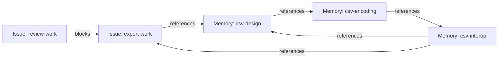
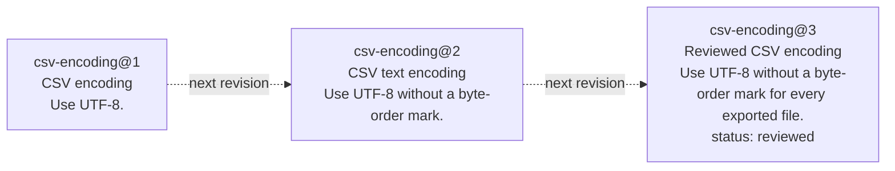
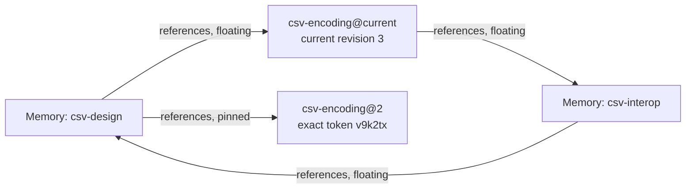
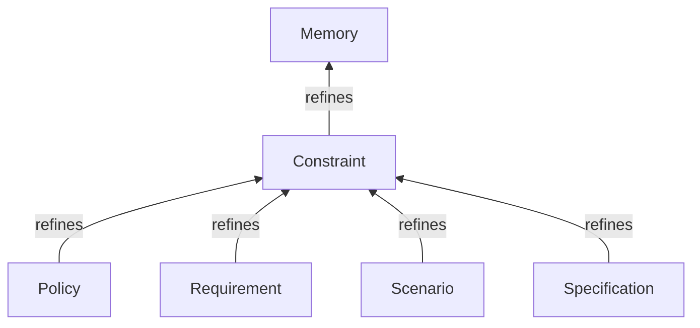
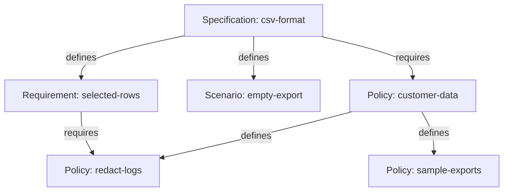
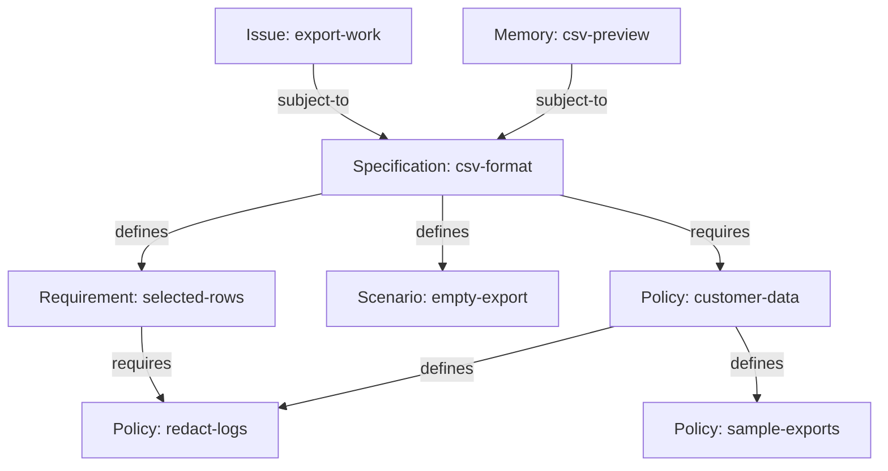

# Canonical Memory CLI

This specification defines the `bd memory` commands that accompany the [Memory
Bead and Link
Types](https://github.com/gastownhall/bdp/blob/94f699b947382e3a52385b1895a941575fcc08cb/specs/types/memory/memory.md).
It also shows how to use those Types with the [general
CLI](bdp-cli.md#cli-specification). Memory is an optional package.

**Status: design draft.** The walkthrough is informative; the command reference
specifies this CLI candidate. Examples are authored illustrations. Support in a
particular build is recorded separately under [Sources and implementation
correspondence](#sources-and-implementation-correspondence).

## Using Memory Beads and Links (informative)

The [Memory Type
spec](https://github.com/gastownhall/bdp/blob/94f699b947382e3a52385b1895a941575fcc08cb/specs/types/memory/memory.md#overview-informative)
introduces the model for Memory Beads in great detail. Here we describe the new
CLI surface for memory (`bd memory`) by walking through one small example: adding CSV
export to a product, keeping the design notes, and recording the rules the
feature must follow.

The installed Bead Type names used here include `memory`, `task` and `bug`;
Link Type names include `references`, `superseded-by` and `blocks`. The `issue`
and `dependency` Types are abstract, so creation selects a concrete refinement
such as `task`, `bug` or `blocks`.

The transcripts below show illustrative, abbreviated output; administrative
fields are omitted. Each example has a comment, a command prefixed with `>`,
and its output. Blocks described as alternatives demonstrate different ways
to perform the same operation.

### Creating Memories

Memory Beads record knowledge for later use by both humans and agents. Memory beads can represent policies, requirements, decisions, or generic information that doesn't fit into a particular category. Plain Memory is informative; the Constraint refinement introduced below adds normative rules while remaining a Memory.

A Memory Bead has a `title` and a Markdown `body`; its third property (`status`) is optional. Unlike Issues, where status defines a lifecycle specific to work tracking, the `status` field on Memory Beads is free-form text and can map onto whatever lifecycle you, your project, or your organization uses (e.g., PROPOSED or APPROVED).

Four commands work with Memory Beads:

- `bd memory remember [BODY] [--key ID | --update REF]` creates a Memory or edits an existing one.
- `bd memory recall REF` reads a Memory's Markdown body.
- `bd memory memories [SEARCH]` browses compact Memory summaries, optionally matching search text.
- `bd memory forget REF` deletes a Memory.

For the CSV feature in this walkthrough, we will start with a design note, an encoding
note and a note about spreadsheet interoperability. `bd memory remember` takes
the body as its argument. Use `--key`
to choose the identity and `--title` to choose the display text.

```console
# Record the initial design under an explicit ID and title.
> bd memory remember 'Export the selected rows as CSV.' \
  --key csv-design --title 'CSV export design' --create-only
Created csv-design [memory] "CSV export design"

# Record the text-encoding note that the design will refer to.
> bd memory remember 'Use UTF-8.' \
  --key csv-encoding --title 'CSV encoding' --create-only
Created csv-encoding [memory] "CSV encoding"

# Record the spreadsheet checks that connect the design to implementation work.
> bd memory remember 'Test the exported UTF-8 file in spreadsheet tools; keep the results with the implementation work.' \
  --key csv-interop --title 'CSV interoperability checks' --create-only
Created csv-interop [memory] "CSV interoperability checks"

```

The top-level `bd remember` command remains a compatibility alias for `bd memory
remember`. Because Memories are Beads, the general `bd create` can create the
same notes by naming the `memory` Type explicitly. The three spellings below
are alternatives to the first creation above; use one spelling when creating
the design note.

```console
# Create the design note using the top-level compatibility alias.
> bd remember 'Export the selected rows as CSV.' \
  --key csv-design --title 'CSV export design' --create-only
Created csv-design [memory] "CSV export design"

# Alternatively, create the same note using the Memory command group.
> bd memory remember 'Export the selected rows as CSV.' \
  --key csv-design --title 'CSV export design' --create-only
Created csv-design [memory] "CSV export design"

# Alternatively, create the same note using the general Bead command.
> bd create --id csv-design --type memory \
  --properties '{"title":"CSV export design","body":"Export the selected rows as CSV."}'
Created csv-design [memory] "CSV export design"

```

To finish out our scenario, let's create two Issues using the concrete `task` Type for implementing and reviewing the
feature. The Issues record the work, while the notes hold knowledge that helps
people carry it out. Issues use `description` for their text, while Memories
use `body`.

```console
# Create the implementation Issue.
> bd create --id export-work --type task \
  --properties '{"title":"Add CSV export","description":"Implement CSV export for the selected rows."}'
Created export-work [task] "Add CSV export"

# Create the review Issue.
> bd create --id review-work --type task \
  --properties '{"title":"Review CSV export","description":"Review the completed CSV export feature."}'
Created review-work [task] "Review CSV export"

```

Memory and Issue Beads work with the general Bead commands. We have created
three Memories and two Issues; use `bd list` to see them together in the mixed
inventory.

```console
# List Memory and Issue Beads together in the current Scope.
> bd list --type any
csv-design      [memory]  CSV export design
csv-encoding    [memory]  CSV encoding
csv-interop     [memory]  CSV interoperability checks
export-work     [task]  Add CSV export
review-work     [task]  Review CSV export

```

To see only Memories or tasks, filter the inventory with `--type`. The
memory-specific `bd memory memories` command, also available as `bd memories`,
provides compact Memory summaries rather than the general inventory's full
Resource formats and paging.

```console
# List the task Type family through the same general command.
> bd list --type task
export-work     [task]  Add CSV export
review-work     [task]  Review CSV export

# List the Memory Type family through the general Bead command.
> bd list --type memory
csv-design      [memory]  CSV export design
csv-encoding    [memory]  CSV encoding
csv-interop     [memory]  CSV interoperability checks

# Browse summaries through the top-level compatibility alias.
> bd memories
csv-design      [memory]  CSV export design
csv-encoding    [memory]  CSV encoding
csv-interop     [memory]  CSV interoperability checks

# Browse the same summaries through the Memory command group.
> bd memory memories
csv-design      [memory]  CSV export design
csv-encoding    [memory]  CSV encoding
csv-interop     [memory]  CSV interoperability checks

```

Likewise, inspect a Memory with the generic `bd show` command or the
memory-specific `bd memory recall`, also available as `bd recall`. The former
shows the Bead document, including its properties; the latter writes only its
Markdown body.

```console
# Inspect the design note as a Bead document.
> bd show csv-design
{
  "id": "csv-design",
  "type": "memory",
  "properties": {
    "title": "CSV export design",
    "body": "Export the selected rows as CSV."
  }
}

# Read only the design note's body through the Memory command group.
> bd memory recall csv-design
Export the selected rows as CSV.

# Read the same body through the top-level compatibility alias.
> bd recall csv-design
Export the selected rows as CSV.

```

Finally, delete a Memory with the general `bd delete` command or the
memory-specific `bd memory forget`, also available as `bd forget`. Create a
separate temporary note so the deletion example leaves the CSV notes available
for the rest of the walkthrough.

After creating the temporary note, choose one of the deletion commands below.
The deletion commands are alternatives. On the
general command, `--force` supplies the intent to apply the deletion, while
`forget` already expresses that intent.

```console
# Create a temporary Memory for the deletion examples.
> bd memory remember 'Temporary note for comparing deletion commands.' \
  --key deletion-demo
Created deletion-demo [memory]

# Delete the temporary Memory through the Memory command group.
> bd memory forget deletion-demo
Deleted deletion-demo.

# Alternatively, delete it through the top-level compatibility alias.
> bd forget deletion-demo
Deleted deletion-demo.

# Alternatively, apply the same deletion through the general Bead command.
> bd delete deletion-demo --force
Deleted deletion-demo.

```

These conveniences work with the same Beads as the general commands, with
Memory-specific defaults and rendering. The mapping for `bd update` is
different: `remember` supports both creating a new Memory and updating an
existing one by using the same key. On a new throwaway identity, these two
calls first create a note and then change its body, preserving its title.

```console
# Create a reminder under a new identity.
> bd memory remember 'Include column headings in CSV exports.' \
  --key remember-demo --title 'CSV headings reminder'
Created remember-demo [memory] "CSV headings reminder"

# Update that same Memory, leaving its title unchanged.
> bd memory remember 'Include headings even when no rows are selected.' \
  --key remember-demo
Updated remember-demo [memory] "CSV headings reminder"

```

The following general commands are an alternative way to perform those two
operations. Choose either this block or the preceding one for the new
`remember-demo` identity.

```console
# Create the same reminder through the general Bead command.
> bd create --id remember-demo --type memory \
  --properties '{"title":"CSV headings reminder","body":"Include column headings in CSV exports."}'
Created remember-demo [memory] "CSV headings reminder"

# Apply the same body change through the general update command.
> bd update remember-demo \
  --set-property body='Include headings even when no rows are selected.'
Updated remember-demo [memory] "CSV headings reminder"

```

After either block, the identity already exists. Supplying `--create-only`
refuses to overwrite it; the stored title and body remain unchanged.

```console
# Refuse to create another Memory at an identity already used above.
> bd memory remember 'This text must not replace the saved reminder.' \
  --key remember-demo --title 'A competing reminder' --create-only
Error: remember-demo already exists; --create-only refused the write.

```

### Linking Memories

References Links connect memory beads so that readers can follow useful related context.  There is a distinct new link type, `references`, that connects memory beads to one another or to beads of any type (e.g., `task`). Reference links share the same three properties as memory beads (title, body, status) allowing you to treat references between memories as full-fledged parts of the memory graph; unlike memory beads however, all three of these fields are optional. Reference links can be created using the memory-specific `bd memory reference` command or the generic `bd link create` command that works with all link types.

Direct References provide informative context. Requires and Subject To state
obligations, and Defines adds defining structure to Requires; these specialized
Links are also References. Superseded By expresses normative succession: it
directs readers to the successor for current guidance. It does not automatically
approve that successor, change status, rewrite Subject To declarations or erase
history.

Three commands create and follow References Links:

- `bd memory reference SOURCE TARGET` creates a References Link from the source to the target.
- `bd memory references REF... [--depth N]` follows outgoing References Links to find related context.
- `bd memory referenced-by REF... [--depth N]` follows incoming References Links to find Beads that refer to the selected Beads.

In our example, the design uses the encoding note, which points to the interoperability checks;
those checks refer back to the design. The checks also point to the
implementation Issue, which refers to the design it implements. These
connections form one cycle entirely among Memories and another through an
Issue. A title or body on a Link can explain why the connection matters. The last
References creation uses `bd link create`, which creates the same kind of Link
as `bd memory reference` by naming its Type explicitly.

```console
# Explain which encoding note the design uses.
> bd memory reference csv-design csv-encoding --id encoding-context \
  --title 'Uses this encoding' --body 'Text encoding for exported files'
Created encoding-context: csv-design --references--> csv-encoding

# Connect the encoding choice to its spreadsheet checks.
> bd memory reference csv-encoding csv-interop --id encoding-checks \
  --title 'Interoperability checks for this encoding'
Created encoding-checks: csv-encoding --references--> csv-interop

# Close the References cycle among the three Memories.
> bd memory reference csv-interop csv-design --id checks-design \
  --title 'Design these checks validate'
Created checks-design: csv-interop --references--> csv-design

# Connect the interoperability checks to the work recording their results.
> bd memory reference csv-interop export-work --id checks-work \
  --title 'Implementation and verification work'
Created checks-work: csv-interop --references--> export-work

# Close the References cycle that passes through the implementation Issue.
> bd link create export-work csv-design --type references --id design-context \
  --properties '{"title":"Implementation context"}'
Created design-context: export-work --references--> csv-design

# Make the review Issue depend on completion of the implementation Issue.
> bd link create review-work export-work --type blocks \
  --id review-after-export
Created review-after-export: review-work --blocks--> export-work

```

The three notes form a permitted References cycle. A second cycle follows the
same encoding and interoperability notes through the implementation Issue and
back to the design. The `blocks` Dependency separately says that review waits
for implementation; References supply context without imposing that workflow.




All links, including `references`, `blocks`, etc, can be updated without recreating them using the `bd link update` command.

A References Link can carry a free-form status just as a Memory can. Metadata
is available on both References and Dependency Links, independently of their
Type-specific properties. These edits keep the existing Link identities.

```console
# Mark the encoding reference reviewed and record its reviewer in metadata.
> bd link update encoding-context --set-property status=reviewed \
  --set-metadata reviewer=csv-review
Updated encoding-context.
{
  "properties": {
    "status": "reviewed"
  },
  "metadata": {
    "reviewer": "csv-review"
  }
}

# Record why the review depends on implementation without adding a property.
> bd link update review-after-export \
  --set-metadata rationale='Review after implementation'
Updated review-after-export.
{
  "metadata": {
    "rationale": "Review after implementation"
  }
}

```


The generic `bd graph` has been updated to handle cyclic references no matter what the link type is, and can filter out only links of a specific type (e.g., `references`, `blocks`).  For convenience, the `bd memory references` and `bd memory referenced-by` will show the graph of memory references in either outbound or inbound direction,

```console
# Find the design note's direct context.
> bd memory references csv-design
csv-design [memory] CSV export design
└─ references → csv-encoding [memory] CSV encoding (depth limit)

# Follow References farther to include both cycles.
> bd memory references csv-design --depth 4
csv-design [memory] CSV export design
└─ references → csv-encoding [memory] CSV encoding
   └─ references → csv-interop [memory] CSV interoperability checks
      ├─ references → csv-design (cycle)
      └─ references → export-work [task] Add CSV export
         └─ references → csv-design (cycle)

# Find Beads that refer to the design note.
> bd memory referenced-by csv-design
csv-design [memory] CSV export design
├─ references ← csv-interop [memory] CSV interoperability checks (depth limit)
└─ references ← export-work [task] Add CSV export (depth limit)
Cross-link: csv-interop --references→ export-work

# Explore the References graph far enough to encounter both cycles.
> bd graph csv-design --link-type references --direction out --depth 4
csv-design [memory] CSV export design
└─ references → csv-encoding [memory] CSV encoding
   └─ references → csv-interop [memory] CSV interoperability checks
      ├─ references → csv-design (cycle)
      └─ references → export-work [task] Add CSV export
         └─ references → csv-design (cycle)

```

### Memories Over Time

There are two ways for memory to evolve over time. The simplest way is simply by updating the memory in place. Its id/key stays the same, it just takes on new values. If you are simply changing the specifics of a given memory but it plays the same role as it did before, this is likely the way to go.

Sometimes however, fundamentally new memories need to be created that effectively replace one or more memories. In this case, agents or humans who reference the memory that's been retired need the ability to know which replacement is in effect.

Both of these scenarios are supported. Let's look at the first one first.


#### Revising a Memory

A revision identifies an immutable saved state of a Bead. An update that changes
its state records a new revision; the id/key stays constant while the state it
references evolves. Deleting a Bead does not rewrite its earlier states. Most
read commands let you select the current state or, using `@` syntax, a specific
retained revision from the past.

To see revisions in action, let's update the encoding note twice, changing its title and body each time and marking the final state reviewed. Both edits keep the ID `csv-encoding`. An unchanged update
leaves the revision unchanged. `bd versions` lists the saved states so that a
reader can select one explicitly.

```console
# Clarify the encoding requirement while keeping the same note.
> bd update csv-encoding --set-property title='CSV text encoding' \
  --set-property body='Use UTF-8 without a byte-order mark.'
Updated csv-encoding; revision v9k2tx.

# Refine the title and body again and label the note reviewed.
> bd update csv-encoding --set-property title='Reviewed CSV encoding' \
  --set-property body='Use UTF-8 without a byte-order mark for every exported file.' \
  --set-property status=reviewed
Updated csv-encoding; revision c6r8wn.

# List the revisions saved for this identity.
> bd versions csv-encoding
SEQ  REVISION  TITLE
1    m7q4pf    CSV encoding
2    v9k2tx    CSV text encoding
3    c6r8wn    Reviewed CSV encoding

```

`SEQ` is the store-local revision number; `REVISION` is the exact stable token
for the same revision, used after `@=`. The short, random-looking tokens in
these illustrations are invented; actual tokens are opaque and may be much
longer. Use the complete token returned by the store when making an exact
reference.

All three revisions share the same id/key (`csv-encoding`). Use `@2` to select
local revision number 2, or `@=v9k2tx` to select that revision by its exact
token. These are *pinned* references. Omitting the suffix produces an unpinned
or *floating* reference, which selects the latest state when used.

The diagram shows three saved states of one identity,
with dotted arrows indicating revision history rather than stored Links.




Here is an example showing unpinned/floating references as well as pinned references using `@` and `@=` to point to a specific revision.

```console
# Read the current note.
> bd show csv-encoding
{
  "id": "csv-encoding",
  "type": "memory",
  "revision": "c6r8wn",
  "properties": {
    "title": "Reviewed CSV encoding",
    "body": "Use UTF-8 without a byte-order mark for every exported file.",
    "status": "reviewed"
  }
}

# Read the saved second revision from this example.
> bd show csv-encoding@2
{
  "id": "csv-encoding",
  "type": "memory",
  "revision": "v9k2tx",
  "properties": {
    "title": "CSV text encoding",
    "body": "Use UTF-8 without a byte-order mark."
  }
}

# Recall just the body of that saved revision.
> bd memory recall csv-encoding@2
Use UTF-8 without a byte-order mark.

# Select the same illustrative revision using its exact token.
> bd show csv-encoding@=v9k2tx
{
  "id": "csv-encoding",
  "type": "memory",
  "revision": "v9k2tx",
  "properties": {
    "title": "CSV text encoding",
    "body": "Use UTF-8 without a byte-order mark."
  }
}

```

The Memory convenience command can also edit an existing note while preserving
omitted content. This title-only example leaves the body unchanged and makes no
new revision if the title is already equal.

```console
# Change only the existing note's title through the Memory command.
> bd memory remember --update csv-encoding --title 'Reviewed CSV encoding'
Unchanged csv-encoding; revision c6r8wn.

```

An unpinned Reference follows the current revision of its target. A pin selects
one exact saved revision, which is useful when recording the version a design
relied on. Add another References Link to revision 2, keeping the original
floating Link alongside it.

```console
# Record the exact encoding revision used by the design.
> bd memory reference csv-design csv-encoding@2 --id encoding-used \
  --title 'Encoding revision used for the design'
Created encoding-used: csv-design --references--> csv-encoding@2

```

Both Links identify the same encoding Bead. The diagram separates its current
and saved representations to make their different revision selections visible.



The pinned Link keeps its exact target token through later edits to the note.
The generic graph viewer can show that stored pin alongside current Bead bodies;
it does not fetch the old body for display. Focused Memory reads require
current-compatible pins in the selected Preview 3 adapter and can refuse this
older pin. Canonical graph reconciliation remains separate from the fixed
Memory questions in this document.

```console
# Inspect the References graph with its stored endpoint pins and current bodies.
> bd graph csv-design --link-type references --direction out --depth 1
csv-design [memory] CSV export design
├─ references [encoding-context, floating] → csv-encoding [memory] Reviewed CSV encoding (current body; depth limit)
└─ references [encoding-used, target pin =v9k2tx] → csv-encoding (same current body; depth limit)

```

The Memory update shorthand accepts `--title`, `--body` and `--status` while
preserving omitted content. Use `bd update` for the full property-edit surface
or a Type change.

#### Retiring a Memory using `superseded-by` links

Revisions allow a memory to evolve in place. Floating references pick up the latest state in that evolution; pinned references freeze at a moment in time. Because very few users of a bead are going to meticulously look through its revisions, it's difficult to know whether that evolution reflected refinement of the same fact, statement, or idea, or a direct contradiction. To make replacement obvious and discoverable, use the `superseded-by` link type to indicate that the source bead is being retired and the target bead holds the updated memory. Revisions over time of a given bead assume refinement; traversing beads through `superseded-by` assumes replacement.

Three commands create and follow Superseded By Links:

- `bd memory supersede OLD NEW` creates a Superseded By Link from a retiring Memory to its replacement.
- `bd memory successor REF... [--depth N]` follows the replacement chain forward from each retiring Memory.
- `bd memory supersedes REF... [--depth N]` follows the chain backward from a replacement, showing its direct predecessors by default.

For example, a short encoding note may eventually give way to a guide covering headings,
spreadsheet behavior and examples. Create the guide as a separately maintained
Memory. A Superseded By Link records that it replaces the old note. The old
identity and its earlier revisions remain readable.

```console
# Create the separately maintained replacement guide.
> bd memory remember 'Encoding, headings and spreadsheet examples.' \
  --key csv-guide --title 'CSV interoperability guide' --create-only
Created csv-guide [memory] "CSV interoperability guide"

# Record the old-to-new replacement.
> bd memory supersede csv-encoding csv-guide --id encoding-replacement
Created encoding-replacement: csv-encoding --superseded-by--> csv-guide

```

The replacement Link points from old to new and directs readers to the
successor for current guidance. This succession is normative: continuing to
follow the replaced guidance can conflict with that direction. This view shows
the Link beside the original forward Reference; the other References remain
unchanged.


The general Link command expresses the same replacement using the installed
`superseded-by` Type. This is an alternative to the preceding `bd memory
supersede` call.

```console
# Create the same replacement Link through the general command.
> bd link create csv-encoding csv-guide --type superseded-by \
  --id encoding-replacement
Created encoding-replacement: csv-encoding --superseded-by--> csv-guide

```

Each retiring Memory has at most one successor, and replacement chains cannot
cycle. Recording the Link revises the old Memory while leaving the replacement
unchanged. The focused reads below follow that replacement relationship in
either direction.

```console
# Follow the encoding note's replacement path.
> bd memory successor csv-encoding
csv-encoding [memory] Reviewed CSV encoding
└─ superseded-by → csv-guide [memory] CSV interoperability guide

# Find notes directly replaced by the guide.
> bd memory supersedes csv-guide
csv-guide [memory] CSV interoperability guide
└─ superseded-by ← csv-encoding [memory] Reviewed CSV encoding

# Display the current replacement path with the Beads graph viewer.
> bd graph csv-encoding --link-type superseded-by --direction out --depth 1000
csv-encoding [memory] Reviewed CSV encoding
└─ superseded-by → csv-guide [memory] CSV interoperability guide

```

### Constraints

#### Constraint Beads

Some memories state what work must do, what it must avoid, or how it must be
carried out. A Constraint Bead records one of these obligations. Its body
describes the rule, and its Type tells readers what kind of rule they are
reading. Use Constraint directly when none of the more specific Bead Types fits.

- Policy states governing rules or adopted directions for a system, project or team.
- Requirement states an outcome or condition that must be met.
- Scenario describes required behavior in a particular situation.
- Specification describes intended results at any useful level of detail.

An adopted choice that governs later work is a Policy; record its scope,
rationale and authority in existing content and metadata. A historical account
of a choice that imposes no continuing rule is a plain Memory. A `superseded-by`
Link can connect a Policy to its replacement, but does not approve that
replacement or rewrite existing Subject To declarations. A required way of
working is a Policy with the steps and conditions in its body; optional how-to
guidance is a plain Memory.

These four Types refine Constraint, which itself refines Memory. The Type diagram
points from each refinement to its parent.



For CSV export, create a Specification, a Requirement and an empty-selection
Scenario. The `remember --type` creation option chooses each installed
Type by name; a separate customer-data Policy supplies rules used by more than
this feature, with two more Policy Beads for its details.

```console
# Describe the feature's intended result.
> bd memory remember 'Export the selected rows and follow the rules linked below.' \
  --key csv-format --title 'CSV export format' --type specification --create-only
Created csv-format [specification] "CSV export format"

# State which rows must appear in the file.
> bd memory remember 'Every selected row appears exactly once.' \
  --key selected-rows --title 'Export every selected row' --type requirement --create-only
Created selected-rows [requirement] "Export every selected row"

# State the expected result for an empty selection.
> bd memory remember 'Produce headings and no data rows.' \
  --key empty-export --title 'Export an empty selection' --type scenario --create-only
Created empty-export [scenario] "Export an empty selection"

# Record the independently maintained customer-data Policy.
> bd memory remember 'Keep personal information out of logs and sample exports.' \
  --key customer-data --title 'Protect customer data' --type policy --create-only
Created customer-data [policy] "Protect customer data"

# Record the log-handling detail as an ordinary Policy Bead.
> bd memory remember 'Remove personal information before writing log entries.' \
  --key redact-logs --title 'Redact application logs' --type policy --create-only
Created redact-logs [policy] "Redact application logs"

# Record the sample-data detail as another Policy Bead.
> bd memory remember 'Use anonymized records in shared sample exports.' \
  --key sample-exports --title 'Use anonymized sample exports' --type policy --create-only
Created sample-exports [policy] "Use anonymized sample exports"

```

Each record has its own identity and can be read, revised or referenced
independently. The next section connects them into defining trees and
cross-references.

### Constraint Bead Graphs

Two Link Types connect Constraint Beads to express compound constraints and dependencies: Requires and Defines. Both connect two Constraint Beads and indicate that the source's constraints cannot be satisfied unless the target's constraints have also been met.

- A `defines` Link builds a compound constraint: a Policy can define subpolicies, or a Specification can define Requirements and Specifications.
- A `requires` Link can cross-reference constraints maintained in other Specifications, Policies or defining trees. Defines refines Requires, so a Requires-family traversal includes Defines Links too.

Defines Links form defining trees: each child has at most one defining parent, and the trees cannot cycle. Requires Links may form cycles; traversals must detect repeated visits and terminate even when cycles occur. Graph queries can collect the necessary obligations reached through the Requires family, including Defines.

Requires and Defines Links are owned by their source Constraint. Changing one revises that source while leaving its target unchanged. A defining child keeps its own identity and can be required from another tree without acquiring a second defining parent.

Six commands create and follow these relationships:

- `bd memory defines PARENT CHILD` creates a Defines Link, making the child part of the parent's definition.
- `bd memory definition REF... [--depth N]` follows outgoing Defines Links to read defining parts.
- `bd memory defined-by REF... [--depth N]` follows incoming Defines Links to find defining parents, showing the direct parent by default.
- `bd memory requires SOURCE TARGET` creates a Requires Link to another Constraint that must also be met.
- `bd memory requirements REF... [--depth N]` follows outgoing Requires-family Links, including Defines, to read the necessary constraints.
- `bd memory required-by REF... [--depth N]` follows incoming Requires-family Links to find dependent Constraints, showing direct dependents by default.

```console
# Make the selected-row Requirement part of the Specification's definition.
> bd memory defines csv-format selected-rows
Created Link: csv-format --defines--> selected-rows

# Make the empty-selection Scenario another defining part.
> bd memory defines csv-format empty-export
Created Link: csv-format --defines--> empty-export

# Give the customer-data Policy its log-handling detail.
> bd memory defines customer-data redact-logs
Created Link: customer-data --defines--> redact-logs

# Give the customer-data Policy its sample-data detail.
> bd memory defines customer-data sample-exports
Created Link: customer-data --defines--> sample-exports

# Require that independently maintained Policy from the CSV Specification.
> bd memory requires csv-format customer-data
Created Link: csv-format --requires--> customer-data

# Require the same log-handling Policy from the selected-row Requirement.
> bd memory requires selected-rows redact-logs
Created Link: selected-rows --requires--> redact-logs

```

The Specification and customer-data Policy each have a defining tree. The last
Requires Link crosses between them: the log-handling Policy keeps its defining
parent even though the selected-row Requirement also requires it.



Each linked target must be met for its source to be met; the source's own text
still applies, and only an explicit statement makes its listed children
exhaustive. The reads below distinguish defining parts from the broader
Requires family, which includes the separate Policies and the cross-reference.

```console
# Read the Specification's defining Requirement and Scenario.
> bd memory definition csv-format
csv-format [specification] CSV export format
├─ defines → selected-rows [requirement] Export every selected row
└─ defines → empty-export [scenario] Export an empty selection

# Read its defining parts and the separate Policies it requires.
> bd memory requirements csv-format
csv-format [specification] CSV export format
├─ defines → selected-rows [requirement] Export every selected row
│  └─ requires → redact-logs [policy] Redact application logs
├─ defines → empty-export [scenario] Export an empty selection
└─ requires → customer-data [policy] Protect customer data
   ├─ defines → redact-logs (already shown)
   └─ defines → sample-exports [policy] Use anonymized sample exports

# Find the direct defining parent of the selected-row Requirement.
> bd memory defined-by selected-rows
selected-rows [requirement] Export every selected row
└─ defines ← csv-format [specification] CSV export format

# Find Constraints that directly require the log-handling Policy.
> bd memory required-by redact-logs
redact-logs [policy] Redact application logs
├─ defines ← customer-data [policy] Protect customer data (depth limit)
└─ requires ← selected-rows [requirement] Export every selected row (depth limit)

# Display only the current Defines tree with the Beads graph viewer.
> bd graph csv-format --link-type defines --direction out --depth 1000
csv-format [specification] CSV export format
├─ defines → selected-rows [requirement] Export every selected row
└─ defines → empty-export [scenario] Export an empty selection

# Display the Requires family, including Defines and the cross-reference.
> bd graph csv-format --link-type requires --direction out --depth 1000
csv-format [specification] CSV export format
├─ defines → selected-rows [requirement] Export every selected row
│  └─ requires → redact-logs [policy] Redact application logs
├─ defines → empty-export [scenario] Export an empty selection
└─ requires → customer-data [policy] Protect customer data
   ├─ defines → redact-logs (already shown)
   └─ defines → sample-exports [policy] Use anonymized sample exports

```

### Applying Constraints

People and agents need to know which constraints apply to a piece of work. They
can find relevant rules from context or follow explicit declarations in the graph.

The constraint graphs we just looked at express what conditions must be true in a given context, but they are silent on how that context is established.

The most obvious and flexible way to determine who or what is subject to a constraint graph is implicit inference. An agent may infer relevant constraints from a prompt or ambient context. For example,
a Policy may state that all bug fixes must include a regression test. The constraint's subjects can be identified this way, but we are relying on inference to find them.

The alternative way to determine the subject(s) of a constraint are using the `subject-to` link, A `subject-to` Link explicitly connects a Bead to a Constraint that governs it.
Any Bead, including an Issue, can be the source, and it can have several such
declarations. Starting from those Constraints, a read can follow Requires and
Defines to deterministically find the set of rules the bead is subject to.

Three commands declare and discover these relationships:

- `bd memory subject-to SUBJECT CONSTRAINT` declares that a Bead is governed by a Constraint.
- `bd memory constraints SUBJECT...` discovers each subject's explicit declarations and the Requires-family paths, including Defines, that follow from them.
- `bd memory subjects CONSTRAINT...` finds Beads that directly declare they are subject to the selected Constraints.

For the CSV example, declare that the implementation Issue and a note about the
preview build are both subject to the CSV Specification. The Issue records the
implementation work; the Memory records knowledge about the build.

```console
# Record a note about the preview build as a second kind of subject.
> bd memory remember 'The CSV preview build is ready for review.' \
  --key csv-preview --title 'CSV preview build' --create-only
Created csv-preview [memory] "CSV preview build"

# Declare which Specification governs the implementation Issue.
> bd memory subject-to export-work csv-format
Created Link: export-work --subject-to--> csv-format

# Declare that the same Specification governs the preview-build note.
> bd memory subject-to csv-preview csv-format
Created Link: csv-preview --subject-to--> csv-format

```

The Issue and the Memory are different kinds of subject governed by the same
Specification. From either subject, its explicit declaration leads into the
Specification's Requires family, including Defines.



The supporting paths explain why each rule was reached for its original subject.
`constraints` follows those declarations and dependencies; `subjects` answers
the direct reverse question of which Beads name this Constraint.

```console
# Discover the rules explicitly governing the implementation Issue.
> bd memory constraints export-work
export-work [task] Add CSV export
└─ subject-to → csv-format [specification] CSV export format
   ├─ defines → selected-rows [requirement] Export every selected row
   │  └─ requires → redact-logs [policy] Redact application logs
   ├─ defines → empty-export [scenario] Export an empty selection
   └─ requires → customer-data [policy] Protect customer data
      ├─ defines → redact-logs (already shown)
      └─ defines → sample-exports [policy] Use anonymized sample exports

# Keep the paths for both subjects visible in one read.
> bd memory constraints export-work csv-preview
export-work [task] Add CSV export
└─ subject-to → csv-format [specification] CSV export format
   ├─ defines → selected-rows [requirement] Export every selected row
   │  └─ requires → redact-logs [policy] Redact application logs
   ├─ defines → empty-export [scenario] Export an empty selection
   └─ requires → customer-data [policy] Protect customer data
      ├─ defines → redact-logs (already shown)
      └─ defines → sample-exports [policy] Use anonymized sample exports

csv-preview [memory] CSV preview build
└─ subject-to → csv-format [specification] CSV export format
   ├─ defines → selected-rows [requirement] Export every selected row
   │  └─ requires → redact-logs [policy] Redact application logs
   ├─ defines → empty-export [scenario] Export an empty selection
   └─ requires → customer-data [policy] Protect customer data
      ├─ defines → redact-logs (already shown)
      └─ defines → sample-exports [policy] Use anonymized sample exports

# Find the subjects that directly declare the CSV Specification.
> bd memory subjects csv-format
csv-format [specification] CSV export format
├─ subject-to ← export-work [task] Add CSV export
└─ subject-to ← csv-preview [memory] CSV preview build

```

Subject To is owned by its source when that source's installed Type supports
this contract, including the required Issue ownership declaration. Editing the
Link revises that subject and leaves the target Constraint unchanged. These
declarations help readers discover the rules; they do not prove compliance or
change Issue readiness. Readiness and scheduling continue to follow their
workflow and Dependency rules.

Subject To does not spread through other Subject To declarations. A
document-review Policy governing the Specification applies to that document; it
does not automatically govern the implementation Issue. Declare the relationship
to the Issue explicitly when that is intended.

A prompt can direct an agent to follow the customer-data Policy today. A future
executable applicability feature might select subjects using a predicate. This
walkthrough discovers stored declarations and their Requires paths.

## CLI specification

The reference starts with rules shared by the Memory commands, followed by one
entry per command. Each entry lists its accepted flags and defaults. The
[general CLI specification](bdp-cli.md#cli-specification) defines shared flags;
this companion defines only the Memory-specific additions and restrictions.
Universal `--help` is omitted from the listings.

### General CLI rules used here

Use the general specification for [Scope selection](bdp-cli.md#scope-selection),
[IDs and revision references](bdp-cli.md#reference-syntax),
[creation IDs](bdp-cli.md#creation-ids),
[revision guards](bdp-cli.md#write-revision-flags),
[object inputs and edits](bdp-cli.md#object-inputs),
[output controls](bdp-cli.md#output-controls) and
[errors and exit status](bdp-cli.md#exit-status).
A shared flag is accepted only where a command lists it. Scope-selection
mechanics retain the general specification's Unreviewed status.

The Type spec owns Type meanings and invariants. Its deferred revision and
lifecycle mechanics remain deferred here. The current Memory proposal requires
Link endpoints in one Scope. A host refuses an operation it cannot faithfully
provide under its installed Types and writer.

### Common Memory flags and behavior

#### Installed Type names

Use the installed local names as Type References. Bead Types include `memory`,
the abstract `issue`, and its concrete refinements `task` and `bug`. Link Types
include `references`, `superseded-by`, the abstract `dependency`, and its
concrete refinement `blocks`. Abstract Types can select families in a read;
creation requires a concrete Type.

<a id="memory-creation-inputs"></a>

#### Named content: `--title`, `--body` and `--status`

`remember` and the five relationship-creation commands accept these property
shortcuts. Each flag sets the corresponding property on the Memory or Link.

| Flag | Meaning |
| --- | --- |
| `--title TEXT` | Set the display title. |
| `--body TEXT` | Set the Markdown body. A Memory body may be empty. |
| `--status TEXT` | Set the descriptive status label. |

A supplied title or status must be nonblank; a relationship Link's body must
also be nonblank when supplied. A property cannot appear both as a named flag
and in `--properties`, even with an equal value. Status adds no approval or
workflow transition. Other object-input rules come from the general
specification.

On `remember`, `--body` is an alternative to positional BODY, `--body-file`,
`--stdin` or a `body` property in `--properties`. Select exactly one body source.
Creation derives a missing title from the body and leaves an omitted status
absent. An existing-ID edit preserves each omitted content property.

<a id="memory-endpoints"></a>

#### Relationship creation

All five relationship-creation commands use the endpoint forms of
[`bd link create`](bdp-cli.md#bd-link-create). Each fixes its installed nominal
Link Type, so there is no `--type` override or Type filter. Use the general Link
command to create another Type or refinement.

The source and target may select revisions where the Type and writer allow
those pins. The current Beads writer's restriction on owned-source pins remains
a product boundary; these signatures do not settle the Type design's deferred
pin mechanics.

<a id="memory-guards"></a>

#### Source revision guard: `--if-source-revision`

The existing Beads owner-guard option is accepted only by a relationship command
whose source owns that Link and whose authoritative writer supports the guard.
It compares the actual source revision atomically with the write. It adds no
new generic BDP field. Its spelling follows the selected product guard adapter;
this editorial pass does not change that parser. Plain References is unowned
and has no source owner guard.

<a id="memory-common-creation"></a>

#### Common relationship-creation behavior

These commands reuse the general Link writer, allocator and transaction
boundary. The writer validates the resulting graph atomically, including
concurrent writes. Read-time diagnostics alone do not enforce an invariant.
An owned Link change revises its source, not its target. Plain References
revises neither endpoint. Subject To requires the actual source Type to declare
its ownership; wider endpoint eligibility does not install it.

The Types inherit References' identity-self prohibition. Requires' same-identity
cross-revision question remains provisional in the Type design. Separate
creation calls do not turn equal endpoints into an upsert. Explicit-ID conflict
and exact retry use the common writer, while each Type keeps its cardinality
and cycle rules.

In the canonical mapping, named content becomes fields of `--properties` on the
general Link command. IDs, metadata and admitted endpoint pins keep their shared
meaning. Emission and [atomic batch](atomic-batch.md) use that corresponding
generic command; these facades add no Memory wire operation or emission flag.

<a id="memory-depth"></a>

#### Traversal depth: `--depth`

`--depth N` sets the hop limit for the eight ordinary family traversals. The
per-command tables give their defaults. Each root gets its own hop allowance;
acquisition, output and work caps are cumulative across all roots and stages.
A default of 1000 is a bound.

For each root, find the Beads reached in the selected direction and depth, then
keep all matching-family Links between those Beads. Preserve parallel, cross
and cycle-closing Links. Combine the per-root graphs without inducing extra
Links across their union. For A→B, A→C, B→D and C→D, roots A and B at depth one
retain AB, AC and BD, not CD: neither root reached both C and D.

Visited identities stop repeated expansion without dropping selected Links.
Requires and direct References can cycle. Defines and Superseded By keep their
stronger invariants. A read does not repair invalid stored state.

`constraints` has a staged bound whose separate depth controls remain
unselected. `subjects` is direct only. Neither accepts `--depth` here. Fixed
Memory questions do not accept extra direction, Type-filter, collection-paging
or arbitrary Selector flags.

<a id="memory-read-view"></a>

#### Consistent relationship reads

Each relationship read requires one or more roots in one consistent, bounded
view. Preserve roots with no matching relationships, per-root membership,
supporting paths, exact stored pins and any depth frontier. Shared expansion
must not transfer governing rules from one original subject to another.

These graph questions need a suitable read-view/traversal adapter. Ordinary
BDP collection Selectors provide no recursive joins or coherent snapshot across
independent pages. The canonical mappings describe composition under that
adapter, rather than a new graph/query wire operation.

The selected Preview 3 specialized adapter requires current-compatible endpoint
pins and refuses a mismatch. Generic graph display can show current Bead bodies
alongside older literal pins. Do not float pins, substitute current content for
a historical root, or claim a current graph is historical evidence. General
historical graph traversal remains unselected.

An invalid, inaccessible or unavailable root, incompatible binding, or
acquisition/work/output budget failure refuses the aggregate. It cannot become
a successful empty or partial result. A depth frontier is visible; it proves
neither a terminal successor, discovery of every governing rule nor compliance.
Failures use the [general statuses](bdp-cli.md#exit-status) and preserve native
Problems.

<a id="memory-output"></a>

#### Memory result views

Relationship reads default to the shared compact tree, with no `--graph` opt-in.
Show IDs, actual Types and titles; label Links with their actual Type and
original arrow direction, including during incoming reads. Distinguish shared
descendants, repeated visits and cycles while preserving all selected Links.
Show Defines children before other Requires dependencies at a Constraint.
Indentation establishes neither ownership nor readiness.

Graph JSON/JSONL framing and the format/projection matrix remain Unreviewed.
The [ordinary-read schema](read-output.md) does not define a graph descriptor.
Graph machine output must retain roots, membership, paths and bounds before a
shared adapter can claim support. Ordinary point-read and collection formats
do not automatically apply to these results.

The five relationship-creation commands use the general Link success renderer,
including the new Link ID. Supported structured output preserves the complete
native mutation result and any source revision actually returned. It invents
no revision field or extra commit stream.

The four nested convenience commands reuse their existing top-level command's
output. In particular, `recall` writes the body and `memories` writes summaries.
They do not silently switch to full Resource rows, a different JSON schema or
the graph renderer. Their entries state the accepted product output controls.

### Memory commands

These four commands are the canonical Memory spellings of the existing
`bd remember`, `bd recall`, `bd memories` and `bd forget` commands. Retain the
top-level spellings as compatibility aliases. Both paths share their handlers,
workspace selection, identity resolution, guards, limits, output, errors and
compatibility options. The entries below describe their Memory-Bead mode. Any existing
key/value-workspace behavior remains the corresponding top-level command's
contract; adding an alias does not migrate a workspace.

The nested spellings are proposed for the Preview 3 queue after this edit pass.
This document makes no claim that the aliases have been registered. Top-level
compatibility remains until a separate removal decision. Their long-term
canonical home is this Memory package.

#### `bd memory remember`

Store a Memory or update the same Memory under an explicit identity.

##### Usage

```text
bd memory remember [BODY] [--key ID | --id ID | --update REF]
    [--type TYPE]
    [--title TEXT] [--body TEXT | --body-file FILE | --stdin] [--status TEXT]
    [--properties JSON | --replace-properties JSON]
    [--metadata JSON | --replace-metadata JSON
       | [--set-metadata KEY=VALUE]... [--unset-metadata KEY]...]
    [--create-only] [--if-revision REV] [--json] [--quiet]
```

##### Arguments

| Argument | Required | Meaning |
| --- | --- | --- |
| `BODY` | For creation, unless another body source supplies it | The Memory's content, not its title or ID. It may be empty when explicitly supplied. |

##### Flags

| Flag | Default | Meaning |
| --- | --- | --- |
| `--key ID` | Derived from body | Choose the literal public ID for create-or-update. |
| `--id ID` | Derived from body | Same identity choice as `--key`; the two conflict. |
| `--update REF` | Create-or-update route | Require an existing, unpinned Memory and preserve omitted fields. |
| `--type TYPE` | `memory` on creation | Choose Memory or a refinement for `--create-only`. See [Types](bdp-cli.md#type-selection). |
| `--title TEXT` | Derived on create; preserved on edit | Set the title without changing the ID. |
| `--body TEXT` | Required through one source on create; unchanged on edit | Set the body explicitly, including an empty body. |
| `--status TEXT` | Absent on create; unchanged on edit | Set a nonblank descriptive label. |
| `--body-file FILE` | No file input | Read the body from a UTF-8 file. |
| `--stdin` | Off | Read the body explicitly from stdin; supplying false is invalid. |
| `--properties JSON` | No supplied object | Initialize or merge declared properties under the existing Memory writer. See [object inputs](bdp-cli.md#object-inputs). |
| `--replace-properties JSON` | No replacement | Replace properties of an existing selected Memory. |
| `--metadata JSON` | Empty on create; unchanged on edit | Initialize or merge metadata. See [object inputs](bdp-cli.md#object-inputs). |
| `--replace-metadata JSON` | No replacement | Set the metadata object through the existing command's replacement mode. |
| `--set-metadata KEY=VALUE` | No keyed edit | Set a metadata key; repeatable. |
| `--unset-metadata KEY` | No keyed edit | Remove a metadata key; repeatable and combinable with sets. |
| `--create-only` | Off | Require a new Memory with explicit `--key` or `--id`. |
| `--if-revision REV` | No comparison | Guard an existing Memory edit using the [general revision grammar](bdp-cli.md#write-revision-flags). |
| `--json` | Off | Preserve the top-level command's supported native structured result. |
| `--quiet` | Off | Preserve the top-level command's quiet rendering. |

##### Behavior

`--key` and `--id` choose the same literal public identity; neither is a title.
They conflict with each other and with `--update`. An explicit ID creates a new
Memory when unused, or updates that same live Memory when already allocated.
It cannot overwrite an Issue, reuse a deleted identity or silently retype a
Bead. `--update` instead requires an existing Memory. A guard also requires an
existing predecessor; it cannot authorize creation.

Creation needs a body. Choose one source: positional BODY, `--body`,
`--body-file`, `--stdin`, or the `body` property in `--properties`. Existing-ID
edits can change `--title`, `--body` or `--status` independently, preserving
omitted content. Naming a property both through a shorthand and in
`--properties` is an error. Only an explicit body source reads stdin.

With no explicit identity, derive the ID through the same content-to-key rule
as top-level `remember`. Retain its existing bare-word safeguard: a single
key-like argument naming an existing Memory recalls it; a missing key-like
argument refuses. Supplying `--key` makes write intent explicit. A missing
creation title becomes the same short body summary used by the existing
command: collapse whitespace in the first trimmed line and shorten it to at
most 80 code points, including the ellipsis when shortened. An empty summary
becomes `Untitled memory`; an explicitly supplied blank creation title refuses.
`--title` on an edit changes the title while preserving an omitted body.

`--type TYPE` is accepted only with `--create-only`, and selects an installed
Memory Type or one of its refinements. Omission creates plain Memory, while an
existing-ID edit preserves its current Type. Type resolution and validation use
the general creation command's rules, including its exact definition-reference
syntax. Use `bd update REF --type TYPE` to change an existing Bead's Type.

`--create-only` requires explicit `--key` or `--id`, and conflicts with a guard
or `--update`. It refuses an already allocated ID. Property replacement needs
exactly one existing identity selector and conflicts with BODY, `--title`,
`--body`, `--status`, body-file/stdin, `--properties` and `--create-only`.
General metadata modes keep their existing conflicts. At least one actual edit input is required for an
existing-ID write; a guard alone is not an edit.

The content-update shorthand is limited to `--title`, `--body` and `--status`.
Use `bd update` for the full property-edit surface and for changing an existing
Bead's Type. Existing property/metadata compatibility options remain available
on both remember spellings; do not add the general command's patch or keyed
property-edit flags here.

As in top-level `remember`, admitted metadata edits apply to an empty object on
creation or the checked predecessor on update. This does not add those modes
to the general `create` command.

Preserve the existing command's body acquisition bound: the inspected Preview 3
adapter accepts at most 1 MiB of UTF-8 body input. Checks, no-op detection and
updates happen in the authoritative writer; omission is not filled by a stale
client read. An unchanged state retains its revision. This convenience adds no
wire upsert operation or implicit read/modify/write fallback.

##### Results

Use exactly the top-level command's creation, update, unchanged or recalled-body
result, as applicable. Preserve its native structured mutation result and quiet
behavior. A recalled bare key produces body output rather than a write receipt.

##### Errors and exit status

Return the same diagnosis and status as top-level `remember`. Refuse conflicting
identity/body sources, blank creation titles, invalid inputs, unsupported
properties, unavailable existing targets and identity reuse. A stale guard must
fail atomically. A lost write acknowledgement must not trigger an unguarded
create or update fallback.

##### Canonical CLI correspondence

`bd memory remember` delegates to `bd remember` with the same arguments.
A selected new Memory corresponds to general `bd create --type TYPE`, using
plain Memory by default or the Type selected for typed creation. An
existing edit corresponds to `bd update REF` with the equivalent object edits
and guard. These are alternative operation outcomes, not a portable atomic
upsert API. The shared Memory writer must decide the admitted route safely.
A body-only result can be read through `bd show REF`, selecting its saved
revision where applicable.

##### Examples

```sh
# Create a named note while choosing its display title separately.
bd memory remember 'Use UTF-8.' --key csv-encoding --title 'CSV encoding' --create-only

# Update only the title of an existing Memory.
bd memory remember --update csv-encoding --title 'CSV text encoding'

# Edit the named content fields without replacing the whole property object.
bd memory remember --update csv-encoding --body 'Use UTF-8 without a byte-order mark.' \
  --status reviewed

# Replace the body under the same explicit key.
bd memory remember 'Use UTF-8 without a byte-order mark.' --key csv-encoding

# Guard a body edit with the exact revision token previously observed.
bd memory remember 'Use UTF-8.' --update csv-encoding --if-revision =saved-r3

# Read the body explicitly from a file.
bd memory remember --key csv-guide --title 'CSV interoperability guide' --body-file guide.md

# Select an installed Policy Type for creation.
bd memory remember 'Keep personal information out of logs.' \
  --key data-logs --title 'Protect log data' --type policy --create-only

```

#### `bd memory recall`

Read one Memory's full body, current or at a saved revision.

##### Usage

```text
bd memory recall REF [--quiet]
```

##### Arguments

| Argument | Required | Meaning |
| --- | --- | --- |
| `REF` | Exactly one | A local Memory ID or full URL, optionally selecting its revision with the [shared syntax](bdp-cli.md#reference-syntax). |

##### Flags

| Flag | Default | Meaning |
| --- | --- | --- |
| `--quiet` | Off | Preserve top-level behavior: the requested body is still printed. |

##### Behavior

Resolve the same Memory selector as top-level `recall`. With a bare Reference,
read the current body. A selected revision reads that retained body or fails;
it never substitutes current content. Read a Memory, rather than an Issue or
Link that happens to have a `body` property.

This is a body command. It does not add graph traversal, property masks or a
new structured representation. The inspected Preview 3 graph adapter refuses
`--json`; use the general `bd show` command for a supported full-record format.
The alias retains the top-level command's Preview 3 compatibility options;
this canonical reference uses revision suffixes.

##### Results

Write the stored body unchanged, followed by one newline, including when the
body is empty. Preserve any newlines already in the body. `--quiet` does not
suppress the requested content. Do not add a title, status or acknowledgement
to the body stream.

##### Errors and exit status

Preserve top-level `recall` statuses and Problems. Refuse an invalid, missing,
inaccessible or wrong-kind target, unavailable saved content, unresolved local
revision number or unsupported format. No failure becomes a successful empty
body.

##### Canonical CLI correspondence

Delegate to `bd recall REF`. The underlying read is the same current or saved
Memory read available through `bd show REF`; render only its body through the
existing recall renderer. Reading a saved body is independent of graph traversal.

##### Examples

```sh
# Recall the current note's complete body.
bd memory recall csv-encoding

# Recall the body from local revision number 2.
bd memory recall csv-encoding@2

# Recall the body at one exact token.
bd memory recall csv-encoding@=saved-r2

# Select a saved body using an absolute URL.
bd memory recall '[https://work.example/acme/csv-encoding]@2'

```

#### `bd memory memories`

Browse Memory summaries, optionally matching text in the ID, title or body.

##### Usage

```text
bd memory memories [SEARCH] [--all] [--details]
    [--format table|records-json] [--quiet]
```

##### Arguments

| Argument | Required | Meaning |
| --- | --- | --- |
| `SEARCH` | No | One literal search string, using the top-level command's ID/title/body matching. |

##### Flags

| Flag | Default | Meaning |
| --- | --- | --- |
| `--all` | Off | Return all matches within the existing bounded summary view. |
| `--details` | Off | Include revision, attribution and owned-Link counts. |
| `--format table\|records-json` | `table` | Preserve the existing summary output formats. |
| `--quiet` | Off | Preserve the top-level command's quiet rendering. |

##### Behavior

Use the same checked current snapshot and summary selection as top-level
`memories`. SEARCH is literal, case-insensitive ID/title/body text matching, not
a Selector, regex, graph predicate or new query language. Omission browses the
admitted Memory population. `--details` obtains no neighboring bodies.

Preserve the product's current bounds. The inspected Preview 3 adapter requires
at most 50 matches by default; more matches refuse with a request to narrow the
search or use `--all`. That option keeps the acquisition/output caps: at most
1000 live Resources and 16 MiB acquired, 1 MiB of output, a search of at most
4096 UTF-8 bytes, and excerpts of at most 160 code points. These are product
bounds, not limits added to BDP or the Memory Type definitions.

There is no paging or promise of full Memory JSON. `records-json` preserves the
existing experimental summary shape; it is not a new canonical Resource
collection descriptor. In the inspected graph adapter, `--json` is unsupported.
This alias does not reconcile general list/search/graph/query or change their
filter rules.

##### Results

Return the existing compact summaries: identities, titles, bounded body excerpts
and optional details. A body match selects an excerpt near the match; otherwise
the excerpt starts at the beginning. Keep exact IDs and revision tokens where
the selected summary format carries them. Return a complete admitted bounded
selection or fail; never silently return the first 50 as though all matches
had been reported. Use `recall` for a selected body's full text.

##### Errors and exit status

Preserve top-level `memories` statuses. Invalid search or unsupported formats
refuse. Acquisition/output limits and more-than-default match counts refuse
the whole selection. A successful empty selection remains distinguishable from
an unreadable workspace or failed query.

##### Canonical CLI correspondence

Delegate to `bd memories` with the same arguments and summary renderer.
`bd list --type "$MEMORY_TYPE"` is the general Type-family inventory; its paging,
projection and full-Resource output are a different command contract. It is
not a drop-in replacement for this bounded summary search. No protocol search
operator or hidden full-store client scan is added here.

##### Examples

```sh
# Browse summaries in the current workspace.
bd memory memories

# Match one literal phrase in IDs, titles or bodies.
bd memory memories 'CSV encoding'

# Include versions, attribution and owned-Link counts.
bd memory memories CSV --details

# Request every match within the existing acquisition/output bounds.
bd memory memories CSV --all --format records-json

```

#### `bd memory forget`

Delete one unreferenced live Memory through the existing Memory deletion writer.

##### Usage

```text
bd memory forget REF [--if-revision REV] [--json] [--quiet]
```

##### Arguments

| Argument | Required | Meaning |
| --- | --- | --- |
| `REF` | Exactly one | An existing, unpinned Memory identity, resolved like top-level `forget`. |

##### Flags

| Flag | Default | Meaning |
| --- | --- | --- |
| `--if-revision REV` | No comparison | Guard the actual current Memory using the [general revision grammar](bdp-cli.md#write-revision-flags). |
| `--json` | Off | Preserve the top-level command's supported native deletion result. |
| `--quiet` | Off | Preserve the top-level command's quiet rendering. |

##### Behavior

Invocation supplies delete intent, as with top-level `forget`. There is no
extra `--force`, preview mode, cascade or new unconditional flag. The inspected
Preview 3 writer accepts the current predecessor when no comparison is supplied
and checks an explicit guard atomically.
Require a live Memory with no incident Links. Refuse an Issue, a revision-pinned
mutation target, or a Memory still participating in any live Link. Remove those
Links through their admitted operations before forgetting the Memory. Retain
its consumed identity and earlier snapshots under the same product lifecycle
contract. Forgetting does not retire it in favor of a successor or erase history.

##### Results

Return the same native deletion result and human acknowledgement as top-level
`forget`. Preserve its selected structured/quiet rendering. Report the actual
committed decision; a display failure does not restore the Memory.

##### Errors and exit status

Use top-level `forget` diagnoses and statuses. Invalid selectors, a missing or
wrong-kind Memory, live incident Links, a stale guard or denied deletion refuse.
Preserve uncertainty if the write outcome is unknown; do not imply rollback or
blindly submit a fresh deletion.

##### Canonical CLI correspondence

Delegate to `bd forget REF` with the same options. The general CLI counterpart
is `bd delete REF --force`, with the corresponding guard and the Memory writer's
no-incident-Link restriction. The convenience supplies apply intent; it adds no
protocol field or wire operation. Use general `bd delete REF` without `--force`
for an observational preview, which never reserves a later successful deletion.

##### Examples

```sh
# Delete a temporary Memory after its live Links have been removed.
bd memory forget scratch-note

# Delete only if the observed exact revision is still current.
bd memory forget scratch-note --if-revision =saved-r3

```

### Reference commands

#### `bd memory reference`

Create a References Link from a Bead to useful context.

##### Usage

```text
bd memory reference SOURCE TARGET [OPTIONS]
bd memory reference SOURCE --to TARGET [OPTIONS]
bd memory reference --from SOURCE --to TARGET [OPTIONS]

OPTIONS:
    [--id ID | --id-root ROOT] [--properties JSON] [--metadata JSON]
    [--title TEXT] [--body TEXT] [--status TEXT]
    [--scope SCOPE] [--output-format FORMAT] [--long]
```

##### Arguments

| Argument | Required | Meaning |
| --- | --- | --- |
| `SOURCE` | Yes, positional or `--from` | Source Bead in an eligible References pair. |
| `TARGET` | Yes, positional or `--to` | Context Bead in that correlated pair. |

Each endpoint is a [Reference](bdp-cli.md#reference-syntax), subject to this Type's pin
rules.

##### Flags

| Flag | Default | Meaning |
| --- | --- | --- |
| `--from REF` | No separate binding | Supply SOURCE by flag. See [endpoint forms](#memory-endpoints). |
| `--to REF` | No separate binding | Supply TARGET by flag. |
| `--id ID` | Generated | Set the complete Link ID. See [creation IDs](bdp-cli.md#creation-ids). |
| `--id-root ROOT` | Ordinary allocation | Generate under a prefix; requires allocation support. |
| `--properties JSON` | Not supplied | Initialize properties. See [object inputs](bdp-cli.md#object-inputs). |
| `--metadata JSON` | Not supplied | Initialize informational metadata. |
| `--title TEXT` | Absent | Set the nonblank title property. |
| `--body TEXT` | Absent | Set the nonblank body property. |
| `--status TEXT` | Absent | Set descriptive, nonblank status text. |
| `--scope SCOPE` | Unreviewed | Relative-ID Scope selection; see [Scope selection](bdp-cli.md#scope-selection). |
| `--output-format FORMAT` | `default` | Use a supported common mutation format. See [output](#memory-output). |
| `--long` | Off | Show full References and administrative details. |

##### Behavior

Create the installed nominal References Type. Endpoint eligibility is
correlated: Memory→Memory, Memory→Issue, Issue→Memory, or any Bead→Constraint.
It is not permission for arbitrary Bead pairs. The current proposal keeps both
endpoints in one Scope and forbids a self-Link by identity.

Direct References is unowned: neither endpoint revision changes. Parallel Links
and cycles are allowed. Equal endpoints on separate calls do not deduplicate
Links. See [common creation behavior](#memory-common-creation).

##### Results

Return the created References Link through the [common Link success renderer](#memory-output), including its identity, actual Type and endpoints.
Preserve the complete native mutation result in supported structured output.
Endpoint revision effects follow [common creation behavior](#memory-common-creation).

##### Errors and exit status

Ineligible endpoint pairs and self-Links refuse. Duplicate endpoint bindings or
properties are usage errors. An owner guard is not accepted for this unowned
relationship. Use the [common statuses](bdp-cli.md#exit-status); only a successful
admitted write returns `0`. Ordinary allocation, Type, access and output
failures keep their common diagnosis.

##### Canonical CLI correspondence

```text
bd link create SOURCE TARGET --type "$REFERENCES_TYPE" [COMMON-CREATE-OPTIONS]
```

`REFERENCES_TYPE` is the installed nominal References Type Reference. All three
endpoint forms select the same operation. Named properties become fields of
`--properties`; IDs, metadata and admitted endpoint pins follow the
[shared creation mapping](#memory-common-creation). This unowned Type has no
source owner guard.

##### Examples

```sh
# Connect a design note to its encoding context.
bd memory reference csv-design csv-encoding --id encoding-context

# Name the target with --to and explain the connection.
bd memory reference csv-design --to csv-encoding --title "Encoding context"

# Name both endpoints explicitly.
bd memory reference --from csv-design --to csv-encoding

```

#### `bd memory references`

Find context referenced by one or more Beads.

##### Usage

```text
bd memory references REF... [--depth N]
    [--scope SCOPE] [--output-format FORMAT] [--long]
```

##### Arguments

| Argument | Required | Meaning |
| --- | --- | --- |
| `REF...` | One or more | One or more Beads eligible for the selected References family. Each is a [Reference](bdp-cli.md#reference-syntax). |

##### Flags

| Flag | Default | Meaning |
| --- | --- | --- |
| `--depth N` | `1` | Set each root's hop allowance. See [traversal depth](#memory-depth). |
| `--scope SCOPE` | Unreviewed | Relative-ID Scope selection; see [Scope selection](bdp-cli.md#scope-selection). |
| `--output-format FORMAT` | `default` | Use shared graph output; nondefault formats remain [Unreviewed](#memory-output). |
| `--long` | Off | Show full References and administrative details. |

##### Behavior

Follow outgoing References-family Links from each root, using its own depth
allowance. This family includes supported refinements, which may have different
ownership from direct References. Endpoint eligibility follows each selected
Type's correlated pairs, not arbitrary Bead connectivity.

The selected family is **References, including supported refinements**. The
common [consistent-read and revision limits](#memory-read-view) apply to every
root. Type, direction, collection paging and arbitrary Selector flags are not
accepted.

##### Results

Each root and its referenced context, with all matching-family Links in that
root's reached set. Actual Types, authored arrows and any depth frontier remain
visible. Use the [shared relationship output](#memory-output), preserving
zero-hop roots, per-root membership, exact pins and bounds. No stored
relationship is created.

##### Errors and exit status

Unsupported historical root/endpoint binding or a missing read-view adapter
refuses; invalid, unavailable or inaccessible requested roots and budget
exhaustion refuse the aggregate. Use the [common statuses](bdp-cli.md#exit-status).
A successful root-only result is `0`; refusal is never disguised as that result.

##### Canonical CLI correspondence

At each admitted expansion step, select Links using the equivalent of `bd link
list --from REF --type "$REFERENCES_TYPE"` and obtain the needed Beads through
`bd show`. The Type filter selects its family. The shared adapter must supply
one consistent view, apply per-root depth, retain all matching Links in each
root's reached set, and combine results under cumulative caps. A single `bd
list` or Link page does not implement this traversal. See [consistent-read requirements](#memory-read-view); independent ordinary pages alone do not
establish that view. Display controls change rendering, not the selected graph.

##### Examples

```sh
# Read the direct context for the design note.
bd memory references csv-design

# Follow context through up to three hops from each root.
bd memory references csv-design csv-guide --depth 3

```

#### `bd memory referenced-by`

Find Beads that reference one or more context Beads.

##### Usage

```text
bd memory referenced-by REF... [--depth N]
    [--scope SCOPE] [--output-format FORMAT] [--long]
```

##### Arguments

| Argument | Required | Meaning |
| --- | --- | --- |
| `REF...` | One or more | One or more Beads eligible as targets in the selected References family. Each is a [Reference](bdp-cli.md#reference-syntax). |

##### Flags

| Flag | Default | Meaning |
| --- | --- | --- |
| `--depth N` | `1` | Set each root's hop allowance. See [traversal depth](#memory-depth). |
| `--scope SCOPE` | Unreviewed | Relative-ID Scope selection; see [Scope selection](bdp-cli.md#scope-selection). |
| `--output-format FORMAT` | `default` | Use shared graph output; nondefault formats remain [Unreviewed](#memory-output). |
| `--long` | Off | Show full References and administrative details. |

##### Behavior

Follow incoming References-family Links from each root. Incoming traversal
changes the search direction, not the stored arrow: the referring source still
points to the referenced target. Retain all matching Links admitted for each
root, including parallel and cycle-closing Links.

The selected family is **References, including supported refinements**. The
common [consistent-read and revision limits](#memory-read-view) apply to every
root. Type, direction, collection paging and arbitrary Selector flags are not
accepted.

##### Results

Each requested context Bead and the Beads that refer to it within the selected
depth. Shared referrers preserve their membership under each root. Use the
[shared relationship output](#memory-output), preserving zero-hop roots,
per-root membership, exact pins and bounds. No stored relationship is created.

##### Errors and exit status

Unsupported historical root/endpoint binding or a missing read-view adapter
refuses; invalid, unavailable or inaccessible requested roots and budget
exhaustion refuse the aggregate. Use the [common statuses](bdp-cli.md#exit-status).
A successful root-only result is `0`; refusal is never disguised as that result.

##### Canonical CLI correspondence

At each admitted expansion step, select Links using the equivalent of `bd link
list --to REF --type "$REFERENCES_TYPE"` and obtain the needed Beads through `bd
show`. The Type filter selects its family. The shared adapter must supply one
consistent view, apply per-root depth, retain all matching Links in each root's
reached set, and combine results under cumulative caps. A single `bd list` or
Link page does not implement this traversal. See [consistent-read requirements](#memory-read-view); independent ordinary pages alone do not
establish that view. Display controls change rendering, not the selected graph.

##### Examples

```sh
# Find direct references to the encoding note.
bd memory referenced-by csv-encoding

```

### Replacement commands

#### `bd memory supersede`

Record that one Memory has been replaced by another identity.

##### Usage

```text
bd memory supersede OLD NEW [OPTIONS]
bd memory supersede OLD --to NEW [OPTIONS]
bd memory supersede --from OLD --to NEW [OPTIONS]

OPTIONS:
    [--id ID | --id-root ROOT] [--properties JSON] [--metadata JSON]
    [--title TEXT] [--body TEXT] [--status TEXT] [--if-source-revision TOKEN]
    [--scope SCOPE] [--output-format FORMAT] [--long]
```

##### Arguments

| Argument | Required | Meaning |
| --- | --- | --- |
| `OLD` | Yes, positional or `--from` | Retiring Memory or supported refinement. |
| `NEW` | Yes, positional or `--to` | Replacement Memory or supported refinement. |

Each endpoint is a [Reference](bdp-cli.md#reference-syntax), subject to this Type's pin
rules.

##### Flags

| Flag | Default | Meaning |
| --- | --- | --- |
| `--from REF` | No separate binding | Supply OLD by flag. See [endpoint forms](#memory-endpoints). |
| `--to REF` | No separate binding | Supply NEW by flag. |
| `--id ID` | Generated | Set the complete Link ID. See [creation IDs](bdp-cli.md#creation-ids). |
| `--id-root ROOT` | Ordinary allocation | Generate under a prefix; requires allocation support. |
| `--properties JSON` | Not supplied | Initialize properties. See [object inputs](bdp-cli.md#object-inputs). |
| `--metadata JSON` | Not supplied | Initialize informational metadata. |
| `--title TEXT` | Absent | Set the nonblank title property. |
| `--body TEXT` | Absent | Set the nonblank body property. |
| `--status TEXT` | Absent | Set descriptive, nonblank status text. |
| `--if-source-revision TOKEN` | No source guard | Conditional product owner guard; see [revision guards](#memory-guards). |
| `--scope SCOPE` | Unreviewed | Relative-ID Scope selection; see [Scope selection](bdp-cli.md#scope-selection). |
| `--output-format FORMAT` | `default` | Use a supported common mutation format. See [output](#memory-output). |
| `--long` | Off | Show full References and administrative details. |

##### Behavior

Create OLD→NEW using the installed nominal Superseded By Type. Both endpoints
are distinct Memory identities and floating under the v0.2 design. OLD owns the
Link; recording it revises OLD, not NEW. The Link expresses normative succession:
readers should follow NEW for current guidance. It does not automatically approve
NEW, change status, rewrite Subject To declarations or erase history.

OLD may have at most one outgoing Superseded By-family Link. An existing one
refuses even when it already names NEW. The prospective replacement graph must
remain acyclic. This command never retargets, silently replaces or treats an
existing successor as a no-op. Common exact retry is a separate writer contract.
The old Memory stays readable and existing references remain unchanged.

##### Results

Return the created Superseded By Link through the [common Link success renderer](#memory-output), including its identity, actual Type and endpoints.
Preserve the complete native mutation result in supported structured output.
Endpoint revision effects follow [common creation behavior](#memory-common-creation).

##### Errors and exit status

Pinned or ineligible endpoints, an existing outgoing successor, or a prospective
cycle refuse. A stale admitted source guard is a revision mismatch. Use the
[common statuses](bdp-cli.md#exit-status); only a successful admitted write returns
`0`. Ordinary allocation, Type, access and output failures keep their common
diagnosis.

##### Canonical CLI correspondence

```text
bd link create OLD NEW --type "$SUPERSEDED_BY_TYPE" [COMMON-CREATE-OPTIONS]
```

`SUPERSEDED_BY_TYPE` is the installed nominal Superseded By Type Reference. All
three endpoint forms select the same operation. Named properties become fields
of `--properties`; IDs, metadata, endpoint pins and supported owner guards
follow the [shared creation mapping](#memory-common-creation).

##### Examples

```sh
# Record the guide as the replacement for the old note.
bd memory supersede csv-encoding csv-guide --id encoding-replacement

# Use the same old-to-new direction with flag-bound endpoints.
bd memory supersede --from csv-encoding --to csv-guide

```

#### `bd memory successor`

Follow the recorded replacements of one or more Memories.

##### Usage

```text
bd memory successor REF... [--depth N]
    [--scope SCOPE] [--output-format FORMAT] [--long]
```

##### Arguments

| Argument | Required | Meaning |
| --- | --- | --- |
| `REF...` | One or more | One or more Memory Beads or supported refinements. Each is a [Reference](bdp-cli.md#reference-syntax). |

##### Flags

| Flag | Default | Meaning |
| --- | --- | --- |
| `--depth N` | `1000` | Set each root's hop allowance. See [traversal depth](#memory-depth). |
| `--scope SCOPE` | Unreviewed | Relative-ID Scope selection; see [Scope selection](bdp-cli.md#scope-selection). |
| `--output-format FORMAT` | `default` | Use shared graph output; nondefault formats remain [Unreviewed](#memory-output). |
| `--long` | Off | Show full References and administrative details. |

##### Behavior

Follow outgoing Superseded By-family Links from each original Memory. Retain
every intermediate Memory and selected Link. The path exposes normative
succession across identities: readers should follow the successor for current
guidance. It preserves the version histories of the distinct identities.

The default depth is bounded. A frontier cannot be presented as the terminal
successor; the read neither rewrites existing references nor approves the
replacement.

The selected family is **Superseded By, including supported refinements**. The
common [consistent-read and revision limits](#memory-read-view) apply to every
root. Type, direction, collection paging and arbitrary Selector flags are not
accepted.

##### Results

The replacement paths from each root, including intermediate Memories and any
bound encountered. A root with no replacement is still shown. Use the [shared relationship output](#memory-output), preserving zero-hop roots, per-root
membership, exact pins and bounds. No stored relationship is created.

##### Errors and exit status

Unsupported historical root/endpoint binding or a missing read-view adapter
refuses; invalid, unavailable or inaccessible requested roots and budget
exhaustion refuse the aggregate. Use the [common statuses](bdp-cli.md#exit-status).
A successful root-only result is `0`; refusal is never disguised as that result.

##### Canonical CLI correspondence

At each admitted expansion step, select Links using the equivalent of `bd link
list --from REF --type "$SUPERSEDED_BY_TYPE"` and obtain the needed Beads
through `bd show`. The Type filter selects its family. The shared adapter must
supply one consistent view, apply per-root depth, retain all matching Links in
each root's reached set, and combine results under cumulative caps. A single `bd
list` or Link page does not implement this traversal. See [consistent-read requirements](#memory-read-view); independent ordinary pages alone do not
establish that view. Display controls change rendering, not the selected graph.

##### Examples

```sh
# Follow the encoding note's recorded replacement path.
bd memory successor csv-encoding

```

#### `bd memory supersedes`

Find Memories directly replaced by the requested Memories.

##### Usage

```text
bd memory supersedes REF... [--depth N]
    [--scope SCOPE] [--output-format FORMAT] [--long]
```

##### Arguments

| Argument | Required | Meaning |
| --- | --- | --- |
| `REF...` | One or more | One or more replacement Memory Beads or supported refinements. Each is a [Reference](bdp-cli.md#reference-syntax). |

##### Flags

| Flag | Default | Meaning |
| --- | --- | --- |
| `--depth N` | `1` | Set each root's hop allowance. See [traversal depth](#memory-depth). |
| `--scope SCOPE` | Unreviewed | Relative-ID Scope selection; see [Scope selection](bdp-cli.md#scope-selection). |
| `--output-format FORMAT` | `default` | Use shared graph output; nondefault formats remain [Unreviewed](#memory-output). |
| `--long` | Off | Show full References and administrative details. |

##### Behavior

Follow incoming Superseded By-family Links. At the default depth, the result
shows direct predecessors of each requested replacement. With a larger depth,
follow earlier predecessors under the same bounded read rules. Keep the stored
old→replacement arrows and per-root membership.

The selected family is **Superseded By, including supported refinements**. The
common [consistent-read and revision limits](#memory-read-view) apply to every
root. Type, direction, collection paging and arbitrary Selector flags are not
accepted.

##### Results

Each replacement root and its selected predecessor Memories. These are separate
identities, not earlier revisions of the root. Use the [shared relationship output](#memory-output), preserving zero-hop roots, per-root membership, exact
pins and bounds. No stored relationship is created.

##### Errors and exit status

Unsupported historical root/endpoint binding or a missing read-view adapter
refuses; invalid, unavailable or inaccessible requested roots and budget
exhaustion refuse the aggregate. Use the [common statuses](bdp-cli.md#exit-status).
A successful root-only result is `0`; refusal is never disguised as that result.

##### Canonical CLI correspondence

At each admitted expansion step, select Links using the equivalent of `bd link
list --to REF --type "$SUPERSEDED_BY_TYPE"` and obtain the needed Beads through
`bd show`. The Type filter selects its family. The shared adapter must supply
one consistent view, apply per-root depth, retain all matching Links in each
root's reached set, and combine results under cumulative caps. A single `bd
list` or Link page does not implement this traversal. See [consistent-read requirements](#memory-read-view); independent ordinary pages alone do not
establish that view. Display controls change rendering, not the selected graph.

##### Examples

```sh
# Find the Memories directly replaced by the guide.
bd memory supersedes csv-guide

```

### Requirement and definition commands

#### `bd memory requires`

Record that one Constraint requires another Constraint.

##### Usage

```text
bd memory requires SOURCE TARGET [OPTIONS]
bd memory requires SOURCE --to TARGET [OPTIONS]
bd memory requires --from SOURCE --to TARGET [OPTIONS]

OPTIONS:
    [--id ID | --id-root ROOT] [--properties JSON] [--metadata JSON]
    [--title TEXT] [--body TEXT] [--status TEXT] [--if-source-revision TOKEN]
    [--scope SCOPE] [--output-format FORMAT] [--long]
```

##### Arguments

| Argument | Required | Meaning |
| --- | --- | --- |
| `SOURCE` | Yes, positional or `--from` | Constraint whose obligations include the dependency. |
| `TARGET` | Yes, positional or `--to` | Necessary Constraint, maintained independently. |

Each endpoint is a [Reference](bdp-cli.md#reference-syntax), subject to this Type's pin
rules.

##### Flags

| Flag | Default | Meaning |
| --- | --- | --- |
| `--from REF` | No separate binding | Supply SOURCE by flag. See [endpoint forms](#memory-endpoints). |
| `--to REF` | No separate binding | Supply TARGET by flag. |
| `--id ID` | Generated | Set the complete Link ID. See [creation IDs](bdp-cli.md#creation-ids). |
| `--id-root ROOT` | Ordinary allocation | Generate under a prefix; requires allocation support. |
| `--properties JSON` | Not supplied | Initialize properties. See [object inputs](bdp-cli.md#object-inputs). |
| `--metadata JSON` | Not supplied | Initialize informational metadata. |
| `--title TEXT` | Absent | Set the nonblank title property. |
| `--body TEXT` | Absent | Set the nonblank body property. |
| `--status TEXT` | Absent | Set descriptive, nonblank status text. |
| `--if-source-revision TOKEN` | No source guard | Conditional product owner guard; see [revision guards](#memory-guards). |
| `--scope SCOPE` | Unreviewed | Relative-ID Scope selection; see [Scope selection](bdp-cli.md#scope-selection). |
| `--output-format FORMAT` | `default` | Use a supported common mutation format. See [output](#memory-output). |
| `--long` | Off | Show full References and administrative details. |

##### Behavior

Create SOURCE→TARGET using the installed nominal Requires Type. Both endpoints
must be Constraints or admitted refinements. SOURCE owns the Link and TARGET
remains independently maintained. A Requires cycle is permitted; a read must
terminate repeated expansion while preserving its selected edges.

The Link states a necessary dependency. It does not execute either Constraint,
prove satisfaction or turn the target into a defining child. See [common creation behavior](#memory-common-creation).

##### Results

Return the created Requires Link through the [common Link success renderer](#memory-output), including its identity, actual Type and endpoints.
Preserve the complete native mutation result in supported structured output.
Endpoint revision effects follow [common creation behavior](#memory-common-creation).

##### Errors and exit status

Ineligible Constraint endpoints, same-identity self-Links or unsupported
pin/ownership combinations refuse. A cycle through distinct Constraint identities
alone is not an error. A stale admitted source guard is a revision mismatch.
Use the [common statuses](bdp-cli.md#exit-status); only a successful admitted write returns `0`. Ordinary allocation, Type, access and
output failures keep their common diagnosis.

##### Canonical CLI correspondence

```text
bd link create SOURCE TARGET --type "$REQUIRES_TYPE" [COMMON-CREATE-OPTIONS]
```

`REQUIRES_TYPE` is the installed nominal Requires Type Reference. All three
endpoint forms select the same operation. Named properties become fields of
`--properties`; IDs, metadata, endpoint pins and supported owner guards follow
the [shared creation mapping](#memory-common-creation).

##### Examples

```sh
# Require an independently maintained data-handling Policy.
bd memory requires csv-format customer-data --title "Protect exported data"

```

#### `bd memory requirements`

Discover the required Constraints of one or more Constraints.

##### Usage

```text
bd memory requirements REF... [--depth N]
    [--scope SCOPE] [--output-format FORMAT] [--long]
```

##### Arguments

| Argument | Required | Meaning |
| --- | --- | --- |
| `REF...` | One or more | One or more Constraint Beads or supported refinements. Each is a [Reference](bdp-cli.md#reference-syntax). |

##### Flags

| Flag | Default | Meaning |
| --- | --- | --- |
| `--depth N` | `1000` | Set each root's hop allowance. See [traversal depth](#memory-depth). |
| `--scope SCOPE` | Unreviewed | Relative-ID Scope selection; see [Scope selection](bdp-cli.md#scope-selection). |
| `--output-format FORMAT` | `default` | Use shared graph output; nondefault formats remain [Unreviewed](#memory-output). |
| `--long` | Off | Show full References and administrative details. |

##### Behavior

Follow outgoing Requires-family Links, including Defines. This includes both
defining children and separately maintained requirements. The root's own body
continues to apply; reached dependencies do not replace it.

Requires can cycle. Use visited identities to terminate expansion while keeping
all admitted cross, parallel and cycle-closing Links. Show Defines children
before other Requires dependencies at each node.

The selected family is **Requires, including Defines and other supported
refinements**. The common [consistent-read and revision limits](#memory-read-view) apply to every root. Type, direction, collection
paging and arbitrary Selector flags are not accepted.

##### Results

Each Constraint root and its bounded dependency graph. The result records
necessary dependencies, not proof that any requirement has been met. Use the
[shared relationship output](#memory-output), preserving zero-hop roots,
per-root membership, exact pins and bounds. No stored relationship is created.

##### Errors and exit status

Unsupported historical root/endpoint binding or a missing read-view adapter
refuses; invalid, unavailable or inaccessible requested roots and budget
exhaustion refuse the aggregate. Use the [common statuses](bdp-cli.md#exit-status).
A successful root-only result is `0`; refusal is never disguised as that result.

##### Canonical CLI correspondence

At each admitted expansion step, select Links using the equivalent of `bd link
list --from REF --type "$REQUIRES_TYPE"` and obtain the needed Beads through `bd
show`. The Type filter selects its family. The shared adapter must supply one
consistent view, apply per-root depth, retain all matching Links in each root's
reached set, and combine results under cumulative caps. A single `bd list` or
Link page does not implement this traversal. See [consistent-read requirements](#memory-read-view); independent ordinary pages alone do not
establish that view. Display controls change rendering, not the selected graph.

##### Examples

```sh
# Read both defining details and external required Policies.
bd memory requirements csv-format

```

#### `bd memory required-by`

Find Constraints that depend on the requested Constraints.

##### Usage

```text
bd memory required-by REF... [--depth N]
    [--scope SCOPE] [--output-format FORMAT] [--long]
```

##### Arguments

| Argument | Required | Meaning |
| --- | --- | --- |
| `REF...` | One or more | One or more Constraint Beads or supported refinements. Each is a [Reference](bdp-cli.md#reference-syntax). |

##### Flags

| Flag | Default | Meaning |
| --- | --- | --- |
| `--depth N` | `1` | Set each root's hop allowance. See [traversal depth](#memory-depth). |
| `--scope SCOPE` | Unreviewed | Relative-ID Scope selection; see [Scope selection](bdp-cli.md#scope-selection). |
| `--output-format FORMAT` | `default` | Use shared graph output; nondefault formats remain [Unreviewed](#memory-output). |
| `--long` | Off | Show full References and administrative details. |

##### Behavior

Follow incoming Requires-family Links, including Defines. At depth one, return
immediate dependents; a larger depth follows their dependents in turn. The
stored requiring→required direction remains visible. A direct dependent is not
automatically an original work subject or a compliance result.

The selected family is **Requires, including Defines and other supported
refinements**. The common [consistent-read and revision limits](#memory-read-view) apply to every root. Type, direction, collection
paging and arbitrary Selector flags are not accepted.

##### Results

Each requested Constraint and its selected dependents, with actual Link Types
showing defining and other requiring relationships. Use the [shared relationship output](#memory-output), preserving zero-hop roots, per-root membership, exact
pins and bounds. No stored relationship is created.

##### Errors and exit status

Unsupported historical root/endpoint binding or a missing read-view adapter
refuses; invalid, unavailable or inaccessible requested roots and budget
exhaustion refuse the aggregate. Use the [common statuses](bdp-cli.md#exit-status).
A successful root-only result is `0`; refusal is never disguised as that result.

##### Canonical CLI correspondence

At each admitted expansion step, select Links using the equivalent of `bd link
list --to REF --type "$REQUIRES_TYPE"` and obtain the needed Beads through `bd
show`. The Type filter selects its family. The shared adapter must supply one
consistent view, apply per-root depth, retain all matching Links in each root's
reached set, and combine results under cumulative caps. A single `bd list` or
Link page does not implement this traversal. See [consistent-read requirements](#memory-read-view); independent ordinary pages alone do not
establish that view. Display controls change rendering, not the selected graph.

##### Examples

```sh
# Find Constraints that directly require the data-handling Policy.
bd memory required-by customer-data

```

#### `bd memory defines`

Add a Constraint as a defining child of another Constraint.

##### Usage

```text
bd memory defines PARENT CHILD [OPTIONS]
bd memory defines PARENT --to CHILD [OPTIONS]
bd memory defines --from PARENT --to CHILD [OPTIONS]

OPTIONS:
    [--id ID | --id-root ROOT] [--properties JSON] [--metadata JSON]
    [--title TEXT] [--body TEXT] [--status TEXT] [--if-source-revision TOKEN]
    [--scope SCOPE] [--output-format FORMAT] [--long]
```

##### Arguments

| Argument | Required | Meaning |
| --- | --- | --- |
| `PARENT` | Yes, positional or `--from` | Parent Constraint that owns the defining Link. |
| `CHILD` | Yes, positional or `--to` | Constraint being defined as this parent's child. |

Each endpoint is a [Reference](bdp-cli.md#reference-syntax), subject to this Type's pin
rules.

##### Flags

| Flag | Default | Meaning |
| --- | --- | --- |
| `--from REF` | No separate binding | Supply PARENT by flag. See [endpoint forms](#memory-endpoints). |
| `--to REF` | No separate binding | Supply CHILD by flag. |
| `--id ID` | Generated | Set the complete Link ID. See [creation IDs](bdp-cli.md#creation-ids). |
| `--id-root ROOT` | Ordinary allocation | Generate under a prefix; requires allocation support. |
| `--properties JSON` | Not supplied | Initialize properties. See [object inputs](bdp-cli.md#object-inputs). |
| `--metadata JSON` | Not supplied | Initialize informational metadata. |
| `--title TEXT` | Absent | Set the nonblank title property. |
| `--body TEXT` | Absent | Set the nonblank body property. |
| `--status TEXT` | Absent | Set descriptive, nonblank status text. |
| `--if-source-revision TOKEN` | No source guard | Conditional product owner guard; see [revision guards](#memory-guards). |
| `--scope SCOPE` | Unreviewed | Relative-ID Scope selection; see [Scope selection](bdp-cli.md#scope-selection). |
| `--output-format FORMAT` | `default` | Use a supported common mutation format. See [output](#memory-output). |
| `--long` | Off | Show full References and administrative details. |

##### Behavior

Create PARENT→CHILD using the installed nominal Defines Type, a refinement of
Requires. PARENT owns the Link; CHILD remains its own Bead identity.

Each child identity may have zero or one live incoming Defines-family Link. A
second incoming Link refuses even if it comes from the same parent. The
prospective Defines graph must remain acyclic. Creating a child relationship
does not assert that the children exhaust the parent's obligations; the parent's
own body still applies.

##### Results

Return the created Defines Link through the [common Link success renderer](#memory-output), including its identity, actual Type and endpoints.
Preserve the complete native mutation result in supported structured output.
Endpoint revision effects follow [common creation behavior](#memory-common-creation).

##### Errors and exit status

A second live incoming Defines-family Link or a prospective defining cycle
refuses. Ineligible endpoints and unsupported pin/ownership combinations also
refuse; stale admitted source guards are revision mismatches. Use the [common statuses](bdp-cli.md#exit-status); only a successful admitted write returns `0`.
Ordinary allocation, Type, access and output failures keep their common
diagnosis.

##### Canonical CLI correspondence

```text
bd link create PARENT CHILD --type "$DEFINES_TYPE" [COMMON-CREATE-OPTIONS]
```

`DEFINES_TYPE` is the installed nominal Defines Type Reference. All three
endpoint forms select the same operation. Named properties become fields of
`--properties`; IDs, metadata, endpoint pins and supported owner guards follow
the [shared creation mapping](#memory-common-creation).

##### Examples

```sh
# Make the selected-row Requirement a defining child.
bd memory defines csv-format selected-rows

# Add the empty-export Scenario as another defining child.
bd memory defines csv-format --to empty-export

```

#### `bd memory definition`

Read the defining children of one or more Constraints.

##### Usage

```text
bd memory definition REF... [--depth N]
    [--scope SCOPE] [--output-format FORMAT] [--long]
```

##### Arguments

| Argument | Required | Meaning |
| --- | --- | --- |
| `REF...` | One or more | One or more Constraint Beads or supported refinements. Each is a [Reference](bdp-cli.md#reference-syntax). |

##### Flags

| Flag | Default | Meaning |
| --- | --- | --- |
| `--depth N` | `1000` | Set each root's hop allowance. See [traversal depth](#memory-depth). |
| `--scope SCOPE` | Unreviewed | Relative-ID Scope selection; see [Scope selection](bdp-cli.md#scope-selection). |
| `--output-format FORMAT` | `default` | Use shared graph output; nondefault formats remain [Unreviewed](#memory-output). |
| `--long` | Off | Show full References and administrative details. |

##### Behavior

Follow outgoing Defines-family Links through the defining tree. Do not include
plain Requires Links to independently maintained Constraints. Each child has at
most one live defining parent under the Type invariant.

This read shows the authored decomposition. The parent's own text still applies,
and the tree does not assert that its leaves exhaust its obligations.

The selected family is **Defines, including supported refinements**. The common
[consistent-read and revision limits](#memory-read-view) apply to every root.
Type, direction, collection paging and arbitrary Selector flags are not
accepted.

##### Results

Each root and its bounded Defines-family tree, with actual Types and any depth
frontier. External Requires dependencies are absent unless separately reached
through Defines. Use the [shared relationship output](#memory-output),
preserving zero-hop roots, per-root membership, exact pins and bounds. No stored
relationship is created.

##### Errors and exit status

Unsupported historical root/endpoint binding or a missing read-view adapter
refuses; invalid, unavailable or inaccessible requested roots and budget
exhaustion refuse the aggregate. Use the [common statuses](bdp-cli.md#exit-status).
A successful root-only result is `0`; refusal is never disguised as that result.

##### Canonical CLI correspondence

At each admitted expansion step, select Links using the equivalent of `bd link
list --from REF --type "$DEFINES_TYPE"` and obtain the needed Beads through `bd
show`. The Type filter selects its family. The shared adapter must supply one
consistent view, apply per-root depth, retain all matching Links in each root's
reached set, and combine results under cumulative caps. A single `bd list` or
Link page does not implement this traversal. See [consistent-read requirements](#memory-read-view); independent ordinary pages alone do not
establish that view. Display controls change rendering, not the selected graph.

##### Examples

```sh
# Read the Specification's Requirement and Scenario decomposition.
bd memory definition csv-format

```

#### `bd memory defined-by`

Find the defining parents of the requested Constraints.

##### Usage

```text
bd memory defined-by REF... [--depth N]
    [--scope SCOPE] [--output-format FORMAT] [--long]
```

##### Arguments

| Argument | Required | Meaning |
| --- | --- | --- |
| `REF...` | One or more | One or more child Constraint Beads or supported refinements. Each is a [Reference](bdp-cli.md#reference-syntax). |

##### Flags

| Flag | Default | Meaning |
| --- | --- | --- |
| `--depth N` | `1` | Set each root's hop allowance. See [traversal depth](#memory-depth). |
| `--scope SCOPE` | Unreviewed | Relative-ID Scope selection; see [Scope selection](bdp-cli.md#scope-selection). |
| `--output-format FORMAT` | `default` | Use shared graph output; nondefault formats remain [Unreviewed](#memory-output). |
| `--long` | Off | Show full References and administrative details. |

##### Behavior

Follow incoming Defines-family Links. At the default depth, return each child's
direct defining parent, if present. A greater depth follows ancestors. Keep the
parent→child arrows; this is not an outgoing requirements query. The
one-live-incoming-Link invariant applies per child identity.

The selected family is **Defines, including supported refinements**. The common
[consistent-read and revision limits](#memory-read-view) apply to every root.
Type, direction, collection paging and arbitrary Selector flags are not
accepted.

##### Results

Each child root and its selected defining ancestors. A child without a defining
parent remains a successful root-only result. Use the [shared relationship output](#memory-output), preserving zero-hop roots, per-root membership, exact
pins and bounds. No stored relationship is created.

##### Errors and exit status

Unsupported historical root/endpoint binding or a missing read-view adapter
refuses; invalid, unavailable or inaccessible requested roots and budget
exhaustion refuse the aggregate. Use the [common statuses](bdp-cli.md#exit-status).
A successful root-only result is `0`; refusal is never disguised as that result.

##### Canonical CLI correspondence

At each admitted expansion step, select Links using the equivalent of `bd link
list --to REF --type "$DEFINES_TYPE"` and obtain the needed Beads through `bd
show`. The Type filter selects its family. The shared adapter must supply one
consistent view, apply per-root depth, retain all matching Links in each root's
reached set, and combine results under cumulative caps. A single `bd list` or
Link page does not implement this traversal. See [consistent-read requirements](#memory-read-view); independent ordinary pages alone do not
establish that view. Display controls change rendering, not the selected graph.

##### Examples

```sh
# Find the Specification that defines the selected-row Requirement.
bd memory defined-by selected-rows

```

### Subject To commands

#### `bd memory subject-to`

Declare that a Bead is subject to a Constraint.

##### Usage

```text
bd memory subject-to SUBJECT CONSTRAINT [OPTIONS]
bd memory subject-to SUBJECT --to CONSTRAINT [OPTIONS]
bd memory subject-to --from SUBJECT --to CONSTRAINT [OPTIONS]

OPTIONS:
    [--id ID | --id-root ROOT] [--properties JSON] [--metadata JSON]
    [--title TEXT] [--body TEXT] [--status TEXT] [--if-source-revision TOKEN]
    [--scope SCOPE] [--output-format FORMAT] [--long]
```

##### Arguments

| Argument | Required | Meaning |
| --- | --- | --- |
| `SUBJECT` | Yes, positional or `--from` | Bead explicitly governed by the declaration. |
| `CONSTRAINT` | Yes, positional or `--to` | Constraint or admitted refinement that governs it. |

Each endpoint is a [Reference](bdp-cli.md#reference-syntax), subject to this Type's pin
rules.

##### Flags

| Flag | Default | Meaning |
| --- | --- | --- |
| `--from REF` | No separate binding | Supply SUBJECT by flag. See [endpoint forms](#memory-endpoints). |
| `--to REF` | No separate binding | Supply CONSTRAINT by flag. |
| `--id ID` | Generated | Set the complete Link ID. See [creation IDs](bdp-cli.md#creation-ids). |
| `--id-root ROOT` | Ordinary allocation | Generate under a prefix; requires allocation support. |
| `--properties JSON` | Not supplied | Initialize properties. See [object inputs](bdp-cli.md#object-inputs). |
| `--metadata JSON` | Not supplied | Initialize informational metadata. |
| `--title TEXT` | Absent | Set the nonblank title property. |
| `--body TEXT` | Absent | Set the nonblank body property. |
| `--status TEXT` | Absent | Set descriptive, nonblank status text. |
| `--if-source-revision TOKEN` | No source guard | Conditional product owner guard; see [revision guards](#memory-guards). |
| `--scope SCOPE` | Unreviewed | Relative-ID Scope selection; see [Scope selection](bdp-cli.md#scope-selection). |
| `--output-format FORMAT` | `default` | Use a supported common mutation format. See [output](#memory-output). |
| `--long` | Off | Show full References and administrative details. |

##### Behavior

Create SUBJECT→CONSTRAINT using the installed nominal Subject To Type. The
source can be any Bead whose installed Type and writer support this contract;
the target must be a Constraint or admitted refinement.

The subject owns the Link only under its actual installed ownership declaration.
Endpoint eligibility alone does not add ownership. For example, native Issue
support must be present in the Issue Type and authoritative writer. Recording a
declaration neither executes the Constraint nor establishes compliance or
changes readiness.

##### Results

Return the created Subject To Link through the [common Link success renderer](#memory-output), including its identity, actual Type and endpoints.
Preserve the complete native mutation result in supported structured output.
Endpoint revision effects follow [common creation behavior](#memory-common-creation).

##### Errors and exit status

An ineligible target, same-identity self-Link, missing source ownership support
for the selected operation, or unsupported endpoint binding refuses. An admitted
source guard applies only to an owned relationship; stale guards are revision
mismatches. Use the [common statuses](bdp-cli.md#exit-status); only a successful admitted write
returns `0`. Ordinary allocation, Type, access and output failures keep their
common diagnosis.

##### Canonical CLI correspondence

```text
bd link create SUBJECT CONSTRAINT --type "$SUBJECT_TO_TYPE" [COMMON-CREATE-OPTIONS]
```

`SUBJECT_TO_TYPE` is the installed nominal Subject To Type Reference. All three
endpoint forms select the same operation. Named properties become fields of
`--properties`; IDs, metadata, endpoint pins and supported owner guards follow
the [shared creation mapping](#memory-common-creation).

##### Examples

```sh
# Declare which Specification governs the export Issue.
bd memory subject-to export-work csv-format

# Name both endpoints and explain the declaration.
bd memory subject-to --from export-work --to csv-format --title "Export contract"

```

#### `bd memory constraints`

Discover a subject's explicit governing Constraints and their dependencies.

##### Usage

```text
bd memory constraints SUBJECT...
    [--scope SCOPE] [--output-format FORMAT] [--long]
```

##### Arguments

| Argument | Required | Meaning |
| --- | --- | --- |
| `SUBJECT...` | One or more | One or more subject Beads whose installed Types support the selected Subject To contract. Each is a [Reference](bdp-cli.md#reference-syntax). |

##### Flags

| Flag | Default | Meaning |
| --- | --- | --- |
| `--scope SCOPE` | Unreviewed | Relative-ID Scope selection; see [Scope selection](bdp-cli.md#scope-selection). |
| `--output-format FORMAT` | `default` | Use shared graph output; nondefault formats remain [Unreviewed](#memory-output). |
| `--long` | Off | Show full References and administrative details. |

##### Behavior

For each original SUBJECT, perform these stages in the same bounded view:

1. Select its explicit outgoing Subject To-family declarations once.
2. From their target Constraints, follow outgoing Requires-family Links,
   including Defines.
3. Retain those declarations, dependencies and supporting paths with their
   original subject membership.

Do not add a reached Constraint's own Subject To declarations, walk an incoming
Defines parent, or infer an obligation from References. Only Links in admitted
staged paths belong to the result; two reached endpoints do not admit an
unrelated Link. Shared expansion cannot transfer obligations between subjects.
Separate stage-depth controls remain unselected; the shared adapter must state
and enforce its bounded view.

The selected family is **Subject To once, then outgoing Requires including
Defines**. The common [consistent-read and revision limits](#memory-read-view)
apply to every root. Type, direction, collection paging and arbitrary Selector
flags are not accepted.

##### Results

Each original subject, its explicit declarations and their Requires
dependencies, preserving supporting paths and bounds. This is not a claim to
discover every possibly applicable rule or establish satisfaction. Use the
[shared relationship output](#memory-output), preserving zero-hop roots,
per-root membership, exact pins and bounds. No stored relationship is created.

##### Errors and exit status

`--depth` is not accepted. Unsupported historical root/endpoint binding or a
missing read-view adapter refuses; invalid, unavailable or inaccessible
requested roots and budget exhaustion refuse the aggregate. Use the [common statuses](bdp-cli.md#exit-status). A successful root-only result is `0`; refusal is
never disguised as that result.

##### Canonical CLI correspondence

First use the equivalent of `bd link list --from SUBJECT --type
"$SUBJECT_TO_TYPE"`. Then compose outgoing `bd link list --from CONSTRAINT
--type "$REQUIRES_TYPE"` and needed `bd show` reads from those declaration
targets. Keep the two stages and original subject membership distinct. A
suitable common adapter supplies the coherent bounded view; there is no single
recursive Selector or new wire operation behind this spelling. See
[consistent-read requirements](#memory-read-view); independent ordinary pages
alone do not establish that view. Display controls change rendering, not the
selected graph.

##### Examples

```sh
# Discover the export Issue's explicit obligations.
bd memory constraints export-work

# Keep the declarations for two subjects distinguishable.
bd memory constraints export-work review-work

```

#### `bd memory subjects`

Find Beads directly declaring that they are subject to a Constraint.

##### Usage

```text
bd memory subjects CONSTRAINT...
    [--scope SCOPE] [--output-format FORMAT] [--long]
```

##### Arguments

| Argument | Required | Meaning |
| --- | --- | --- |
| `CONSTRAINT...` | One or more | One or more Constraint Beads or supported refinements. Each is a [Reference](bdp-cli.md#reference-syntax). |

##### Flags

| Flag | Default | Meaning |
| --- | --- | --- |
| `--scope SCOPE` | Unreviewed | Relative-ID Scope selection; see [Scope selection](bdp-cli.md#scope-selection). |
| `--output-format FORMAT` | `default` | Use shared graph output; nondefault formats remain [Unreviewed](#memory-output). |
| `--long` | Off | Show full References and administrative details. |

##### Behavior

Select direct incoming Subject To-family declarations targeted at each requested
CONSTRAINT. This is a direct lookup, with no deeper Subject To mode. Do not
reverse Requires to invent indirect subjects or include secondary Subject To
Links between reached subjects. Keep requested roots with no declarations. The
read creates no inferred stored Link.

The selected family is **Subject To, including supported refinements**. The
common [consistent-read and revision limits](#memory-read-view) apply to every
root. Type, direction, collection paging and arbitrary Selector flags are not
accepted.

##### Results

Each requested Constraint, its direct subject Beads and their authored
declarations. It does not claim every subject indirectly governed through
another Constraint. Use the [shared relationship output](#memory-output),
preserving zero-hop roots, per-root membership, exact pins and bounds. No stored
relationship is created.

##### Errors and exit status

`--depth` is not accepted. Unsupported historical root/endpoint binding or a
missing read-view adapter refuses; invalid, unavailable or inaccessible
requested roots and budget exhaustion refuse the aggregate. Use the [common statuses](bdp-cli.md#exit-status). A successful root-only result is `0`; refusal is
never disguised as that result.

##### Canonical CLI correspondence

Use the equivalent of `bd link list --to CONSTRAINT --type "$SUBJECT_TO_TYPE"`
and the needed `bd show` reads, within one captured bounded view. Do not add
reverse Requires traversal or a second Subject To stage. The generic commands'
wire mappings remain in the general CLI specification. See [consistent-read requirements](#memory-read-view); independent ordinary pages alone do not
establish that view. Display controls change rendering, not the selected graph.

##### Examples

```sh
# Find work directly subject to the export Specification.
bd memory subjects csv-format

```

### Ordinary Bead and Link commands

Use the general CLI for [creation](bdp-cli.md#bd-create),
[point reads](bdp-cli.md#bd-show), [updates](bdp-cli.md#bd-update),
[deletion](bdp-cli.md#bd-delete), [listing](bdp-cli.md#bd-list) and
[versions](bdp-cli.md#bd-versions), with the corresponding Link commands for
Link identities. Their flag definitions and edit modes are owned by that
specification. Memory adds no second CRUD contract or implicit cascade.

Use the Type's actual installed Reference to select a family or exact Type.
Changing a Type preserves the shared validity rules and does not promise that a
native Issue can change its backing model. A focused Memory relationship read
keeps its stated question; the generic filters do not turn it into an arbitrary
query. `bd type list` remains the agreed location for the later Type CLI.

The four convenience aliases above preserve their existing Memory contracts.
In particular, `memories` summary search does not replace general `list`, and
`recall` body output does not replace `show`'s Resource representation.

### Editorial decisions still open

- **Graph views.** The existing Beads graph examples can display individual
  current Link families. Melinda owns canonical list/search/graph/query
  reconciliation. In particular, `constraints` is a staged Subject To-then-Requires
  question; selecting both families in one generic traversal is not equivalent.
  No new generic graph grammar or historical-read guarantee is selected here.

## Sources and implementation correspondence

This file is the proposed canonical home beside the general CLI. The four
namespace aliases additionally follow Donna's October 24 instruction to preserve
the corresponding top-level commands while moving their canonical home here. The older
[accepted ten-read/five-create proposal, Beads #7758](https://github.com/gastownhall/beads/issues/7758) and its [editable Beads source](https://github.com/donnabox/beads/blob/86e1efcf63ae84736a63975d12ebb01250eb0d50/docs/reference/bdp/cli/types/memory/memory.md)
are reconciliation inputs. On adoption, the Beads documentation should point
here or identify itself as a product mirror of an exact revision, rather than
maintain a second independent canonical command contract. This draft does not
silently replace a released documentation or runtime pin.

| Source | Role and correspondence |
| --- | --- |
| [Accepted-cut Memory semantic source](https://github.com/gastownhall/bdp/blob/94f699b947382e3a52385b1895a941575fcc08cb/specs/types/memory/memory.md), BDP `94f699b947382e3a52385b1895a941575fcc08cb` | Current semantic citation: seven Bead Types and nine Link Types, retaining the assessment gates. Decision and Procedure are removed; Scenario stays. Exact source: 103,192 bytes, SHA256 `60c319aac0e42ea9825d6b383a6d09b7d789023fded675e647fd657f37961cb0`. Independent semantic review and source CI passed; product projection and runtime qualification remain separate. This CLI exposes only the ordinary Memory/constraint surface. |
| Memory Types v0.2 at BDP `21fa91d3e189bff3832bd977c3d6be49f2b5d93c`, with Donna's October 24 editorial comments | Historical pre-reduction model: eight Bead Types and five Link Types; selected ownership and invariants, with revision/lifecycle work still deferred. The accepted catalog reductions below amend this editorial target. They do not change this historical source digest. The comments request this companion and its task walkthrough; they are not a new runtime dependency. |
| #7758 and Beads source `86e1efcf63ae84736a63975d12ebb01250eb0d50` | Accepted command lineage and bounded per-root graph questions. Its older `--by`, synthetic-prefix elision, `bd types` and `--patch` examples do not override the shared canonical spellings here. |
| Older Beads facade's BDP dependency `afec9117914bd1c1fe0027c2067e4d89677e40a3` | Evidence for that older catalog only. It does not qualify v0.2 References ownership or its reduced catalog; retaining or listing an older definition is not authoring availability. |
| Beads catalog at `02da6f085001ad960680aff5b1279993541c45a9`, source reviewed by Trish | Direct References is already unowned; Memory owns Subject To and Superseded By, and Constraint owns Requires. There is no identified current ownership mismatch here. This source correspondence does not qualify the whole v0.2 design. |
| [Preview3 shared CLI alignment](preview3-alignment.md) | Settled selector, from/to, Type-filter, actual-Type renderer, product pin and current-compatible traversal decisions. These are CLI/adaptor contracts, not BDP schema changes. |
| [Release evidence ledger](https://github.com/gastownhall/beads/issues/7656) | Actual source-bound implementation, checks and integration status. A source review, this paper, or an older passing suite is not an aggregate runtime PASS. |

The earlier product facade documents `bd types` and an earlier catalog; it
is not proof the ten focused reads or this v0.2 model are qualified. The
canonical `bd type list` location selects no new inventory payload. Assessment
authoring, evaluation/claim commands, custom Type installation, executable
applicability, domain query languages and parameterized batches are outside this
companion. Preserving their future design space changes no existing command or
string into an implicit executable instruction.

> **Cleo — Memory correspondence:** Reuse your selection/output and mutation
> helpers. Reconcile the three endpoint forms, singular property edit flags,
> revision selectors and actual declared Type labels against the selected build.
> Direct References is unowned in both the v0.2 design and the reviewed current
> catalog. Preserve the explicit generic/product/deferred pin boundaries above;
> do not change a runtime pin or claim qualification from publication.

### Keeping the Type and CLI documents aligned

The October 25 catalog rulings remove the new Memory Decision and Procedure
Types and retain Scenario. Policy covers adopted binding choices and required
ways of working; plain Memory covers historical accounts and optional guidance.
The existing Issue classification `decision` is unchanged. Evaluation and the
assessment gates retain their existing status. These editorial rulings do not
install an executable catalog or change a product's selected source pin.

The [Memory Type spec](https://github.com/gastownhall/bdp/blob/94f699b947382e3a52385b1895a941575fcc08cb/specs/types/memory/memory.md)
is authoritative for Type meanings, properties, endpoint rules, ownership and
graph invariants. This companion is authoritative for Memory command syntax,
selection, results and CLI examples. The [general CLI](bdp-cli.md#cli-specification)
owns shared flags. Introductory prose can use the same explanations without
creating a second source of semantic rules.

For an editorial change, update the explanation where it belongs and check the
corresponding topic in its companion. The walkthrough deliberately has its own
flow; paragraphs need not remain identical. For a semantic change affecting both,
update the Type rule and the affected command/example together in one paired
review. A wording edit must not silently change a Type invariant through a CLI
example.

Check these shared facts at each such review: the six Bead Types used here
(`memory`, `constraint`, `policy`, `requirement`, `scenario`, `specification`)
and the separately gated `evaluation`; their refinements; the five Link Types
used here and existing assessment gates; the difference between revisions and
replacement; source ownership; Defines' single-parent/acyclic rules; Requires
cycles; and explicit Subject To followed by Requires without transitive Subject
To inheritance. Keep executable applicability and deferred pin mechanics
identified as deferred in both documents.

Publication records exact Type and CLI source revisions independently. An
editorial update does not adopt a new runtime catalog, regenerate schemas or
promote a client/server pin. Keep product documentation as a pointer or an
identified mirror, rather than a third independently edited command contract.

### Four-command alias correspondence

The inspected behavior source is Beads
[`79450c2d67ccab326b20b07cc3d66179fa148ec0`](https://github.com/donnabox/beads/tree/79450c2d67ccab326b20b07cc3d66179fa148ec0).
The relevant command handlers are
[memory.go](https://github.com/donnabox/beads/blob/79450c2d67ccab326b20b07cc3d66179fa148ec0/cmd/bd/memory.go),
[remember admission](https://github.com/donnabox/beads/blob/79450c2d67ccab326b20b07cc3d66179fa148ec0/cmd/bd/graph_preview.go),
[remember edits](https://github.com/donnabox/beads/blob/79450c2d67ccab326b20b07cc3d66179fa148ec0/cmd/bd/graph_preview_remember_update.go),
[recall](https://github.com/donnabox/beads/blob/79450c2d67ccab326b20b07cc3d66179fa148ec0/cmd/bd/graph_preview_recall.go),
[memories](https://github.com/donnabox/beads/blob/79450c2d67ccab326b20b07cc3d66179fa148ec0/cmd/bd/graph_preview_memories.go)
and [forget](https://github.com/donnabox/beads/blob/79450c2d67ccab326b20b07cc3d66179fa148ec0/cmd/bd/graph_preview_memory_delete.go).
The source is evidence for the existing command contracts, not proof that the
four nested spellings are implemented or that this whole v0.2 model is qualified.

The canonical reference uses the settled `@N`/`@=TOKEN` selection and
`N`/`=TOKEN` guard notation. Preview 3 may retain its existing compatibility
flags; the aliases must share those options and the selected guard resolver,
not fork them. Follow the current guard-alignment source when implementing.
The inspected forget handler accepts an omitted guard even though older help
text described a required unconditional choice; use the actual shared handler.

The accepted `remember --type TYPE --create-only` option and explicit `--body`
and `--status` content flags are additions to the inspected behavior source.
Both command spellings must use the same general Type resolution and native
writer checks, preserving existing-ID edit behavior.
Examples use installed literal Type names; they do not infer identities from
Resource prefixes or adopt a new runtime catalog.

> **Cleo and Janet — after the edit pass:** Queue the four nested spellings for
> Preview 3 as aliases using the existing handlers, rather than copies with
> independent flags or storage logic. Add typed creation to both spellings
> together, preserving existing-ID behavior and compatibility. Keep the update
> shorthand to title, body and status; full property edits stay with `bd update`.
> This is a recorded implementation follow-up, not an instruction to interrupt current
> work or a claim that the aliases have landed.
