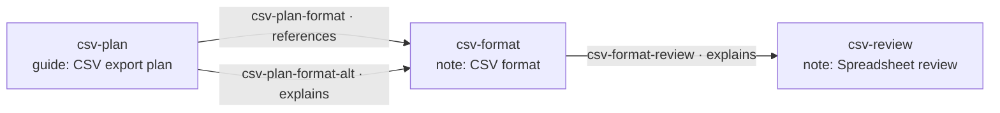

## Explore the graph

Before changing anything, we can read what is already in the selected Scope.
Beads hold content, and Links explain how Beads relate. We will inspect an
existing CSV export plan, find its supporting notes, and follow their connections.
All commands use the default Scope already selected.

This Scope has the example Bead Types `guide`, `note`, and `encoding-note`; the
last refines `note`. Its Link Type `explains` refines `references`. These are
Scope-local fixtures with the properties and endpoint rules used here, rather
than Types every BDP provider installs. The output excerpts are authored,
abbreviated illustrations; `…` omits display detail. A command example describes
the canonical design target and does not assert support in an installed build.

### Read a Bead

`bd show` reads one Resource by ID. Start with the CSV plan. Its title gives us a
short description, while its body records the actual guidance.

```console
# Read the existing export plan.
> bd show csv-plan
csv-plan [guide] CSV export plan
…
Export selected rows with column headings.

Properties
  status: draft

```

The plan is one Bead among several. `bd list` browses the current Beads in the
selected Scope. Canonical List has no implicit Issue-only or open-status filter.

```console
# Browse current Beads in this example Scope.
> bd list
ID            TYPE           TITLE
csv-encoding  encoding-note  CSV encoding
csv-format    note           CSV format
csv-plan      guide          CSV export plan
csv-review    note           Spreadsheet review

```

These rows describe the Beads themselves. Listing Beads does not traverse Links
or acquire their neighboring Beads.

### Select a Type family

`--type` includes refinements of the selected Type. It finds ordinary notes and
the more specific encoding note. `--exact-type` restricts the result to the named
nominal Type.

```console
# Include both note and its encoding-note refinement.
> bd list --type note
ID            TYPE           TITLE
csv-encoding  encoding-note  CSV encoding
csv-format    note           CSV format
csv-review    note           Spreadsheet review

# Select only Beads whose actual Type is note.
> bd list --exact-type note
ID          TYPE  TITLE
csv-format  note  CSV format
csv-review  note  Spreadsheet review

```

The service needs the authoritative Type-family interpretation for the first
request. Unsupported affiliation is an explicit refusal; a client cannot quietly
substitute exact matching.

### Choose represented fields

`--include` and `--omit` select fields using JSON Pointers. They have the same
Resource meaning on `show` and List items. Filtering chooses the records;
projection chooses which fields of those records are transferred and shown.

```console
# Request the title property without acquiring the body's content in the response.
> bd show csv-plan --include /properties/title
csv-plan [guide] CSV export plan
…

# Apply the same field selection to the note family.
> bd list --type note --include /properties/title
ID            TYPE           TITLE
csv-encoding  encoding-note  CSV encoding
csv-format    note           CSV format
csv-review    note           Spreadsheet review

```

Identity and actual Type remain available as context. The omitted protocol
details stay protected under the shared Resource representation rules. A valid
include naming an absent optional property adds nothing; it does not fail the
read, fabricate null, or fall back to returning every property.

> **Design incorporation**
>
> Shared service-side Resource projection is accepted. The existing command
> reference still contains earlier display-only descriptions. Its wire binding
> must be amended explicitly; a client-only display mask does not implement this
> target. The command examples here follow the accepted projection behavior.

### Inspect Links separately

`bd link list` browses Links. Its filters inspect the Links' own content and stored
endpoint References. `bd link show` reads one Link, including its ID and directed
endpoints. The connection can have properties of its own.

```console
# Find Reference-family Links authored from the plan.
> bd link list --from csv-plan --type references
ID                   TYPE        SOURCE    TARGET      STATUS
csv-plan-format      references  csv-plan  csv-format  active
csv-plan-format-alt  explains    csv-plan  csv-format  draft

# Read one connection.
> bd link show csv-plan-format-alt
csv-plan-format-alt [explains]
…
Source: csv-plan
Target: csv-format

Properties
  status: draft

```

These are two different Links between the same Beads. Their identities and
properties remain separate. `explains` appears in the family result because it
refines `references` in this Scope.

### Follow a neighborhood

Graph starts from explicit Beads and follows selected Link Types. Direction says
which way to walk; depth counts Link hops. A depth of one finds direct neighbors.
The graph result retains its roots, the traversed Links, and their endpoint Beads.
`--link-type` includes refinements, like `--type`; `--exact-link-type` restricts
the eligible Links to the named nominal Type.

```console
# Follow outgoing Reference-family connections through two hops.
> bd graph csv-plan --direction out --depth 2 --link-type references
csv-plan [guide] CSV export plan
├─ references → csv-format [note] CSV format
│  └─ explains → csv-review [note] Spreadsheet review
└─ explains → csv-format [already shown]

```

The tree is a compact view of a graph. The repeated format Bead is shown once
with a second relationship pointing to it. Both plan-to-format Links are retained
in structured graph content. This view is complete for the requested two-hop
neighborhood; it does not claim that no connections continue beyond it.



The example also has a Link from the review back to the plan. Another hop reveals
that cycle. A graph reader can preserve the Link without repeatedly expanding
the same Bead forever.

```console
# Include the review-to-plan Link at the next depth.
> bd graph csv-plan --direction out --depth 3 --link-type references
csv-plan [guide] CSV export plan
├─ references → csv-format [note] CSV format
│  └─ explains → csv-review [note] Spreadsheet review
│     └─ references → csv-plan [cycle]
└─ explains → csv-format [already shown]

```

`--direction in` follows incoming Links; `both` follows either direction while
keeping each Link's authored source and target. Additional root IDs combine
their neighborhoods. These examples use the focused Graph candidate: roots,
direction, depth and Link Type restrictions. They introduce no property-filter
flag or implicit satisfaction evaluator.

### Ask about related content

List filters inspect the candidate Resource. Query can ask about related Beads.
For example, we can select Beads with an outgoing Reference-family Link to a
ratified Bead. The result is the qualifying starting Beads, not an automatic
expansion of every witness.

```text
# Query expression: find starting Beads with a ratified supporting target.
beads as b where (
  any outgoing(b) as link
    through link is references
    where link.target.status = "ratified"
)

# Expected Resource result in this fixture.
csv-plan [guide] CSV export plan

```

The bindings are visible: `b` is a candidate Bead and `link` is a traversed Link.
`through` limits which relationships may be followed. The inner `where` is the
test for `any`; the outer `where` selects starting Beads. `all` uses the same form
to test every member. Empty input makes `any` false and `all` true.

This is the accepted expression direction, with remaining lexical details under
review. The final CLI argument/file spelling and transport binding are still
open, so this example deliberately shows an expression rather than inventing a
working `bd query` invocation. The [portable AST draft](../query-ir.md) gives the
same example as structured data for review.

The service can return an exact count of selected Resources instead of their
records. The canonical CLI uses `--count-only` on List and Query, including Link
variants. Count is computed before paging and does not depend on included or
omitted fields. A service can execute the count in storage without fetching every
body. The older command reference's lack of a native count binding is an
incorporation gap, not a reason to count a page or silently scan at the client.

> **Product conveniences**
>
> A product may retain field-specific flags such as `--title`, or its established
> Issue/search defaults. Existing `bd count` and `bd link count` can remain
> compatibility facades with their own admitted selection/default behavior.
> Each such flag or facade needs an exact lowering or an explicit
> compatibility route. The canonical examples here use generic Resources, Type
> filters and shared field selection; legacy `bd query` and `bd sql` keep their
> existing behavior until a deliberate compatibility decision changes them.

For this story, no objects have changed. The exact Scope fixtures and expected
selection sets are captured in [the authored seed](../query-ir/fixtures.json).
