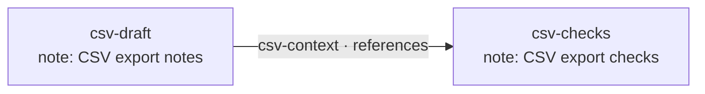
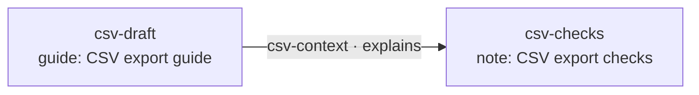

## Build and revise the graph

The same commands that read a graph also help us inspect the changes we make to it. We will add a design note and a short checklist for a CSV export feature, connect them, and turn the note into a guide as its content takes shape. We will then remove the checklist and its Link, leaving the guide in place. All commands use the default Scope already selected.

For this example, that Scope offers the Bead Types `note` and `guide`, and the Link Types `references` and `explains`. Both Bead Types accept the properties in this example, and both Link Types permit these endpoints. These names belong to this example's Scope. The output excerpts are illustrative and abbreviated; `…` marks omitted display detail.

### Create Beads

`bd create` adds one Bead to the current Scope. `--type` chooses its Type, and `--properties` supplies its initial content as a JSON object. We will choose IDs with `--id` so the commands are easy to follow. If we omit that flag, the service chooses a new ID and returns it.

```console
# Create a design note with an explicit ID.
> bd create --id csv-draft --type note \
  --properties '{"title":"CSV export notes","body":"Keep column headings in every CSV export."}' \
  --metadata '{"area":"export","scratch":true}'
Created
csv-draft [note] CSV export notes

# Create the checklist as a separate Bead.
> bd create --id csv-checks --type note \
  --properties '{"title":"CSV export checks","body":"Open an exported file in a spreadsheet and check its headings."}'
Created
csv-checks [note] CSV export checks

```

The properties hold the note's content. Metadata is a separate object; here it records the area of the product and a temporary marker.

```console
# Read the note through the same show command used for existing Beads.
> bd show csv-draft
csv-draft [note] CSV export notes
…
Keep column headings in every CSV export.

Metadata
  area: export
  scratch: true

```

> **Product conveniences**
>
> A product command may offer `--title 'CSV export notes'` as a shorthand for initializing the `title` property. The canonical creation above puts that value in `--properties`, where we can also supply any other properties admitted by the selected Type.

### Connect the Beads

`bd link create` creates a directed Link between two Beads. The first operand is the source and the second is the target. The Link has its own ID, Type and properties, so we can describe why this connection matters and edit it independently. Here the design note refers to the checklist.

```console
# Connect the design note to the checks that accompany it.
> bd link create csv-draft csv-checks --id csv-context --type references \
  --properties '{"title":"Checks accompanying the design"}' \
  --metadata '{"area":"export"}'
Created
csv-context [references] csv-draft → csv-checks  Checks accompanying the design

# Read the Link itself.
> bd link show csv-context
csv-context [references] Checks accompanying the design
…
Source: csv-draft
Target: csv-checks

Metadata
  area: export

```

The graph now contains two Beads and one Link. `csv-context` identifies the connection itself; `csv-draft` and `csv-checks` identify its endpoints.



### Edit individual properties and metadata

`bd update` edits an existing Bead, and `bd link update` edits an existing Link. A keyed edit changes the named property while preserving the others. The corresponding metadata flags edit the separate metadata object. We can combine a property edit and a metadata edit in the same command.

```console
# Clarify the note's body, add a temporary status, and record review in metadata.
> bd update csv-draft \
  --set-property body='Include headings even when no rows are selected.' \
  --set-property status=review-needed \
  --set-metadata reviewed=true
Updated
csv-draft [note] CSV export notes

# Describe the connection more precisely and mark it reviewed too.
> bd link update csv-context \
  --set-property title='Checks for CSV output' \
  --set-metadata reviewed=true
Updated
csv-context [references] csv-draft → csv-checks  Checks for CSV output

```

Neither edit changes an ID or moves a Link endpoint. Reading the note shows its new body alongside the content we left alone.

```console
# Read the edited note.
> bd show csv-draft
csv-draft [note] CSV export notes
…
Include headings even when no rows are selected.

Properties
  status: review-needed

Metadata
  area: export
  scratch: true
  reviewed: true

```

> **Product conveniences**
>
> A product's `bd update csv-draft --title 'CSV export guide'` can lower to `bd update csv-draft --set-property title='CSV export guide'`. The generic keyed flag works for any admitted top-level property, rather than reserving a flag for each property's name.

Use `--unset-property` or `--unset-metadata` to remove a member. Removing the temporary markers leaves the body and the remaining metadata intact.

```console
# Remove the temporary content status and scratch metadata.
> bd update csv-draft --unset-property status --unset-metadata scratch
Updated
csv-draft [note] CSV export notes

```

The keyed flags operate on literal top-level names. A name containing `/` is still one property name.

### Merge, replace or patch an object

For several top-level values, `--properties` merges the supplied members into the current properties object. `--replace-properties` instead supplies its writable contents as a replacement. `--patch-properties` applies an ordered JSON Patch for edits to particular paths. Metadata offers the same choices, and each object chooses its editing mode independently.

```console
# Add an audience property and a delivery-channel metadata member.
> bd update csv-draft \
  --properties '{"audience":"spreadsheet users"}' \
  --metadata '{"channel":"preview"}'
Updated
csv-draft [note] CSV export notes

```

That merge preserves the existing title, body and other metadata. A supplied nested object would replace that entire top-level value; this is a shallow merge.

```console
# Replace the note's writable properties while adding one metadata member.
> bd update csv-draft \
  --replace-properties '{"title":"CSV export guide","body":"Include headings even when no rows are selected."}' \
  --patch-metadata '[{"op":"add","path":"/ready","value":true}]'
Updated
csv-draft [note] CSV export guide

```

The example's properties are caller-writable, so omitting `audience` from this replacement removes it. The metadata patch adds `ready` while preserving `area`, `reviewed` and `channel`.

```console
# Refine the body with a strict patch and replace the metadata object.
> bd update csv-draft \
  --patch-properties '[{"op":"replace","path":"/body","value":"Include headings even for an empty selection. Check the exported file in a spreadsheet."}]' \
  --replace-metadata '{"area":"export","ready":true}'
Updated
csv-draft [note] CSV export guide

# Inspect the result.
> bd show csv-draft
csv-draft [note] CSV export guide
…
Include headings even for an empty selection. Check the exported file in a spreadsheet.

Metadata
  area: export
  ready: true

```

The title survived the body patch, while the metadata replacement removed the omitted metadata members. A patch's `replace` or `remove` requires the addressed member to exist; a keyed unset tolerates an already absent writable member.

Each object uses one editing mode per command. Omitting an object preserves it; in replacement mode, `{}` supplies an empty replacement, subject to the Type's rules. A member set to JSON `null` has a value rather than being removed. A Type may protect existing values or reserve fields for the service to maintain. Replacement obeys those rules, and the service completes and validates the resulting content.

### Change a Type without changing identity

A Bead's Type can change while its ID stays the same. Use `--type` on an update to select the destination Type, leaving existing properties intact unless the command also edits them. The destination Type must admit the resulting content and relationships. Our note now contains a guide, and the Link can describe the checklist as an explanation of that guide.

```console
# Change the note into a guide while keeping its content and identity.
> bd update csv-draft --type guide
Updated
csv-draft [guide] CSV export guide

# Change the connection's Type while keeping the same Link and endpoints.
> bd link update csv-context --type explains
Updated
csv-context [explains] csv-draft → csv-checks  Checks for CSV output

```

The two commands change the Types of existing objects. They preserve the Bead ID, the Link ID and both endpoint identities.



If the destination Type rejects the content or connected graph, the update fails without partially changing the object. Changing a Type does not silently convert or discard its properties.

### Delete a Link and a Bead

We can now remove the separate checklist because its content has been incorporated into the guide. `bd delete` and `bd link delete` first offer a preview: without `--force`, they read and display the current object without deleting it. Supplying `--force` applies the deletion and checks the graph's rules. A Bead with a live incoming or outgoing Link cannot be deleted until those Links have been removed.

```console
# Preview deleting the checklist.
> bd delete csv-checks
Delete preview
csv-checks [note] CSV export checks
…
Open an exported file in a spreadsheet and check its headings.

# Attempt the deletion while the incoming Link still exists.
> bd delete csv-checks --force
Error: incident-links-exist: csv-checks has a live incident Link.

```

The failed deletion leaves the checklist and its Link in place. We must remove the connection explicitly.

```console
# Preview deleting the connection.
> bd link delete csv-context
Delete preview
csv-context [explains] csv-draft → csv-checks  Checks for CSV output

# Delete that Link.
> bd link delete csv-context --force
Deleted
csv-context [explains] csv-draft → csv-checks

# Delete the checklist after removing its incident Link.
> bd delete csv-checks --force
Deleted
csv-checks [note] CSV export checks

```

`--force` means apply the deletion; it does not override authorization or graph integrity. A preview reserves nothing, so each applied deletion checks the actual state when it runs.

```console
# Confirm the Link is no longer available as a current object.
> bd link show csv-context
Error: resource-not-found: csv-context.

# Confirm the checklist is no longer available as a current object.
> bd show csv-checks
Error: resource-not-found: csv-checks.

# Read the guide that remains.
> bd show csv-draft
csv-draft [guide] CSV export guide
…
Include headings even for an empty selection. Check the exported file in a spreadsheet.

Metadata
  area: export
  ready: true

```

The guide remains under the same ID with its final content and metadata. The deleted Bead and Link IDs remain unavailable for new objects.
