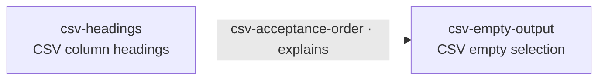
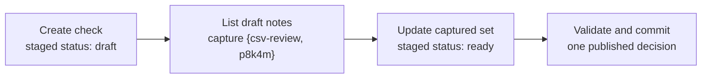
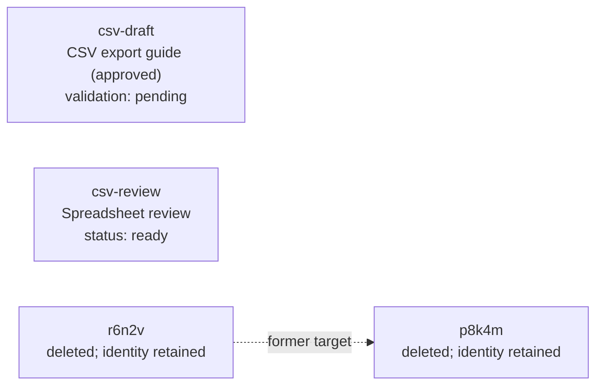

## Apply related changes atomically

An atomic batch asks one Scope to accept a group of changes together. We can
create two Beads and connect them without leaving a half-built graph if one
member fails. The CLI assembles the ordinary operations into one request, and
the authority makes one decision about the complete group. We'll start with
fixed IDs so the transaction is easy to see.

> **Review draft.** This chapter describes the selected CLI direction, not
> implemented commands. JSONL authoring, `--batch-bind`, `batch-ref::NAME` and
> required/used `--batch-arg` inputs reflect Donna's review. Selection sees
> earlier staged changes and captures each set once. The proposed version-2 wire
> encoding and exact result/selection forms remain
> [author proposals](../batch-selection-design.md). The examples use proposed
> encoder version 2 as the stable CLI default; the retained version-1
> protocol and schemas are unchanged.

### Create two Beads and a Link

The current Scope is still `https://work.example/acme/`. It has the fixture
Types `note`, `guide`, `references` and `explains`, which admit the content and
endpoints illustrated here. We want a note about column headings and another
about empty exports, with an explaining Link between them. The three explicit
IDs below have never been used in this Scope.

`--dry-run-mode batch` emits one compact JSON member followed by a newline.
It applies no mutation and allocates no identity. The shell can collect those
members into a JSONL file using its ordinary quoting and redirection.

```sh
# Assemble the three members, stopping if any emission fails.
(
  # Describe the column-headings note with an explicit ID.
  bd create --id csv-headings --type note \
    --properties '{"title":"CSV column headings","status":"ready"}' \
    --dry-run-mode batch || exit

  # Describe the empty-export note with another explicit ID.
  bd create --id csv-empty-output --type note \
    --properties '{"title":"CSV empty selection","status":"ready"}' \
    --dry-run-mode batch || exit

  # Describe the connection using those ordinary IDs.
  bd link create csv-headings csv-empty-output --id csv-acceptance-order \
    --type explains --dry-run-mode batch || exit

) > csv-basics.jsonl &&
# Submit the assembled file as one decision.
bd batch --file csv-basics.jsonl

```

The shell runs these commands; `bd batch` reads their JSON output. There is no
CLI-command-file input or shell interpreter inside the batch reader. The
[complete assembly script](examples/csv-basics.sh), [JSONL members](examples/csv-basics.jsonl)
and [native request](examples/csv-basics.batch.json) show the three forms.



The first member stages the headings note, and the second stages the empty-export
note. The Link can refer to those earlier staged creations. Other readers see
the committed graph after the decision; they cannot observe a committed prefix.

### Read the result

A successful result reports one batch decision and identifies what each member
targeted. It also reports the final outcome of each affected Resource. The
member mappings preserve input order. Each mapping has an identity array,
including singleton operations; set arrays are sorted by canonical URI.
The final Resource outcomes collect repeated edits to the same identity. The output below is authored and abbreviated.

```text
Committed
Member 0  createBead  → csv-headings
Member 1  createBead  → csv-empty-output
Member 2  createLink  → csv-acceptance-order
Created: csv-headings, csv-empty-output, csv-acceptance-order
…

```

Each new Resource has one published creation revision. If several members edit
the same existing Resource, the result carries its final state and at most one
new revision. A net-zero change to an existing Resource preserves its revision;
creating and deleting a new identity still consumes that identity.

Machine-readable output preserves the complete compound result, including the
member mappings and final outcomes. Selecting JSONL output carries that compound
result as one record. Input JSONL describes members; output JSONL describes one
atomic decision.

### Handle a failure

The approved CSV guide is still `csv-draft`, at revision `guide-i`. Suppose we
try to add another review note while changing the guide under the older
`guide-h` guard. The guide's guard must refuse, so the new note must not be
published either. A failure belongs to the complete decision.

```sh
# Assemble a creation followed by an edit with a stale guard.
(
  # Describe a fresh review note.
  bd create --id csv-review-attempt --type note \
    --properties '{"title":"Another CSV review"}' --dry-run-mode batch || exit

  # Require a guide revision that has already been replaced.
  bd update csv-draft --if-revision =guide-h \
    --set-metadata validation=pending --dry-run-mode batch || exit

) > csv-failure.jsonl &&
# Submit both members and observe one refusal.
bd batch --file csv-failure.jsonl

```

Member evaluation stops at its first failure and returns one ordinary Problem
with the failing member's index and permitted target detail. The guide's stale
guard produces revision mismatch here. No review note or guide change
from this attempt becomes public, and no Resource lifecycle Event announces
either proposed change. A failure does not turn the earlier member into an
independent success.

Malformed JSONL, missing arguments and invalid local input fail before submission.
The CLI reads and validates the whole file before sending the request. A file
containing only an accidentally retained valid prefix cannot reveal the author's
missing intent; the shell's failure handling above prevents automatically
submitting that prefix after an emission error.

### Guard revisions and recover an uncertain outcome

An existing target's `--if-revision` guard compares its committed revision at
the batch's baseline. Later staged edits to that target do not manufacture a
new public token for another guard. Newly created Resources have no committed
baseline revision to satisfy a literal guard. The authority must check the
applicable baseline and commit the decision atomically under its concurrency
rules. A guard is accepted only when the resolved target is a singleton,
including a singleton set; an empty or multi-target set cannot use one token
as a group guard. There is no generic revision guard on the outer batch.

Successful execution is serializable: its observations and effects are
equivalent to some sequential ordering with competing authoritative changes.
The authority may make bounded internal restarts after a serialization conflict,
before recording a terminal decision. A restarted attempt may capture different
sets; each capture stays fixed within its attempt. Guard, authorization and
validation failures do not trigger that restart mechanism.

A batch does not reserve identities or establish a public Scope snapshot while
its JSONL is being assembled. Serializability also does not protect a caller's
old observation automatically; an explicit Resource guard still does that job.
A committed or terminally recorded decision is never rerun by internal restart.

A lost response is different from a known refusal: the batch may have committed.
The client saves the frozen request and its key before sending it. Recovery asks
for that original decision, including its original identities and outcome.

```sh
# Recover the original batch after an uncertain response.
bd batch --retry-file private-replay.json

```

Recovery does not reread the member files, choose new IDs or repeat selection
against today's graph. An unavailable retained outcome remains explicit
uncertainty. A fresh key would request a different execution and is never an
automatic response to a lost result.

### Bind a generated identity

Sometimes we want the authority to choose an ID. A create can use
`--batch-bind checks` to name its resulting identity, and a later operand can
refer to it as `batch-ref::checks`. Each operand carries its own reference, so
a Link can independently use bindings for its source and target. The names exist
only within this batch and do not create saved aliases.

Here is a self-contained batch description with a fixed guide ID and a generated
check ID. It has no externally supplied arguments. Both commands emit members;
the final command shows the complete request without applying it.

```sh
# Assemble a creation and a Link to its generated identity.
(
  # Bind the check identity allocated when the batch executes.
  bd create --batch-bind checks --type note \
    --properties '{"title":"CSV acceptance checks","body":"Check headings for empty and non-empty selections.","status":"draft"}' \
    --dry-run-mode batch || exit

  # Refer to that identity in the Link's target operand.
  bd link create csv-draft batch-ref::checks --batch-bind connection \
    --type explains --properties '{"title":"Acceptance checks"}' \
    --dry-run-mode batch || exit

) > csv-bindings.jsonl &&
# Inspect this self-contained batch without executing it.
bd batch --file csv-bindings.jsonl \
  --dry-run-mode batch

```

The [JSONL members](examples/csv-bindings.jsonl) use a structural reference,
`{"binding":"checks"}`, in the target slot. The
[compiled request](examples/csv-bindings.batch.json) preserves that reference
for execution. No generated ID is allocated while either form is emitted.

`batch-ref::NAME` is reserved in admitted batch Reference positions. It is
recognized before ordinary URI resolution; full HTTP URLs remain ordinary
References. Property strings containing the same text stay literal. Unknown,
forward or wrong-kind internal references fail, and `--batch-bind` or a batch
reference on ordinary execution is an error. Each internal name has one
definition; assigning the same name again fails before submission. A selected
set may fill a Link endpoint only when it contains exactly one live Bead.
There is no implicit fan-out.

### Supply arguments to a reusable batch

We can make the guide an input while keeping the check's generated identity
internal. In this variant, replace the Link's source `csv-draft` with
`batch-ref::guide`. No member defines `guide`, so its use implicitly declares
a required external argument. The caller supplies its value with
`--batch-arg guide=csv-draft`; no parameter declaration block is needed.

The [argument assembly script](examples/csv-arguments.sh) produces the
[reusable JSONL file](examples/csv-arguments.jsonl). We can inspect its resolved
request using:

```sh
# Supply the guide argument and inspect the request without applying it.
bd batch --file csv-arguments.jsonl \
  --batch-arg guide=csv-draft --dry-run-mode batch

```

With that argument, the [compiled request](examples/csv-arguments.batch.json)
is identical to the self-contained one. The supplied guide becomes an ordinary
absolute Reference; the internal `checks` reference remains a binding. The
service receives no unresolved external argument.

Argument rules apply before submission. Missing and unused arguments fail,
as do duplicate assignments and attempts to override an internal binding.
The reader first collects every internal definition: a reference to a later
definition is a forward-reference error, not an implicit external argument.

This first example accepts Reference-valued arguments in admitted operand
positions: mutation targets, Link endpoints and explicit read Reference inputs.
Values use the selected Scope and the ordinary kind/revision rules for that
position. Explicit read roots can also use earlier internal bindings, including
generated identities. There is no arbitrary property-string, query-text or
JSON-pointer substitution.

### Select a set with List

A List member can bind a complete set of identities using the same
`--batch-bind` flag. Later updates or deletions can consume that set. The List
runs inside the authority's transaction and sees earlier staged changes. Its
membership is captured once, even when later edits change the selected fields.

The existing `csv-review` note has status `draft`; the notes created at the
start of this chapter are already `ready`. We can extend the self-contained
check batch with a selection of draft notes, an update of that set and a guarded
edit of the guide. Its one new check is still `draft` when selection runs.

```sh
# Extend the self-contained members with selection and review edits.
(
  # Include the earlier creation and connection descriptions.
  cat csv-bindings.jsonl || exit

  # Capture draft notes, including the earlier staged creation.
  bd list --batch-bind draft-notes --type note --property 'status = "draft"' \
    --dry-run-mode batch || exit

  # Update the captured identities without repeating their predicate.
  bd update batch-ref::draft-notes --set-property status=ready \
    --dry-run-mode batch || exit

  # Mark the guide only if it is still the revision we approved.
  bd update csv-draft --if-revision =guide-i --set-metadata validation=pending \
    --dry-run-mode batch || exit

) > csv-review.jsonl &&
# Submit the creation, selection and edits as one decision.
bd batch --file csv-review.jsonl

```

The [complete assembly script](examples/csv-review.sh),
[JSONL members](examples/csv-review.jsonl) and
[native request](examples/csv-review.batch.json) describe the same five members.
The example authority advertises the proposed selection-capable version and
transaction-scoped List. Transaction-scoped Query is advertised separately. A provider that supports only the retained
six-CRUD version refuses this request before effects.



Here the authority allocates `p8k4m` for `checks` and `r6n2v` for
`connection`. Those are illustrative IDs, not a prescribed allocation format.
The captured `draft-notes` set contains `csv-review` and `p8k4m`.

```text
Committed
checks       → p8k4m [note] CSV acceptance checks
connection   → r6n2v [explains] csv-draft → p8k4m
draft-notes  → {csv-review, p8k4m}
Changed: csv-draft, csv-review, p8k4m, r6n2v
…

```

The new check is published once in its final `ready` state. Its staged
`draft` value has no public revision or Event. The guide and existing review
note each receive one new revision, and the new Link is published once.
The guide's earlier floating and pinned citations keep their stored References.

A selection's result is a typed identity set, with no paging, masks, sort or
Resource-body delivery controls. Exceeding a bound refuses the whole batch;
a truncated prefix is never a successful complete selection. A captured set
retains membership after field changes, but deleting a member does not permit
a later update or deletion of that target; the whole batch refuses rather than
skipping it.

A captured set can become the candidate input to another List. That List filters
the same identities using their staged content at its own position and captures
a new subset. Query can use a captured Bead set as roots and traverse from it.
The [shared read proposal](../query-ir/transaction-selection-inputs.md) expresses
these forms with typed inputs. Its proposed `--candidates` flag names a prior
set without overloading Link endpoint flags.

For example, a later member placed after the status update can narrow the
original capture using its current staged fields:

```sh
# Emit a later List using the previously captured identities as candidates.
bd list --candidates batch-ref::draft-notes --property 'status = "ready"' \
  --batch-bind ready-notes --dry-run-mode batch

```

This supplementary member would capture the same two notes after their update.
It cannot admit another newly ready note outside the original capture.
The five-member review file remains the complete example submitted above.

### Select through relationships with Query

List selects by a Resource's own fields. Query adds relationship traversal and
endpoint inspection using the same logical read language introduced earlier.
A provider must advertise support for that selection shape inside its write
transaction. Standalone Query support alone does not establish it. This first
slice selects the current staged graph, without historical acquisition or tests
that require a published revision of an unpublished staged state.

The separate acceptance check has now served its purpose. We can capture its
explaining Links and their target Beads, then remove the Links before removing
the Beads. Both selections run while the relationships still exist.

```sh
# Assemble relationship selection and explicit deletion.
(
  # Capture explaining Links whose target notes are ready.
  bd link query 'outgoing("csv-draft") as edge through edge is explains where edge.target.status = "ready"' \
    --batch-bind ready-links --dry-run-mode batch || exit

  # Capture the target Beads before removing those Links.
  bd query '(outgoing("csv-draft") as edge through edge is explains where edge.target.status = "ready").target' \
    --batch-bind ready-checks --dry-run-mode batch || exit

  # Remove the captured Links explicitly.
  bd link delete batch-ref::ready-links --force --dry-run-mode batch || exit

  # Remove their captured target Beads.
  bd delete batch-ref::ready-checks --force --dry-run-mode batch || exit

) > csv-cleanup.jsonl &&
# Apply the cleanup as one decision.
bd batch --file csv-cleanup.jsonl

```

The [assembly script](examples/csv-cleanup.sh),
[JSONL members](examples/csv-cleanup.jsonl) and
[native request](examples/csv-cleanup.batch.json) preserve those four members.
Here `ready-links` captures `r6n2v`, and `ready-checks` captures `p8k4m`.
Removing the Link does not change the earlier Bead capture.



Any other live incident Link or ordinary integrity refusal fails the complete
cleanup. There is no implicit cascade, endpoint cross-product or mixed Graph
display used as a mutation operand.

Execution stays within one Scope: selections, acquired endpoints and mutations
cannot enlist remote Resources. A local Link may still store an opaque external
URI where its Type permits it. The authority does not acquire that remote
Resource or make a transactional promise about its state. External endpoint
values do not become remote identities in the batch's result mappings.

The fixed-ID notes and their Link remain live, as do the guide and review note.
Deleted identities remain unavailable for reuse under the Scope's identity rules.

### Handle an empty selection and inspect the wire request

After these changes, this fixture has no note-family Bead with status `draft`.
The [empty-set script](examples/csv-empty.sh) selects that known-kind empty set
and updates it. An empty-set update succeeds with no Resource effects.
Unknown names or a wrong Resource kind still fail.

We can also inspect a fully compiled protocol request rather than apply it.
The preview includes the method, target, relevant headers and body for the
selected discovery binding. It includes neither credentials nor an execution
claim.

```sh
# Inspect the empty-set batch's BDP request without applying it.
bd batch --file csv-empty.jsonl \
  --dry-run-mode bdp

```

The request preview may perform discovery and reads needed to determine its
route or resolve a local revision number. It applies no mutations, allocates
no identities and reserves no key. If the required information cannot be
established, it refuses rather than guessing. Member emission remains offline;
the exact BDP-preview framing is still an encoding proposal. Retry mode
preserves the original resolved arguments and complete decision; it never
reevaluates a committed selection.

### Read without changing the graph

A batch can contain only selections. It uses the same capability, one key and
one consistent view, with the same bounds and retained outcome. Its results
report captured identities without inventing mutation outcomes, Resource
revisions or lifecycle Events. A separately installed read-only query facility
can coexist with this batch composition.

The [read-only member](examples/csv-read-only.jsonl) selects the ready notes left
by this walkthrough. The [assembly script](examples/csv-read-only.sh) emits that
member, and the [native request](examples/csv-read-only.batch.json) contains it.

```sh
# Read the ready-note selection through the ordinary batch result envelope.
bd batch --file csv-read-only.jsonl --output-format json

```

The [authored result](examples/csv-read-only.result.json) makes the result shape
concrete. These version-2 field names remain an encoding proposal.

```json
{
  "capabilityVersion": "2",
  "changed": false,
  "results": [
    {
      "operationIndex": 0,
      "operation": "select",
      "bindingName": "ready-notes",
      "ids": [
        "https://work.example/acme/csv-empty-output",
        "https://work.example/acme/csv-headings",
        "https://work.example/acme/csv-review"
      ]
    }
  ],
  "resources": []
}
```

Whitespace-only JSONL lines may separate groups visually; every nonblank line
must contain one complete member object. Comments and multiline member records
are not accepted. A file with no members is an input error, distinct from a
real selection that returns an empty set.

The [design notes](../batch-selection-design.md) record the completed decision
pass, remaining encoding/incorporation work and a provider acceptance case for
staged visibility and fixed captures. The
[story-state fixture](06-batch.fixture.json) records the authored results,
including the successful fixed-ID batch and failed guarded attempt.
These are consistency examples, not execution evidence for a CLI or provider.
