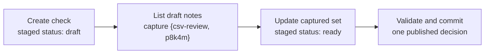
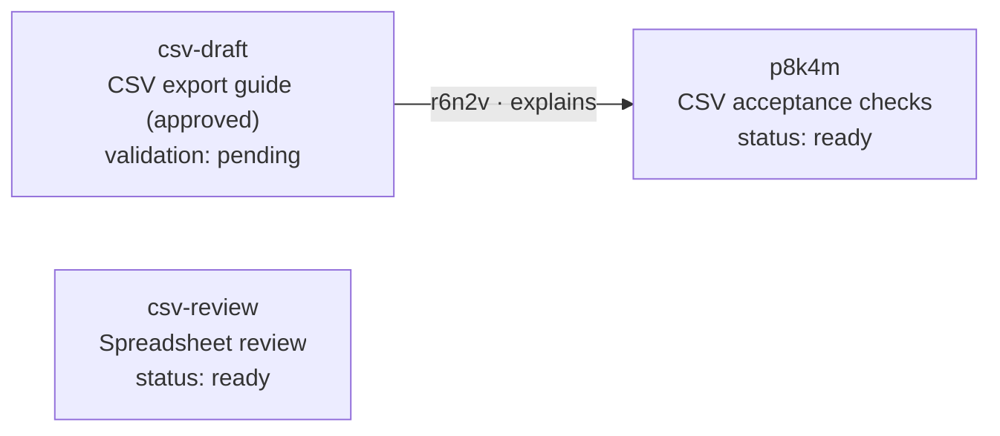
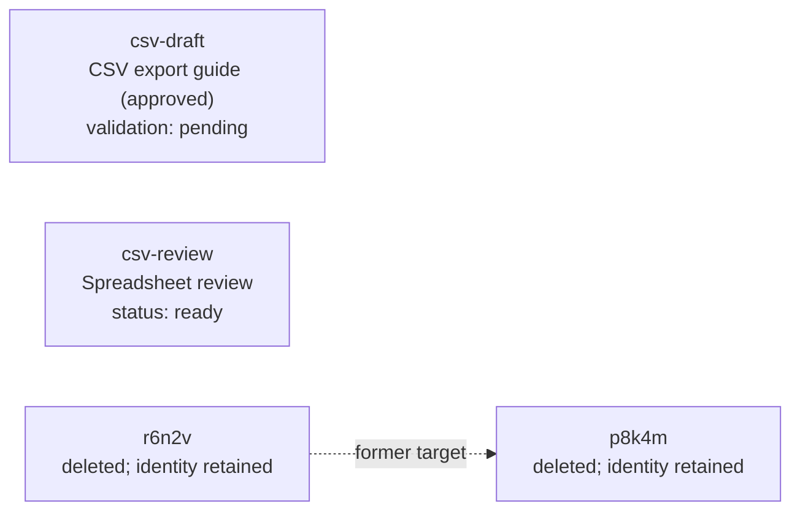

## Apply related changes atomically

The approved CSV guide is still `csv-draft`, at revision `guide-i`. We now want
to add acceptance checks, connect them to the guide, and prepare the draft notes
for review. These changes belong together: a failure should leave the graph as
it was. An atomic batch lets us describe the changes with familiar commands and
ask the owning Scope to make one decision.

> **Review draft.** The examples below extend the existing six-CRUD batch with
> named List/Query selections and the proposed `--dry-run-mode` spelling.
> Selection and writes being atomic, seeing earlier staged changes, and capturing
> each selected ID set once are agreed. The concrete version-2 encoding,
> supported selection subset and remaining choices are
> [proposals for the batch review](../batch-selection-design.md), not implemented
> commands or amendments to the retained version-1 contract.

### Name the values later commands need

A creation can give its new identity a name with `--name`; `@checks` then refers
to the identity created earlier in this batch. A List can name a set of
identities in the same way. Update and delete can use either kind of binding,
with the ordinary Bead/Link kind checks. Names belong to this batch document;
they are not saved aliases or variables available to a later invocation.

Our Scope has the fixture Types `note`, `guide`, `references` and `explains`.
They admit the illustrated content and endpoints, with no additional
ownership-induced guide changes. The existing `csv-review` note has status
`draft`; the other existing note-family Beads are ratified. This gives us one
existing draft to select alongside the new acceptance-check note.

Save the following as [csv-review.bdp](examples/csv-review.bdp).
The file contains command arguments without the `bd` executable. It is literal
command data: comments and quoting help us author it, but it does not run a shell.

```text
# Create the checks and bind their new identity.
create --name checks --type note \
  --properties '{"title":"CSV acceptance checks","body":"Check headings for empty and non-empty selections.","status":"draft"}'

# Connect the existing guide to that newly created Bead.
link create csv-draft @checks --name connection --type explains \
  --properties '{"title":"Acceptance checks"}'

# Capture every current draft note, including the earlier staged creation.
list --name draft-notes --type note --property 'status = "draft"'

# Prepare all captured notes for review.
update @draft-notes --set-property status=ready

# Mark the guide only if it is still the version we approved.
update csv-draft --if-revision =guide-i --set-metadata validation=pending

```

The List sees the staged creation, so `draft-notes` contains `csv-review` and the
new acceptance-check Bead. That membership is fixed when the List runs. Changing
their statuses to `ready` does not make them disappear from the binding or cause
the selection to run again.



The `checks` binding contains one Bead identity; `draft-notes` contains a Bead
identity set. A Link identity set belongs on `link update` or `link delete`.
Passing a set to a Link endpoint does not imply creation of every possible pair
of endpoints; endpoint cardinality must be admitted explicitly.

### Commit one decision

The outer command selects the Scope, authorization context and batch capability
once. This example uses the same default Scope as the earlier chapters,
`https://work.example/acme/`. The example service advertises the proposed
selection-capable batch version, including the List subset used here. A service
that supports only independent writes or the earlier six-CRUD version must
refuse this batch before effects.

```console
# Apply the complete batch as one atomic decision.
> bd batch --file csv-review.bdp --input-format cli
Committed
checks       → p8k4m [note] CSV acceptance checks
connection   → r6n2v [explains] csv-draft → p8k4m
draft-notes  → {csv-review, p8k4m}
Changed: csv-draft, csv-review, p8k4m, r6n2v
…

```

These are authored, abbreviated outputs. The allocated IDs are illustrations;
they do not prescribe an allocation format. The result identifies the selected
and created identities and reports each final affected Resource once.



The new check is published in its final `ready` state. Its staged `draft` state
does not become a separate public revision or Event. The guide and existing
review note each receive one new revision, and the new Link is published once.
The earlier floating and pinned citations retain their stored References.

### Inspect the corresponding BDP input

`--dry-run-mode batch` emits the native member corresponding to an ordinary
invocation. On the outer `batch` command it emits the complete batch wrapper.
It does not execute the requested mutation, allocate new identities, or prove
that the service will admit the write. Relative names use the selected Scope;
exact revision tokens survive the translation.

```console
# Emit the ordinary member for the guide's metadata edit.
> bd update csv-draft --if-revision =guide-i \
  --set-metadata validation=pending --dry-run-mode batch
{
  "operation": "updateBead",
  "bead": "https://work.example/acme/csv-draft",
  "metadataChange": [
    {"op": "add", "path": "/validation", "value": "pending"}
  ],
  "expectedRevision": "guide-i"
}

# Compile the entire command file without applying it.
> bd batch --file csv-review.bdp --input-format cli --dry-run-mode batch
…

```

The [complete native example](examples/csv-review.batch.json) pairs all five
members with this command file. The proposed encoding uses a named selection
and explicit binding references. It reuses the read language's logical selection
nodes; a caller does not author SQL or a client-side loop.

The broader `--dry-run-mode bdp` exposes the corresponding protocol request,
including its method, discovered target, relevant headers and body. For this
example the selected discovery binding supplies the batch operation URL.
A missing route or unresolved local revision cannot be turned into a guessed
request.

```sh
# Inspect the BDP request for the complete batch without applying it.
bd batch --file csv-review.bdp --input-format cli --dry-run-mode bdp

```

The exact request-preview format and treatment of read-only discovery remain
review choices. Authentication material is not part of emitted examples, and
printing a preview does not reserve an idempotency key or promise admission.
Existing exact-value, patch and Type semantics must survive either emission mode.

### Select through relationships

List can choose notes by their own fields. To select through a Link and inspect
its target, we use Query's existing logical operators. A batch service must
advertise support for that selection shape inside its transaction; standalone
Query support alone does not establish it. Each selection still binds one
statically known Resource kind.

Suppose the separate acceptance-check note has served its purpose and we want
to remove it and its connection. We select both sets while the Link exists,
then delete the Links before deleting their target Beads. Save this second
document as [csv-cleanup.bdp](examples/csv-cleanup.bdp).

```text
# Capture the guide's explaining Links whose target notes are ready.
link query 'outgoing("csv-draft") as edge through edge is explains where edge.target.status = "ready"' \
  --name ready-links

# Capture those Links' target Beads before removing the Links.
query '(outgoing("csv-draft") as edge through edge is explains where edge.target.status = "ready").target' \
  --name ready-checks

# Remove the captured connections explicitly.
link delete @ready-links --force

# Remove the captured Beads after the incident connections are gone.
delete @ready-checks --force

```

Here `ready-links` contains `r6n2v`, and `ready-checks` contains `p8k4m`. The
second binding retains its captured identity after the Link is removed.
Selection does not grant a special cascade permission: any other live incident
Link or ordinary integrity refusal would make the entire batch fail.

```console
# Apply the relationship-selected cleanup as one decision.
> bd batch --file csv-cleanup.bdp --input-format cli
Committed
ready-links   → {r6n2v}
ready-checks  → {p8k4m}
Deleted: r6n2v, p8k4m
…

```

The [paired cleanup input](examples/csv-cleanup.batch.json) uses the same
selection representation with the Query profile. A mixed Graph display is not
an implicit mutation operand. Selecting its Links or Beads requires an explicit
collection, as above.



The guide and review note remain live. The deleted identities are not available
for reuse, and retained-history behavior follows the Scope's actual History
capability. No deletion revision is invented.

### Handle empty selections and failures

A set binding has a known kind even when it is empty. This draft proposes that
updating or deleting an empty set succeeds without Resource effects.
For example, after the preceding work no note-family Bead in this fixture has
status `draft`. The [empty-set example](examples/csv-empty.bdp) selects that
empty set and performs a no-op update.

```console
# Select and update the now-empty set of draft notes.
> bd batch --file csv-empty.bdp --input-format cli
Committed
draft-notes → {}
Changed: false

```

A provider limit must not silently turn a larger intended selection into a
smaller successful mutation. Unsupported selection, insufficient authorization,
an ordinary target refusal or a stale guard fails the whole decision.
For example, if `guide-i` was already replaced before the first batch's decision,
its guard fails and none of that batch's Resource changes becomes visible.

A binding remembers membership, not permanent liveness. Deleting a member and
then trying to update it through an earlier binding still fails. One revision
token also cannot silently act as the expected revision of every Resource in a
set; per-Resource guarding needs its own explicit representation.

### Recover the original decision

A batch can commit even when the caller loses its response. The client retains
the frozen invocation and key, and recovery asks for that same decision.
The recovered result must preserve the original selected set and allocated
identities. It must not reevaluate the selector against today's graph and
silently perform another mutation.

```sh
# Recover the original batch after an uncertain response.
bd batch --retry-file private-replay.json

```

This is an alternative recovery path for the original invocation, not an
instruction to repeat the successful example with a fresh key. A lost or
unavailable retained outcome remains explicit uncertainty. It does not authorize
automatic reexecution.

The final-state rule applies throughout: multiple edits publish at most one
new revision per final changed Resource, and a net-zero completed state retains
its prior revision. Reads and staged intermediate values do not publish their
own lifecycle Events. A transaction-capable provider must preserve the same
decision across its authorized selection, writes, durable outcome and required
Event publication.

The [batch design notes](../batch-selection-design.md) collect the remaining
review choices: binding/cardinality syntax, transaction isolation, the staged
selection subset, result mappings, capability/version dispatch and the precise
dry-run request format.

The [authored story-state fixture](06-batch.fixture.json) records the bindings,
expected final effects and refusal examples. It is an example consistency check,
not execution evidence for a CLI, evaluator or transaction provider.
