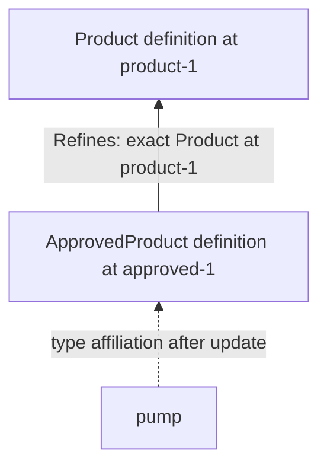

# Canonical Types CLI

This companion explains how to use Type contracts through the
[general canonical CLI](bdp-cli.md). The [Type definitions](../../specs/types/type-system/type-system.md)
describe Type, BeadType, LinkType and Refines; the
[Types profile](../../specs/profiles/types/types.md) specifies their detailed
semantics. The companion uses the overview, connected walkthrough and command
reference structure of the [Memory CLI](memory-cli.md).

**Status: design draft.** The walkthrough is informative and its examples are
authored illustrations. The general operations shown here retain their existing
contracts. `bd type list` is an agreed command location with an incomplete command
contract; this document makes that gap visible. It does not select lifecycle
commands or claim support in a particular build.

The [first local authoring sequence](types-first-sequence.md) orders inspection
of BeadType, LinkType, Refines and Type, then the all-Type family view and
BeadType/LinkType-filtered local views, local Refines reads and creation of Foo.
Its step5 is deliberately a disposable placeholder while the broader instance-use
design is discussed. It is not a finalized registration/default workflow. The
[Types1 source binding](../../specs/profiles/types/types-binding.md) describes the
independent protocol-selection obligation; implementation remains separate.

## Using Types (informative)

### Start with an available contract

A Type describes a record's meaning and requirements; the record's affiliation
names an exact definition revision. This example follows a Product Bead as it
gains an approval requirement, using the
[existing Product example](../../specs/profiles/types/types.md#34-the-parent-must-allow-additional-properties).

Assume the workspace already has registered Product at token `product-1` and
ApprovedProduct at token `approved-1`, with a Refines declaration to that exact
Product revision. Product requires `name` and a nonnegative `price` and permits
additional properties, while ApprovedProduct adds required `approvalCode`.
The names resolve to installed Type identities in the selected Scope, and the
tokens are illustrative.

```sh
# Create a Product with its exact registered Type revision.
bd create --id pump --type Product@=product-1 \
  --properties '{"name":"Pump","price":25,"warehouse":"north"}'

```

`warehouse` is ordinary application data allowed by this example's open schema.
Choosing a Type does not discard permitted extra properties. Registration is a
precondition here; creating or retrieving a definition would not establish it.

### Find a Type family or one nominal Type

Product and ApprovedProduct are different nominal Types. A Product-family query
includes records affiliated with Product and those whose exact Type has recorded
conformance to it, directly or transitively. A nominal query selects records
affiliated directly with Product across its definition revisions. These filters
select records, rather than registering Types or changing their affiliations.

```sh
# Find Product records and records of its conforming Types.
bd list --type Product

# Find records whose nominal Type is Product itself.
bd list --exact-type Product

```

The filters use unpinned identities. `--exact-type` means exact nominal identity;
it does not select one definition revision. The shared read contract owns paging,
output selection and refusal when the required family interpretation is unavailable.

### Adopt a more specific contract

The pump can become an ApprovedProduct when its complete resulting state meets
that contract. Supplying the new affiliation and the approval code together lets
the service validate one resulting change. The record keeps its identity and its
permitted existing properties. A failed check leaves the original record intact.

```sh
# Retype the same record and supply its newly required approval code atomically.
bd update pump --type ApprovedProduct@=approved-1 \
  --set-property approvalCode=A-17

```

The `warehouse` value remains present unless an explicit edit changes it.
The approval requirement joins Product's requirements; it cannot waive the
nonnegative-price rule. The exact affiliation changes under the shared revision,
authorization and mutation rules.



The solid arrow is the definition's recorded Refines declaration. The dashed
arrow illustrates the instance's distinguished affiliation field, which is not
an additional incident Link. This diagram describes the assumed definition graph;
the walkthrough does not create or register those definitions.

### Continue using the recorded revision

An ordinary content edit can omit Type and retain the complete existing
affiliation. Installing a later definition or changing a local default does not
move this record to it. Explicit retyping is a separate authored action. The
general CLI owns guards, retry behavior and the [scalar-or-text interpretation](object-edits.md#deterministic-lowering) that
makes `price=30` a numeric value.

```sh
# Change one property while preserving the exact ApprovedProduct affiliation.
bd update pump --set-property price=30

# Read the resulting Resource through the ordinary point-read command.
bd show pump

```

Ordinary historical Resource reads require the shared History contract.
An exact definition lookup instead has an explicit interpreting Scope and
preserves the complete definition/origin wrapper. The
[exact-definition seam](exact-definition-read.md) defines that distinction;
the public Type-command spelling for it remains to be selected.

## CLI specification

### General CLI rules used here

The general CLI is the authority for shared parsing and operation behavior.
This companion groups the relevant rules so that a reader can find them without
duplicating their definitions.

| Topic | Shared contract |
| --- | --- |
| Scope, complete IDs and exact References | [Scope and References](bdp-cli.md#scope-references-and-exact-values) and [reference parsing](scope-and-references.md#revision-selectors). |
| Creation and ordinary updates | [General command inventory](bdp-cli.md#command-inventory-and-native-correspondence) and [object edits](object-edits.md). |
| Authored affiliation and omitted Type | [Type affiliations](affiliations-and-owned-state.md#author-a-type-preserve-an-omission). |
| Family and nominal filters | [Type selection](affiliations-and-owned-state.md#select-by-nominal-type-or-family). |
| Paging and completeness | [Reads and paging](reads-and-paging.md). |
| Human and machine output | [Read output descriptors](read-output.md). |
| Exact definition interpretation | [Explicit interpreting-context seam](exact-definition-read.md) and the [common definition-read contract](../../specs/profiles/core/type-definition-read.md). |
| Errors, writes and required observations | [Shared output and errors](bdp-cli.md#honest-output-errors-and-required-events). |

The `bd` spelling used in the examples follows the canonical hierarchy. The
retained general candidate also uses `bdp` as its executable name; that naming
distinction does not create another operation contract.

### Common Types rules

#### Names, exact affiliations and filters

Literal installed Type names are resolved through the selected catalog to their
actual Type identities. A Type identity is a whole Scope-defined ID or admitted
absolute URI; no mandatory `types/` prefix or Resource-kind inference is added.
Definitions, instance affiliations and Refines declarations retain their distinct
roles.

| Context | Meaning |
| --- | --- |
| Authored `--type TYPE` on a write | Explicitly select the affiliation; under Types, the service resolves unpinned input once to its eligible registered exact default. The CLI never resolves it during compilation. |
| Authored `--type TYPE@=TOKEN` | Explicitly select the named exact definition revision, subject to the profile's availability and admission rules. |
| Omitted `--type` on an update | Preserve the whole existing affiliation, including its exact revision. |
| Read filter `--type TYPE` | Select the Type family through the applicable recorded conformance. |
| Read filter `--exact-type TYPE` | Select the nominal Type identity across its definition revisions. |

These are summaries of the linked shared rules. They do not add a Type-specific
flag or change which flags a general command accepts. A filter is not a write
default lookup, and a display name or alias is not a second Type identity.

#### Definition presence and availability

An ordinary graph can store a Type-definition Bead without making that Type
available for instantiation. Registration, retained interpretation, default
selection, retirement and publication authority remain distinct under the
[lifecycle rules](../../specs/profiles/types/types.md#72-definition-origin-installed-identity-and-publication-authority).
Installed foreign definitions keep their canonical identities. Cache presence
and successful reads supply no implicit registration or write authority.

#### Complete records and faithful composition

When a Type-aware operation interprets an exact affiliation, it must preserve
the exact definition and recorded origin context required by the shared lookup.
Reading a child alone is not proof of a complete dependency interpretation.
Current incident-Link pages cannot replace a definition revision's captured
declarations, and separate list pages do not establish a coherent graph snapshot.

The CLI must not strengthen the underlying guarantees by presentation. If a
future convenience cannot be lowered faithfully, its contract must require the
needed capability or refuse. The mapping belongs in the general CLI and the
matching protocol source when its command signature is selected.

### Type commands

#### `bd type list` — command contract still open

The one agreed Type command location is for Type discovery. Its complete
invocation and result contract have not been selected. The headings below record
what must be supplied before this can be a complete canonical command entry.

##### Usage

```text
bd type list
```

This records the command location only. It does not settle positional Scope
syntax, accepted options or executable availability. The `[SCOPE]` entry in the
current general inventory is a deferred placeholder, not a complete argument grammar.

##### Arguments

| Argument | Selection status | Meaning |
| --- | --- | --- |
| Scope selection | Unselected | Must follow the coordinated general Scope contract once the command's invocation is bound. |

##### Flags

No command-specific flags or set of accepted shared flags is selected yet.
The completed entry must list every accepted flag, default and conflict, linking
shared definitions rather than duplicating them. Output and paging flags must
not be assumed merely because ordinary Resource collections accept them.

##### Behavior

The Types profile distinguishes available retained definitions from ordinary
local graph inventory and from opportunistic cache entries. The eventual command
must specify which population it exposes and how eligibility, retirement and
multiple retained revisions are represented. Discovery supplies no registration,
default selection or publication authority.

The current source does not select filters, ordering, paging, completeness bounds
or an inventory endpoint. Those are command and protocol binding decisions still
needed for this entry.

##### Results

The inventory payload, result descriptor and human presentation remain
unselected. In particular, a general Resource collection does not automatically
represent the Scope's installed foreign definitions or their local availability.
No sample inventory is presented as captured output.

##### Errors and exit status

The completed command must map actual diagnostics through the shared CLI error
contract. Feature absence, denied access and unavailable retained definitions
must remain distinct where the underlying operation distinguishes them. No new
exit-status assignment or unsupported-operation fallback is selected here.

##### Canonical CLI correspondence

This command location belongs to the general CLI inventory; there is no selected
faithful lowering yet. `bd list --type BeadType` is an ordinary graph query, not
an implementation of the Scope's available-Type inventory. It does not by itself
include registered foreign definitions or establish local eligibility.

##### Examples

The walkthrough above uses already registered Types through existing general
operations. A complete `bd type list` example awaits the selected invocation,
population and result contract. This gap must be resolved in source before an
example can serve as an implementation target.

## Remaining command design

| Area | Existing semantic boundary | Still to specify |
| --- | --- | --- |
| Type inventory | Available definitions differ from local graph inventory and cache presence. | Complete list invocation, population, flags, paging, results and protocol binding. |
| Exact definition inspection | An exact Reference and explicit interpreting Scope select a complete definition/origin result. | Public command signature and honest output descriptor; ordinary show/History remains distinct. |
| Local definition authoring | Definition Beads use the ordinary model; storage alone does not register them. | Any specialized command conveniences and their exact general-operation mapping. |
| Acquisition and registration | Required exact closure is admitted explicitly and atomically; initial use/import requires registration. | Operation syntax, permissions, diagnostics and any deliberately combined operation. |
| Local write default | Explicit selection affects future unpinned writes, not stored affiliations. | Selection and removal operations and their permission contract. |
| Retirement and removal | Retirement preserves retained meaning and existing use; removal has retention obligations. | Concrete operations, authorization and retention policy. |

These gaps belong to [BDP59](https://github.com/gastownhall/bdp/issues/59) and the
[Types correspondence work](https://github.com/gastownhall/bdp/issues/282).
The historical [Type CLI proposal](https://github.com/gastownhall/bdp/blob/cbd59b601875ec5c20dd189c22a95ccad4b33390/docs/design/type-cli-proposal.md)
contains earlier command ideas; it is not a source for reviving superseded names,
automatic availability on creation or unselected lifecycle behavior.

## Sources and implementation correspondence

The descriptor specification owns field meanings, and the Types profile owns
detailed conformance and enforcement. The general CLI owns shared syntax and
wire mapping; this companion owns its explanatory Type workflow and the visible
status of the Type-command reference. Changes crossing those boundaries need
paired review. The general CLI needs a paired navigation link to this companion; its source is owned by the
common CLI workstream and is unchanged in this editorial pass.

The documentation structure follows the completed Memory editorial pass and the
[Memory specification's organization](https://github.com/gastownhall/bdp/blob/21fa91d3e189bff3832bd977c3d6be49f2b5d93c/specs/types/memory/memory.md).
That structural precedent does not adopt a different Type catalog. No shell
example here is runtime evidence. The selected fixed-catalog Memory product,
general Type-definition provider and broader Types CLI retain their separate
implementation and qualification states.
