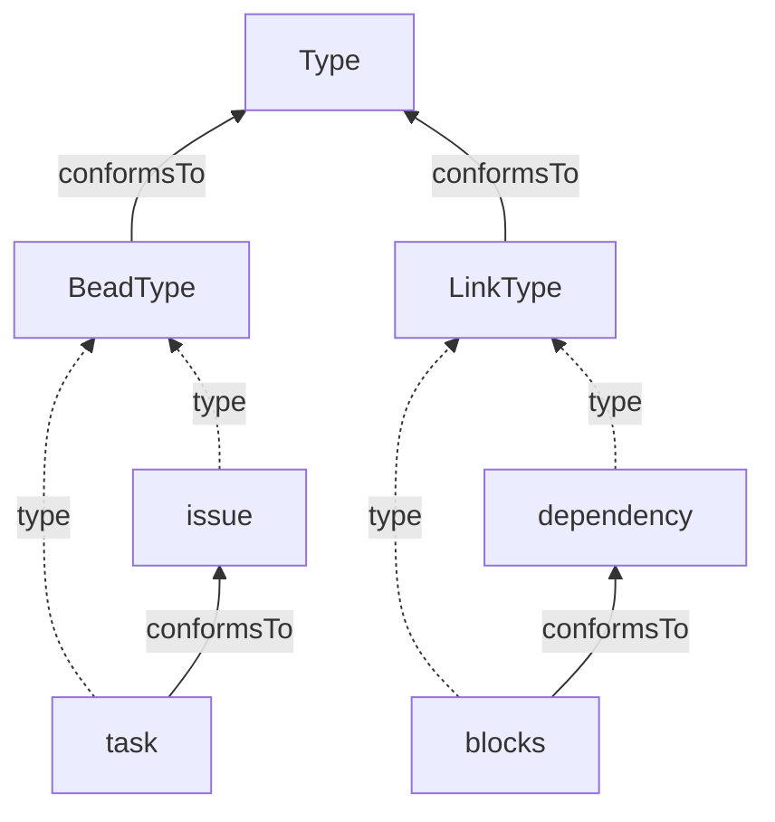
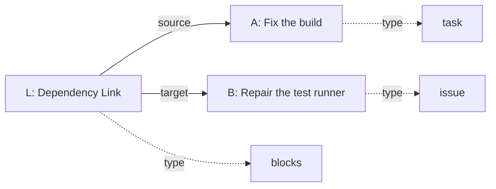

# Proposal: Bead and Link Types

Draft for discussion, October 15, 2026. Intended for an issue in
`gastownhall/beads`; not yet posted. This proposal covers the model and the Beads CLI. The shared rules are being
developed in public [draft BDP PR #60](https://github.com/gastownhall/bdp/pull/60),
including its [Types design draft](https://github.com/gastownhall/bdp/blob/codex/trish-bdp-design-authority/specs/types.md).
That draft is not an adopted BDP specification.
Command spellings remain proposals. The supporting design record is
[BDP #59](https://github.com/gastownhall/bdp/issues/59).

## Proposal

In the shipping product, built-in Bead and Link Types are effectively hard-coded,
and the constraints they impose on Issue/Dependency graphs are enforced by
imperative code. Users can configure additional categorization labels, but adding
new Type-specific behavior or validation generally means changing code through PRs.

As we generalize the graph model beyond Issues and Dependencies, this is a good
time to look at how we define Bead and Link Types and manage them within a workspace.

This proposal defines a model for Bead and Link Types, including schemas for their
properties, constraints on their relationships, and declarations of Type-to-Type
conformance. The initial authoring surface is the CLI, with a `bd type` command
prefix for operations on or related to Types.

## How Types have worked so far

Beads began with a concrete domain: work items and their dependencies. An Issue
has a classification such as `task`, `bug` or `epic`; a Dependency has a relationship
classification such as `blocks` or `parent-child`. The application knows what those
classifications mean. Some names select behavior, and configurable names extend
categorization. Validation and workflow rules largely live in the application.

Graph Preview 2 introduces explicit Bead/Link Type descriptors and an installed
catalog. It also makes existing classifications usable through familiar CLI Type
selectors. `bd types` helps users discover available choices; detailed/JSON output
exposes installed definitions. This is useful groundwork, but the inspected code
still treats the catalog as a fixed installation rather than arbitrary user-authored,
versioned definition Beads. Existing Issue and Dependency classifications are being
brought forward as intrinsic Types.

The proposed domain hierarchy preserves established vocabulary and behavior:
`task`, `bug` and the other work-item Types conform to `issue`; `blocks`,
`parent-child` and the other relationship Types conform to `dependency`. This does
not invent new scheduling semantics or turn every Dependency into a blocking Link.
Existing storage classifications can be translated at the graph boundary as the
implementation evolves. That translation is a compatibility task, not a reason to
retain `issue_type` or `dep_type` as duplicate authorities in the proposed properties.

The next step is to let people author their own definitions, evolve them without
silently changing old records, and reuse contracts across applications. Adding a
new label alone does not answer what properties it supports, what its relationships
mean, or whether an existing record can safely adopt it.

## What we need from Types

| Need | User question | Proposed capability |
| --- | --- | --- |
| Categorization | “What kind of thing is this, and how do I find related kinds?” | A stable Type identity; explicit conformance lets a query for a general Type include more specific Types |
| Schematization | “What properties can this thing have, and what do they mean?” | A JSON Schema for properties and documentation of their meaning |
| Relationship constraints | “What kinds of Beads can this Link connect, and in what combinations?” | Allowed source/target Type pairs, plus participation counts, pair uniqueness and cycle restrictions |
| Conformance testing and enforcement | “Does this record satisfy that contract, and will writes preserve it?” | Prospective checks against a proposed Type; write-time enforcement of supported structural and graph requirements; explicit author responsibility for meaning that cannot be mechanically proved |

A Type can have open properties with no required application fields, or a schema
that requires particular structure. Both participate in categorization and declared
conformance. The definition makes those promises explicit.

Three questions must remain distinct:

1. **Affiliation:** what Type revision is recorded on this Bead or Link?
2. **Declared conformance:** what other exact contracts does that Type promise to
   satisfy, directly or transitively?
3. **Prospective acceptance:** would this particular record or proposed graph state
   pass the enforceable requirements of another Type?

Passing a prospective check does not add a conformance declaration to the record's
current Type. Two unrelated Types can happen to accept the same JSON without
meaning the same thing.

For example, ApprovedProduct can conform to Product while adding a required
approval code. A reader relying on Product's guarantees can understand the shared
fields. An update still has to preserve ApprovedProduct's additional requirements;
a full replacement that omits its required approval code fails. Conformance is
not permission to ignore the actual Type when writing.

For Link Types, the contract can also say which source/target combinations are
allowed, how many Links may meet at an identity, whether a pair must be unique,
and whether a Link may participate in a cycle. These checks concern the Scope's
own graph. They do not imply validating arbitrary external resources. Supported
graph invariants are checked against the final state of an atomic change, including
affected surrounding records; open properties alone do not waive those rules.

Schemas also cannot establish every semantic promise. A numeric `price` interpreted
as dollars is different from one interpreted as cents, even if their JSON shapes
are identical. Definitions must document meaning; validators enforce the vocabulary
and constraints they understand, while diagnostics distinguish those checks from
semantic claims requiring human or application review.

## The model

**A Type definition is a Bead.** Its `properties` describe the properties and
relationships permitted for instances of that Type. A schema is part of that
descriptor; it is not a separate resource.

Three foundational Bead Types organize the definitions:

- **Type** is the common contract for Type definitions.
- **BeadType** conforms to Type. Its instances define Bead Types.
- **LinkType** conforms to Type. Its instances define Link Types. A Link-Type
  definition is a Bead, even though the things it describes are Links.

**ConformsTo** is a Link Type. Its Links say that one Type promises to satisfy
another Type's contract. The source and target must both define Bead Types or both
define Link Types. Conformance can add requirements or narrow permissions, but it
cannot withdraw inherited promises.

Here is a small definition graph. Solid arrows are ConformsTo Links. Dashed arrows
show `type` fields; they are references, not additional graph Links.



The bootstrap affiliations of the foundational definitions are intentionally
omitted here. They are not needed to understand authoring and using Types.

Now some work records can refer to those definitions. The Link record is drawn as
a box so that its fields can be shown; it remains a Link, not a Bead vertex.



Because task conforms to issue, A can satisfy an issue Type constraint. L is a
blocks Link and therefore also satisfies dependency through declared conformance.
Its existing domain meaning is preserved: A depends on B, so B blocks A.

An ordinary Bead or Link has one distinguished `type` reference. This is how it
selects its definition; it does not require an extra affiliation Link. Displaying
an Issue's work graph does not automatically traverse into the Type hierarchy.
The hierarchy itself is available to ordinary graph tools.

Canonical identity comes from the resource ID. Generic resource aliases can make
references friendlier. There is no separate Type-name identity or Type-specific
display-name setting; aliases do not change equality or conformance.

## Revisions, briefly

Definitions evolve using the same revision model as other Beads. Each instance
pins the exact Type-definition revision it uses. Editing a definition does not
silently change existing instances; changing affiliation is an explicit update.

ConformsTo Links also pin their target definitions and are owned by their source
definition. “Owned” means changing a declaration produces a new source-definition
revision. Older definitions retain the declaration state that gave them meaning.
Conformance is transitive and must not form a cycle through exact revisions.

A pinned constraint such as `Product@r1` requires that exact contract, directly or
through conformance. An unpinned `Product` constraint deliberately accepts any
revision of that identity or conformance to one; it does not resolve “latest” on
each check. Stored affiliations and declaration targets remain exact pins.

Optional SemVer is still an informational-label proposal. It would not replace
resource revisions or prove compatibility.

## Why model definitions as Beads?

A Type definition needs many of the things ordinary Beads already need. Reusing
that model gives us one coherent way to address, revise, inspect and relate them.

| Existing graph mechanism | What it gives Type definitions |
| --- | --- |
| Stable Bead identity and exact revision references | A Type can evolve while old instances keep the precise contract they were written against |
| Common Bead/Link representations and BDP operations | Definitions use the same resource envelope, addressing, revision and ownership rules as other graph data |
| Ordinary CLI create/show/update/delete/versions/compare | Definitions remain accessible through familiar operations; specialized commands add conveniences rather than another persistence model |
| Atomic writes and owned Links | Editing a conformance declaration revises the owning definition coherently and preserves its historical declaration set |
| Explicit Links and graph traversal | The conformance hierarchy is a real graph that generic graph tools can display and inspect |
| Common metadata and revision attribution/provenance mechanisms | Changes to definitions and declarations can use the same contextual information as other changes, as those mechanisms become available |

We could keep a separate descriptor store and implement these capabilities again.
Choosing Beads makes the shared mechanisms the architectural contract. It does not
mean all the required implementation already exists, or that graph traversal alone
is a sufficiently fast conformance-query implementation; indexes may still be needed.

There are costs. The first metatypes need a trusted bootstrap; historical Type
meaning requires retained definitions and declaration revisions; and generic
editing must enforce Type integrity just as carefully as specialized commands.
Those obligations must hold through ordinary graph operations as well as the
specialized Type commands.

## Shared BDP semantics and Beads behavior

The proposed BDP Types profile defines the shared meaning of definitions, conformance,
matching and constraints. It is optional and Scope-wide. Core defines the common
resource/reference/revision contract without requiring every Type reference to
point to a Bead or every server to implement this particular Type system. Servers
advertising this Types profile use Type-definition Beads and its shared rules.

Beads supplies command syntax, short-reference/alias resolution, presentation,
file inputs, storage, indexes and operator workflows. The same validation applies
whether the caller uses a specialized command, an ordinary graph command, or a
supported protocol operation. BDP and Beads must be brought into alignment through
coordinated changes; this proposal does not describe the draft as today's wire format.

## Operational rules

Make Type Beads practical to author using both ordinary graph operations and
specialized commands. The specialized commands supply file-reading, convenient
arguments, presentation and diagnostics; they do not maintain another Type store
or bypass validation available through ordinary Bead/Link operations.

The proposed operating rules are:

- Types are Beads under the optional BDP Types profile. BeadType and LinkType
  conform to Type; ConformsTo declarations are owned Links with exact target pins.
- Successful local creation of a valid definition makes its exact revision usable;
  no separate activation/publish command is needed now.
- Canonical identity comes from the resource ID. There is no required independent
  name. Friendly aliases may provide convenient references; alias storage,
  collisions, Scope lookup and pin resolution still need a precise CLI contract.
- Existing instance affiliations never move when a definition is revised.
- Instance retyping is an explicit ordinary update, optionally combined with
  properties changes atomically. Proposed `--set-type` requires `--if-revision`.
- No general migration engine. Atomic batch applies caller-authored changes;
  prospective checking diagnoses a supplied change rather than inventing repairs.
- Import/export is a separate, parked design exercise. No package format or
  foreign-identity installation rules are selected by this proposal.

## Proposed surface

Command spelling is review syntax. Resource/Type arguments use the common reference
system. The examples' `ID@REVISION` spelling is illustrative; parsing/escaping and
legacy `--version` compatibility still need specification.

| Command | Purpose | Contract |
| --- | --- | --- |
| `bd type list` | Catalog | Preserve `bd types` as an equivalent spelling; readable/JSON output, separate Bead and Link categories |
| `bd type show TYPE_REF` | Stored definition | Declared schema/constraints, identity, selected revision and other descriptor fields |
| `bd type create --bead ...` | Author a Bead Type | Creates a Bead affiliated with BeadType; same validation as ordinary create |
| `bd type create --link ...` | Author a Link Type | Creates a Bead affiliated with LinkType; endpoint constraints remain descriptor data |
| `bd type update TYPE_ID ...` | Edit definition | New definition revision; existing instance affiliations preserved |
| `bd type delete TYPE_ID ...` | Delete definition | Subject to unfinished reference/retention policy; no implicit cascading destruction |
| `bd type explain TYPE_REF` | Effective contract | Inherited schemas/constraints and their origins; explain local breadth versus inherited restrictions |
| `bd type validate TYPE_REF` | Definition integrity | Check schema syntax, closure, category, cycles, contradictions and supported semantics |
| `bd type check RESOURCE_ID --against TYPE_REF` | Prospective affiliation check | Check hypothetical final state, including affected neighboring Links, without mutation |
| `bd type compare OLD_REF NEW_REF` | Contract differences | Explain mechanical differences and identify where compatibility needs semantic review |

Ordinary `bd show`, `update`, `versions`, `compare`, `delete`, `link` and generic
`graph` remain routes to the same records. Do not duplicate every generic command
under `bd type` without a Type-specific benefit.

`bd types` already ships in
[v1.3.1](https://github.com/gastownhall/beads/blob/v1.3.1/cmd/bd/types.go), so this
proposal preserves it as a familiar spelling rather than removing an existing
command. Exact legacy options and machine-output compatibility need reconciliation
when `bd type list` is introduced.

## Create and update affordances

| Argument | Meaning |
| --- | --- |
| `--bead` / `--link` | Select one definition category on create |
| `--id ID` | Explicit resource identity under the normal ID rules; requiredness/default allocation still to finalize |
| `--schema FILE` | Read and embed the file as propertiesSchema; does not persist a mutable file/URL dependency |
| `--properties JSON` | Existing Preview 2 convention for other descriptor properties |
| `--conforms-to TYPE_REF` | Repeatable create-only convenience; create the initial owned declarations with exact target pins atomically |

```sh
bd type create --bead --id approved-product \
  --schema approved-product.schema.json \
  --conforms-to Product@REVISION

bd type update approved-product \
  --schema revised-product.schema.json \
  --if-revision CURRENT_REVISION
```

Omitted fields on update remain unchanged. Supplying the same property through
both a convenience flag and `--properties` fails, matching Preview 2's duplicate
input principle. Schema replacement is explicit, not a hidden schema merge.
Keep normal supported attribution/message/source controls consistent with generic
commands as those controls land; do not invent a second provenance envelope here.

Initial definition plus ConformsTo Links form one atomic operation. Later
conformance editing uses ordinary `bd link create/update/delete`: declarations
have identity, properties and provenance that replacement-list conveniences must
not silently discard. Generic property edits cannot change owned declarations.

An open-schema default is proposed: omitted `--schema`
materializes an explicit open object schema, with no required application fields.
The descriptor still contains propertiesSchema. It does not mean skipping validation
of the Type-definition envelope, category, closure, ownership or conformance graph.
For Link definitions, an explicit baseline endpoint policy must also be selected;
local Beads with wildcard Types is a bounded candidate, not a selected universal default.

## Changing an instance's Type

```sh
bd update BEAD_ID --set-type TYPE_REF \
  --properties '{"approvalCode":"ABC"}' --if-revision CURRENT_REVISION

bd link update LINK_ID --set-type TYPE_REF --if-revision CURRENT_REVISION
```

Retyping is an explicit single-resource update. Omission
preserves the whole existing exact affiliation. Supplied target replaces that
reference as a whole; floating author input resolves once before commit. Require a
revision precondition for this operation. Validate the proposed complete properties
and affected graph atomically. No hidden latest-Type upgrade on ordinary edits.

Editing a Type definition's schema and retyping an instance are different changes.
`bd type update Product --schema ...` does not move Product instances or change
Product's own metatype affiliation.

## Checking and diagnostics

`validate` examines a definition. `check` examines proposed use of a definition on
particular Beads/Links, whether or not they already carry that affiliation. Passing
check is not a new declaration that their old Type conforms to the proposed Type.

Checking a graph requires a caller-authored mapping of records to target Types and
any property changes. Its input format remains open and must align with atomic
operation planning. Checks include affected surrounding Links, even outside the
selected input set. Execution must revalidate against current state/preconditions.

Report machine-checkable properties/relationship results separately from author
semantic obligations. A tool cannot discover every dollars/cents change or certify
semantic compatibility from JSON structure. It must not report unimplemented
constraint checks as passed. Exact diagnostic JSON/exit codes remain to specify.

`explain` should identify why a rule applies, for example: a local maximum of two
is narrowed by an inherited maximum of one, naming the exact defining revision.
For per-Link acyclicity, prospective cycle checks traverse all family revisions.
A future whole-family preflight can help operators see old cycles before adoption;
it must not redefine or waive the per-Link protocol invariant. No new flags selected.

## Relationship-constraint requirements

The target model needs the following behavior. The detailed descriptor vocabulary
and some interactions remain open for review; these requirements do not claim that
the current product implements them.

| Requirement | Intended meaning |
| --- | --- |
| Allowed endpoint pairs | A Link must match both sides of at least one allowed pair; for example `(Person → Task) OR (Team → Task)` |
| Type alternatives and wildcards | Each side accepts an OR-list of Type references, or an unrestricted wildcard; Type matching includes declared conformance |
| Correlated endpoint categories | ConformsTo permits `(BeadType → BeadType) OR (LinkType → LinkType)`, preventing cross-kind declarations |
| Participation counts | Bead Types can require minimums/maximums; Link Types can impose maximums. Count across endpoint alternatives and conforming Types per endpoint identity |
| Ordered-pair uniqueness | A constrained Link's source/target pair must be unique within the applicable family population, including other revisions |
| Per-Link acyclicity | A constrained Link cannot participate in a directed cycle; cycle traversal includes all current Links in the applicable family |
| Inherited requirements | Every inherited constraint applies; a local declaration cannot loosen it |
| Atomic enforcement | Validate graph invariants against the final transaction state, permitting temporary violations repaired within the same atomic operation |

Endpoint pins do not create extra arity or uniqueness allowances; those checks use
endpoint identity. Existing constraints continue to apply until an explicit change
removes their applicability. Introducing a new Type revision does not impose its
new requirements on unrelated old records.

Checks use the storing Scope's own Link table. External references remain references;
this model does not promise to validate or monitor outside resources. The rules for
local endpoint deletion and changing a floating endpoint's Type still need precision.

## Open questions

- **Endpoint-constraint description:** finalize the representation of allowed
  pairs, Type-reference arrays/wildcards and local-versus-external endpoint policies.
  The requirements above are the intended behavior, not a frozen schema format.
- **Definition removal and retention:** what can be deleted while instances,
  dependent definitions and historical records still reference it?
- **Bootstrap:** how do the foundational definitions acquire their identities and
  pinned references through the normal versioning model?
- **Type evolution:** finish the rules for inherited constraint revisions and
  local floating-endpoint revalidation, preserving explicit migration and old pins.
- **CLI details:** finalize alias resolution, file/stdin conventions, prospective
  graph-change input, diagnostics and machine output, including existing `bd types`
  compatibility.
- **Validation limits:** define required mechanical checks and the boundary between
  supported semantic vocabularies and author-attested meaning.

Import/export, a general migration engine and deeper provenance questions are
separate discussions. Implementation sequencing is deliberately outside this
proposal's target-design review.

## Feedback requested

- Does the distinction between categorization, schemas and conformance cover the
  Types people need to author and use?
- Do Type Beads and owned ConformsTo Links give us a useful common model without
  unnecessary authoring burden?
- Does the CLI make definition integrity, prospective adoption and actual changes
  easy to distinguish?
- Do the relationship-constraint requirements express the graph rules people need,
  without implying guarantees about resources outside the Scope?
