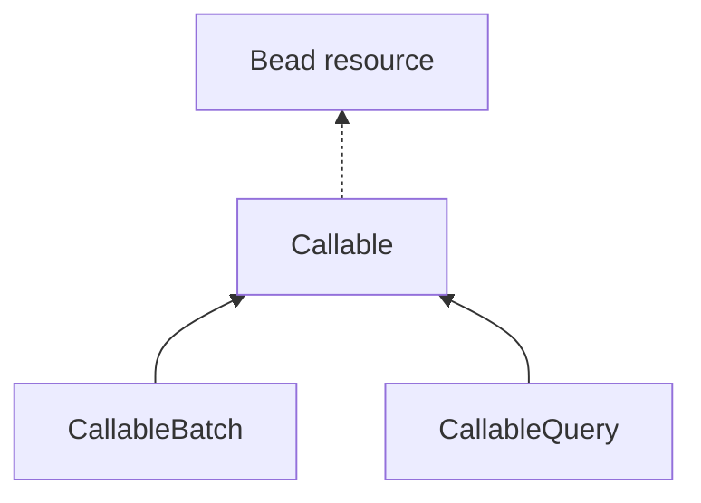

# Callable Beads

> **NON-NORMATIVE EXPERIMENTAL DRAFT. NOT THE PLAN OF RECORD. NOT A RELEASED CAPABILITY OR AN IMPLEMENTATION CLAIM.**
>
> Donna requested this starting specification under Experimental. It records her selected direction and makes remaining author proposals explicit. [BDP #59](https://github.com/gastownhall/bdp/issues/59) remains the shared plan; [specs/](../specs/README.md) remains the selected protocol front door.

This editable Specification follows the [Memory catalog](https://github.com/donnabox/memory-beads/blob/cc32cba35758a8dbbd89d5cf953c7035203cd836/specs/type-packages/memory-references/memory-and-references.md) and its [Markdown authoring bundle](https://github.com/donnabox/memory-beads/blob/cc32cba35758a8dbbd89d5cf953c7035203cd836/specs/formats/markdown-bead-bundles.md). Its H1 is the Specification title; its identity is explicitly unassigned. The Type and Scenario indexes project candidate source-owned definition Links. File paths, heading anchors and schema identifiers do not assign Bead or Link identities or establish installed Types.

## Scope and selected direction

A **Callable** is a Bead describing a named, parameterized operation that a supporting service can invoke over BDP. It can be defined and invoked without package installation. This Specification depends on existing Types and Batch/Query contracts, and has no dependency on a package Specification. Parameter declarations, argument projection, execution and direct invocation form its standalone boundary.

| Status | Content |
| --- | --- |
| Donna's direction | Callable base and Batch/Query refinements; common help, declared parameters, declarative CLI projection; adopted AST or service-side Go extern implementations; independence from Packs. |
| Donna's transport decisions | Batch POST; named Query GET with an explicit query-string invocation mode and Query POST with JSON arguments; normal Bead GET retrieves the definition. The example ?call was illustrative, not selected syntax. |
| Donna's parameter decision | JSON value schemas for declared parameter values. |
| First-pass author proposals | Abstract Callable; required description/parameter array; optional CLI mapping; body XOR extern in each concrete refinement; field spellings, schema factoring and default rules below. |
| Still open | Parameter binding into executable bodies, full argument/result carriers, exact definition closure, extern implementation identity, capability/version selection, mode-selector grammar and mount registration. |

Ordinary authorization, capability admission, Type interpretation, result semantics and mutation guarantees remain applicable. Definition packaging, installed command trees, shortcut collisions, package visibility and physical distribution are outside this Specification; none is required to define or directly invoke a Callable. Go deployment is outside the callable declaration contract.

## Bead Types

Each named definition below is intended to be an addressable Bead affiliated with BeadType, defined by this Specification. This is the authoring bundle's definition index; it assigns no stored identities or Links.

| Bead Type | Meaning |
| --- | --- |
| [Callable](#callable--bead-type) | Common operation help, parameter contract and reusable CLI argument projection. |
| [CallableBatch](#callablebatch--bead-type) | Invocable update operation implemented by a selected Batch body or service-side Go extern. |
| [CallableQuery](#callablequery--bead-type) | Invocable read-only operation implemented by a selected Query AST or service-side Go extern. |



Solid arrows mean Type refinement, child to parent. The dashed arrow identifies the Resource category; it does not introduce a universal Bead supertype. Callable is proposed abstract. These names are draft labels, not Type Bead identities or a new declaration language. Actual refinement uses the existing [Refines](../specs/types/type-system/type-system.md#refines--link-type) contract with an exact captured parent definition; no refines descriptor property is introduced.

### Callable — Bead Type

**Meaning and use.** Common contract for a named operation. A proposed abstract base; concrete Batch/Query refinements remain directly usable under ordinary Types rules. A Callable's operation identity is independent of its CLI spelling or operational mount.

**Conforms to.** None within this catalog. It is the parent of CallableBatch and CallableQuery.

**Properties.** These rows constrain a Callable instance's properties, rather than the Type-definition Bead's descriptor. Table headers and representable Type expressions follow the Markdown schema DSL; the complete-schema limits are explicit below.

Other fields: allowed

| Name | Type | Required | Defined by | Meaning |
| --- | --- | --- | --- | --- |
| description | text | yes | Callable | Standard help for this operation. |
| parameters | array of Parameter | yes | Callable | Declared named arguments; an empty array is allowed. |
| cliMapping | CliMapping | no | Callable | Reusable flag and positional mappings; does not choose a command route. |

The base remains open so refinements can add body, extern or later typed properties. [Existing composition rules](../specs/profiles/types/types.md#3-conformance-in-plain-language) conjoin ancestor and child constraints against the same unchanged properties object. The [Type descriptor already has optional description](../specs/types/type-system/type-system.md#type--bead-type); it describes a Type definition. Callable.description describes the instance operation. No intrinsic Type/schema change is needed to add operation help.

**Owned outgoing Link Types.** None declared by this draft. Type-descriptor mechanics such as Refines remain governed by Types; they are not outgoing Links owned by callable instances.

### CallableBatch — Bead Type

**Meaning and use.** A named update operation. Its local properties schema requires exactly one implementation: body or extern. This exclusive choice is an author proposal. The selected Batch engine keeps its atomic owner, order, guards, final publication, complete result and durable retry semantics.

**Conforms to.** Callable, through its exact definition. Concrete; abstract is false by the ordinary Types default.

**Properties.** Inherited rows are shown with their origin. Both local implementation fields are individually optional; the separate exclusive-choice constraint requires exactly one of them.

Other fields: allowed

| Name | Type | Required | Defined by | Meaning |
| --- | --- | --- | --- | --- |
| description | text | yes | Callable | Standard operation help. |
| parameters | array of Parameter | yes | Callable | Declared named arguments. |
| cliMapping | CliMapping | no | Callable | Reusable flag and positional mappings. |
| body | BatchBody | no | CallableBatch | JSON representation of the explicitly selected Batch contract. |
| extern | ExternBinding | no | CallableBatch | Declared lookup for a service-side Go implementation. |

BatchBody refers to the common schema's [batchRequest](../specs/profiles/core/bdp-v0.1.schema.json) in the first structural companion. This is the retained six-CRUD optional atomic-batch version 1 carrier: a precise **literal-body baseline**, not adoption of richer read/set/query selection or parameterized Batch encodings. The existing [Batch source](../docs/cli-design/atomic-batch.md) requires an independently selected/versioned contract for stored parameterization.

**Owned outgoing Link Types.** None declared by this draft.

### CallableQuery — Bead Type

**Meaning and use.** A named read-only operation. Its local properties schema likewise requires body XOR extern. Either implementation preserves the selected List/Graph/Query subset, Resource editions, completeness/count and error meanings. POST does not grant mutation authority.

**Conforms to.** Callable, through its exact definition. Concrete; abstract is false by default.

**Properties.** Inherited rows retain their origin. Exactly one local implementation field must be present.

Other fields: allowed

| Name | Type | Required | Defined by | Meaning |
| --- | --- | --- | --- | --- |
| description | text | yes | Callable | Standard operation help. |
| parameters | array of Parameter | yes | Callable | Declared named arguments. |
| cliMapping | CliMapping | no | Callable | Reusable flag and positional mappings. |
| body | QueryBody | no | CallableQuery | Selected JSON Query AST. |
| extern | ExternBinding | no | CallableQuery | Service-side Go implementation of the read contract. |

QueryBody refers to the [existing Query AST schema](../docs/cli-design/query-ir/query.schema.json), SHA-256 bf5fbf0b89f74273122c28b944907dd3e0fdb057d9266fdee4de9c0dfcbaeaa8. It adds no parameter nodes or arbitrary scalar/computed-record results. Query result-contract declaration and the exact native wrapper remain adoption work; storing a Query cannot silently widen its evaluator or History capability.

**Owned outgoing Link Types.** None declared by this draft.

## Shared value shapes

These are property value shapes, not additional Bead Types. Field spellings, requiredness, explicit defaults and CLI details remain first-pass author proposals. Only the choice of JSON value schemas for parameter values is selected.

### Parameter

Other fields: not allowed

| Name | Type | Required | Defined by | Meaning |
| --- | --- | --- | --- | --- |
| name | text | yes | Callable | Nonempty exact argument name; names are distinct within one callable. |
| schema | ValueSchema | yes | Callable | Embedded Draft 2020-12 schema for the argument value, object or boolean. |
| description | text | no | Callable | Parameter help, reused by CLI mappings. |
| required | boolean | no | Callable | Proposed default false; omission remains distinguishable from explicit null. |
| default | JsonValue | no | Callable | Explicit callable default for an omitted argument; must satisfy its value schema. |

ValueSchema and JsonValue name contracts retained in JSON below; they are not new DSL primitive tokens. JsonValue admits any JSON value. A callable default is not automatic application of a JSON Schema default annotation.

Proposed admission rejects duplicate declared names, unknown arguments, required parameters without supplied/default values, and incompatible supplied/default values. These are semantic checks beyond structural validation. Required-plus-default behavior and exact Type/Reference resolution remain open. A value schema does not establish Resource kind, nominal Type membership, authorization or exact Reference acquisition; a URI-shaped string establishes none of these either.

### CliMapping

Other fields: not allowed

| Name | Type | Required | Defined by | Meaning |
| --- | --- | --- | --- | --- |
| flags | array of FlagMapping | no | Callable | Mappings from CLI flag spellings to parameters. |
| positionals | array of PositionalMapping | no | Callable | Mappings from zero-based CLI positions to parameters. |

### FlagMapping

Other fields: not allowed

| Name | Type | Required | Defined by | Meaning |
| --- | --- | --- | --- | --- |
| names | array of text | yes | Callable | Nonempty array of distinct nonempty flag names, such as --limit and -l. |
| parameter | text | yes | Callable | Nonempty name of an existing declared parameter. |

### PositionalMapping

Other fields: not allowed

| Name | Type | Required | Defined by | Meaning |
| --- | --- | --- | --- | --- |
| position | integer | yes | Callable | Zero-based nonnegative argument position. |
| parameter | text | yes | Callable | Nonempty name of an existing declared parameter. |

This is declarative data. Flags and positionals have distinct known record shapes. Duplicate/ambiguous flags and positional indexes refuse registration. Supported CLI spelling, Boolean/collection input, aliases, requiredness and decoding need one shared CLI binding contract. Help derives from Callable.description and parameter descriptions; the parameter contract governs validation/defaults, and mapping cannot change it.

The generic client receives the selected declarative argument projection before parsing operation arguments, with only Scope-specific metadata caching. The projection does not choose a friendly command path or grant invocation authority; it needs no operation-specific client installation.

### ExternBinding

Other fields: not allowed

| Name | Type | Required | Defined by | Meaning |
| --- | --- | --- | --- | --- |
| binding | text | yes | Callable | Nonempty name in a service-side Go implementation registry. |

A binding name does not freeze implementation behavior. Availability, input/result compatibility, read-only versus update authority, exact implementation identity and historical/retry behavior require a service contract. Dynamic Go loading is not assumed. Missing implementations refuse under the selected capability/error contract; they are not successful no-ops or unknown-Bead lookups.

## Markdown DSL and JSON coverage

Use the existing [Markdown schema DSL version 0.5](https://github.com/donnabox/memory-beads/blob/cc32cba35758a8dbbd89d5cf953c7035203cd836/specs/formats/markdown-json-schema.md) and [Markdown API DSL version 0.4](https://github.com/donnabox/memory-beads/blob/cc32cba35758a8dbbd89d5cf953c7035203cd836/specs/formats/markdown-openapi.md). Do not treat an informal beadtype block or newly invented table syntax as their replacement.

The catalog above uses their exact property columns, Type vocabulary and Other fields settings wherever representable, while preserving Memory's meaning, conformance and owned-Link descriptions. It is a bundled Type catalog, **not one standalone schema DSL document**. A standalone schema document begins with a schema-name H1, Properties and named Object/Allowed-values sections; flattening this catalog into one would also lose the distinction between Type definitions and value shapes.

The complete [properties-schema companion](callables/callables.properties.schema.json) remains JSON because the current DSL cannot express its complete contract. These gaps are explicit rather than silently weakened:

| Contract | Existing DSL boundary | Treatment in this draft |
| --- | --- | --- |
| Parameter schema and default | Arbitrary JSON values and arbitrary embedded object/boolean schemas are not complete named shapes in the subset. | Preserve ValueSchema and JsonValue contracts in JSON; their names above do not extend DSL syntax. |
| Nonempty names, flag uniqueness and nonnegative positions | String lengths, array cardinality/uniqueness and numeric bounds are unsupported. | Preserve these JSON constraints and show their meaning alongside the table rows. |
| Exact body schema references | Remote schema references are unsupported by the schema DSL. | Preserve the existing Batch/Query JSON references and exact source context. |
| Body XOR extern and inherited conjunction | General oneOf, not and allOf are unsupported. Inclusive OR would change the contract. | Preserve exclusivity and effective schema conjunction in JSON and Type refinement in prose. |
| Callable HTTP operations | The API DSL needs concrete paths, parameters, schemas and response rows; mode grammar, carriers and full responses remain open here. | Keep the behavioral protocol outline below. No invented selector, carrier or status code is emitted as a completed OpenAPI projection. |

A supported isolated schema or future API slice may be authored in those DSLs. No complete DSL translation, compiler or lossless round trip is claimed for this draft. The JSON companion is a structural projection, not an installable Type graph; its effective helpers do not create Refines Links or enforce abstractness/registration. The Specification remains the drafting home for semantic decisions the schema cannot enforce.

## Direct CLI invocation

The direct entry is independent of package installation. Client options precede the callable; subsequent arguments use its CLI projection:

```text
bd [client options] call CALLABLE [callable arguments]
```

A callable at chris/sells/laughs is invoked as bd call chris/sells/laughs. A projected --times flag gives bd call chris/sells/laughs --times 3. Callable-specific help is available without execution; the exact help control and generic JSON-argument input still need a spelling/collision pass. CallableBatch and CallableQuery share this entry, with execution following their respective BDP contracts.

The client reads the selected callable contract and declarative projection before parsing its arguments, and invokes that same selected definition. CLI parsing must preserve omitted/null/default values and the declared JSON value schemas. Friendly command placement is outside this Specification and is not a prerequisite for direct invocation.

## Implementation and parameter binding

Arguments are typed data, and AST/Go implementations share the declared callable boundary. The binding representation remains unselected. Predicate binders, Batch prior-creation handles, transaction captured sets and invocation parameters are different concepts.

Choose a versioned parameter-reference/body form or an explicitly typed materialization adapter before admitting parameterized AST implementations. It must produce the selected engine's admitted request without string substitution into arbitrary JSON or reinterpretation of old nodes/literals. The companion validates existing literal body grammars only; passing examples do not prove general parameterization, executable availability or full argument admission.

## Protocol revision outline

This section specifies the **scope of a future explicit callable extension**, not an amendment to current Core/Write methods or schemas. Concrete capability URI/version, mode grammar, JSON carrier and Problem-family changes remain unselected. Existing service URLs and supported callable Types must be discoverable; clients do not infer executable support from a stored Bead or a path prefix.

### Resource identity and operational mounts

A callable is an ordinary Bead at its canonical URI. The service-owned `bdp/` namespace remains reserved from ordinary Bead allocation. A mount such as `<scope>/bdp/operations/recall` binds a protocol operation address to a selected callable/context; it does not create a second Resource identity. Standalone callables need no Pack. Mount creation/lifecycle, route collisions and binding retention still need design.

Existing BDP [aliases](../specs/profiles/core/core.md#alias-resolution) define GET/HEAD redirect resolution, not POST forwarding. Existing [operation URLs](../specs/profiles/write/retained-write.md#eight-ordinary-targets-one-scope-and-complete-outcomes) are discovered, not a universally mandated path suffix. Do not silently widen either contract to implement callable mounts.

### Selected method behavior

| Target and method | Behavior |
| --- | --- |
| Canonical callable URI, ordinary GET/HEAD | Existing Bead definition read, with its ordinary authorization/media/conditional semantics. |
| Canonical CallableQuery URI, GET with explicit invocation mode | Invoke the stored Query; arguments use a defined URL carrier. No GET request body. |
| Canonical CallableQuery URI, POST | Invoke the same read-only operation with JSON arguments. |
| Canonical CallableBatch URI, POST | Invoke the update operation with JSON arguments and the applicable mutation/outcome contract. |
| Operational mount | Bind to the same selected callable/context. Exact mode-selector/description-read rules at the mount are still open. |

`?call` was an off-the-cuff example. **The distinction is selected; its spelling and bare-flag versus key/value grammar are deliberately open.** No Batch GET invocation is introduced. Unsupported callable methods, invocation HEAD, mode/control conflicts and non-callable invocation need a coherent advertised method/error table before adoption.

The existing inline-AST [Query POST](../specs/profiles/core/read-operations.md) carries an AST. Named Query invocation references a stored definition and carries arguments. Both remain read-only. This experimental extension neither replaces that inline transport nor invents GET-body semantics.

### Argument and result carriers

Keep invocation controls, arguments, operation/definition selection and result-delivery controls separate. A parameter named like the eventual mode control must remain representable. JSON bodies can carry an argument object; a JSON-encoded argument-object URL member is one possible GET encoding, not selected syntax. Decide duplicate keys, exact JSON values, References, omitted/null/default values, limits and diagnostics under the shared admission rules.

Transport spelling must not change the declared argument environment or domain result. Query returns its selected resource/graph/count semantics; Batch preserves actual ordered per-operation/final-publication outcomes. Do not use definition ETags as if they validated results over mutable business data. Resource definition reads and invocation results need distinct response/media/validator semantics; their exact carrier is still open.

### Definition closure and mutation recovery

An exact member/dependency closure is selected. Its **carrier and complete coverage are not**. Proposed next distinction: pin executable definition inputs while runtime data uses ordinary Query read-context or Batch transaction semantics. A Callable Bead revision alone does not necessarily fix every referenced Type/schema/body/extern dependency.

Before execution, define how to select and retain the operation revision, parameter/default contracts, exact Refines/schema closure, implementation version/binding, CLI projection witnesses and semantic dependency definitions. A stale mapping or replaced definition must not silently reinterpret previously parsed arguments. Static definition evidence must not invent historical business-data acquisition capability.

For mutations, preserve one atomic owner where the selected Batch contract promises it, one complete admitted request/outcome, original resolution witnesses, guards, and same-key replay/conflict semantics. A retained successful key must not reevaluate newer defaults, aliases, definitions or Go handlers. Large results do not justify a commit followed by a truncated/unknown success. Runtime data is not implicitly frozen with the definition; the service establishes its ordinary transaction context.

### Discovery and authorization

Callable support needs its own explicit opt-in capability/version amendment. A definition's presence, a registered Type, an available implementation, a usable mount, and a CLI exposure are separate facts. Do not add arbitrary callable keys to the existing closed ordinary Write operation directory. Named-operation/catalog capability shape and the exact-Type/shape support advertisement need design before implementation claims.

Normal principal/Scope/data authorization applies. A CLI projection is not an access grant. A stored Callable or cached help cannot manufacture supported AST shapes, an extern implementation, Type authority, History access or permission to mutate.

## Scenarios

These embedded Scenario drafts carry acceptance expectations into later adoption. Each has its own unassigned identity and draft status; the index projects defining Links, not executed conformance or stored records.

| Scenario | Meaning |
| --- | --- |
| [S1. Invoke without a Pack](#s1-invoke-without-a-pack) | Standalone callable admission and base abstractness. |
| [S2. Select one implementation](#s2-select-one-implementation) | Refinement, exclusive implementation choice and literal-body preservation. |
| [S3. Bind declared arguments](#s3-bind-declared-arguments) | Parameter admission, CLI mappings and unresolved value/Reference rules. |
| [S4. Distinguish definition and invocation](#s4-distinguish-definition-and-invocation) | Definition GET, Query GET/POST and Batch POST. |
| [S5. Retain exact execution context](#s5-retain-exact-execution-context) | Replaced/unavailable externs, stale mappings and mutation recovery. |
| [S6. Respect actual data capability](#s6-respect-actual-data-capability) | Exact definition closure does not manufacture historical data access. |

### S1. Invoke without a Pack

Status: draft

Given a standalone concrete callable and a supporting authorized service, storage/invocation imposes no synthetic Pack requirement. Direct instantiation of the proposed abstract Callable base refuses under Types/service semantics, rather than the properties helper.

### S2. Select one implementation

Status: draft

A CallableBatch or CallableQuery refinement preserves common help, parameter and CLI constraints by conjunction against the same properties object. Its actual Refines declaration needs an exact parent identity. Neither implementation, or both body and extern, refuses under the structural projection. A parameter-looking literal inside an existing body remains literal data; there is no implicit template expansion.

### S3. Bind declared arguments

Status: draft

Duplicate parameter names, dangling CLI parameter mappings and duplicate flags/positions refuse under explicit definition/registration semantics. Shape validation alone does not prove these relations. Omitted, null, defaulted and incompatible supplied values follow the eventual declaration and exact value/Reference rules; unresolved required-plus-default and Reference details remain explicit design work rather than implicit coercion.

### S4. Distinguish definition and invocation

Status: draft

Plain Query Bead GET retrieves the definition. Explicit invocation mode GET and named Query POST invoke the same read-only operation with its actual result/error meanings through different argument carriers. The illustrative ?call spelling is not frozen, and GET has no request body. Batch invocation uses POST; no Batch GET invocation is introduced.

### S5. Retain exact execution context

Status: draft

An unavailable or replaced Go extern has an explicit availability/compatibility/closure disposition, not inferred successful execution. A definition or mapping changing during CLI use or a mutation retry is selected/refused using the agreed exact evidence. A retained successful mutation key replays the same outcome without reevaluating newer defaults, aliases, definitions or handlers.

### S6. Respect actual data capability

Status: draft

If the requested data edition is unsupported, invocation preserves the real capability refusal. Pinning executable definition dependencies does not imply History support or freeze runtime business data.

## Open issues

The core model is settled enough for this experimental design draft, but the callable contract is **not ready to implement as a complete interoperable feature**. Donna chose to leave these three contracts open, continue the package design, and return once that shape is clearer. This is design sequencing, not a semantic dependency on package installation.

| Issue | Contract | Status | Remaining decision | Completion evidence needed |
| --- | --- | --- | --- | --- |
| CALL-O1 | Argument admission and AST binding | Open; revisit after package shape | Exact required/default/omission rules, structured values and References, and a versioned parameter-reference form or typed adapter into the chosen Batch/Query engine. | Concrete declarations plus admitted request examples and positive/negative binding cases; current literal-body validation is insufficient. |
| CALL-O2 | BDP invocation and result carriers | Open; revisit after package shape | Capability/version advertisement, distinguished Query GET mode, JSON/URL argument envelopes, results/errors/media, method behavior and mutation retry composition. | Complete request/response and refusal contracts, with AST and extern examples preserving the selected engine's semantics. |
| CALL-O3 | Exact definition and extern binding | Open; revisit after package shape | Selection/retention of Types, schemas, defaults, body dependencies and implementation identity, including stale CLI projections and successful-key recovery after changes. | An exact invocation binding/closure carrier and defined stale/unavailable/retry outcomes; a Bead revision or Go lookup name alone is insufficient. |

Return to CALL-O1 through CALL-O3 once the package member/import model, installed closure boundary and CLI installation/catalog shape are concrete enough to inform them. CALL-O3 is the first reconciliation point because executable definition selection and installed package closure meet there. No deferred contract is treated as implemented or silently decided by a package convention.

First-pass descriptor details, including abstract Callable, body XOR extern, field spellings and CLI decoding/help controls, also need explicit adoption. Closing these items is independent of any package command tree or shortcut design. The structural helper and finite examples remain useful evidence of the proposed shapes, not completion of these contracts.

## Source and validation boundaries

This draft starts from main 37d30c7bd6fd6fe39925bb43cd241e77c6d6d8f4. Type already supplies description, propertiesSchema, schemaResources, abstractness and Refines semantics. No intrinsic publication change is proposed. The authoring sources are pinned below; this is an Experimental Specification, not a change to retained protocol authority.

The schema companion uses an illustrative schema-document $id, not a Type Bead identity. External Batch/Query schema references must be bound to retained exact bytes for definition publication. The [examples](callables/examples.json) are synthetic structural examples, not live Resources, Type registrations, executable invocations or parameter-binding evidence.

The bounded [example checker](callables/check_examples.py) checks schema meta-shapes, authored examples and mutations, embedded example value schemas/defaults, and local Markdown links. It forbids network schema retrieval. It does not prove effective Type closure/admission, abstractness, duplicate-name or CLI reference rules, parameter binding, HTTP/discovery behavior, authorization, provider constraints or runtime results. Run from the repository root with an existing/cached Draft 2020-12 validator:

```sh
uv run --offline --no-project --with 'jsonschema[format]' python experimental/callables/check_examples.py
```

These finite artifact checks do not establish a DSL round trip or run a service, CLI, store, build or HTTP/provider test. No retained schema, profile, intrinsic graph, product source, installation or runtime is changed here.

## Depends on

These are candidate dependency Links using authoring locators; publication must resolve and validate target identities and Types before asserting stored Links. External citations do not register or import those Types.

| Title | Target | Status | Body |
| --- | --- | --- | --- |
| Memory catalog style | [Memory catalog](https://github.com/donnabox/memory-beads/blob/cc32cba35758a8dbbd89d5cf953c7035203cd836/specs/type-packages/memory-references/memory-and-references.md) | draft | Canonical style reference, not normative callable or BDP semantics. |
| Markdown Bead authoring | [Authoring bundles](https://github.com/donnabox/memory-beads/blob/cc32cba35758a8dbbd89d5cf953c7035203cd836/specs/formats/markdown-bead-bundles.md) | draft | Root frontmatter, homogeneous definition indexes, embedded child drafts and owned-Link tables. |
| Markdown schema DSL | [Schema tables v0.5](https://github.com/donnabox/memory-beads/blob/cc32cba35758a8dbbd89d5cf953c7035203cd836/specs/formats/markdown-json-schema.md) | draft | Exact table vocabulary and explicit complete-schema projection limits. |
| Markdown API DSL | [API tables v0.4](https://github.com/donnabox/memory-beads/blob/cc32cba35758a8dbbd89d5cf953c7035203cd836/specs/formats/markdown-openapi.md) | draft | Operation projection format; complete callable operation tables await carrier/selector/response decisions. |
| BDP Types | [Type system](../specs/types/type-system/type-system.md) | — | Existing descriptors, Type affiliation, abstractness and exact Refines semantics at the source base. |
| BDP effective validation | [Types profile](../specs/profiles/types/types.md) | — | Ancestor/child conjunction over one unchanged properties object. |
| BDP read and write | [Core](../specs/profiles/core/core.md), [Write](../specs/profiles/write/retained-write.md) | — | Existing Resource reads, aliases, discovered operation URLs, mutation outcomes and authorization remain authoritative. |
| Batch body baseline | [Common schema](../specs/profiles/core/bdp-v0.1.schema.json), [Batch design](../docs/cli-design/atomic-batch.md) | — | Retained literal batchRequest; named parameterization requires separate adoption. |
| Query body baseline | [Query schema](../docs/cli-design/query-ir/query.schema.json), [read operations](../specs/profiles/core/read-operations.md) | — | Existing AST and inline Query transport; no implicit named invocation or parameter nodes. |
