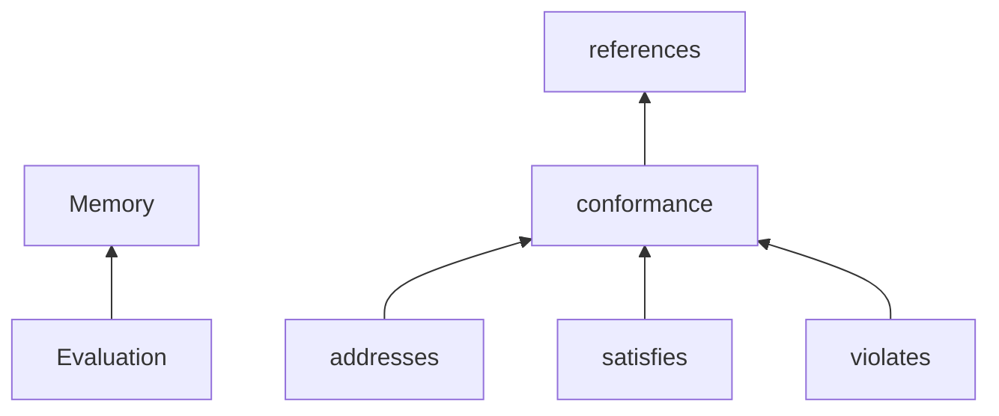
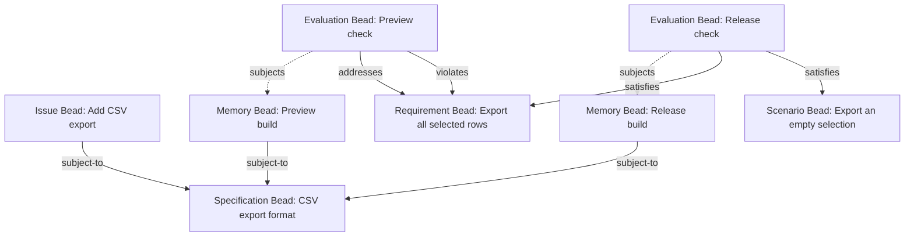
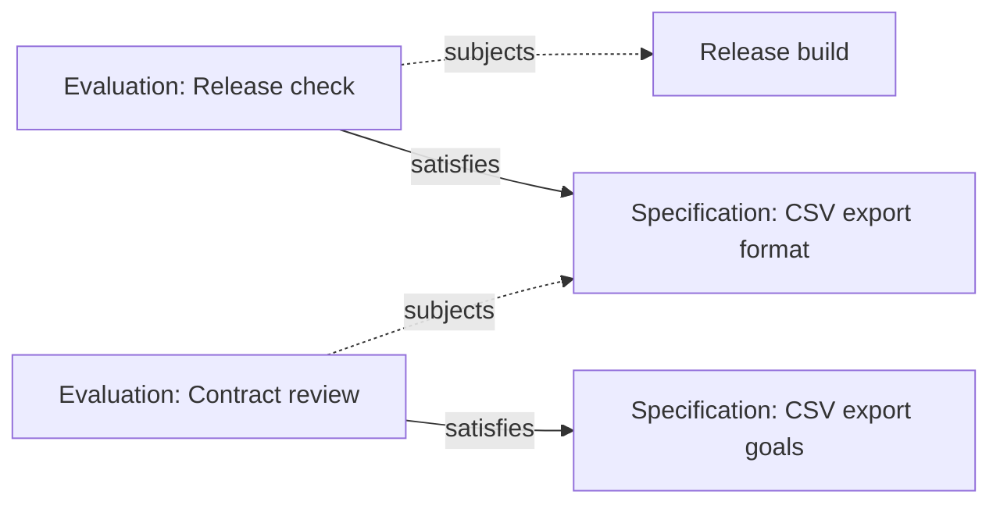

# [Assessment] Evaluation and Conformance Types

This independent design draft defines the Evaluation Bead Type and the Conformance, Addresses, Satisfies, and Violates Link Types. It preserves the selected evaluation-owned collective-claim model for future review. It is not an enabled Memory release capability or an implementation qualification claim; agent use of the base knowledge model can inform its next revision.

Sections marked informative explain the design without adding requirements. Other contract text is normative for this proposed extension, not protocol adoption. Type identities, runtime installation and lifecycle automation require their own qualification.

## Depends on

| Title | Target | Status | Body |
| --- | --- | --- | --- |
| Memory Bead and Link Types | [Memory](../memory/memory.md) | Required design dependency | Supplies Memory, Constraint, References, Subject To, Requires, Defines, and their ownership/discovery rules. |
| BDP Types profile | [Types](../../profiles/types/types.md) | Shared owner contract | Supplies Type refinement and shared Type constraints. |

## Overview (informative)

An Evaluation describes one exact subject group and owns every claim it makes about that group. The group is considered collectively. Contributions, complete satisfaction and breaches are distinct conclusions, represented by peer Link Types under the abstract Conformance family. Independent evaluations can concern the same subjects without changing those subjects' revisions.

| Type | Role |
| --- | --- |
| Evaluation | Concrete Memory subtype; identifies one nonempty exact subject group and owns its claims. |
| Conformance | Abstract common Link family from Evaluation to Constraint. |
| Addresses | Claims contribution, without asserting completeness or a known failure. |
| Satisfies | Claims complete satisfaction, potentially unattested. |
| Violates | Claims a specific breach; not implicitly transitive. |



## A worked example (informative)

The base Memory example defines a CSV export Specification with a row-export Requirement, an empty-selection Scenario, and a customer-data Policy. This extension records conclusions about concrete preview and release builds against those obligations.

### Apply the constraints and assess the work

An Issue Bead tracks the export work. Separate Memory Beads identify the preview and release builds. Subject To Links declare that the Specification Bead applies to each of these subjects. Following the Specification Bead's Requires Link family also discovers the Requirement, Scenario, and Policy Beads, including the subpolicy Beads.

The preview exports some selected rows. A preview Evaluation Bead identifies that build as its subject and owns an Addresses Link to the row-export Requirement. A validation run finds that numeric rows are omitted; the evaluation also owns a Violates Link to that Requirement, with supporting evidence. Contribution and breach can coexist.

A later release exports every selected row and handles an empty selection. A separate release Evaluation Bead identifies the release build as its subject and owns Satisfies Links to the Requirement and Scenario. Adding those claims revises the evaluation, not the release build.



Dashed arrows illustrate the `subjects` property references, not another stored Link Type. The solid assessment Links are owned by their Evaluation Beads.

The child-level claims do not automatically establish satisfaction of the whole Specification. A full claim must account for every obligation, including required Policies and their defined children. An unassessed log-redaction obligation remains unknown. Neither contribution nor the absence of a claim establishes violation.

An evaluation can instead identify a Web app and an API together. Every claim it owns then concerns that combination. A Satisfies claim about the pair does not imply that either component independently meets the Requirement. An individual claim needs a separate evaluation whose subject group is that individual Bead. Independent evaluations may assess the same group.

### Determining Conformance

Start with the subject and the Constraints that apply to it. Find its explicit or implicitly selected Subject To roots, then follow Requires, including Defines, to expose necessary obligations. Subject To is not transitive; a Constraint's own applicability declarations do not automatically bind the original subject.

Next, find evaluations whose subject groups concern the selected subject state, and inspect their owned Conformance-family claims. Preserve each evaluation's full group, selected revisions, evidence and context. A query for one member may show its participation in a collective assessment, but cannot present the group claim as individual satisfaction. Addresses claims contribution, Satisfies claims complete satisfaction, and Violates claims breach. These are recorded claims, not automatic verdicts; a missing relevant assessment leaves an obligation unknown.

Satisfaction can also be composed across compatible evaluations. Suppose one evaluation assesses the release against the format Specification, and another assesses that Specification alone against the export-goals Specification:



A view may explain an indirect claim about the release meeting the goals when the intermediate Specification revision and assessment contexts are compatible. This is composition of claims through their declared subjects, not a literal chain of Satisfies Links: every stored claim Link starts at an evaluation. If the second evaluation assesses the Specification together with something else, its collective claim cannot be distributed to the Specification alone. An Addresses step likewise supplies no automatic complete-coverage composition. The explanation retains the evaluations, subject bindings and claims; it neither creates a stored Link nor verifies the evidence.

## Assessment and the CLI (informative)

These are future interface sketches, not installed commands or accepted grammar. `bd memory assess` could run an explicitly selected evaluator over one full subject group and selected Constraints. A saved result would create an Evaluation and its owned claims. An unsaved result would emit an ephemeral Bead graph, with selected Link families and target identities, rather than leaving stored residue. Evaluator invocation, input/output contracts and exact flags remain separate design work.

A coverage view could show applicable obligations, complete subject groups, owned Addresses/Satisfies/Violates claims, compatible indirect composition, evidence, contradictions and unknowns. An explanation view could preserve applicability paths, selected revisions, context and the reasons a conclusion cannot be composed. Neither view runs tests or authors claims implicitly. Collective results must not be displayed as individual conclusions about each member.

## Assessment behavioral contract

A **subject** is the Bead whose obligations or behavior are being considered. An evaluation assesses one subject group: one or more Beads with selected revisions. All of its claims concern that group collectively; a different group needs a separate evaluation. It can have any Bead Type, including an Issue Type; being subject to a Constraint Bead does not make the subject itself a Constraint Bead. Constraint targets include every Type refining Constraint. “Any Bead” is an endpoint category without a Type restriction, not a new Bead Type or a closed union of known names. Link and opaque external-Resource endpoints are not added by that category.

| Type | Common behavioral contract |
| --- | --- |
| Conformance | Evaluation → Constraint. Abstract common claim contract about the full subject group; no conclusion or general transitivity follows from membership alone. |
| Addresses | Contribution without complete satisfaction or known failure; no automatic composition. |
| Satisfies | Complete satisfaction; compatible claims compose through exact subject bindings without distributing group claims. |
| Violates | A specific breach, with no implicit transitivity. |

### Conditional obligations

Conditions and exceptions in the Constraint Bead itself are a different matter. The body can state a conditional obligation, such as “If the export contains personal data, anonymize it.” When an assessment establishes that there is no personal data and accounts for every other obligation, it can make a Satisfies Link claim because the condition imposes no work in that case. The subject remains discoverably subject to the Constraint Bead; the assessment explains why its obligations are discharged.

An evaluator may author an Evaluation Bead and its Satisfies Link with a title such as `N/A — no personal data`, a body naming the exception and its reasoning, and evidence identifying the assessed facts and revisions. It remains an ordinary full-satisfaction claim, potentially unattested or disputed. `N/A` is a display convention, not a new status, Link Type, or machine-interpreted value. Evaluation does not automatically store assessment Links. Unknown conditions do not justify an N/A conclusion.

A parent exception does not silently remove its Requires dependencies or Defines children. A parent Satisfies claim must still account for those necessary obligations. How to express a parent condition that also qualifies its dependencies remains open. An empty child set alone still establishes no satisfaction: an N/A assessment needs a stated condition or exception and a reason it applies to the assessed case.

### Discovery, assessment, and evidence

A generic constraint view recognizes Constraint and every Type refining it. It uses Type refinement, not a fixed enumeration of Policy, Decision, Procedure, Requirement, Scenario, or Specification. A future supported Constraint subtype inherits the common contract and may add its own properties or restrictions. This design does not require arbitrary public Type creation or installation as a prerequisite for the first release.

The caller identifies the subject, context or governing roots to examine, and the relevant revisions. A Subject To Link declares an applicable Constraint Bead for any source Bead; predicate matches can supply additional implicit starting relationships. Within the selected context, the view takes the subject's explicit or implicitly selected Subject To roots, then follows those Constraints' Requires Link families, including Defines, to find the complete reachable set of necessary obligations. It does not follow another Constraint's Subject To Links as if they bound the original subject. A dependency can cross defining trees without giving its target another defining parent. How an agent or task selects its subject and roots, who can establish binding applicability, and detailed traversal/revision mechanics remain open. A direct References Link supplies context without making its target a governing constraint. No inferred stored Subject To Links are created by dependency traversal.

A coverage view can examine a selected Bead, including an Issue, a Constraint, or a Memory Bead describing a release. It finds evaluations with the relevant subject bindings and reads their owned claims, preserving the complete group. It does not substitute the evaluation itself for its assessed subjects. Querying the Conformance family includes Addresses, Satisfies, and Violates; querying the Requires family includes Defines. An Addresses-only query does not include its peer Satisfies or Violates Types. The view distinguishes applicable obligations declared through Subject To, authored and composed Satisfies claims, contributions through Addresses, explicit Violates claims, and unknown assessment. Subject To alone supplies no assessment. Absence of a relevant assessment claim means unknown, not violation; absence of an Addresses Link alone does not mean unknown when a Violates Link claim exists. Missing supporting evidence leaves verification unresolved, even when a full-coverage claim is recorded. The view shows the participating revisions, context, supporting Links, and available evidence so a caller can inspect the result.

Every outgoing Requires target is necessary for its source, including targets reached through Defines and through further Requires relationships. The parent's own body constraints still apply. A full claim about the parent asserts that those obligations have been met, but the claim itself is not verification. Child claims do not create an inferred stored parent Link, and satisfying all children is sufficient only when that completeness is explicitly asserted. A childless Constraint Bead is not automatically satisfied. If the same complete subject group, with compatible selected revisions and context, is claimed to violate a necessary Constraint Bead, a parent Satisfies claim is contradicted for compatible revisions and the same applicable context. Preserve both claims and expose the conflict; a violation claim itself still needs assessment. This reasoning creates neither a parent Violates Link nor an Addresses Link: failure alone establishes no contribution. Claims about another subject group, revision, or context must not be combined as if they concerned the same assessed scope. Overlapping groups, or a compound Bead and a list of its apparent components, are not automatically equivalent subject groups. Detailed reconciliation of conflicting evidence remains open.

The Conformance Link Type declares optional evidence text, such as test, review, execution, or source pointers. Addresses, Satisfies, and Violates inherit it. Every such claim is owned by an evaluation, including self-authored and unattested claims. A validator authors an evaluation and its claims about the declared subject group; neither the actor nor the group members replace the evaluation as the claim Link's source. Independent runs may create evaluations for the same group, retaining their claims, evidence and provenance. Link counts, an evaluation's existence, and a test-run label are not verification. A later claim does not silently replace earlier claims.

The Evaluation Type below supplies the selected owner contract and requires exact subject-revision references. Structured context/run evidence and lifecycle details remain open. No direct, unowned subject-to-Constraint claim form is retained as an alternative. This proposal supplies no solver, general constraint language, or automatic interpretation of arbitrary prose.

### Issue workflow and assessment boundaries

A Bead is eligible for dispatch only if its actual Type is Issue or refines Issue. Type membership alone does not establish readiness: ordinary Issue workflow rules still apply. Memory or Constraint membership, a status label, and the presence of Subject To or Conformance-family Links do not confer dispatch eligibility. Blocking semantics must be expressed by a Link whose Type is Dependency or refines Dependency; neither Requires nor Subject To becomes an Issue Dependency merely because it connects obligations.

Closing an Issue records a workflow transition, not a Satisfies claim or a verified conformance result. Automation must not infer satisfaction from closed status or create assessment claims merely to reflect closure. A consumer using coverage as a release, compliance, or closing gate owns the acceptance and reconciliation policy. It must identify the evidence and authority it accepts, assessed revisions and context, and its handling of missing, conflicting, inaccessible, or bounded results. A claim's presence, a test-run label, and Link counts alone establish no verification.

### Evaluation ownership and lifecycle

The evaluation owns the entire Conformance family. Creating, changing or deleting a claim revises the evaluation, not an assessed subject or the target Constraint. An evaluation's own Subject To declarations govern the evaluation; they do not silently impose obligations on every member of its subject group.

The first successfully accepted Evaluation state binds its exact subject group to the Bead identity. The binding survives retyping away from Evaluation and later back to Evaluation, including repeated transitions and periods with no owned claims. Returning to Evaluation must preserve that same group; reordering its exact subject references is allowed. A different group requires a new Evaluation Bead identity, not a new revision or a retyping cycle of the existing identity. An ordinary `subjects` extension property on a Bead that has never been an Evaluation does not establish the binding; it is established only when the Bead first successfully becomes an Evaluation or one of its subtypes. This rule states the invariant without choosing a storage representation or history-retention mechanism.

Grouping claims under their evaluation supports deliberate cleanup of that assessment. Ownership alone selects no deletion cascade, hard erasure, or retention exception. The exact operation for removing an evaluation and its live claims must follow the shared write/history contract and remains to be specified. Earlier retained evaluations and evidence must not be silently rewritten as though they never existed.

### Type-constraint enforcement

An implementation claiming enforcement must validate affected Type constraints on create, update, and delete, including graph effects on surviving Beads and Links. This includes Defines' single-parent rule and the selected Defines and Superseded By acyclicity rules. Invalid resulting state must be rejected atomically at the shared contract's commit boundary; concurrent writes must not jointly evade an invariant. A merged graph must be validated before it is admitted as valid state. Batch validation follows the accepted shared transaction contract; this statement selects no storage or branch-merge mechanism. Read-time diagnostics alone do not constitute enforcement.

## Bead Type

### Evaluation — Bead Type

**Design status.** Donna selected Evaluation refining Memory, with Conformance-family ownership and a required nonempty array of exact subject references. This extends MEM-DEC-010's accepted owner/group contract with the concrete carrier and subject-reference shape. Installation, implementation qualification, special lifecycle automation and ephemeral-output framing are separate; no installed Type identity is inferred from this document. `subjects` is a typed property, not a metadata convention.

**Meaning and use.** An Evaluation Bead records an assessment of one subject group against one or more Constraints. Its body explains the evaluation, its context and method. Its `subjects` property identifies the Beads and selected revisions being assessed. The evaluation owns Addresses, Satisfies and Violates Links to Constraint Beads; those Links record the conclusions and supporting evidence. Self-authored or unattested claims use the same model. The evaluation record and its claims do not by themselves establish verification or trusted authority.

Every owned claim concerns the whole subject group collectively. The first accepted Evaluation state binds that group to the Bead identity, even if the Bead is later retyped away from Evaluation and back. A different group needs a new Evaluation Bead identity, without per-claim subset selectors. Multiple independent evaluations may assess the same group. A compound subject remains its own Bead identity; its apparent components are not automatically substituted for it. Evaluation and assessed-subject identities are distinct, so recording a claim does not revise an assessed subject; another evaluation can assess an Evaluation Bead.

**Example (informative).** An evaluation assesses a Web app and an API together against an export Requirement. Its Satisfies claim concerns the combination. A query for the Web app can show that collective assessment as context, but an individual satisfaction claim needs an evaluation of the Web app alone.

**Refines.** Memory.

**Properties.** `subjects` is a required nonempty array of exact Bead references. Each member is an object with required `uri` and `revision` members identifying a Bead of any Type and the exact revision assessed. The URI and opaque revision follow the shared Bead-reference contracts. A bare URI or an object without a revision is a floating subject reference and is refused; never silently substitute a newer revision for the one assessed. This property does not change the current-versus-exact policy of other Link endpoints.

**Example subject value (informative).**

```json
[
  {"uri": "https://beads.example/acme/beads/web-app", "revision": "web-r2"},
  {"uri": "https://beads.example/acme/beads/api", "revision": "api-r7"}
]
```

These URIs and revision tokens are illustrative, not assigned identities or revisions. The array declares one collective subject group; the claims do not select subsets.

| Name | Type | Defined by | Use and meaning |
| --- | --- | --- | --- |
| `title` | Required nonblank text | Memory | Human-readable name for this evaluation. |
| `body` | Required Markdown text; may be empty | Memory | Primary account of the assessment, method, context and caveats. |
| `status` | Optional nonblank open string | Memory | Descriptive lifecycle label; no automatic verification, approval or conclusion. |
| `subjects` | Required nonempty array of exact Bead references: `{uri, revision}`; floating references refused | Evaluation | Full collective scope of every owned claim. The first accepted Evaluation state binds the group to this Bead identity across retyping; array order is immaterial. A different group requires a new Evaluation identity; no per-claim subset selector. |

**Owned outgoing Link Types.**

| Link Type family | Declared by | Effect |
| --- | --- | --- |
| `conformance` | Evaluation | Owns every concrete Conformance-family claim, including Addresses, Satisfies and Violates. A claim mutation revises this evaluation, not its assessed subjects. |
| `subject-to` | Memory | Inherited ownership; declares Constraints on the evaluation itself. |
| `superseded-by` | Memory | Inherited replacement relationship; does not silently replace or erase the assessed subjects or earlier claims. |

## Link Types

The four Link Types below extend the References Type defined by the Memory specification. Conformance is abstract; Addresses, Satisfies and Violates are concrete peers. Their optional evidence property extends the inherited optional title, body and status.

### `conformance` — Link Type

**Meaning and use.** Conformance is the abstract common Link Type for a claim by an Evaluation Bead about its full assessed subject group relative to a target Constraint Bead. Any Bead may be an assessed subject; the claim's source is always its owning evaluation. The authoring actor is identified through provenance. The claim can explain its conclusion and retain supporting evidence.

The common Type is neutral about the conclusion. Addresses, Satisfies, and Violates refine it as peers and supply contribution, complete-satisfaction, and breach assertions. Membership in the Conformance family alone establishes none of these conclusions. Evidence and an authored claim are not independent verification. A query over this family finds all three forms without enumerating them.

Conformance is abstract: a Link cannot declare Conformance itself as its actual Type. Concrete Link Types such as Addresses, Satisfies, and Violates refine it and inherit its common contract. Abstractness does not automatically make a refinement abstract. Family queries and ownership selectors naming Conformance still match its concrete refinements. The Conformance Type-definition Bead remains a legal instance of its metatype; the restriction concerns Links instantiating the defined Type. The generic representation belongs to the shared Types contract; this ruling selects no field spelling, `kind`, outcome enum, implicit default conclusion, or new test-execution operation.

**Example (informative).** Two evaluations of the same release revision can own separate Satisfies and Violates Links to the same Policy. A Conformance-family view preserves both evaluations, their common subject scope, claims, evidence and contexts rather than counting them as votes or silently replacing one.

**Refines.** `references`. It inherits optional title, body, and status.

**Link constraints.**

| Source Type | Target Type |
| --- | --- |
| Evaluation or any subtype | Constraint or any subtype |

| Rule | Meaning |
| --- | --- |
| Claim | An assertion about the source evaluation's full subject group relative to the target's obligations. The common Type supplies no positive, negative, partial, or verified conclusion. |
| Arity | Many-to-many; no participation minimum or additional maximum. |
| Parallel claims | Allowed. Independent claims, assessment runs, evidence, and selected revisions retain their identities. Later claims do not silently erase earlier claims or resolve contradictions. |
| Self Links and cycles | Inherit References' identity-self prohibition; no additional cycle prohibition. Circular claims supply no evidence. |
| Ownership | The source Evaluation owns every Conformance-family claim. A claim mutation revises that evaluation, without revising its assessed subjects or target Constraint. There is no direct unowned claim form or third-party owner. |
| Provenance | Identifies the actor making the claim; that actor is distinct from the owning evaluation and its assessed subjects. |
| Composition | No general transitivity or automatic coverage rule. Each specialization supplies any stronger composition rule. |
| Scope and pins | Scope follows References. The target and subject bindings remain within the current single-Scope baseline. Subject references require exact `{uri, revision}` objects. Context/run binding and evidence reconciliation remain open. |

**Properties.** Introduces optional evidence; inherits title, body, and status from References. These fields preserve the claim and its support without certifying it.

| Name | Type | Defined by | Use and meaning |
| --- | --- | --- | --- |
| `title` | Optional nonblank text | references | Human-readable label for the claim. |
| `body` | Optional nonblank Markdown text | references | Explains the claim about the owner's full subject group and its caveats; cannot select a subset. |
| `status` | Optional nonblank open string | references | Descriptive label; no automatic conclusion or verification effect. |
| `evidence` | Optional nonblank free-form text | conformance | Test, review, execution, or source pointers supporting the claim. |

### `addresses` — Link Type

**Meaning and use.** Use an Addresses Link owned by an evaluation to claim that its full subject group contributes toward meeting a target Constraint Bead. Explain the contribution and any known limits in the body, and cite supporting evidence when useful. The Link makes no completeness assertion: it establishes neither complete satisfaction nor known failure. Contribution concerns coverage of obligations rather than effort performed. It is distinct from the complete-satisfaction and breach assertions of its peer Types.

Addresses, Satisfies, and Violates are peer specializations of Conformance. Query the Conformance family to find all three kinds of claim; an Addresses-family query selects contribution claims only. Status is descriptive; changing it does not turn an Addresses Link into Satisfies.

**Example (informative).** A preview build exports only text columns. An evaluation of that build owns an Addresses Link to the export Requirement, and the Link body explains that numeric columns remain unsupported. The body supplies that known limitation; the Addresses Type itself makes no completeness assertion.

**Refines.** `conformance`; transitively `references`. It inherits title, body, status, and evidence.

**Link constraints.**

| Source Type | Target Type |
| --- | --- |
| Evaluation or any subtype | Constraint or any subtype |

| Rule | Meaning |
| --- | --- |
| Contribution | The Link claims a contribution toward meeting the target; it makes no completeness assertion. |
| Arity | Many-to-many; no participation minimum or additional maximum. |
| Self Links | Forbidden by Bead identity through References, including different revision selectors. |
| Parallel Links | Allowed. Independent claims, evidence, and revision selections retain their identities. A later Satisfies Link does not overwrite or delete an earlier contribution. |
| Cycles | No additional cycle prohibition. Circular claims do not manufacture supporting evidence or establish completion by themselves. |
| Ownership | Inherited from Conformance: the source evaluation owns the claim; its mutation revises the evaluation, not the assessed subjects or target. |
| Transitivity | Addresses supplies no automatic transitive coverage rule. The peer Satisfies Type supplies its own rule for compatible Satisfies-claim composition through evaluation subject bindings. |
| Scope and pins | Scope follows References. Exact pin and assessment-reconciliation mechanics remain open. |

**Properties.** No new properties; all are inherited from Conformance and References. Evidence is supporting material, not verification by itself.

| Name | Type | Defined by | Use and meaning |
| --- | --- | --- | --- |
| `title` | Optional nonblank text | references | Short display label for the contribution. |
| `body` | Optional nonblank Markdown text | references | Explains the contribution and any known limits. |
| `status` | Optional nonblank open string | references | Organization-defined label; no automatic completion or workflow effect. |
| `evidence` | Optional nonblank free-form text | conformance | Human-readable test, review, execution, or source pointers supporting the claim. |

### `satisfies` — Link Type

**Meaning and use.** Use a Satisfies Link owned by an evaluation to claim that its whole subject group meets all of a target Constraint's obligations. The Link can explain the claim and point to tests or reviews. It asserts satisfaction, potentially without attestation; it never means an aspiration to satisfy later. Its existence does not establish that its evidence is sound or that a validator confirmed it.

A collective claim concerns the complete declared group. It does not assert that each member satisfies the target independently. If an evaluation assesses a Specification alone, satisfaction concerns that Specification's contract, rather than merely the existence of a concrete result. All Bead Types can be assessed, including Issues, releases, Specifications and evaluations themselves, using a distinct owning evaluation.

Satisfies claims can compose semantically through their subject bindings. If one evaluation claims that group G satisfies Constraint A, and another claims that the singleton subject A satisfies Constraint B, a view may explain an indirect claim that G satisfies B when the selected A revision and assessment contexts are compatible. Further compatible singleton intermediate Constraints can continue that reasoning. This is not native graph transitivity of stored Satisfies Links: every claim edge starts at an evaluation.

If the second evaluation assesses A together with other subjects, its collective claim cannot be distributed to A alone and supplies no automatic composition. A contribution through Addresses, a breach through Violates, or mere Conformance membership also supplies no full-coverage composition. Missing compatibility information leaves the composition unresolved; a view must not guess.

Preserve the original full group, participating evaluation identities and revisions, subject bindings, claim Links and evidence as the explanation. An indirect result creates no stored claim and performs no independent verification. A case-specific N/A exception supports composition only where that exception also holds for the resulting group and context.

**Example (informative).** A release evaluation claims that the release satisfies the CSV format Specification. A separate evaluation of that Specification alone claims that its contract satisfies the export goals. Compatible claims support an indirect claim about the release meeting the goals. An evaluation of the Specification plus another artifact would not supply the same singleton intermediate claim.

**Procedure and Decision examples (informative).** An evaluation of a concrete release run can claim that the run followed a Procedure. An evaluation of a result using PostgreSQL can claim that the result follows the Decision selecting PostgreSQL. Neither claim establishes approval or independently verifies the evaluation.

**Conditional satisfaction example (informative).** A Policy says “If the export contains personal data, anonymize it.” An evaluation of an export containing no personal data can own a Satisfies Link titled `N/A — no personal data`, explaining the condition and evidence. The group remains subject to the Policy; the claim neither removes applicability nor waives independently necessary obligations.

**Refines.** `conformance`; transitively `references`. It inherits title, body, status, and evidence.

**Link constraints.**

Allowed source → target Type pairs:

| Source Type | Target Type |
| --- | --- |
| Evaluation or any subtype | Constraint or any subtype |

Other constraints:

| Kind | Rule |
| --- | --- |
| Coverage | A direct claim must account for the target's stated obligations. Every Requires target is necessary, including each Defines child. For a Constraint parent, its defined Constraint children are necessary by default; satisfying the children does not by itself establish that every constraint in the parent's body has been met. Separate child claims do not silently create a parent Link. |
| Conditions and exceptions | A stated exception can discharge the target's obligations in the assessed case. An explicit Satisfies claim may explain this as N/A in title or body, with supporting evidence. Missing facts are unresolved, not an exception; dependencies remain necessary unless an explicit qualified-dependency contract says otherwise. N/A text has no machine-defined effect. |
| Defined children | For Constraint and every refining subtype, all Defines children are necessary through Requires refinement. The parent's own constraints still apply. Children are not collectively sufficient unless that completeness is explicitly stated; a parent with no children is not automatically satisfied. Plain Memory notes supply context through References. |
| Indirect coverage | Compatible Satisfies claims can compose through evaluation subject bindings: group G satisfies A, and singleton A satisfies B, preserving G. A collective intermediate group containing A supplies no distributive step. This is not native transitivity of stored claim edges. A case-specific exception supports composition only where that exception is established for the resulting subject and context; an N/A label alone supplies no such proof. Report the evaluations, subject bindings and claims separately from an authored claim; create no inferred stored Link. |
| General-contribution steps | A proposed composition with an Addresses step whose Type does not refine Satisfies establishes no automatic coverage of its final target. |
| Arity, parallel Links, cycles and ownership | Inherit Conformance rules, including evaluation-source ownership and no additional cycle prohibition. Circular claims alone are not evidence. |
| Coexistence | Independent Addresses, Satisfies, and Violates claims about the same complete subject group and target retain their own identities, evidence, and provenance, including claims from multiple evaluations. Contradictory claims must be exposed rather than silently overwritten. |
| Necessary-condition conflict | A claim that this same complete subject group violates a necessary Constraint contradicts a parent satisfaction claim for compatible revisions and the same applicable context. Preserve the authored claims and report the conflict. This creates neither a parent Violates Link nor an Addresses Link; failure alone establishes no contribution. |
| Open mechanics | Exact revision resolution and conflicting-assessment reconciliation remain to specify. |

**Properties.** No new properties; it inherits the Conformance and References fields.

| Name | Type | Defined by | Use and meaning |
| --- | --- | --- | --- |
| `title` | Optional nonblank text | references | Short display label for this complete-coverage claim. |
| `body` | Optional nonblank Markdown text | references | Explanation of the complete-coverage claim; may include human-readable evidence pointers. |
| `status` | Optional nonblank open string | references | Organization-defined label for this claim; it does not validate or change its coverage meaning. |
| `evidence` | Optional nonblank free-form text | conformance | Human-readable test, review, or source pointer supporting this claim; not verification by itself. |

`evidence` is an authored claim about supporting material, not a validator verdict. `status` likewise does not verify the claim.

### `violates` — Link Type

**Meaning and use.** Use a Violates Link owned by an evaluation to claim that its full subject group breaches a target Constraint Bead. Identify the specific obligation and explain the counterexample or supporting evidence. The source is the evaluation owning the claim; the assessed subjects are identified by that evaluation, and the actor is identified through provenance. A claim can be contested; the Link's existence does not establish that its evidence is sound.

Violates, Addresses, and Satisfies are peer specializations of the Conformance Link Type. A breach does not by itself establish a contribution toward satisfaction. Missing evidence, an inconclusive test, or the absence of a Satisfies Link or Addresses Link is not a violation. Independent evaluations may own separate claims about the same full group and target, including conflicting Satisfies and Violates claims; preserve their evidence and assessed context.

**Example (informative).** A validation pass finds customer secrets in a sample export. Its Evaluation Bead identifies the assessed release and owns a Violates Link to the anonymization Policy. The evidence identifies the run, assessed revisions, and failing output. A later passing run may add a separate Satisfies claim; its existence alone does not erase or resolve the earlier claim.

**Refines.** `conformance`; transitively `references`. It inherits title, body, status, and evidence.

**Link constraints.**

| Source Type | Target Type |
| --- | --- |
| Evaluation or any subtype | Constraint or any subtype |

| Rule | Meaning |
| --- | --- |
| Breach | The source evaluation claims that its full subject group breaches a specific obligation in the target for the assessed revisions and context. |
| Arity and parallel Links | Many-to-many; no participation minimum or additional maximum. Independent evaluations may claim different results for the same group and target; each retains its own identity. |
| Self Links and cycles | Inherit References' identity-self prohibition; no additional cycle prohibition. Circular claims supply no evidence. |
| Ownership | Inherited from Conformance: the source evaluation owns the claim. Its mutation revises that evaluation, not the assessed subjects or target. The assessing actor is identified through provenance. |
| Transitivity | Violates is not implicitly transitive. Neither a Violates chain nor a dependency traversal creates an inferred stored Violates Link. |
| Necessary-condition conflict | A breach claim about a necessary Constraint contradicts satisfaction of a dependent Constraint by the same complete subject group for compatible revisions and context. Report the conflicting claims without silently converting their Types or inferring an Addresses contribution. |
| Scope and pins | Scope follows References. Exact assessment/run binding, revision selection, and conflict-reconciliation mechanics remain open. |

**Properties.** No new properties; inherits evidence from Conformance and title, body, and status through References. Supporting material does not verify the breach claim by itself.

| Name | Type | Defined by | Use and meaning |
| --- | --- | --- | --- |
| `title` | Optional nonblank text | references | Short display label for the breach claim. |
| `body` | Optional nonblank Markdown text | references | Identifies the breached obligation, counterexample, and relevant context. |
| `status` | Optional nonblank open string | references | Organization-defined label; it does not verify or resolve the claim. |
| `evidence` | Optional nonblank free-form text | conformance | Test, review, execution, or source pointers supporting the breach claim, including assessed revisions and run context when available. |

## Ownership

Evaluation owns the complete Conformance Link family, including every concrete refinement. Creating, changing or deleting a claim revises its Evaluation, not its subjects or the target Constraint. Its inherited Subject To declarations govern the Evaluation itself. Its inherited replacement relationship does not silently replace subjects or erase earlier claims. The base Memory ownership contract supplies those inherited relationships.

## Publication scope and deferred specification work

This extension describes one Bead Type and four Link Types. The original combined catalog and decision history retain their exact historical identities; splitting documents changes no selected claim/group/lifetime rule. [MEM-DEC-010](https://github.com/gastownhall/beads/issues/7656#mem-dec-010-evaluation-owned-collective-conformance-claims) records the selected uniform evaluation-owned model and its exact-subject-reference extension.

Evaluation refines Memory. Its nonempty exact `{uri, revision}` subject group binds to the identity at its first accepted Evaluation state, including across retyping away and back. Reordering is allowed; different membership or revisions require a new identity. Ordinary pre-Evaluation extension data does not create the binding. Every owned claim concerns that group collectively; no direct unowned alternative, per-claim subset or automatic distribution is selected.

The following remain open: structured context/run/evidence bindings; conflict adjudication and trusted authority; exact compatible-revision composition and pin mechanics; predicate representation and evaluator interfaces; conditional dependency qualifications and structured sufficient conditions; abstract-Type representation under the shared Types contract; ephemeral result framing; and cleanup/retention operations. Ownership selects no cascade or erasure exception. Unresolved compatibility, missing facts and unavailable behavior must be explicit. A stored claim, Link count or test-run label is not verification.
