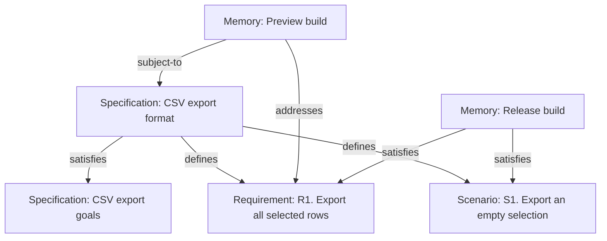
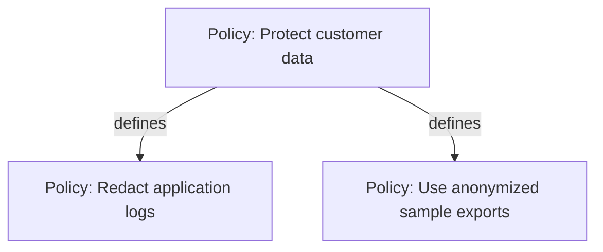
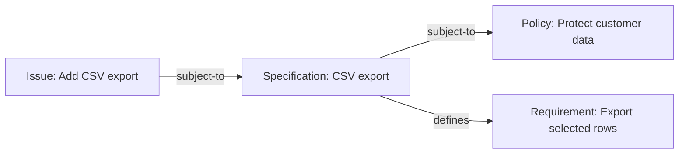
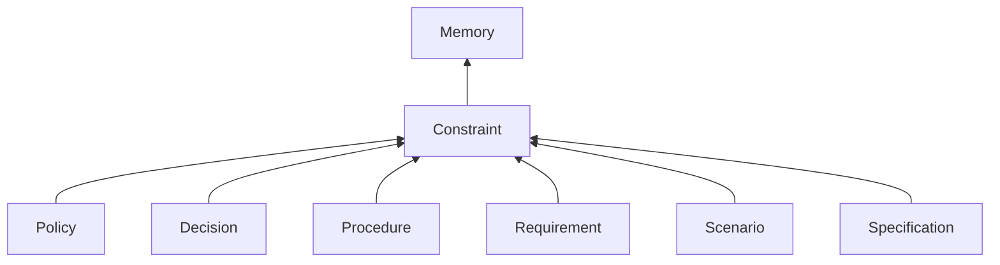
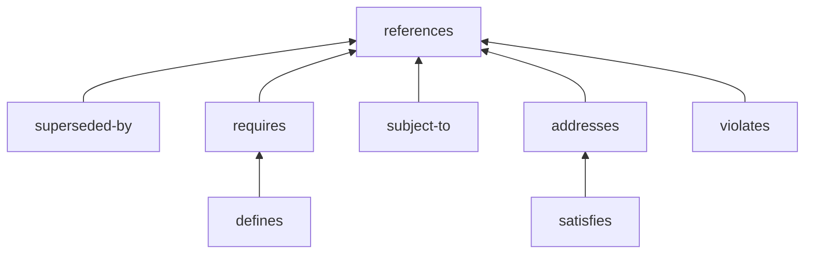

# [Memory] Memory Bead and Link Types

This proposal defines Memory Bead and Link Types and their common constraint-system behavior. It is a published design draft; the [publication scope](#publication-scope-and-deferred-specification-work) separates the selected model from deferred mechanics and implementation qualification. It builds on [Chris's Memory Beads proposal](https://github.com/gastownhall/beads/issues/5877).

The overview and worked example below are **informative**: they explain how to use the design. The structured Bead and Link Type definitions specify the rules. Examples illustrate those rules without adding requirements or Type properties.

## Overview (informative)

The main goal of Memory Beads is to give agents deterministically discoverable rails for their behavior and side effects. An agent should be able to find the constraints governing its work, understand what it must do or avoid, and identify evidence that its work stayed within those constraints.

[Constraint](#constraint--bead-type) is the common Bead Type for obligations and restrictions. Policy, Decision, Procedure, Requirement, Scenario, and Specification conform to Constraint. An additional project-specific Constraint subtype participates in the same discovery and coverage model through conformance, without requiring a checker to maintain a closed list of names.

Policies and Decisions constrain behavior and side effects. Procedures prescribe how work is carried out, with their flow in the body. Requirements and Scenarios state required outcomes and conditions. Specifications describe intended results at any level of detail. These are different ways of expressing constraints. A plain Constraint can hold a rule that does not need a more specific Type; plain Memory holds context or explanations.

Deterministic discovery calls for explicit rules about which constraints apply to a task or context, which relationships to follow, and which revisions are in scope. Subject To explicitly declares that a target Constraint applies to its source. Selecting the governing roots for an agent or task, establishing authority for that declaration, and resolving revisions remain open. The common Constraint Type gives a tool a stable family to recognize once its discovery context is selected. The model records constraints, satisfaction claims, and evidence; it does not select a solver or claim that arbitrary prose can be evaluated automatically.

The base Types are [Memory](#memory--bead-type) for knowledge Beads and [References](#references--link-type) for Links. Constraint conforms to Memory. Specification conforms to Constraint and describes an intended result. A plain Memory Bead can identify a concrete result, such as a build or completed execution, independently of an Issue tracking the work. Any Bead can be subject to a Constraint and can make a contribution, satisfaction, or breach claim about one, including an Issue or a Bead of a future Type. No conformance to Memory or Constraint is required of the subject. A Specification can be draft or accepted through its optional status without changing Type.

Requires connects a Constraint to another Constraint that is necessary for satisfying it. Defines conforms to Requires and adds a defining-parent relationship: a Policy can define subpolicies, and a Requirement can define subrequirements. Each child has at most one defining parent. The parent owns the Defines Link through the Requires family, and the child keeps its own identity and history. A transitive query over Requires and its conforming Link Types includes Defines without a special case. Plain Memory notes can provide context through References.

Other Links distinguish obligations from assessments. Subject To declares which Constraints apply to any Bead; it makes no claim that they have been met. Addresses claims a contribution toward meeting an obligation, Satisfies claims complete satisfaction, and Violates claims a specific breach. Satisfies conforms to Addresses; Subject To and Violates are separate References specializations. Independent assessments can carry their own explanations and evidence, while review and testing determine how much confidence to place in each claim.

Knowledge also changes. Update a Bead when you are continuing to maintain the same piece of knowledge; its identity stays the same and it gains a new revision. When a different Bead takes its place, retire the old Bead with a Superseded By Link to the replacement. That makes the change of identity explicit and leaves the old Bead's history available.

## A worked example (informative)

A team wants users to export selected rows from a table. It starts with a high-level Specification, **CSV export goals**, explaining the intended outcome and the expected benefit. The team then writes a more detailed Specification, **CSV export format**, describing the behavior precisely enough to check.

The Specification defines a Requirement, **R1. Export all selected rows**, and a Scenario, **S1. Export an empty selection**. The Scenario says that an empty selection produces a file containing column headings and no data rows. The R1 and S1 prefixes are readable labels in the Bead titles.

A Subject To Link from the preview build Bead to the format Specification declares that the contract applies to that build. This declares an obligation, not a hope or a claim of success. A preview build handles only some of the required data, so its Memory Bead has an Addresses Link to R1. A later release handles every selected row and the empty-selection case. Its Memory Bead has separate Satisfies Links to R1 and S1, with test pointers in the Links' evidence.

A validation run might find that the preview omits selected numeric rows and author a Violates Link from the preview to R1, with evidence identifying the run and assessed revisions. Another run can add its own Link for the same pair. The preview's Addresses and Violates claims can coexist: a contribution does not rule out a breach. With no assessment claim, the result is unknown.

The format Specification's Satisfies Link claims that it covers the higher-level Specification's goals. The release build's child-level claims do not automatically create a Satisfies Link to the whole Specification. Someone making that broader claim must consider all of the Specification's obligations and add the Link explicitly.

If the release Bead also has a Satisfies Link to the format Specification, the coverage view can follow an uninterrupted Satisfies chain to the goals Specification:

The indirect result carries the chain as its explanation. It does not create another stored Link or verify the claims. A direct Addresses Link that does not conform to Satisfies cannot simply be substituted in this chain: implementing part of the format Specification may cover a different part from the one needed by a particular goal.

Later, an informal Memory note about sample data becomes a formal Policy. The old note gets a Superseded By Link to the new Policy. Readers can follow the replacement chain while still consulting earlier revisions of the note. Editing the note itself would instead have kept its original identity.

A Policy tree uses the same Defines relationship:

The two subpolicies are ordinary Policy Beads. They have the same properties as their parent and can define further subpolicies. A reference to one of them from another Bead does not create another defining parent.

The Policy and both subpolicies conform to Constraint. A generic coverage view can find them through that common Type, even when a project adds a new specialized Constraint Type later. Suppose a release run has a Satisfies Link to "Use anonymized sample exports" but no recorded coverage for "Redact application logs". The view can expose that remaining obligation instead of deriving full coverage of "Protect customer data" merely from one child.

The default says that every defined Constraint child is necessary. It does not say that the children are collectively sufficient: the parent's body may state further obligations. If a parent explicitly states that its complete acceptance condition is the conjunction of its child constraints, that declaration supplies the additional sufficiency claim. Machine-readable composition and evidence reconciliation remain design questions; this example introduces no solver or automatic proof.

## Memory and the CLI

The proposed command behavior uses the existing Memory capture and retrieval commands. `bd remember` creates a plain Memory Bead, and `bd recall` reads a Memory Bead. Selection of Memory subtypes in `bd memories` remains an open design question below.

The shared `bd create`, `bd update`, `bd delete`, `bd show`, `bd list`, and `bd versions` commands work with these Bead Types as they do with Issue Types. `bd types` lists the supported Memory Bead and Link Types alongside the supported Issue and Dependency Types.

## Constraint-system behavioral contract

Constraint is the common Bead Type for this system. Specification, Policy, Decision, Procedure, Requirement, and Scenario conform to Constraint and inherit this contract. Their distinct meanings and additional properties remain useful, but they do not need separate dependency, applicability, or assessment rules. Future Constraint subtypes participate through conformance. The rules below apply to each Link family, including its conforming Types.

A **subject** is the Bead whose obligations or behavior are being considered. It can have any Bead Type, including an Issue Type; being subject to a Constraint does not make the subject itself a Constraint. Constraint targets include every Type conforming to Constraint. “Any Bead” is an endpoint category without a Type restriction, not a new Bead Type or a closed union of known names. Link and opaque external-Resource endpoints are not added by that category.

| Type | Common behavioral contract |
| --- | --- |
| Constraint | States obligations, restrictions, and their conditions in its body. Its meaning and inherited rules apply to every Constraint subtype. |
| Subject To | Any Bead → Constraint. Declares applicable obligations and composes transitively. It makes no assessment claim. |
| Requires | Constraint → Constraint. Makes its target necessary for satisfying its source; necessity composes transitively. |
| Defines | Conforms to Requires. Adds the defining-parent role, at most one defining parent per child, and an acyclic defining tree. |
| Addresses | Any Bead → Constraint. Claims a contribution without asserting complete satisfaction or known failure. It does not compose automatically. |
| Satisfies | Conforms to Addresses. Claims complete satisfaction, potentially unattested. Compatible uninterrupted Satisfies chains support indirect claims. |
| Violates | Any Bead → Constraint. Claims a specific breach, with no implicit transitivity. It does not conform to Addresses. |

Applicability composes in two ways, for compatible revisions and the same applicable context:

- If X is subject to A, and A is subject to B, then X is indirectly subject to B.
- If X is subject to A, and A requires B, then B is also an obligation for X. This includes Defines and every other Requires specialization, and continues through further dependencies and Subject To relationships.

These are derived applicability results. A view retains the supporting path and distinguishes it from a direct declaration; it creates no inferred stored Links. Traversal must terminate on cycles and duplicate paths, which add no obligations beyond those already reached and supply no evidence of satisfaction. Applicability does not propagate through an unrelated reference, Issue dependency, project membership, or ownership relationship without an explicit rule.

For example, an Issue can be subject to an export Specification that is itself subject to a data-protection Policy. The Issue is indirectly subject to that Policy and to the Specification's necessary Requirements. Separate assessment Links describe contribution, satisfaction, or breach; neither applicability nor a closed Issue status establishes satisfaction.

### Explicit declarations and implicit selection

Constraint's optional `applicability` property is an executable predicate selecting additional subjects. A match implicitly establishes Subject To applicability; it does not create a stored Link. Explicit Subject To declarations and matching predicates are independent inclusions. Their union supplies starting relationships for the transitive rules above. A non-match does not filter an explicit Link or remove an obligation reached through another path. Omitting the property adds no predicate-selected subjects; it does not select every Bead or remove explicit applicability.

Evaluation takes the predicate, a selected subject revision, and an explicit context snapshot. Within a selected authority and search scope, it returns match, non-match, or unresolved, retaining the rule, relevant facts, and revisions as its explanation. Missing or inaccessible information must not silently become a non-match. The concrete predicate representation, available inputs and operators, graph-query boundaries, and authority rules remain open; this draft selects executable inclusion semantics, not a query syntax or automatic interpretation of prose.

Conditions and exceptions in the Constraint itself are a different matter. The body can state a conditional obligation, such as “If the export contains personal data, anonymize it.” When an assessment establishes that there is no personal data and accounts for every other obligation, it can make a Satisfies claim because the condition imposes no work in that case. The subject remains discoverably subject to the Constraint; the assessment explains why its obligations are discharged.

An evaluator may explicitly author that Satisfies Link with a title such as `N/A — no personal data`, a body naming the exception and its reasoning, and evidence identifying the assessed facts and revisions. It remains an ordinary full-satisfaction claim, potentially unattested or disputed. `N/A` is a display convention, not a new status, Link Type, or machine-interpreted value. Evaluation does not automatically store assessment Links. Unknown conditions do not justify an N/A conclusion.

A parent exception does not silently remove its Requires dependencies or Defines children. A parent Satisfies claim must still account for those necessary obligations. How to express a parent condition that also qualifies its dependencies remains open. An empty child set alone still establishes no satisfaction: an N/A assessment needs a stated condition or exception and a reason it applies to the assessed case.

### Discovery, assessment, and evidence

A generic constraint view recognizes Constraint and every Type conforming to it. It uses conformance, not a fixed enumeration of Policy, Decision, Procedure, Requirement, Scenario, or Specification. A future Constraint specialization inherits the common contract and may add its own properties or restrictions. This design does not require arbitrary public Type creation or installation as a prerequisite for the first release.

The caller identifies the subject, context or governing roots to examine, and the relevant revisions. Subject To declares an applicable Constraint for any source Bead; predicate matches can supply additional implicit starting relationships. Within the selected context, the view follows Subject To transitively and the applicable Constraints' Requires families, including Defines, to find the complete reachable set of applicable obligations. A dependency can cross defining trees without giving its target another defining parent. How an agent or task selects its subject and roots, who can establish binding applicability, and detailed traversal/revision mechanics remain open. A direct References Link supplies context without making its target a governing constraint. No inferred stored Subject To Links are created by dependency traversal.

A coverage view can consider all available subjects or a selected Bead, including an Issue, Constraint, or Memory describing a release. Querying the Addresses family includes Satisfies; querying the Requires family includes Defines. The view distinguishes applicable obligations declared through Subject To, direct and indirect Satisfies claims, contributions through Addresses, explicit Violates claims, and unknown assessment. Subject To alone supplies no assessment. Absence of a relevant assessment claim means unknown, not violation; absence of an Addresses Link alone does not mean unknown when a Violates claim exists. Missing supporting evidence leaves verification unresolved, even when a full-coverage claim is recorded. The view shows the participating revisions, context, supporting Links, and available evidence so a caller can inspect the result.

Every outgoing Requires target is necessary for its source, including targets reached through Defines and through further Requires relationships. The parent's own body constraints still apply. A full claim about the parent asserts that those obligations have been met, but the claim itself is not verification. Child claims do not create an inferred stored parent Link, and satisfying all children is sufficient only when that completeness is explicitly asserted. A childless Constraint is not automatically satisfied. If the same subject is claimed to violate a necessary Constraint, a parent Satisfies claim is contradicted for compatible revisions and the same applicable context. Preserve both claims and expose the conflict; a violation claim itself still needs assessment. This reasoning creates neither a parent Violates Link nor an Addresses Link: failure alone establishes no contribution. Claims about another subject, revision, or context must not be combined as if they concerned the same assessment. Detailed reconciliation of conflicting evidence remains open.

Addresses and Violates each carry optional evidence as text, such as test, review, execution, or source pointers; Satisfies inherits evidence from Addresses. Multiple test or review passes may produce independent Satisfies, Violates, or Addresses Links between the same Bead pair, each retaining its identity, evidence, and provenance. Assessments need to distinguish the subject, target Constraint, assessed revisions, applicable context, and supporting run. Link counts are not a verdict, and a later claim does not silently replace earlier claims. A validator authors a claim about the assessed source; it is not substituted for that source as a Link endpoint. This proposal supplies no evaluation algorithm, general constraint language, or automatic interpretation of arbitrary prose. The structured representation of assessment/run identity, evidence, and compound sufficient conditions remains open.

## Reading the definitions (informative)

In prose, capitalized names such as Memory and References identify Types. Code formatting identifies literal commands, property names, and precise Type spellings, such as `references` or `superseded-by`.

A Type that **conforms to** another Type has its parent's properties and rules, plus any additions in its own definition. For example, a Decision has Memory's `title`, `body`, and `status`. The **Defined by** column identifies which Type introduces a property. The diagrams show conformance with an arrow from the more specific Type to its parent.

Links have a source and a target. An **owned Link** is part of its source Bead's versioned content. Adding, changing, or deleting that owned Link creates a new revision of the source Bead. For example, adding a Requirement to a Specification with an owned `defines` Link changes what that Specification defines, so the Specification gets a new revision. The Link change does not revise the target Requirement.

Ownership is declared by the source Bead Type for particular outgoing Link Types. An unowned Link has its own identity and history, and changing it does not revise either endpoint. Ownership describes revision behavior; it does not give permission to edit or delete the target.

## Bead Types

The following definitions specify the Bead Types. Examples labelled informative illustrate their use and add no rules.

| Bead Type | Meaning |
| --- | --- |
| [Memory](#memory--bead-type) | A Memory Bead holds knowledge that should remain available for later use. All other Bead Types in this list conform to Memory. |
| [Constraint](#constraint--bead-type) | A Constraint states an obligation or restriction; its subtypes share discovery and coverage rules. |
| [Policy](#policy--bead-type) | A Policy states a governing rule for a project or organization. |
| [Decision](#decision--bead-type) | A Decision explains a choice and the reasons for making it. |
| [Procedure](#procedure--bead-type) | A Procedure explains how to carry out a repeatable task. |
| [Requirement](#requirement--bead-type) | A Requirement states an outcome or constraint that must be met. |
| [Scenario](#scenario--bead-type) | A Scenario describes a concrete situation and the outcome expected in it. |
| [Specification](#specification--bead-type) | A Specification describes an intended result and conforms to Constraint. |

### Memory — Bead Type

**Meaning and use.** A Memory Bead holds knowledge you want to use again. Use plain Memory for a general note, or choose a more specific Type when the knowledge is a Policy, Decision, or another Type defined here. The title helps readers find the Bead, and the body holds the knowledge itself. Choosing a Type is an explicit authoring action; the content does not automatically change the Bead's Type. Constraint Beads and their subtypes can define other Constraints. A plain Memory note supplies context through References.

**Example (informative).** A Memory Bead might explain an unexpected behavior in the project's export tool.

**Conforms to.** None within this catalog. It is the common parent of the named Memory Types below.

**Properties.**

| Name | Type | Defined by | Use and meaning |
| --- | --- | --- | --- |
| `title` | Required nonblank text | Memory | Human-readable name for discovery and display. |
| `body` | Required Markdown text; may be empty | Memory | The Bead's primary content, preserved as authored. |
| `status` | Optional nonblank open string | Memory | Organization-defined lifecycle label (e.g., draft, approved). Organizations choose their own values; this property adds no built-in workflow or approval effect. |

**Owned outgoing Link Types.**

| Link Type family | Declared by | Effect |
| --- | --- | --- |
| `subject-to` | Memory | Owns applicability declarations; a Link change revises the source. |
| `addresses` | Memory | Owns the entire Addresses family, including Satisfies; a claim change revises the source. |
| `violates` | Memory | Owns breach claims; a claim change revises the source. |
| `superseded-by` | Memory | Revises the retiring source when its replacement Link changes. |

### Constraint — Bead Type

**Meaning and use.** A Constraint states an obligation or restriction governing behavior, side effects, or outcomes. Use Constraint directly for a general rule, or choose a named subtype when Policy, Decision, Procedure, Requirement, Scenario, or Specification expresses the rule more clearly. A project can define additional subtypes that inherit the same discovery and coverage rules. Type membership, rather than a metadata flag or a closed vocabulary, identifies a Bead as a Constraint.

The body carries the constraint itself, including conditions, exceptions, and any explicit statement of what is sufficient to meet it. Its optional executable `applicability` predicate selects additional subjects without filtering explicit Subject To Links. A Satisfies claim may explain that a stated exception leaves no active obligation in the assessed case; this is vacuous satisfaction, not evidence that the subject performed work. Every Requires target, including each Defines child, is necessary for satisfying the source Constraint. All such children and the parent's own constraints must be accounted for. Plain Memory notes can supply explanations through References without becoming required Constraints. Neither an empty child set nor evidence for only some children establishes satisfaction of the parent.

A Constraint can be the source or target of Subject To, Addresses, Satisfies, and Violates Links. A Bead of any other Type, including an Issue, can also be a source without conforming to Constraint. Subject To declares applicability. Addresses claims a contribution without asserting completeness; Satisfies specializes Addresses and claims complete satisfaction. Violates claims a specific breach and does not conform to Addresses. Assessment Links do not by themselves verify their claims. Status remains an optional descriptive label and adds no approval or enforcement effect.

**Example (informative).** A general Constraint can state "No customer secrets may leave the approved environment". A future project-specific Constraint subtype can express the same class of restrictions in more detail and remain discoverable by a generic constraint view.

**Conforms to.** Memory.

**Properties.** Introduces optional applicability as a design extension whose concrete executable representation is deferred; it inherits Memory's title, body, and optional status.

| Name | Type | Defined by | Use and meaning |
| --- | --- | --- | --- |
| `title` | Required nonblank text | Memory | Human-readable name of the obligation or restriction. |
| `body` | Required Markdown text; may be empty | Memory | The constraint and its conditions, preserved as authored. An empty body does not establish that the constraint is satisfied. |
| `status` | Optional nonblank open string | Memory | Organization-defined label; no automatic approval, applicability, or workflow effect. |
| `applicability` | Optional executable subject-selection predicate; concrete representation deferred | Constraint | Matches add implicit Subject To applicability without filtering explicit declarations or inherited obligations. |

**Owned outgoing Link Types.**

| Link Type family | Declared by | Effect |
| --- | --- | --- |
| `requires` | Constraint | Owns the entire Requires family, including Defines; a Link change revises the source. |
| `subject-to` | Memory | Inherited ownership of applicability declarations. |
| `addresses` | Memory | Inherited ownership of Addresses and its specializations, including Satisfies. |
| `violates` | Memory | Inherited ownership of breach claims. |
| `superseded-by` | Memory | Inherited ownership; revises this Bead when its replacement Link changes. |

### Policy — Bead Type

**Meaning and use.** A Policy states a rule that governs how a project or organization works, including constraints on an agent's behavior and side effects. Put the rule and its scope in the body so readers can tell when it applies. You can explain its authority there, cite another Bead with a References Link, or identify the issuing person or governing source with `authority`. A Policy can use Defines to organize more specific subpolicies, each of which remains an ordinary Policy Bead. Any Bead, including an Issue, can have a Satisfies Link to a Policy to claim that it meets the Policy's obligations; that claim does not approve or change the Policy.

**Example (informative).** A Policy might require customer data to be removed from sample exports.

**Conforms to.** Constraint; transitively Memory.

**Properties.**

| Name | Type | Defined by | Use and meaning |
| --- | --- | --- | --- |
| `title` | Required nonblank text | Memory | Name of the rule. |
| `body` | Required Markdown text; may be empty | Memory | Rule, scope, rationale, and any source citation. |
| `status` | Optional nonblank open string | Memory | Organization-defined lifecycle label (e.g., draft, approved); no automatic workflow effect. |
| `applicability` | Optional executable subject-selection predicate; concrete representation deferred | Constraint | Matches add implicit Subject To applicability without filtering explicit declarations or inherited obligations. |
| `authority` | Optional URI or `{uri, revision}` Reference | Policy | Identifies the person, role, or governing source that issued the rule. |

The `authority` value identifies who or what issued the Policy; it is a claim of authority, not proof of approval.

**Owned outgoing Link Types.**

| Link Type family | Declared by | Effect |
| --- | --- | --- |
| `requires` | Constraint | Inherited ownership of Requires and its specializations, including Defines. |
| `subject-to` | Memory | Inherited ownership of applicability declarations. |
| `addresses` | Memory | Inherited ownership of Addresses and its specializations, including Satisfies. |
| `violates` | Memory | Inherited ownership of breach claims. |
| `superseded-by` | Memory | Inherited ownership; revises this Bead when its replacement Link changes. |

### Decision — Bead Type

**Meaning and use.** A Decision explains a choice and why it was made, and constrains subsequent behavior and side effects that must conform to that choice. The body can explain the alternatives considered and the consequences of the choice. A Decision can define finer-grained subordinate Decisions worth identifying separately. A Satisfies Link to a Decision claims that the work conforms to the chosen direction; it does not establish that the choice was justified or approved. If a later choice replaces this one, create a new Decision and give the earlier Decision a Superseded By Link to its replacement. Editing an existing Decision's wording does not by itself express a replacement.

**Example (informative).** A team might choose CSV for its first export format because its users already work in spreadsheets.

**Conforms to.** Constraint; transitively Memory.

**Properties.**

| Name | Type | Defined by | Use and meaning |
| --- | --- | --- | --- |
| `title` | Required nonblank text | Memory | The decision's subject or chosen direction. |
| `body` | Required Markdown text; may be empty | Memory | Choice, rationale, consequences, and any alternatives worth recording. |
| `status` | Optional nonblank open string | Memory | Organization-defined lifecycle label (e.g., draft, accepted); no automatic workflow effect. |
| `applicability` | Optional executable subject-selection predicate; concrete representation deferred | Constraint | Matches add implicit Subject To applicability without filtering explicit declarations or inherited obligations. |
| `authority` | Optional URI or `{uri, revision}` Reference; working shape | Decision | Identifies the person, team, or governing body that made the decision. |

**Owned outgoing Link Types.**

| Link Type family | Declared by | Effect |
| --- | --- | --- |
| `requires` | Constraint | Inherited ownership of Requires and its specializations, including Defines. |
| `subject-to` | Memory | Inherited ownership of applicability declarations. |
| `addresses` | Memory | Inherited ownership of Addresses and its specializations, including Satisfies. |
| `violates` | Memory | Inherited ownership of breach claims. |
| `superseded-by` | Memory | Inherited ownership; revises this Bead when its replacement Link changes. |

### Procedure — Bead Type

**Meaning and use.** A Procedure explains how to carry out a task that people or agents may need to repeat. Put the flow, steps, and relevant conditions in the body. Defines Links identify meaningful parts that can be assessed independently, such as named subpolicies or subprocedures; the Links do not encode execution order. A Satisfies Link from a concrete execution result claims that the Procedure was followed, including its applicable conditions. A Procedure describes the method; an account of someone carrying it out belongs in the Activity and provenance model.

**Example (informative).** A release checklist explains the steps to repeat for each release.

**Conforms to.** Constraint; transitively Memory.

**Properties.**

| Name | Type | Defined by | Use and meaning |
| --- | --- | --- | --- |
| `title` | Required nonblank text | Memory | Name of the method. |
| `body` | Required Markdown text; may be empty | Memory | The instructions and relevant conditions. |
| `status` | Optional nonblank open string | Memory | Organization-defined lifecycle. |
| `applicability` | Optional executable subject-selection predicate; concrete representation deferred | Constraint | Matches add implicit Subject To applicability without filtering explicit declarations or inherited obligations. |

**Owned outgoing Link Types.**

| Link Type family | Declared by | Effect |
| --- | --- | --- |
| `requires` | Constraint | Inherited ownership of Requires and its specializations, including Defines. |
| `subject-to` | Memory | Inherited ownership of applicability declarations. |
| `addresses` | Memory | Inherited ownership of Addresses and its specializations, including Satisfies. |
| `violates` | Memory | Inherited ownership of breach claims. |
| `superseded-by` | Memory | Inherited ownership; revises this Bead when its replacement Link changes. |

### Requirement — Bead Type

**Meaning and use.** A Requirement states something that must be true of the intended result. A Requirement can be defined by another Constraint, such as a Specification or parent Requirement. Use Defines to break a Requirement into subrequirements; each child has at most one defining parent. Other Beads can depend on that same Requirement or describe work that meets it, without defining a duplicate.

**Example (informative).** 'An export must include every row selected by the user' describes an outcome that an implementation can be checked against.

**Conforms to.** Constraint; transitively Memory.

**Properties.**

| Name | Type | Defined by | Use and meaning |
| --- | --- | --- | --- |
| `title` | Required nonblank text | Memory | Short description of the demanded outcome or constraint. |
| `body` | Required Markdown text; may be empty | Memory | The full obligation and interpretation. |
| `status` | Optional nonblank open string | Memory | Organization-defined lifecycle. |
| `applicability` | Optional executable subject-selection predicate; concrete representation deferred | Constraint | Matches add implicit Subject To applicability without filtering explicit declarations or inherited obligations. |

**Owned outgoing Link Types.**

| Link Type family | Declared by | Effect |
| --- | --- | --- |
| `requires` | Constraint | Inherited ownership of Requires and its specializations, including Defines. |
| `subject-to` | Memory | Inherited ownership of applicability declarations. |
| `addresses` | Memory | Inherited ownership of Addresses and its specializations, including Satisfies. |
| `violates` | Memory | Inherited ownership of breach claims. |
| `superseded-by` | Memory | Inherited ownership; revises this Bead when its replacement Link changes. |

### Scenario — Bead Type

**Meaning and use.** A Scenario makes an expected outcome concrete by describing a situation. A Scenario can be defined by another Constraint, such as a Specification, through Defines. The Scenario describes an expected outcome; a claim that a test exercised it needs separate evidence. Requirements and Scenarios remain distinct Types so authors can write and find either form.

**Example (informative).** 'A user with no selected rows requests an export and receives an empty file with column headings' explains what should happen in that case.

**Conforms to.** Constraint; transitively Memory.

**Properties.**

| Name | Type | Defined by | Use and meaning |
| --- | --- | --- | --- |
| `title` | Required nonblank text | Memory | Short name of the case. |
| `body` | Required Markdown text; may be empty | Memory | Situation, actors, actions, and relevant outcomes. |
| `status` | Optional nonblank open string | Memory | Organization-defined lifecycle. |
| `applicability` | Optional executable subject-selection predicate; concrete representation deferred | Constraint | Matches add implicit Subject To applicability without filtering explicit declarations or inherited obligations. |

**Owned outgoing Link Types.**

| Link Type family | Declared by | Effect |
| --- | --- | --- |
| `requires` | Constraint | Inherited ownership of Requires and its specializations, including Defines. |
| `subject-to` | Memory | Inherited ownership of applicability declarations. |
| `addresses` | Memory | Inherited ownership of Addresses and its specializations, including Satisfies. |
| `violates` | Memory | Inherited ownership of breach claims. |
| `superseded-by` | Memory | Inherited ownership; revises this Bead when its replacement Link changes. |

### Specification — Bead Type

**Meaning and use.** A Specification describes what a result must do clearly enough for someone to check it. It may describe high-level goals or turn another Specification's goals into detailed Requirements and Scenarios, using Defines for the ones it introduces. Its optional status can distinguish a draft from an accepted Specification without changing its Type. A Bead identifying the result can then link to the obligations it meets. A more detailed Specification can contribute to a broader one through Addresses or Satisfies; an older Specification can point to its replacement with Superseded By.

**Example (informative).** A CSV export Specification can define the file format, escaping rules, and behavior for an empty selection.

**Conforms to.** Constraint; transitively Memory.

**Properties.**

| Name | Type | Defined by | Use and meaning |
| --- | --- | --- | --- |
| `title` | Required nonblank text | Memory | Name of the contract. |
| `body` | Required Markdown text; may be empty | Memory | Normative behavior or interface description. |
| `status` | Optional nonblank open string | Memory | Organization-defined lifecycle. |
| `applicability` | Optional executable subject-selection predicate; concrete representation deferred | Constraint | Matches add implicit Subject To applicability without filtering explicit declarations or inherited obligations. |
| `version` | Optional nonblank open string | Specification | Author-chosen version label; independent of Bead revisions and source/build identifiers. No automatic increment or ordering. |

**Owned outgoing Link Types.**

| Link Type family | Declared by | Effect |
| --- | --- | --- |
| `requires` | Constraint | Inherited ownership of Requires and its specializations, including Defines. |
| `subject-to` | Memory | Inherited ownership of applicability declarations. |
| `addresses` | Memory | Inherited ownership of Addresses and its specializations, including Satisfies. |
| `violates` | Memory | Inherited ownership of breach claims. |
| `superseded-by` | Memory | Inherited ownership; revises this Bead when its replacement Link changes. |

## Link Types

The following definitions specify the Link Types. Examples labelled informative illustrate their use and add no rules. Each specialized Link conforms directly or transitively to `references` and inherits its optional `title`, `body`, and `status` properties. Requires and Defines share the selected Constraint-to-Constraint necessity semantics. Requires supplies the dependency family and Addresses supplies the contribution family. Defines and Satisfies specialize those families, respectively. Subject To declares applicability and Violates claims a breach; both conform directly to References.

| Link Type | Meaning |
| --- | --- |
| [`references`](#references--link-type) | A `references` Link connects related Beads without making a more specific claim. |
| [`superseded-by`](#superseded-by--link-type) | A `superseded-by` Link points from a retired Memory Bead to its replacement. |
| [`requires`](#requires--link-type) | A `requires` Link says that its target Constraint is necessary for satisfying its source Constraint. |
| [`defines`](#defines--link-type) | A `defines` Link makes one Constraint the defining parent of another and inherits Requires necessity. |
| [`subject-to`](#subject-to--link-type) | A `subject-to` Link declares that its target Constraint applies to its source, without claiming satisfaction. |
| [`addresses`](#addresses--link-type) | An `addresses` Link claims a contribution toward meeting a Constraint, without asserting completeness. |
| [`satisfies`](#satisfies--link-type) | A `satisfies` Link specializes Addresses with a complete-coverage claim about a Constraint. |
| [`violates`](#violates--link-type) | A `violates` Link claims a specific breach of a target Constraint. |

### `references` — Link Type

**Meaning and use.** Use References when one Bead provides useful context for another. The Link points from the Bead making the reference to the Bead being cited. It adds an informational connection without claiming that an obligation is satisfied or that either Bead replaces the other.

A direct `references` Link is unowned: changing it does not revise either endpoint. The other Link Types below build on `references` to express a more specific relationship.

**Example (informative).** A Decision about CSV export might reference a Policy about customer data.

**Conforms to.** No named Link Type in this catalog. It is the direct or transitive parent of every other Link Type in this catalog.

**Link constraints.**

Allowed source → target Type pairs:

| Source Type | Target Type |
| --- | --- |
| Memory | Memory |
| Memory | Issue |
| Issue | Memory |
| Any Bead Type | Constraint or any subtype |

The last alternative admits a source of any Bead Type when the target is a Constraint, so the generic applicability and assessment Links below remain valid References specializations. It does not open other target Types to arbitrary sources.

Other constraints:

| Kind | Rule |
| --- | --- |
| Scope | Endpoints are in one Scope under the current public proposal. |
| Pins | A direct `references` Link may use current or exact-revision target selection; an exact pin does not follow later revisions. A subtype may narrow this rule. |
| Direction and multiplicity | Direction is recorded. A reverse connection needs a separate Link. Direct `references` Links allow parallel Links and cycles, but refuse a self-Link by Bead identity. No participation minimum or ordered-pair uniqueness rule applies to direct `references`; subtypes may be stricter. |
| Status | Descriptive only; it does not activate, validate, hide, or invalidate the connection. |

**Properties.**

| Name | Type | Defined by | Use and meaning |
| --- | --- | --- | --- |
| `title` | Optional nonblank text | references | Short display label for the relationship; not its identity. |
| `body` | Optional nonblank Markdown text | references | Context for the connection; a direct `references` Link makes no more specific claim. |
| `status` | Optional nonblank open string | references | Author-reported state of this Link; no automatic workflow effect. |

### `superseded-by` — Link Type

**Meaning and use.** Use Superseded By to retire a Memory Bead in favor of a replacement with a different identity. The replacement can have any Memory subtype, including a different subtype from the retiring Bead.

An ordinary update creates a new revision of the same Bead. The latest revision becomes that Bead's current state, and earlier revisions remain in its history. A Superseded By Link expresses a different change: another Bead, with a different identity, takes over the old Bead's role. Use an update to maintain one Bead; use Superseded By to retire it in favor of another.

The Link points from the retiring Bead to its replacement. The retiring Bead owns the Link, so adding or changing the replacement creates a new revision of that Bead. Each Bead can point to at most one replacement. If that replacement is later retired too, following the Links leads along a chain to the current successor. Cycles are forbidden.

Retirement through this Link leaves the old Bead and its earlier revisions available. It does not delete the Bead, assign a status value, or approve the replacement. Both endpoints follow their Beads' current states rather than exact revisions.

**Example (informative).** A plain Memory note about an informal convention can point to a Policy that makes the convention a governing rule.

**Conforms to.** `references`. It receives `title`, `body`, and `status` from `references`.

**Link constraints.**

Allowed source → target Type pairs:

| Source Type | Target Type |
| --- | --- |
| retiring Memory or any subtype | replacement Memory or any subtype |

Other constraints:

| Kind | Rule |
| --- | --- |
| Identity | Endpoints are distinct identities, both floating rather than pinned to exact revisions. |
| Direction | The source is the retiring Bead; the target is its replacement. |
| Ownership | Memory owns its outgoing `superseded-by` Link. Every Memory subtype inherits this rule. Adding, changing, or deleting the Link revises the source Bead; the Link change does not revise the replacement. |
| Successor count | Each Memory Bead has zero or one live outgoing `superseded-by` Link. A competing draft may exist without being selected as its replacement. |
| Acyclicity | Following `superseded-by` Links must never return to a previously visited Bead. |
| Effect | The Link does not approve the replacement, alter either Bead's status, delete the retiring Bead, or rewrite History. |

**Properties.**

| Name | Type | Defined by | Use and meaning |
| --- | --- | --- | --- |
| `title` | Optional nonblank text | references | Short display label for this retirement and replacement. |
| `body` | Optional nonblank Markdown text | references | Reason for retiring the source in favor of the target; the replacement Bead may explain the fuller rationale. |
| `status` | Optional nonblank open string | references | Organization-defined label; no automatic workflow effect. |

### `requires` — Link Type

**Meaning and use.** Use Requires when satisfying one Constraint requires satisfying another. The source is the dependent Constraint and the target is a necessary Constraint. This can connect Requirements, Policies, Decisions, Procedures, Scenarios, Specifications, or other Constraint subtypes. The target keeps its defining home; requiring it does not copy it or assign another defining parent.

Requires is interpreted transitively. If A requires B and B requires C, then A transitively requires C. Traversal includes every Link Type conforming to Requires, including Defines. Multiple necessary conditions do not become sufficient merely because all of them have been recorded or met; the source's own constraints still apply.

**Example (informative).** An export Specification defines a Requirement for correct output. That Requirement requires a data-protection Policy defined elsewhere. A uniform Requires traversal starting at the Specification finds both the Requirement and the Policy, with the dependency path as its explanation.

**Conforms to.** `references`. It inherits optional `title`, `body`, and `status`.

**Link constraints.**

| Source Type | Target Type |
| --- | --- |
| Constraint or any subtype | Constraint or any subtype |

| Rule | Meaning |
| --- | --- |
| Direction and necessity | The source requires the target. Every target is necessary for satisfying the source; necessity composes transitively across the Requires family, including Defines. |
| Arity | Many outgoing and many incoming Links are allowed, with no participation minimum or additional maximum. |
| Defining home | Requires alone assigns no defining parent. Defines adds that role and its narrower structural restrictions. |
| Self Links | Provisionally forbidden by Bead identity, including different revision selectors, as inherited from References. Whether cross-revision dependency Links on the same identity should be permitted remains open. |
| Cycles | Allowed in the Requires family. Mutual necessity is meaningful, but a cycle supplies no satisfaction evidence. Traversal must terminate without treating repeated visits as progress. Defines still forbids cycles within its own family. |
| Parallel Links | Allowed. Independently authored Links, reasons, and revision selections keep their identities; repeated paths do not count as additional satisfaction. |
| Ownership | Constraint owns outgoing Requires-family Links. Adding, changing, or deleting one revises the source Constraint; the Link change does not revise the target. |
| Scope and pins | Scope follows References. Detailed revision selection, edit, deletion, and transaction behavior remain open. |

**Properties.** No new properties are selected.

| Name | Type | Defined by | Use and meaning |
| --- | --- | --- | --- |
| `title` | Optional nonblank text | references | Optional label for the dependency. |
| `body` | Optional nonblank Markdown text | references | Explains why the target is necessary. |
| `status` | Optional nonblank open string | references | Descriptive label; it does not enable, disable, or satisfy the dependency. |

### `defines` — Link Type

**Meaning and use.** Use Defines when a Constraint defines another Constraint as part of its content. It supplies the defining tree for Constraints and inherits Requires necessity. A parent may define many children, while each child has at most one defining parent. A standalone Bead can be the root of a tree. No separate Subpolicy or Subrequirement Type is needed: a subpolicy is a Policy Bead defined by another Policy, and a subrequirement is a Requirement Bead defined by another Requirement.

The source is the parent and the target is the child. The parent owns the Link, so adding, changing, or removing a defining relationship revises the parent. The child keeps its own Type, identity, properties, and history. Ownership of the Link does not transfer ownership of the child's identity or grant permission to edit or delete it. Deleting a parent does not by itself imply deletion of its children.

Another Constraint can require the child without becoming a second defining parent. Defines inherits source ownership from Requires and adds the definitional role. It does not by itself approve a child or establish satisfaction. The parent's own body constraints still apply, so the children are not collectively sufficient unless that completeness is explicitly stated. Plain Memory notes can be linked through References for context.

**Example (informative).** The Policy "Protect customer data" can define the subpolicies "Redact application logs" and "Use anonymized sample exports". The same structure lets an export Requirement define smaller Requirements about preserving rows and column headings.

**Conforms to.** `requires`; transitively `references`. It inherits optional `title`, `body`, and `status`.

**Link constraints.**

| Source Type | Target Type |
| --- | --- |
| Constraint or any subtype | Constraint or any subtype |

| Kind | Rule |
| --- | --- |
| Defining parent | Each child Bead identity has zero or one live incoming `defines` Link, across all allowed parent Types. No defining parent is required for a root. The mechanics of moving a child to a different parent remain open. |
| Children | A parent may have any number of outgoing `defines` Links, subject to each child's single-parent rule. |
| Tree structure | Self-Links and directed cycles are forbidden by Bead identity. Following Defines from parent to child must never return to a previously visited Bead. |
| Ownership | Constraint owns outgoing Requires-family Links, including Defines; every Constraint subtype inherits this rule. A Link change revises its source parent, without revising the target child. The child retains independent identity and history. |
| Meaning | The Link supplies the defining tree. For a Constraint parent, defined Constraint children are necessary by default under the Satisfies rules below. It does not assert approval or established satisfaction, and does not imply cascading deletion. |
| Display label | `R1`, `R2`, and so on may prefix Requirement titles; `S1`, `S2`, and so on may prefix Scenario titles. For example, a Requirement may be titled "R1. Export all selected rows". This is a display convention in the child title. It does not assign the Link title or a Bead ID, and it adds no automatic numbering or uniqueness rule. |
| Pin and edit mechanics | Exact revision selection, child edits, moves, and publication of a bundled child remain open. |

**Properties.** No new properties. The child's status and body belong to the child, not the Link. Writing children inline in a document is one way to display the tree; the Link does not require that layout.

| Name | Type | Defined by | Use and meaning |
| --- | --- | --- | --- |
| `title` | Optional nonblank text | references | A relationship-specific label if useful; not the child's R/S number. |
| `body` | Optional nonblank Markdown text | references | Context about the defining relationship, if distinct from the child body. |
| `status` | Optional nonblank open string | references | State of the defining Link; not the child's status. |

### `subject-to` — Link Type

**Meaning and use.** Use Subject To to declare that a Constraint applies to any source Bead, including an Issue. It identifies an obligation the source must meet, without claiming contribution, satisfaction, or a breach. This is applicability, not an aspiration. For example, a release can be subject to a data-protection Policy before anyone has assessed its compliance.

Subject To and Requires answer different questions. Subject To identifies an applicable contract for a subject; Requires identifies another Constraint necessary for satisfying a Constraint. Subject To is transitive: if X is subject to A and A is subject to B, X is indirectly subject to B. Following the target's Requires dependencies also exposes necessary obligations, including Defines children. These rules compose for compatible revisions and context, retain the supporting path, and create no additional stored Subject To Links. A Subject To declaration does not by itself prove that its author has authority to bind the source.

**Example (informative).** An Issue for CSV export is subject to the format Specification, which is subject to a customer-data Policy. The Policy therefore applies indirectly to the Issue. An export release can likewise be subject to these Constraints. Separate Satisfies, Addresses, or Violates Links describe assessments against those obligations. Removing or adding an assessment does not by itself remove the applicability declaration.

**Conforms to.** `references`. It inherits optional title, body, and status. It does not conform to Addresses.

**Link constraints.**

| Source Type | Target Type |
| --- | --- |
| Any Bead Type | Constraint or any subtype |

| Rule | Meaning |
| --- | --- |
| Applicability | The target's constraints apply to the source. No contribution, satisfaction, verification, or breach is asserted. |
| Arity and parallel Links | Many-to-many; no participation minimum or additional maximum. Independent declarations may coexist. |
| Self Links and cycles | Inherit References' identity-self prohibition; no additional cycle prohibition. Circular declarations supply no evidence. |
| Ownership | Every source Bead owns its outgoing Subject To-family Links under this contract. A Link change revises the source, without revising the target. |
| Composition | Transitive across Subject To-family Links for compatible revisions and context. Applicability also extends through the target's Requires family, including Defines. Report the supporting path, terminate on repeated visits, and create no inferred stored Links. |
| Scope and pins | Scope follows References. Exact revision selection, contextual applicability, authority, and lifecycle mechanics remain open. |

**Properties.** No new properties are selected. These fields do not substitute for unresolved structured applicability or authority rules.

| Name | Type | Defined by | Use and meaning |
| --- | --- | --- | --- |
| `title` | Optional nonblank text | references | Optional label for the applicability declaration. |
| `body` | Optional nonblank Markdown text | references | Explains why the Constraint applies and any relevant context. |
| `status` | Optional nonblank open string | references | Descriptive label; it does not activate or suspend the obligation. |

### `addresses` — Link Type

**Meaning and use.** Use Addresses when any source Bead, including an Issue, contributes toward meeting a target Constraint. It says that the source addresses the target without claiming that the contribution is complete. Explain the contribution and its limits in the body, and cite supporting material through evidence when useful. A direct Addresses claim alone does not establish either completeness or that the work is known to be incomplete. Contribution concerns coverage of the target obligations and does not necessarily imply work performed: a conforming Satisfies claim may account for all obligations through a stated exception.

Satisfies conforms to Addresses and adds the complete-coverage claim. A query for the Addresses family therefore finds both general contributions and complete claims without enumerating the Link Types. Status is descriptive; changing it does not turn an Addresses Link into Satisfies.

**Example (informative).** A preview build exports only text columns. Its Memory Bead addresses the export Requirement, and the Link body explains that numeric columns remain unsupported. The body supplies that known limitation; the Addresses Type itself makes no completeness assertion.

**Conforms to.** `references`. It inherits optional `title`, `body`, and `status`.

**Link constraints.**

| Source Type | Target Type |
| --- | --- |
| Any Bead Type | Constraint or any subtype |

| Rule | Meaning |
| --- | --- |
| Contribution | The Link claims a contribution toward meeting the target; it makes no completeness assertion. |
| Arity | Many-to-many; no participation minimum or additional maximum. |
| Self Links | Forbidden by Bead identity through References, including different revision selectors. |
| Parallel Links | Allowed. Independent claims, evidence, and revision selections retain their identities. A later Satisfies Link does not overwrite or delete an earlier contribution. |
| Cycles | No additional cycle prohibition. Circular claims do not manufacture supporting evidence or establish completion by themselves. |
| Ownership | Every source Bead owns its outgoing Addresses-family Links, including Satisfies, under this contract. A claim change revises its source; the Link change does not revise the target. |
| Transitivity | Addresses supplies no automatic transitive coverage rule. The stronger Satisfies specialization supplies its own rule for uninterrupted Satisfies chains. |
| Scope and pins | Scope follows References. Exact pin and assessment-reconciliation mechanics remain open. |

**Properties.** Evidence is supporting authored material, not a verification result by itself.

| Name | Type | Defined by | Use and meaning |
| --- | --- | --- | --- |
| `title` | Optional nonblank text | references | Short display label for the contribution. |
| `body` | Optional nonblank Markdown text | references | Explains the contribution and any known limits. |
| `status` | Optional nonblank open string | references | Organization-defined label; no automatic completion or workflow effect. |
| `evidence` | Optional nonblank free-form text | addresses | Human-readable test, review, execution, or source pointers supporting the claim. |

### `satisfies` — Link Type

**Meaning and use.** Use Satisfies when any source Bead, including an Issue, claims to meet all of a target Constraint's obligations, including any Type conforming to Constraint. The Link can explain the claim and point to supporting tests or reviews. Its existence alone does not prove that those checks passed. It claims that satisfaction holds, even if unattested; it never means an intention to satisfy the target later. For a Specification source, complete satisfaction concerns the target contract's obligations, not the existence of a concrete result. Several sources may each meet part of a larger obligation without any one of them satisfying the whole.

An uninterrupted chain of Satisfies Links supports an indirect full-coverage claim. For example, if a Bead identifying a release satisfies a detailed Specification and that Specification satisfies a higher-level Specification, the release Bead indirectly satisfies the higher-level Specification. The same rule can continue through further Specifications to any Constraint subtype. Each intermediate step must satisfy the allowed source and target Types. The initial subject may have any Bead Type; every intermediate Bead and the final target must conform to Constraint. A subject that does not conform to Constraint can therefore begin the chain but cannot serve as its intermediate target.

A coverage view must distinguish direct and indirect claims and show the supporting Link chain for an indirect result. It does not create a new stored Link or turn an authored claim into verified evidence. The intermediate claims must concern compatible revisions; claims about different revisions of an intermediate Bead must not be composed as if they concerned the same state. The detailed pin-resolution mechanics remain open.

An Addresses-family step that does not conform to Satisfies does not automatically compose along this chain. A partial contribution may concern a different portion of an intermediate Specification from the one that satisfies a later target. A chain containing a contribution step that does not conform to Satisfies therefore establishes neither full nor partial coverage of the end target by itself; more specific coverage evidence is needed.

**Example (informative).** A release satisfies the CSV format Specification, which satisfies the export goals Specification. The release indirectly satisfies those goals. By contrast, a preview that only addresses the format Specification may format column headings while leaving the requirement to export every selected row unaddressed.

**Policy example (informative).** An export Specification satisfies the Policy "Use anonymized sample exports" by specifying how sample data is anonymized. A release Bead that satisfies that Specification can indirectly satisfy the Policy through the same chain rule, provided the claims concern compatible revisions. The chain is a compliance claim, not an approval or independent verification.

**Procedure and Decision examples (informative).** A Memory Bead describing a completed release run can satisfy the release Procedure by claiming that its instructions were followed, with execution evidence. A Bead identifying a result that uses PostgreSQL can satisfy a Decision selecting PostgreSQL by conforming to that choice. Following the Procedure and conforming to the Decision are different applications of the same Satisfies claim.

**Conditional satisfaction example (informative).** A Policy says “If the export contains personal data, anonymize it.” For an assessed export containing no personal data, a Satisfies Link can be titled `N/A — no personal data`; its body explains the condition and its evidence points to the assessment. This is a claim that the conditional obligation is met without additional action, not that anonymization was performed. It does not remove Subject To applicability or independently necessary obligations.

**Conforms to.** `addresses`; transitively `references`. It inherits title, body, status, and evidence.

**Link constraints.**

Allowed source → target Type pairs:

| Source Type | Target Type |
| --- | --- |
| Any Bead Type | Constraint or any subtype |

Other constraints:

| Kind | Rule |
| --- | --- |
| Coverage | A direct claim must account for the target's stated obligations. Every Requires target is necessary, including each Defines child. For a Constraint parent, its defined Constraint children are necessary by default; satisfying the children does not by itself establish that every constraint in the parent's body has been met. Separate child claims do not silently create a parent Link. |
| Conditions and exceptions | A stated exception can discharge the target's obligations in the assessed case. An explicit Satisfies claim may explain this as N/A in title or body, with supporting evidence. Missing facts are unresolved, not an exception; dependencies remain necessary unless an explicit qualified-dependency contract says otherwise. N/A text has no machine-defined effect. |
| Defined children | For Constraint and every conforming subtype, all Defines children are necessary through Requires conformance. The parent's own constraints still apply. Children are not collectively sufficient unless that completeness is explicitly stated; a parent with no children is not automatically satisfied. Plain Memory notes supply context through References. |
| Indirect coverage | An uninterrupted Satisfies chain supports an indirect full-coverage claim when intermediate revisions and assessment contexts are compatible. A case-specific exception supports composition only where that exception is established for the resulting subject and context; an N/A label alone supplies no such proof. Report the supporting chain separately from a direct Link; create no inferred stored Link. |
| General-contribution steps | A chain with an Addresses step that does not conform to Satisfies establishes no automatic coverage of its final target. |
| Arity, parallel Links, cycles and ownership | Inherit Addresses rules, including source ownership and no additional cycle prohibition. Circular claims alone are not evidence. |
| Coexistence | Independent Addresses, Satisfies, and Violates claims for the same pair retain their own identities, evidence, and provenance, including claims from multiple assessment runs. Contradictory claims must be exposed rather than silently overwritten. |
| Necessary-condition conflict | A claim that this same subject violates a necessary Constraint contradicts a parent satisfaction claim for compatible revisions and the same applicable context. Preserve the authored claims and report the conflict. This creates neither a parent Violates Link nor an Addresses Link; failure alone establishes no contribution. |
| Open mechanics | Exact revision resolution and conflicting-assessment reconciliation remain to specify. |

**Properties.** No new properties; it inherits the Addresses and References fields.

| Name | Type | Defined by | Use and meaning |
| --- | --- | --- | --- |
| `title` | Optional nonblank text | references | Short display label for this complete-coverage claim. |
| `body` | Optional nonblank Markdown text | references | Explanation of the complete-coverage claim; may include human-readable evidence pointers. |
| `status` | Optional nonblank open string | references | Organization-defined label for this claim; it does not validate or change its coverage meaning. |
| `evidence` | Optional nonblank free-form text | addresses | Human-readable test, review, or source pointer supporting this claim; not verification by itself. |

`evidence` is an authored claim about supporting material, not a validator verdict. `status` likewise does not verify the claim.

### `violates` — Link Type

**Meaning and use.** Use Violates when any source Bead, including an Issue, is claimed to breach a target Constraint. Identify the specific obligation and explain the counterexample or other supporting evidence. The source is the thing assessed, not the validator reporting the result. A claim can be contested; the existence of the Link does not establish that its evidence is sound.

Violates is a sibling of Addresses under References. A breach does not by itself establish a contribution toward satisfaction. Missing evidence, an inconclusive test, or the absence of a Satisfies or Addresses Link is not a violation. Independent runs may author separate claims for the same pair, including conflicting Satisfies and Violates claims; preserve their evidence and assessed context.

**Example (informative).** A validation pass finds customer secrets in a sample export. It authors a Violates Link from the Bead identifying the assessed release to the anonymization Policy. The evidence identifies the run, assessed revisions, and failing output. A later passing run may add a separate Satisfies claim; its existence alone does not erase or resolve the earlier claim.

**Conforms to.** `references`. It inherits optional title, body, and status. It does not conform to Addresses.

**Link constraints.**

| Source Type | Target Type |
| --- | --- |
| Any Bead Type | Constraint or any subtype |

| Rule | Meaning |
| --- | --- |
| Breach | The source is claimed to breach a specific obligation in the target for the assessed revisions and context. |
| Arity and parallel Links | Many-to-many; no participation minimum or additional maximum. Independent test passes and assessments may produce separate claims for the same pair. |
| Self Links and cycles | Inherit References' identity-self prohibition; no additional cycle prohibition. Circular claims supply no evidence. |
| Ownership | Every source Bead owns its outgoing Violates-family Links under this contract. A claim change revises the source, without revising the target. The assessing actor is identified through provenance. |
| Transitivity | Violates is not implicitly transitive. Neither a Violates chain nor a dependency traversal creates an inferred stored Violates Link. |
| Necessary-condition conflict | A breach claim about a necessary Constraint contradicts satisfaction of a dependent Constraint by the same subject for compatible revisions and context. Report the conflicting claims without silently converting their Types or inferring an Addresses contribution. |
| Scope and pins | Scope follows References. Exact assessment/run binding, revision selection, and conflict-reconciliation mechanics remain open. |

**Properties.** Evidence supports the authored breach claim; it is not verification by itself. Violates declares its own evidence property, with the same current text shape as Addresses, without inheriting contribution semantics.

| Name | Type | Defined by | Use and meaning |
| --- | --- | --- | --- |
| `title` | Optional nonblank text | references | Short display label for the breach claim. |
| `body` | Optional nonblank Markdown text | references | Identifies the breached obligation, counterexample, and relevant context. |
| `status` | Optional nonblank open string | references | Organization-defined label; it does not verify or resolve the claim. |
| `evidence` | Optional nonblank free-form text | violates | Test, review, execution, or source pointers supporting the breach claim, including assessed revisions and run context when available. |

## Ownership by source Bead and Link Type

Ownership is declared for a Link Type family and includes conforming Link Types. The source owns the Link; the target retains its independent identity and history. A Link change does not revise its target.

| Source Bead Type | Outgoing Link family | Allowed target Type | Owner | Consequence |
| --- | --- | --- | --- | --- |
| Any Bead Type | direct `references` | As in References endpoint pairs | None | The Link has its own history; neither endpoint revises when it changes. |
| Constraint or any subtype | `requires`, including `defines` | Constraint or any subtype | Source Constraint | Its revision includes its necessary dependencies. Defines also establishes the defining parent. |
| Any Bead Type | `subject-to` | Constraint or any subtype | Source Bead | Its revision includes its declared applicable obligations. |
| Any Bead Type | `violates` | Constraint or any subtype | Source Bead | Its revision includes its breach claims and supporting evidence. |
| Any Bead Type | `addresses`, including `satisfies` | Constraint or any subtype | Source Bead | Its revision includes its contribution or complete-coverage claim and supporting evidence. |
| Memory or any subtype | `superseded-by` | Replacement Memory or any subtype | Retiring source Bead | Its revision includes its selected replacement; the target is not revised by the Link change. |

Defines permits at most one incoming Defines-family Link per child identity, while other Requires dependencies may have many incoming Links. Memory declares outgoing Subject To, Addresses, and Violates ownership for its whole family. Every other participating source Bead Type must declare the same ownership, directly or through its own base; it need not conform to Memory or Constraint. In particular, adoption requires adding those declarations to Issue and other source definitions. Widening Link endpoint eligibility alone does not install ownership on existing Types. Existing Issue→Issue Dependency ownership belongs to the separate Issue contract and is independent of these families.

## Publication scope and deferred specification work

This revision publishes the selected model for review and implementation planning. It does not adopt a new BDP profile, install Type definitions, qualify a runtime, select a release cutline, or lift an existing integration hold. Runtime scope and qualification remain separate decisions. A Bead identifying the assessed result is still distinct from an Issue tracking work; no separate Implementation Bead Type is required.

The selected catalog has eight Bead Types: Memory, Constraint, Policy, Decision, Procedure, Requirement, Scenario, and Specification. It has eight Link Types: References, Superseded By, Requires, Defines, Subject To, Addresses, Satisfies, and Violates. Their conformance, declared properties, correlated endpoint pairs, family ownership, necessity, tree limits, multiplicity, and claim meanings are specified above. No `kind` field or subtype-specific constraint checker is required. These rules are not deferred merely because they may require implementation work.

The following specification work is deliberately deferred and does not block publication of this design:

| Deferred work | Baseline retained by this revision |
| --- | --- |
| Pin and revision mechanics | Claim compatibility requires appropriate revisions and context. Current versus exact selection follows the applicable shared contract where defined; this draft supplies no new pin policy, automatic repinning, or complete revision-composition algorithm. Requires' same-identity cross-revision prohibition remains provisional. |
| Executable applicability representation and evaluator | Explicit Links and implicit matches independently include subjects; a selector non-match cancels neither. The concrete `applicability` value shape, query language/operators, permitted inputs, evaluation bounds, time/context binding, authority, and root selection are deferred. The abstract property is a reserved design extension, not an installable executable schema or a supported evaluator. Arbitrary strings must not be advertised as executable predicates. |
| Conditional dependency overrides | Stated conditions and exceptions may support an explicit N/A Satisfies claim. Requires targets, including Defines children, remain necessary. A parent's N/A explanation does not automatically waive them; qualified dependencies need a later explicit contract. |
| Structured sufficient conditions | Requires expresses necessity. A body can state a complete acceptance condition, but this revision selects no machine-readable AND/OR/threshold language or solver. Children alone, including an empty child set, establish no parent satisfaction. |
| Structured assessment/evidence and reconciliation | Independent claims and runs retain their identities, textual evidence, and available provenance. Assessed subject revisions and context must be distinguishable before claims are composed. The schema for run/context bindings, evidence references, conflict adjudication, and automated verification is deferred. Unresolved compatibility or evidence must be reported; Link counts and N/A text are not verdicts. |
| Exact query/CLI grammar and presentation | Generic discovery must expose obligations, supporting paths, contribution/full/breach claims, and unresolved results. Domain-tuned CRUD, command/flag spelling, listing defaults, and ordering/bounds remain separate interface design. |
| Detailed shared write/lifecycle integration | Source ownership, family graph rules, and refusal to silently manufacture evidence remain selected. Exact retype/edit/move/delete, recovery, and transaction integration must reconcile with accepted shared semantics. Non-Memory source definitions, including Issue, need matching ownership declarations; widening endpoints alone does not install them. |

A deferred feature is not implicitly supported. Implementations must state the exact catalog revision and supported behavior, preserve existing accepted shared contracts, and report unavailable or unresolved behavior truthfully. An implementation omission of a selected rule requires a separate explicit scope decision and must not be represented as enforcement. Historical schemas, example corpora, and their passing results do not validate this revised catalog unless deliberately regenerated and checked against this revision.
