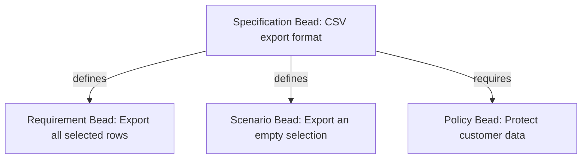
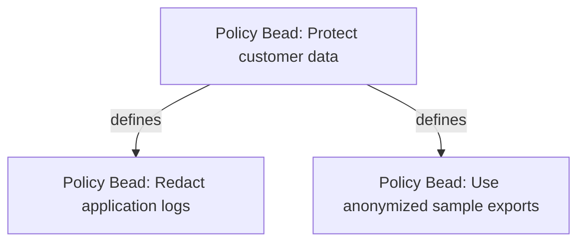
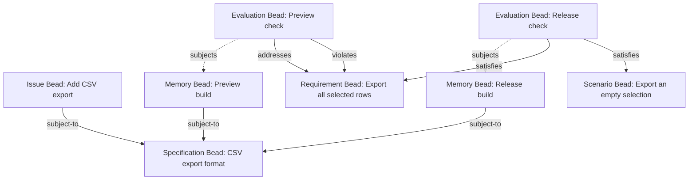
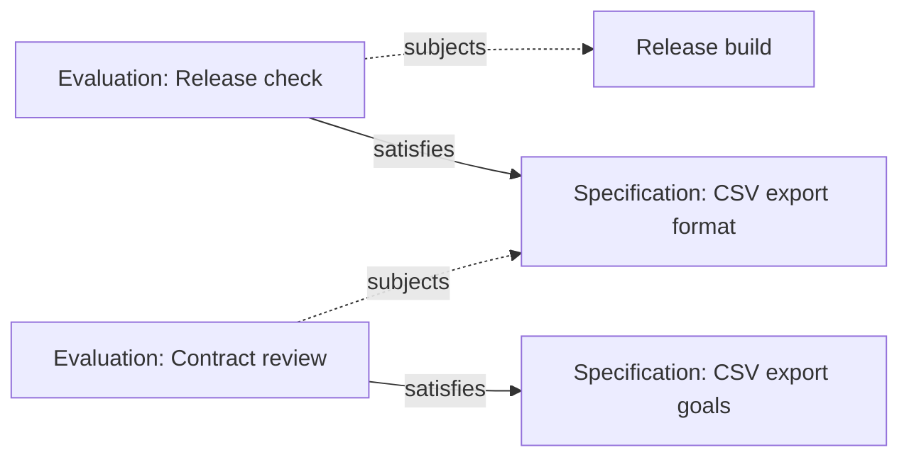
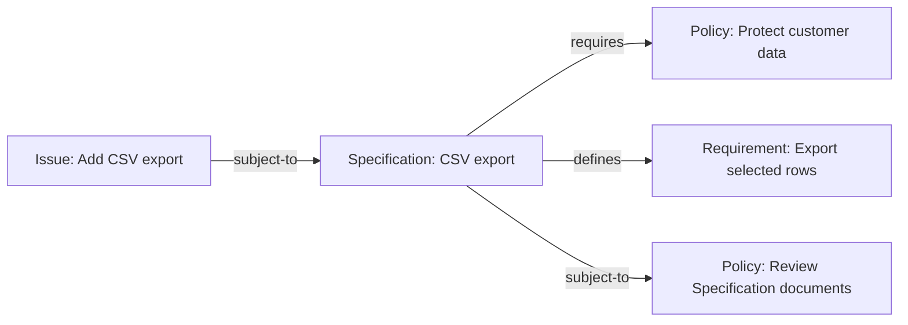
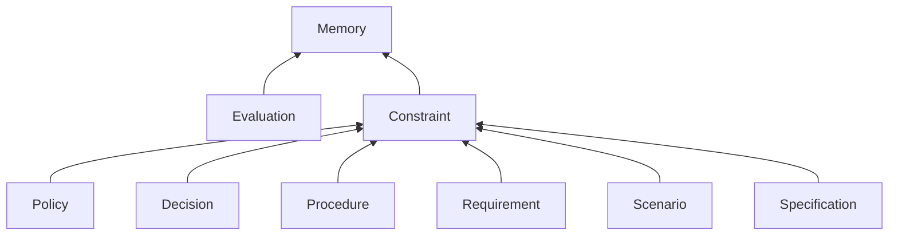
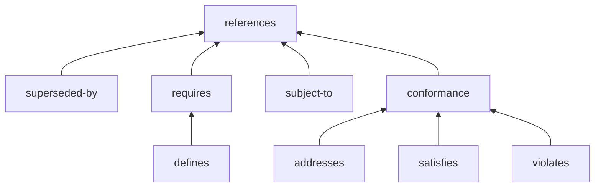

# [Memory] Memory Bead and Link Types

This proposal defines Memory Bead and Link Types and their common constraint-system behavior. It is a published design draft; the [publication scope](#publication-scope-and-deferred-specification-work) separates the selected model from deferred mechanics and implementation qualification. It builds on [Chris's Memory Beads proposal](https://github.com/gastownhall/beads/issues/5877).

Sections marked **informative**, including their subsections and examples, explain the design without adding requirements. The CLI sketch is also informative. All other contract text is **normative for this proposed design**. Normative status does not imply adoption or implementation; the publication-scope table identifies deferred work.

> **Validation status.** Historical JSON Schemas, `definitions.json`, and example fixtures retained alongside this draft describe the earlier catalog. Their passing checks do not validate this v0.2 catalog. Current implementation or qualification evidence must name the exact catalog revision and deliberately regenerated schemas and fixtures.

> **Evaluation update.** The accepted model places every conformance claim under an evaluation, for one full subject group assessed collectively. Donna selected **Evaluation** refining Memory as the concrete carrier. Its required nonempty `subjects` array contains exact Bead references shaped as `{"uri": "…", "revision": "…"}`; floating subject references are refused. This design selection does not itself install a Type identity, qualify an implementation, or select lifecycle automation.

## Overview (informative)

### Memory Beads and References Links

Memory Beads let agents record and recall knowledge in a graph that connects memories with Issues. The two general-purpose Types are [Memory Bead Type](#memory--bead-type) and [References Link Type](#references--link-type). A Memory Bead holds knowledge; a References Link connects it to useful context. The shared graph contract supplies identity, revision, and relationship rules, while the content can serve many purposes.

A Memory Bead's body holds arbitrary Markdown, and a References Link can have an optional Markdown body explaining the connection. Both also carry metadata for application-specific labels and structured data. The system preserves that content without interpreting arbitrary prose or metadata as executable rules.

### Revisions and replacement

Edit a Memory Bead when you are maintaining the same piece of knowledge. Its identity stays the same and it gains a new revision. Readers can distinguish the current content from earlier retained revisions.

Use a [Superseded By Link](#superseded-by--link-type) when a different Memory Bead takes its place. The Link points from the retiring Bead to its replacement. Each retiring Bead has at most one selected replacement, and replacement chains cannot form cycles. Retirement preserves the old Bead and its history; it does not delete it or automatically approve the replacement.

For example, a short deployment note might be replaced by a separately maintained deployment handbook. A Superseded By Link makes that change of identity explicit. Editing the original note would instead keep its identity.

Memory Beads, References Links, and Superseded By Links provide the general knowledge model. The Types below add a common system for expressing constraints and assessing whether they have been met.

### Shared constraint behavior

Agents also need to discover the rules governing their behavior and side effects. They should be able to find their obligations, understand what they must do or avoid, and inspect evidence about whether their work stayed within those obligations.

[Constraint](#constraint--bead-type) is the common Bead Type for obligations and restrictions. Policy Beads state governing rules. Decision Beads state choices that constrain later work. Procedure Beads describe how work is carried out, with the flow in the body. Requirement and Scenario Beads state required outcomes and conditions. Specification Beads describe intended results at any level of detail. These six Types refine the Constraint Bead Type and share its behavior. A plain Constraint Bead can hold a rule that needs no more specific Type; a plain Memory Bead can hold context and can itself be subject to constraints.

> **Custom Types (informative).** Creating and installing user-defined Bead or Link Types is not part of this proposal's initial Memory release surface. While that capability is unavailable, use the closest supported Bead or Link Type and put experimental labels or structured fields in metadata. Such conventions do not create new Type membership, validation, or executable behavior. Type refinement allows later Types to join the common model when custom Type support is introduced.

A Requires Link connects a Constraint Bead to another Constraint Bead necessary for satisfying it. The Defines Link Type refines the Requires Link Type and adds the defining-parent relationship. A Policy Bead can define subpolicy Beads; a Requirement Bead can define subrequirement Beads. Each child has at most one defining parent and keeps its own identity and history. A query over the Requires Link family includes Defines Links without needing a special case.

A Subject To Link declares that a Constraint Bead applies to any source Bead, including an Issue Bead. Addresses Links claim contributions, Satisfies Links claim complete satisfaction, and Violates Links claim breaches. The Conformance Link Type supplies the shared claim contract. Addresses, Satisfies, and Violates are peer Link Types refining Conformance: contribution, complete satisfaction, and breach are distinct assertions. Each claim is owned by an Evaluation Bead that identifies the assessed subjects. An evaluation has one nonempty subject group, and every claim it owns concerns that whole group collectively. Even a self-authored or unattested claim belongs to an evaluation. The actor authoring it is recorded through provenance, separately from the evaluation and its assessed subjects.

Selecting which rules govern an agent, establishing their authority, and evaluating their conditions still need precise contracts. This model makes obligations and claims inspectable. It does not select a solver or promise automatic evaluation of arbitrary prose.

## A worked example (informative)

### Define the obligations

A team wants users to export selected rows from a table. Its **CSV export format** Specification Bead defines a Requirement Bead, **Export all selected rows**, and a Scenario Bead, **Export an empty selection**. The Scenario Bead says that an empty selection produces column headings and no data rows.

The Specification Bead also requires a separately defined **Protect customer data** Policy Bead. The Defines Links identify the Specification Bead's own parts; the Requires Link brings in a necessary obligation from another defining tree.



### Organize the Policy Beads

The Policy Bead defines two more specific Policy Beads: **Redact application logs** and **Use anonymized sample exports**.



The subpolicy Beads use the ordinary Policy Bead Type. They can define further Policy Beads, and another Bead can require one without assigning it a second defining parent. The same structure supports subrequirement Beads.

Every defined child is necessary for its parent. That does not make the children collectively sufficient: the parent's body may contain other obligations. A body can explicitly state that the children form its complete acceptance condition. Structured ways to express that statement remain deferred.

### Apply the constraints and assess the work

An Issue Bead tracks the export work. Separate Memory Beads identify the preview and release builds. Subject To Links declare that the Specification Bead applies to each of these subjects. Following the Specification Bead's Requires Link family also discovers the Requirement, Scenario, and Policy Beads, including the subpolicy Beads.

The preview exports some selected rows. A preview Evaluation Bead identifies that build as its subject and owns an Addresses Link to the row-export Requirement. A validation run finds that numeric rows are omitted; the evaluation also owns a Violates Link to that Requirement, with supporting evidence. Contribution and breach can coexist.

A later release exports every selected row and handles an empty selection. A separate release Evaluation Bead identifies the release build as its subject and owns Satisfies Links to the Requirement and Scenario. Adding those claims revises the evaluation, not the release build.



Dashed arrows illustrate the `subjects` property references, not another stored Link Type. The solid assessment Links are owned by their Evaluation Beads.

The child-level claims do not automatically establish satisfaction of the whole Specification. A full claim must account for every obligation, including required Policies and their defined children. An unassessed log-redaction obligation remains unknown. Neither contribution nor the absence of a claim establishes violation.

An evaluation can instead identify a Web app and an API together. Every claim it owns then concerns that combination. A Satisfies claim about the pair does not imply that either component independently meets the Requirement. An individual claim needs a separate evaluation whose subject group is that individual Bead. Independent evaluations may assess the same group.

### Determining Conformance

Start with the subject and the Constraints that apply to it. Find its explicit or implicitly selected Subject To roots, then follow Requires, including Defines, to expose necessary obligations. Subject To is not transitive; a Constraint's own applicability declarations do not automatically bind the original subject.

Next, find evaluations whose subject groups concern the selected subject state, and inspect their owned Conformance-family claims. Preserve each evaluation's full group, selected revisions, evidence and context. A query for one member may show its participation in a collective assessment, but cannot present the group claim as individual satisfaction. Addresses claims contribution, Satisfies claims complete satisfaction, and Violates claims breach. These are recorded claims, not automatic verdicts; a missing relevant assessment leaves an obligation unknown.

Satisfaction can also be composed across compatible evaluations. Suppose one evaluation assesses the release against the format Specification, and another assesses that Specification alone against the export-goals Specification:



A view may explain an indirect claim about the release meeting the goals when the intermediate Specification revision and assessment contexts are compatible. This is composition of claims through their declared subjects, not a literal chain of Satisfies Links: every stored claim Link starts at an evaluation. If the second evaluation assesses the Specification together with something else, its collective claim cannot be distributed to the Specification alone. An Addresses step likewise supplies no automatic complete-coverage composition. The explanation retains the evaluations, subject bindings and claims; it neither creates a stored Link nor verifies the evidence.

## Memory and the CLI (informative)

**Design placeholder for review.** The content and stored relationships use the shared Bead and Link operations planned for Memory V1. Derived constraint queries and evaluators need the additional command contracts sketched here.

To simplify working with Memory Beads, the proposal will define the canonical `bd memory` command group and specify its relationship to the four existing commands: `bd remember`, `bd recall`, `bd memories`, and `bd forget`. The sketches below describe candidate behavior and names for discussion; they are not an accepted command grammar, an implementation claim, or a release allocation. Shared Bead and Link operations supply the underlying writes, reads, history, and Type semantics.

The main additional value of `bd memory` is to help people and agents discover governing Constraint Beads, inspect necessary obligations, and explain contribution, satisfaction, and breach claims. These operations accept any eligible subject Bead, including an Issue Bead. Constraint subtype recognition and Link-family traversal follow Type refinement, so a future supported Constraint subtype can use the same commands without extending a closed list of Type names. This does not expose custom Type creation in the initial release.

### Existing commands and the canonical group

The existing entry points should be compatibility aliases for the corresponding canonical operations, with the same underlying behavior. This table proposes the group spellings; the final contract must resolve inputs, selection, output, errors, and compatibility before those spellings are adopted.

| Existing entry point | Candidate canonical spelling | Behavior to specify |
| --- | --- | --- |
| `bd remember` | `bd memory remember` | Deliberate capture of Memory content. Specify Type selection, title/body input, keys if supported, and how creation is distinguished from an explicit update under the shared write contract. |
| `bd recall` | `bd memory recall` | Return the complete selected Memory state. Specify current/exact selection, empty-body behavior, included Links and provenance, and plain versus structured output. |
| `bd memories` | `bd memory list` | Discover and list Memory Beads. Specify search and filters, plain Memory Beads versus subtype selection, summaries, ordering, and truthful result bounds. |
| `bd forget` | `bd memory forget` | Delete selected Memory through the shared deletion/history contract. Specify guards, retained history, incident-Link effects, errors, and output; do not equate deletion with Superseded By retirement. |

The shared `bd create`, `bd update`, `bd delete`, `bd show`, `bd list`, and history operations continue to apply to these Bead Types. `bd types` enumerates the supported Types. The Memory group should share their identity, authorization, validation, failure, and history semantics. A shorter spelling must not introduce a second mutation model.

### Optional Type-specific creation shortcuts (informative)

A convenience spelling could select a Type while delegating to ordinary `bd create`. For example, `bd memory policy <title>` could create a Policy Bead, and `bd memory decision <title>` could create a Decision Bead. Body input and any distinct optional properties would use the eventual shared input conventions.

These are optional shorthand candidates. They do not create a `kind` field, change Type contracts, infer authority or applicability, or automatically add Defines, Subject To, or assessment Links. A generic creation path must remain available for every supported Type. Future custom Type support can use the same path without requiring a built-in shortcut. Whether shortcuts use noun commands or a form such as `bd memory create policy` remains open.

### Constraint queries and explanations (informative)

The following sketches identify useful questions before settling exact syntax. Angle-bracket arguments are illustrative selectors, not assigned Bead identities. These views can compose shared query facilities and the constraint-system rules; the design does not require a separate query language for Memory.

| Candidate operation | Question answered | Useful result |
| --- | --- | --- |
| `bd memory constraints <subject>` | What Constraints govern this Bead? | Explicit and implicitly selected Subject To roots, necessary obligations reached through Requires/Defines, and supporting paths. Do not inherit Subject To declarations made by another subject. Distinguish direct declarations from derived applicability. |
| `bd memory requires <constraint>` | What is necessary for satisfying this Constraint? | The Requires-family closure, including Defines. Show the defining tree separately from cross-tree dependencies, retaining shared targets and cycles without counting repeated visits as progress. |
| `bd memory coverage <subject>` | What do the evaluations claim about this subject or a group containing it? | Applicable obligations with evaluations, their full assessed groups and owned Satisfies, Addresses, and Violates claims; compatible indirect claim composition; evidence; contradictions; and missing or unresolved assessments. A target selector could optionally narrow the view. |
| `bd memory explain <subject> <constraint>` | Why does this Constraint apply, and what supports the assessment? | The explicit Link or predicate-match explanation, all reported derivation paths, selected revisions/context, evaluation identities and full subject groups, supporting claim Links and evidence, and reasons composition is unavailable or disputed. |

For example, a table view of coverage might contain:

```text
Subject: <selected Issue>

Constraint                 Claim summary        Applicability path
CSV export Specification   contribution claimed subject-to
Export selected rows       satisfaction claimed subject-to -> defines
Protect customer data      conflicting claims   subject-to -> requires
Redact application logs    unknown              subject-to -> requires -> defines
```

This is an illustrative presentation, not a prescribed output schema. Claim summaries identify what was asserted; they are not verified verdicts or values written into the Beads' open `status` properties. A contribution does not establish known incompleteness, and unknown does not establish a violation. An N/A Satisfies Link explanation should be visible with its condition and evidence.

Human views could offer tables, dependency trees, and graphs. Trees need references for shared targets and cycle markers so a general dependency graph is not misrepresented as a defining tree. Machine-readable output should preserve selected subject/Constraint identities and revisions, evaluation identities and full subject groups, Link identities and Types, paths, provenance/evidence, and unresolved or bounded results. A collective assessment involving a selected member must remain distinguishable from an assessment of that member alone. Exact rendering and output shape remain open.

### CLI decisions still to make

- Final group verbs and compatibility mappings, including whether the familiar `remember`, `recall`, and `forget` spellings are also the group verbs.
- Creation shortcuts, input conventions, and the scope of any future domain-tuned update/show/delete behavior.
- Subject and target selection, context/scope, current/exact reads, listing defaults, and query bounds.
- Table/tree/graph presentation, machine-readable output, diagnostics, and exit behavior for findings versus execution failures.
- The boundary between showing recorded claims, composing compatible satisfaction claims through evaluations, and running an actual evaluator. A read/query view does not automatically run tests, interpret arbitrary prose, or author assessment Links.

The published Type catalog can proceed independently of this CLI design. Specifying these command contracts is required follow-up work; executable support for predicates, assessment, and revision composition remains subject to the explicit deferrals below.

## Constraint-system behavioral contract

Constraint is the common Bead Type for this system. The Specification, Policy, Decision, Procedure, Requirement, and Scenario Bead Types refine Constraint and inherit this contract. Their distinct meanings and additional properties remain useful, but they do not need separate dependency, applicability, or assessment rules. Future supported Constraint subtypes participate through Type refinement; creating or installing custom Types is outside this proposal's initial release surface. The rules below apply to each Link family, including its refining Types.

A **subject** is the Bead whose obligations or behavior are being considered. An evaluation assesses one subject group: one or more Beads with selected revisions. All of its claims concern that group collectively; a different group needs a separate evaluation. It can have any Bead Type, including an Issue Type; being subject to a Constraint Bead does not make the subject itself a Constraint Bead. Constraint targets include every Type refining Constraint. “Any Bead” is an endpoint category without a Type restriction, not a new Bead Type or a closed union of known names. Link and opaque external-Resource endpoints are not added by that category.

| Type | Common behavioral contract |
| --- | --- |
| Constraint | States obligations, restrictions, and their conditions in its body. Its meaning and inherited rules apply to every Constraint subtype. |
| Subject To | Any Bead → Constraint. Declares applicable obligations without transitive Subject To inheritance. Necessary obligations are reached through Requires. It makes no assessment claim. |
| Requires | Constraint → Constraint. Makes its target necessary for satisfying its source; necessity composes transitively. |
| Defines | Refines Requires. Adds the defining-parent role, at most one defining parent per child, and an acyclic defining tree. |
| Conformance | Evaluation → Constraint. Abstract common claim contract; the evaluation owns the claim, which concerns its whole subject group. Membership selects no conclusion or general transitivity rule. |
| Addresses | Refines Conformance. Claims a contribution without asserting complete satisfaction or known failure. It does not compose automatically. |
| Satisfies | Refines Conformance. Claims complete satisfaction, potentially unattested. Compatible Satisfies claims compose through explicitly bound evaluation subjects, without distributing group claims. |
| Violates | Refines Conformance. Claims a specific breach, with no implicit transitivity. |

Subject To is not transitive. If X is subject to A and A is subject to B, B applies to A; that path alone does not make B apply to X. A Policy requiring Specification documents to undergo security review governs the Specification document, not every Issue or release governed by that Specification.

Necessary obligations are discovered through Requires. If X is subject to A and A requires B, then B is an obligation for X. Follow the complete Requires family, including Defines and further Requires dependencies, for compatible revisions and context. A view retains each supporting path and distinguishes derived obligations from direct Subject To declarations; it creates no inferred stored Links. Repeated visits and cycles add no obligations or evidence of satisfaction.

For example, an export Specification requires a data-protection Policy and defines a row-export Requirement. An Issue subject to that Specification must account for both necessary obligations. The Specification may separately be subject to a document-review Policy without imposing that document-review process on the Issue.



Applicability does not propagate through Subject To chains, unrelated References Links, Issue Dependencies, project membership, or ownership relationships. Separate assessment Links describe contribution, satisfaction, or breach; neither applicability nor a closed Issue status establishes satisfaction.

### Explicit declarations and implicit selection

**Policy Beads as applicability entry points (informative).** An agent could receive a Policy Bead describing which subjects are governed by which Constraint Beads. For example, an applicability Policy Bead could state that Issues concerning customer data are subject to a particular data-protection Policy Bead. Such a Policy Bead could become a useful root for discovering an agent's governing rules. This is a use case for the evaluator design, not an automatic interpretation of the Policy Bead's body.

The applicability representation remains open: an inline predicate on the Constraint Bead and a Link to a Policy Bead supplying the selection rule are both candidates for implementation experiments. Using a Policy Bead to determine applicability is distinct from declaring that a subject is itself subject to that Policy Bead. No new applicability Link Type, authority rule, or executable Policy-body language is selected here.

Constraint's optional `applicability` property is an executable predicate selecting additional subjects. A match implicitly establishes Subject To applicability; it does not create a stored Link. Explicit Subject To declarations and matching predicates are independent inclusions. Their union supplies starting relationships for Requires-family obligation discovery above. A non-match does not filter an explicit Link or remove an obligation reached through another path. Omitting the property adds no predicate-selected subjects; it does not select every Bead or remove explicit applicability.

Evaluation takes the predicate, a selected subject revision, and an explicit context snapshot. Within a selected authority and search scope, it returns match, non-match, or unresolved, retaining the rule, relevant facts, and revisions as its explanation. Missing or inaccessible information must not silently become a non-match. The concrete predicate representation, including the inline-field versus linked-Policy choice, available inputs and operators, graph-query boundaries, and authority rules remain open; this draft selects executable inclusion semantics, not a query syntax or automatic interpretation of prose.

Conditions and exceptions in the Constraint Bead itself are a different matter. The body can state a conditional obligation, such as “If the export contains personal data, anonymize it.” When an assessment establishes that there is no personal data and accounts for every other obligation, it can make a Satisfies Link claim because the condition imposes no work in that case. The subject remains discoverably subject to the Constraint Bead; the assessment explains why its obligations are discharged.

An evaluator may author an Evaluation Bead and its Satisfies Link with a title such as `N/A — no personal data`, a body naming the exception and its reasoning, and evidence identifying the assessed facts and revisions. It remains an ordinary full-satisfaction claim, potentially unattested or disputed. `N/A` is a display convention, not a new status, Link Type, or machine-interpreted value. Evaluation does not automatically store assessment Links. Unknown conditions do not justify an N/A conclusion.

A parent exception does not silently remove its Requires dependencies or Defines children. A parent Satisfies claim must still account for those necessary obligations. How to express a parent condition that also qualifies its dependencies remains open. An empty child set alone still establishes no satisfaction: an N/A assessment needs a stated condition or exception and a reason it applies to the assessed case.

### Discovery, assessment, and evidence

A generic constraint view recognizes Constraint and every Type refining it. It uses Type refinement, not a fixed enumeration of Policy, Decision, Procedure, Requirement, Scenario, or Specification. A future supported Constraint subtype inherits the common contract and may add its own properties or restrictions. This design does not require arbitrary public Type creation or installation as a prerequisite for the first release.

The caller identifies the subject, context or governing roots to examine, and the relevant revisions. A Subject To Link declares an applicable Constraint Bead for any source Bead; predicate matches can supply additional implicit starting relationships. Within the selected context, the view takes the subject's explicit or implicitly selected Subject To roots, then follows those Constraints' Requires Link families, including Defines, to find the complete reachable set of necessary obligations. It does not follow another Constraint's Subject To Links as if they bound the original subject. A dependency can cross defining trees without giving its target another defining parent. How an agent or task selects its subject and roots, who can establish binding applicability, and detailed traversal/revision mechanics remain open. A direct References Link supplies context without making its target a governing constraint. No inferred stored Subject To Links are created by dependency traversal.

A coverage view can examine a selected Bead, including an Issue, a Constraint, or a Memory Bead describing a release. It finds evaluations with the relevant subject bindings and reads their owned claims, preserving the complete group. It does not substitute the evaluation itself for its assessed subjects. Querying the Conformance family includes Addresses, Satisfies, and Violates; querying the Requires family includes Defines. An Addresses-only query does not include its peer Satisfies or Violates Types. The view distinguishes applicable obligations declared through Subject To, authored and composed Satisfies claims, contributions through Addresses, explicit Violates claims, and unknown assessment. Subject To alone supplies no assessment. Absence of a relevant assessment claim means unknown, not violation; absence of an Addresses Link alone does not mean unknown when a Violates Link claim exists. Missing supporting evidence leaves verification unresolved, even when a full-coverage claim is recorded. The view shows the participating revisions, context, supporting Links, and available evidence so a caller can inspect the result.

Every outgoing Requires target is necessary for its source, including targets reached through Defines and through further Requires relationships. The parent's own body constraints still apply. A full claim about the parent asserts that those obligations have been met, but the claim itself is not verification. Child claims do not create an inferred stored parent Link, and satisfying all children is sufficient only when that completeness is explicitly asserted. A childless Constraint Bead is not automatically satisfied. If the same complete subject group, with compatible selected revisions and context, is claimed to violate a necessary Constraint Bead, a parent Satisfies claim is contradicted for compatible revisions and the same applicable context. Preserve both claims and expose the conflict; a violation claim itself still needs assessment. This reasoning creates neither a parent Violates Link nor an Addresses Link: failure alone establishes no contribution. Claims about another subject group, revision, or context must not be combined as if they concerned the same assessed scope. Overlapping groups, or a compound Bead and a list of its apparent components, are not automatically equivalent subject groups. Detailed reconciliation of conflicting evidence remains open.

The Conformance Link Type declares optional evidence text, such as test, review, execution, or source pointers. Addresses, Satisfies, and Violates inherit it. Every such claim is owned by an evaluation, including self-authored and unattested claims. A validator authors an evaluation and its claims about the declared subject group; neither the actor nor the group members replace the evaluation as the claim Link's source. Independent runs may create evaluations for the same group, retaining their claims, evidence and provenance. Link counts, an evaluation's existence, and a test-run label are not verification. A later claim does not silently replace earlier claims.

The Evaluation Type below supplies the selected owner contract and requires exact subject-revision references. Structured context/run evidence and lifecycle details remain open. No direct, unowned subject-to-Constraint claim form is retained as an alternative. This proposal supplies no solver, general constraint language, or automatic interpretation of arbitrary prose.

### Issue workflow and assessment boundaries

A Bead is eligible for dispatch only if its actual Type is Issue or refines Issue. Type membership alone does not establish readiness: ordinary Issue workflow rules still apply. Memory or Constraint membership, a status label, and the presence of Subject To or Conformance-family Links do not confer dispatch eligibility. Blocking semantics must be expressed by a Link whose Type is Dependency or refines Dependency; neither Requires nor Subject To becomes an Issue Dependency merely because it connects obligations.

Closing an Issue records a workflow transition, not a Satisfies claim or a verified conformance result. Automation must not infer satisfaction from closed status or create assessment claims merely to reflect closure. A consumer using coverage as a release, compliance, or closing gate owns the acceptance and reconciliation policy. It must identify the evidence and authority it accepts, assessed revisions and context, and its handling of missing, conflicting, inaccessible, or bounded results. A claim's presence, a test-run label, and Link counts alone establish no verification.

### Evaluation ownership and lifecycle

The evaluation owns the entire Conformance family. Creating, changing or deleting a claim revises the evaluation, not an assessed subject or the target Constraint. An evaluation's own Subject To declarations govern the evaluation; they do not silently impose obligations on every member of its subject group.

The first successfully accepted Evaluation state binds its exact subject group to the Bead identity. The binding survives retyping away from Evaluation and later back to Evaluation, including repeated transitions and periods with no owned claims. Returning to Evaluation must preserve that same group; reordering its exact subject references is allowed. A different group requires a new Evaluation Bead identity, not a new revision or a retyping cycle of the existing identity. An ordinary `subjects` extension property on a Bead that has never been an Evaluation does not establish the binding; it is established only when the Bead first successfully becomes an Evaluation or one of its subtypes. This rule states the invariant without choosing a storage representation or history-retention mechanism.

Grouping claims under their evaluation supports deliberate cleanup of that assessment. Ownership alone selects no deletion cascade, hard erasure, or retention exception. The exact operation for removing an evaluation and its live claims must follow the shared write/history contract and remains to be specified. Earlier retained evaluations and evidence must not be silently rewritten as though they never existed.

### Type-constraint enforcement

An implementation claiming enforcement must validate affected Type constraints on create, update, and delete, including graph effects on surviving Beads and Links. This includes Defines' single-parent rule and the selected Defines and Superseded By acyclicity rules. Invalid resulting state must be rejected atomically at the shared contract's commit boundary; concurrent writes must not jointly evade an invariant. A merged graph must be validated before it is admitted as valid state. Batch validation follows the accepted shared transaction contract; this statement selects no storage or branch-merge mechanism. Read-time diagnostics alone do not constitute enforcement.

## Reading the definitions (informative)

Prose uses names such as Memory Bead and References Link to distinguish the resources. In headings, Type tables, refinement declarations, and property-origin columns, the shorter names identify the Types themselves. Code formatting identifies literal commands, property names, and precise Type spellings, such as `references` or `superseded-by`.

The **Refines** relationship connects Types: every valid instance of the source Type must meet the target Type's structural and semantic promises. The source inherits the target's properties and rules and may add restrictions. This universal implication is conceptually closer to Requires necessity than to a claim that one subject satisfies a Constraint. It does not declare Refines to be a Requires subtype or turn the `type` field into a Conformance Link. For example, a Decision Bead inherits `title`, `body`, and `status` from the Memory Bead Type. The **Defined by** column identifies which Type introduces a property. The diagrams show Type refinement with an arrow from the more specific Type to its parent. The shared Type-to-Type relationship is named Refines in this design; older source revisions call it ConformsTo. This naming decision preserves its universal structural and semantic promise. It does not automatically rename stored identifiers, wire fields, or installed definitions.

Links have a source and a target. An **owned Link** is part of its source Bead's versioned content. Adding, changing, or deleting that owned Link creates a new revision of the source Bead. For example, adding a Requirement Bead to a Specification Bead with an owned `defines` Link changes what that Specification Bead defines, so the Specification Bead gets a new revision. The Link change does not revise the target Requirement Bead.

Ownership is declared by the source Bead Type for particular outgoing Link Types. An unowned Link has its own identity and history, and changing it does not revise either endpoint. Ownership describes revision behavior; it does not give permission to edit or delete the target.

## Bead Types

The following definitions specify the Bead Types. Examples labelled informative illustrate their use and add no rules.

| Bead Type | Meaning |
| --- | --- |
| [Memory](#memory--bead-type) | A Memory Bead holds knowledge that should remain available for later use. All other Bead Types in this list refine Memory. |
| [Evaluation](#evaluation--bead-type) | Concrete carrier for an evaluation of one collective subject group, bound to exact Bead revisions; owns every claim it makes. |
| [Constraint](#constraint--bead-type) | A Constraint Bead states an obligation or restriction; its subtypes share discovery and coverage rules. |
| [Policy](#policy--bead-type) | A Policy Bead states a governing rule for a project or organization. |
| [Decision](#decision--bead-type) | A Decision Bead explains a choice and the reasons for making it. |
| [Procedure](#procedure--bead-type) | A Procedure Bead explains how to carry out a repeatable task. |
| [Requirement](#requirement--bead-type) | A Requirement Bead states an outcome or constraint that must be met. |
| [Scenario](#scenario--bead-type) | A Scenario Bead describes a concrete situation and the outcome expected in it. |
| [Specification](#specification--bead-type) | A Specification Bead describes an intended result and refines Constraint. |



### Memory — Bead Type

**Meaning and use.** A Memory Bead holds knowledge you want to use again. Use a plain Memory Bead for a general note, or choose one of the more specific Bead Types defined here. The title helps readers find the Bead, and the body holds the knowledge itself. Choosing a Type is an explicit authoring action; the content does not automatically change the Bead's Type. Constraint Beads can define other Constraint Beads. Plain Memory Beads supply context through References Links.

**Example (informative).** A Memory Bead might explain an unexpected behavior in the project's export tool.

**Refines.** None within this catalog. It is the common parent of the named Memory Types below.

**Properties.**

| Name | Type | Defined by | Use and meaning |
| --- | --- | --- | --- |
| `title` | Required nonblank text | Memory | Human-readable name for discovery and display. |
| `body` | Required Markdown text; may be empty | Memory | The Bead's primary content, preserved as authored. |
| `status` | Optional nonblank open string | Memory | Organization-defined lifecycle label (e.g., draft, approved). Organizations choose their own values; this property adds no built-in workflow or approval effect. |

**Owned outgoing Link Types.**

| Link Type family | Declared by | Effect |
| --- | --- | --- |
| `subject-to` | Memory | Owns applicability declarations; a Link change revises the source. |
| `superseded-by` | Memory | Revises the retiring source when its replacement Link changes. |

### Evaluation — Bead Type

**Design status.** Donna selected Evaluation refining Memory, with Conformance-family ownership and a required nonempty array of exact subject references. This extends MEM-DEC-010's accepted owner/group contract with the concrete carrier and subject-reference shape. Installation, implementation qualification, special lifecycle automation and ephemeral-output framing are separate; no installed Type identity is inferred from this document. `subjects` is a typed property, not a metadata convention.

**Meaning and use.** An Evaluation Bead records an assessment of one subject group against one or more Constraints. Its body explains the evaluation, its context and method. Its `subjects` property identifies the Beads and selected revisions being assessed. The evaluation owns Addresses, Satisfies and Violates Links to Constraint Beads; those Links record the conclusions and supporting evidence. Self-authored or unattested claims use the same model. The evaluation record and its claims do not by themselves establish verification or trusted authority.

Every owned claim concerns the whole subject group collectively. The first accepted Evaluation state binds that group to the Bead identity, even if the Bead is later retyped away from Evaluation and back. A different group needs a new Evaluation Bead identity, without per-claim subset selectors. Multiple independent evaluations may assess the same group. A compound subject remains its own Bead identity; its apparent components are not automatically substituted for it. Evaluation and assessed-subject identities are distinct, so recording a claim does not revise an assessed subject; another evaluation can assess an Evaluation Bead.

**Example (informative).** An evaluation assesses a Web app and an API together against an export Requirement. Its Satisfies claim concerns the combination. A query for the Web app can show that collective assessment as context, but an individual satisfaction claim needs an evaluation of the Web app alone.

**Refines.** Memory.

**Properties.** `subjects` is a required nonempty array of exact Bead references. Each member is an object with required `uri` and `revision` members identifying a Bead of any Type and the exact revision assessed. The URI and opaque revision follow the shared Bead-reference contracts. A bare URI or an object without a revision is a floating subject reference and is refused; never silently substitute a newer revision for the one assessed. This property does not change the current-versus-exact policy of other Link endpoints.

**Example subject value (informative).**

```json
[
  {"uri": "https://beads.example/acme/beads/web-app", "revision": "web-r2"},
  {"uri": "https://beads.example/acme/beads/api", "revision": "api-r7"}
]
```

These URIs and revision tokens are illustrative, not assigned identities or revisions. The array declares one collective subject group; the claims do not select subsets.

| Name | Type | Defined by | Use and meaning |
| --- | --- | --- | --- |
| `title` | Required nonblank text | Memory | Human-readable name for this evaluation. |
| `body` | Required Markdown text; may be empty | Memory | Primary account of the assessment, method, context and caveats. |
| `status` | Optional nonblank open string | Memory | Descriptive lifecycle label; no automatic verification, approval or conclusion. |
| `subjects` | Required nonempty array of exact Bead references: `{uri, revision}`; floating references refused | Evaluation | Full collective scope of every owned claim. The first accepted Evaluation state binds the group to this Bead identity across retyping; array order is immaterial. A different group requires a new Evaluation identity; no per-claim subset selector. |

**Owned outgoing Link Types.**

| Link Type family | Declared by | Effect |
| --- | --- | --- |
| `conformance` | Evaluation | Owns every concrete Conformance-family claim, including Addresses, Satisfies and Violates. A claim mutation revises this evaluation, not its assessed subjects. |
| `subject-to` | Memory | Inherited ownership; declares Constraints on the evaluation itself. |
| `superseded-by` | Memory | Inherited replacement relationship; does not silently replace or erase the assessed subjects or earlier claims. |

### Constraint — Bead Type

**Meaning and use.** A Constraint Bead states an obligation or restriction governing behavior, side effects, or outcomes. Use the Constraint Bead Type directly for a general rule, or choose a Policy, Decision, Procedure, Requirement, Scenario, or Specification Bead when one expresses the rule more clearly. Additional subtypes can inherit these rules when custom Type support is introduced; that authoring surface is not selected for the initial release. Type membership identifies a Constraint Bead, independently of any experimental metadata labels.

The body carries the constraint itself, including conditions, exceptions, and any explicit statement of what is sufficient to meet it. Its optional executable `applicability` predicate selects additional subjects without filtering explicit Subject To Links. A Satisfies Link claim may explain that a stated exception leaves no active obligation in the assessed case; this is vacuous satisfaction, not evidence that the subject performed work. Every Requires target, including each Defines child, is necessary for satisfying the source Constraint. All such children and the parent's own constraints must be accounted for. Plain Memory Beads can supply explanations through References Links without becoming required Constraint Beads. Neither an empty child set nor evidence for only some children establishes satisfaction of the parent.

A Constraint Bead can be a source or target of Subject To and can be an assessed subject or claim target. Any Bead Type, including Issue, can be assessed through an evaluation. Conformance-family Links originate at the evaluation, not at the assessed subject. Subject To Links declare applicability. Addresses Links claim contributions without asserting completeness; Satisfies Links add complete-satisfaction claims. Violates Links claim specific breaches and do not refine the Addresses Link Type. Assessment Links do not by themselves verify their claims. Status remains an optional descriptive label and adds no approval or enforcement effect.

**Example (informative).** A general Constraint Bead can state "No customer secrets may leave the approved environment". Put experimental context in metadata on a supported Type while custom Type authoring is unavailable; that metadata does not create a new Constraint subtype or an executable rule.

**Refines.** Memory.

**Properties.** Introduces optional applicability as a design extension whose concrete executable representation is deferred; it inherits Memory's title, body, and optional status.

| Name | Type | Defined by | Use and meaning |
| --- | --- | --- | --- |
| `title` | Required nonblank text | Memory | Human-readable name of the obligation or restriction. |
| `body` | Required Markdown text; may be empty | Memory | The constraint and its conditions, preserved as authored. An empty body does not establish that the constraint is satisfied. |
| `status` | Optional nonblank open string | Memory | Organization-defined label; no automatic approval, applicability, or workflow effect. |
| `applicability` | Optional executable subject-selection predicate; concrete representation deferred | Constraint | Matches add implicit Subject To applicability without filtering explicit declarations or inherited obligations. |

**Owned outgoing Link Types.**

| Link Type family | Declared by | Effect |
| --- | --- | --- |
| `requires` | Constraint | Owns the entire Requires family, including Defines; a Link change revises the source. |
| `subject-to` | Memory | Inherited ownership of applicability declarations. |
| `superseded-by` | Memory | Inherited ownership; revises this Bead when its replacement Link changes. |

### Policy — Bead Type

**Meaning and use.** A Policy Bead states a rule governing how a project or organization works, including constraints on an agent's behavior and side effects. Put the rule and its scope in the body so readers can tell when it applies. Explain its authority there, cite another Bead with a References Link, or identify the issuing person or governing source with `authority`. Defines Links can organize more specific Policy Beads beneath it. A Satisfies Link owned by an evaluation claims that its full subject group meets the Policy Bead's obligations; it does not approve or change the Policy Bead.

**Example (informative).** A Policy Bead might require customer data to be removed from sample exports.

**Refines.** Constraint; transitively Memory.

**Properties.**

| Name | Type | Defined by | Use and meaning |
| --- | --- | --- | --- |
| `title` | Required nonblank text | Memory | Name of the rule. |
| `body` | Required Markdown text; may be empty | Memory | Rule, scope, rationale, and any source citation. |
| `status` | Optional nonblank open string | Memory | Organization-defined lifecycle label (e.g., draft, approved); no automatic workflow effect. |
| `applicability` | Optional executable subject-selection predicate; concrete representation deferred | Constraint | Matches add implicit Subject To applicability without filtering explicit declarations or inherited obligations. |
| `authority` | Optional URI or `{uri, revision}` Reference | Policy | Identifies the person, role, or governing source that issued the rule. |

The `authority` value identifies who or what issued the Policy Bead; it is a claim of authority, not proof of approval.

**Owned outgoing Link Types.**

| Link Type family | Declared by | Effect |
| --- | --- | --- |
| `requires` | Constraint | Inherited ownership of Requires and its specializations, including Defines. |
| `subject-to` | Memory | Inherited ownership of applicability declarations. |
| `superseded-by` | Memory | Inherited ownership; revises this Bead when its replacement Link changes. |

### Decision — Bead Type

**Meaning and use.** A Decision Bead explains a choice and why it was made. It constrains subsequent behavior and side effects that must conform to that choice. The body can explain alternatives and consequences. Defines Links can identify finer-grained Decision Beads. A Satisfies Link claims that the work follows the chosen direction; it does not establish that the choice was justified or approved. If a later choice replaces this one, create a new Decision Bead and give the earlier Bead a Superseded By Link to its replacement. Editing the earlier Bead instead continues its identity.

**Example (informative).** A team might choose CSV for its first export format because its users already work in spreadsheets.

**Refines.** Constraint; transitively Memory.

**Properties.**

| Name | Type | Defined by | Use and meaning |
| --- | --- | --- | --- |
| `title` | Required nonblank text | Memory | The decision's subject or chosen direction. |
| `body` | Required Markdown text; may be empty | Memory | Choice, rationale, consequences, and any alternatives worth recording. |
| `status` | Optional nonblank open string | Memory | Organization-defined lifecycle label (e.g., draft, accepted); no automatic workflow effect. |
| `applicability` | Optional executable subject-selection predicate; concrete representation deferred | Constraint | Matches add implicit Subject To applicability without filtering explicit declarations or inherited obligations. |
| `authority` | Optional URI or `{uri, revision}` Reference; working shape | Decision | Identifies the person, team, or governing body that made the decision. |

**Owned outgoing Link Types.**

| Link Type family | Declared by | Effect |
| --- | --- | --- |
| `requires` | Constraint | Inherited ownership of Requires and its specializations, including Defines. |
| `subject-to` | Memory | Inherited ownership of applicability declarations. |
| `superseded-by` | Memory | Inherited ownership; revises this Bead when its replacement Link changes. |

### Procedure — Bead Type

**Meaning and use.** A Procedure Bead explains how to carry out a task that people or agents may need to repeat. Put the flow, steps, and relevant conditions in the body. Defines Links identify meaningful parts that can be assessed independently, such as named subprocedure or subpolicy Beads; the Links do not encode execution order. A Satisfies Link owned by an evaluation of a concrete run claims that the run followed the instructions and applicable conditions. Keep the method separate from the account and evidence of a particular execution.

**Example (informative).** A release checklist explains the steps to repeat for each release.

**Refines.** Constraint; transitively Memory.

**Properties.**

| Name | Type | Defined by | Use and meaning |
| --- | --- | --- | --- |
| `title` | Required nonblank text | Memory | Name of the method. |
| `body` | Required Markdown text; may be empty | Memory | The instructions and relevant conditions. |
| `status` | Optional nonblank open string | Memory | Organization-defined lifecycle. |
| `applicability` | Optional executable subject-selection predicate; concrete representation deferred | Constraint | Matches add implicit Subject To applicability without filtering explicit declarations or inherited obligations. |

**Owned outgoing Link Types.**

| Link Type family | Declared by | Effect |
| --- | --- | --- |
| `requires` | Constraint | Inherited ownership of Requires and its specializations, including Defines. |
| `subject-to` | Memory | Inherited ownership of applicability declarations. |
| `superseded-by` | Memory | Inherited ownership; revises this Bead when its replacement Link changes. |

### Requirement — Bead Type

**Meaning and use.** A Requirement Bead states something that must be true of the intended result. Another Constraint Bead, such as a Specification Bead or parent Requirement Bead, can define it. Use Defines Links to break it into subrequirement Beads; each child has at most one defining parent. Other Beads can require that same Requirement Bead or describe work that meets it without defining a duplicate.

**Example (informative).** 'An export must include every row selected by the user' describes an outcome that an implementation can be checked against.

**Refines.** Constraint; transitively Memory.

**Properties.**

| Name | Type | Defined by | Use and meaning |
| --- | --- | --- | --- |
| `title` | Required nonblank text | Memory | Short description of the demanded outcome or constraint. |
| `body` | Required Markdown text; may be empty | Memory | The full obligation and interpretation. |
| `status` | Optional nonblank open string | Memory | Organization-defined lifecycle. |
| `applicability` | Optional executable subject-selection predicate; concrete representation deferred | Constraint | Matches add implicit Subject To applicability without filtering explicit declarations or inherited obligations. |

**Owned outgoing Link Types.**

| Link Type family | Declared by | Effect |
| --- | --- | --- |
| `requires` | Constraint | Inherited ownership of Requires and its specializations, including Defines. |
| `subject-to` | Memory | Inherited ownership of applicability declarations. |
| `superseded-by` | Memory | Inherited ownership; revises this Bead when its replacement Link changes. |

### Scenario — Bead Type

**Meaning and use.** A Scenario Bead makes an expected outcome concrete by describing a situation. Another Constraint Bead, such as a Specification Bead, can define it through a Defines Link. Its body describes the situation and expected outcome. Whether a particular test exercised the scenario or established its outcome needs a separate claim and evidence. Requirement and Scenario Beads remain distinct so authors can write and find either form.

**Example (informative).** 'A user with no selected rows requests an export and receives an empty file with column headings' explains what should happen in that case.

**Refines.** Constraint; transitively Memory.

**Properties.**

| Name | Type | Defined by | Use and meaning |
| --- | --- | --- | --- |
| `title` | Required nonblank text | Memory | Short name of the case. |
| `body` | Required Markdown text; may be empty | Memory | Situation, actors, actions, and relevant outcomes. |
| `status` | Optional nonblank open string | Memory | Organization-defined lifecycle. |
| `applicability` | Optional executable subject-selection predicate; concrete representation deferred | Constraint | Matches add implicit Subject To applicability without filtering explicit declarations or inherited obligations. |

**Owned outgoing Link Types.**

| Link Type family | Declared by | Effect |
| --- | --- | --- |
| `requires` | Constraint | Inherited ownership of Requires and its specializations, including Defines. |
| `subject-to` | Memory | Inherited ownership of applicability declarations. |
| `superseded-by` | Memory | Inherited ownership; revises this Bead when its replacement Link changes. |

### Specification — Bead Type

**Meaning and use.** A Specification Bead describes what a result must do clearly enough for someone to check it. It may state high-level goals or turn another Specification Bead's goals into detailed Requirement and Scenario Beads, using Defines Links for the ones it introduces. Its optional status can distinguish draft from accepted without changing Type. A Bead identifying the result can link to the obligations it meets. A more detailed Specification Bead can contribute to a broader one through Addresses or Satisfies Links; an older Specification Bead can select its replacement through a Superseded By Link.

**Example (informative).** A CSV export Specification can define the file format, escaping rules, and behavior for an empty selection.

**Refines.** Constraint; transitively Memory.

**Properties.**

| Name | Type | Defined by | Use and meaning |
| --- | --- | --- | --- |
| `title` | Required nonblank text | Memory | Name of the contract. |
| `body` | Required Markdown text; may be empty | Memory | Normative behavior or interface description. |
| `status` | Optional nonblank open string | Memory | Organization-defined lifecycle. |
| `applicability` | Optional executable subject-selection predicate; concrete representation deferred | Constraint | Matches add implicit Subject To applicability without filtering explicit declarations or inherited obligations. |
| `version` | Optional nonblank open string | Specification | Author-chosen version label; independent of Bead revisions and source/build identifiers. No automatic increment or ordering. |

**Owned outgoing Link Types.**

| Link Type family | Declared by | Effect |
| --- | --- | --- |
| `requires` | Constraint | Inherited ownership of Requires and its specializations, including Defines. |
| `subject-to` | Memory | Inherited ownership of applicability declarations. |
| `superseded-by` | Memory | Inherited ownership; revises this Bead when its replacement Link changes. |

## Link Types

The following definitions specify the Link Types. Examples labelled informative illustrate their use and add no rules. Each specialized Link Type refines `references` directly or transitively and inherits its optional `title`, `body`, and `status` properties. Requires and Defines share the selected Constraint-to-Constraint necessity semantics. Requires supplies the dependency family, with Defines adding defining-parent structure. Conformance supplies the common claim family, with Addresses, Satisfies, and Violates as peers. Subject To declares applicability independently of assessment.

| Link Type | Meaning |
| --- | --- |
| [`references`](#references--link-type) | A `references` Link connects related Beads without making a more specific claim. |
| [`superseded-by`](#superseded-by--link-type) | A `superseded-by` Link points from a retired Memory Bead to its replacement. |
| [`requires`](#requires--link-type) | A `requires` Link says that its target Constraint is necessary for satisfying its source Constraint. |
| [`defines`](#defines--link-type) | A `defines` Link makes one Constraint the defining parent of another and inherits Requires necessity. |
| [`subject-to`](#subject-to--link-type) | A `subject-to` Link declares that its target Constraint applies to its source, without claiming satisfaction. |
| [`conformance`](#conformance--link-type) | An abstract common claim contract about a subject relative to a Constraint, without selecting a conclusion. |
| [`addresses`](#addresses--link-type) | An `addresses` Link claims a contribution toward meeting a Constraint, without asserting completeness. |
| [`satisfies`](#satisfies--link-type) | A `satisfies` Link claims complete satisfaction of a Constraint. |
| [`violates`](#violates--link-type) | A `violates` Link claims a specific breach of a target Constraint. |



### `references` — Link Type

**Meaning and use.** Use a References Link when one Bead provides useful context for another. The Link points from the Bead making the reference to the Bead being cited. It adds an informational connection without claiming that an obligation is satisfied or that either Bead replaces the other.

A direct `references` Link is unowned: changing it does not revise either endpoint. The other Link Types below build on `references` to express a more specific relationship.

**Example (informative).** A Decision Bead about CSV export might reference a Policy Bead about customer data.

**Refines.** No named Link Type in this catalog. Every other Link Type in this catalog refines it directly or transitively.

**Link constraints.**

Allowed source → target Type pairs:

| Source Type | Target Type |
| --- | --- |
| Memory | Memory |
| Memory | Issue |
| Issue | Memory |
| Any Bead Type | Constraint or any subtype |

The last alternative admits a source of any Bead Type when the target is a Constraint Bead, so the generic applicability and assessment Links below remain valid References specializations. It does not open other target Types to arbitrary sources.

Other constraints:

| Kind | Rule |
| --- | --- |
| Scope | Endpoints are in one Scope under the current public proposal. |
| Pins | A direct `references` Link may use current or exact-revision target selection; an exact pin does not follow later revisions. A subtype may narrow this rule. |
| Direction and multiplicity | Direction is recorded. A reverse connection needs a separate Link. Direct `references` Links allow parallel Links and cycles, but refuse a self-Link by Bead identity. No participation minimum or ordered-pair uniqueness rule applies to direct `references`; subtypes may be stricter. |
| Status | Descriptive only; it does not activate, validate, hide, or invalidate the connection. |

**Properties.**

| Name | Type | Defined by | Use and meaning |
| --- | --- | --- | --- |
| `title` | Optional nonblank text | references | Short display label for the relationship; not its identity. |
| `body` | Optional nonblank Markdown text | references | Context for the connection; a direct `references` Link makes no more specific claim. |
| `status` | Optional nonblank open string | references | Author-reported state of this Link; no automatic workflow effect. |

### `superseded-by` — Link Type

**Meaning and use.** Use a Superseded By Link to retire a Memory Bead in favor of a replacement with a different identity. The replacement may have any Memory Bead Type, including a different subtype from the retiring Bead.

An ordinary update creates a new revision of the same Bead. The latest revision becomes that Bead's current state, and earlier revisions remain in its history. A Superseded By Link expresses a different change: another Bead, with a different identity, takes over the old Bead's role. Use an update to maintain one Bead; use Superseded By to retire it in favor of another.

The Link points from the retiring Bead to its replacement. The retiring Bead owns the Link, so adding or changing the replacement creates a new revision of that Bead. Each Bead can point to at most one replacement. If that replacement is later retired too, following the Links leads along a chain to the current successor. Cycles are forbidden.

Retirement through this Link leaves the old Bead and its earlier revisions available. It does not delete the Bead, assign a status value, or approve the replacement. Both endpoints follow their Beads' current states rather than exact revisions.

**Example (informative).** A plain Memory note about an informal convention can point to a Policy Bead that makes the convention a governing rule.

**Refines.** `references`. It receives `title`, `body`, and `status` from `references`.

**Link constraints.**

Allowed source → target Type pairs:

| Source Type | Target Type |
| --- | --- |
| retiring Memory or any subtype | replacement Memory or any subtype |

Other constraints:

| Kind | Rule |
| --- | --- |
| Identity | Endpoints are distinct identities, both floating rather than pinned to exact revisions. |
| Direction | The source is the retiring Bead; the target is its replacement. |
| Ownership | Memory owns its outgoing `superseded-by` Link. Every Memory subtype inherits this rule. Adding, changing, or deleting the Link revises the source Bead; the Link change does not revise the replacement. |
| Successor count | Each Memory Bead has zero or one live outgoing `superseded-by` Link. A competing draft may exist without being selected as its replacement. |
| Acyclicity | Following `superseded-by` Links must never return to a previously visited Bead. |
| Effect | The Link does not approve the replacement, alter either Bead's status, delete the retiring Bead, or rewrite History. |

**Properties.**

| Name | Type | Defined by | Use and meaning |
| --- | --- | --- | --- |
| `title` | Optional nonblank text | references | Short display label for this retirement and replacement. |
| `body` | Optional nonblank Markdown text | references | Reason for retiring the source in favor of the target; the replacement Bead may explain the fuller rationale. |
| `status` | Optional nonblank open string | references | Organization-defined label; no automatic workflow effect. |

### `requires` — Link Type

**Meaning and use.** Use a Requires Link when satisfying one Constraint Bead requires satisfying another. The source depends on the target. Any Constraint subtype can participate, including Requirement, Policy, Decision, Procedure, Scenario, and Specification. The target keeps its defining home; requiring it does not copy it or assign another defining parent.

Requires Links are interpreted transitively. If A requires B and B requires C, then A transitively requires C. Traversal includes every Link Type refining Requires, including Defines. Multiple necessary conditions do not become sufficient merely because all of them have been recorded or met; the source's own constraints still apply.

**Example (informative).** An export Specification defines a Requirement Bead for correct output. That Requirement requires a data-protection Policy defined elsewhere. A uniform Requires traversal starting at the Specification Bead finds both the Requirement Bead and the Policy Bead, with the dependency path as its explanation.

**Refines.** `references`. It inherits optional `title`, `body`, and `status`.

**Link constraints.**

| Source Type | Target Type |
| --- | --- |
| Constraint or any subtype | Constraint or any subtype |

| Rule | Meaning |
| --- | --- |
| Direction and necessity | The source requires the target. Every target is necessary for satisfying the source; necessity composes transitively across the Requires family, including Defines. |
| Arity | Many outgoing and many incoming Links are allowed, with no participation minimum or additional maximum. |
| Defining home | Requires alone assigns no defining parent. Defines adds that role and its narrower structural restrictions. |
| Self Links | Provisionally forbidden by Bead identity, including different revision selectors, as inherited from References. Whether cross-revision dependency Links on the same identity should be permitted remains open. |
| Cycles | Allowed in the Requires family. Mutual necessity is meaningful, but a cycle supplies no satisfaction evidence. Traversal must terminate without treating repeated visits as progress. Defines still forbids cycles within its own family. |
| Parallel Links | Allowed. Independently authored Links, reasons, and revision selections keep their identities; repeated paths do not count as additional satisfaction. |
| Ownership | Constraint owns outgoing Requires-family Links. Adding, changing, or deleting one revises the source Constraint; the Link change does not revise the target. |
| Scope and pins | Scope follows References. Detailed revision selection, edit, deletion, and transaction behavior remain open. |

**Properties.** No new properties are selected.

| Name | Type | Defined by | Use and meaning |
| --- | --- | --- | --- |
| `title` | Optional nonblank text | references | Optional label for the dependency. |
| `body` | Optional nonblank Markdown text | references | Explains why the target is necessary. |
| `status` | Optional nonblank open string | references | Descriptive label; it does not enable, disable, or satisfy the dependency. |

### `defines` — Link Type

**Meaning and use.** Use a Defines Link when a Constraint Bead defines another Constraint Bead as part of its content. It supplies the defining tree and inherits the necessity semantics of Requires Links. A parent may define many children, while each child has at most one defining parent. A standalone Bead can be the root of a tree. No separate Subpolicy or Subrequirement Type is needed: these are ordinary Policy or Requirement Beads with defining parents.

The source is the parent and the target is the child. The parent owns the Link, so adding, changing, or removing a defining relationship revises the parent. The child keeps its own Type, identity, properties, and history. Ownership of the Link does not transfer ownership of the child's identity or grant permission to edit or delete it. Deleting a parent does not by itself imply deletion of its children.

Another Constraint Bead can require the child without becoming a second defining parent. The Defines Link Type inherits source ownership from the Requires Link Type and adds the definitional role. It does not by itself approve a child or establish satisfaction. The parent's own body constraints still apply, so the children are not collectively sufficient unless that completeness is explicitly stated. Plain Memory Beads can be linked through References Links for context.

**Example (informative).** The Policy Bead "Protect customer data" can define the subpolicies "Redact application logs" and "Use anonymized sample exports". The same structure lets an export Requirement define smaller Requirement Beads about preserving rows and column headings.

**Refines.** `requires`; transitively `references`. It inherits optional `title`, `body`, and `status`.

**Link constraints.**

| Source Type | Target Type |
| --- | --- |
| Constraint or any subtype | Constraint or any subtype |

| Kind | Rule |
| --- | --- |
| Defining parent | Each child Bead identity has zero or one live incoming `defines` Link, across all allowed parent Types. No defining parent is required for a root. The mechanics of moving a child to a different parent remain open. |
| Children | A parent may have any number of outgoing `defines` Links, subject to each child's single-parent rule. |
| Tree structure | Self-Links and directed cycles are forbidden by Bead identity. Following Defines from parent to child must never return to a previously visited Bead. |
| Ownership | Constraint owns outgoing Requires-family Links, including Defines; every Constraint subtype inherits this rule. A Link change revises its source parent, without revising the target child. The child retains independent identity and history. |
| Meaning | The Link supplies the defining tree. For a Constraint parent, defined Constraint children are necessary by default under the Satisfies rules below. It does not assert approval or established satisfaction, and does not imply cascading deletion. |
| Pin and edit mechanics | Exact revision selection, child edits, moves, and publication of a bundled child remain open. |

**Properties.** No new properties. The child's status and body belong to the child, not the Link. Writing children inline in a document is one way to display the tree; the Link does not require that layout.

| Name | Type | Defined by | Use and meaning |
| --- | --- | --- | --- |
| `title` | Optional nonblank text | references | A relationship-specific label if useful; separate from the child's title. |
| `body` | Optional nonblank Markdown text | references | Context about the defining relationship, if distinct from the child body. |
| `status` | Optional nonblank open string | references | State of the defining Link; not the child's status. |

### `subject-to` — Link Type

**Meaning and use.** Use a Subject To Link to declare that a Constraint Bead applies to any source Bead, including an Issue Bead. It identifies an obligation the source must meet without claiming contribution, satisfaction, or breach. For example, a release Bead can be subject to a data-protection Policy Bead before anyone has assessed its compliance.

Subject To and Requires Links answer different questions. A Subject To Link identifies an applicable contract for a subject; a Requires Link identifies another Constraint Bead necessary for satisfying a Constraint Bead. Subject To is not transitive: if X is subject to A and A is subject to B, B applies to A, not automatically to X. Following the target's Requires family exposes the necessary obligations for X, including children reached through Defines Links and further Requires dependencies. Retain supporting paths for compatible revisions and context, and create no additional stored Subject To Links. A Subject To Link declaration does not by itself prove that its author has authority to bind the source.

**Example (informative).** An Issue Bead for CSV export is subject to the format Specification, which requires a customer-data Policy. The Policy Bead is therefore a necessary obligation for the Issue Bead. A separate Subject To Link from the Specification to a document-review Policy would govern the Specification, without imposing that review process on the Issue. An export release can likewise be subject to the format Specification. Separate Satisfies, Addresses, or Violates Links describe assessments against those obligations. Removing or adding an assessment does not by itself remove the applicability declaration.

**Refines.** `references`. It inherits optional title, body, and status. It does not refine Addresses.

**Link constraints.**

| Source Type | Target Type |
| --- | --- |
| Any Bead Type | Constraint or any subtype |

| Rule | Meaning |
| --- | --- |
| Applicability | The target's constraints apply to the source. No contribution, satisfaction, verification, or breach is asserted. |
| Arity and parallel Links | Many-to-many; no participation minimum or additional maximum. Independent declarations may coexist. |
| Self Links and cycles | Inherit References' identity-self prohibition; no additional cycle prohibition. Circular declarations supply no evidence. |
| Ownership | Every source Bead owns its outgoing Subject To-family Links under this contract. A Link change revises the source, without revising the target. |
| Composition | Subject To is not transitive. Discover the source's necessary obligations by following each applicable target's Requires family, including Defines. Retain supporting paths for compatible revisions and context, terminate on repeated visits, and create no inferred stored Links. |
| Scope and pins | Scope follows References. Exact revision selection, contextual applicability, authority, and lifecycle mechanics remain open. |

**Properties.** No new properties are selected. These fields do not substitute for unresolved structured applicability or authority rules.

| Name | Type | Defined by | Use and meaning |
| --- | --- | --- | --- |
| `title` | Optional nonblank text | references | Optional label for the applicability declaration. |
| `body` | Optional nonblank Markdown text | references | Explains why the Constraint applies and any relevant context. |
| `status` | Optional nonblank open string | references | Descriptive label; it does not activate or suspend the obligation. |

### `conformance` — Link Type

**Meaning and use.** Conformance is the abstract common Link Type for a claim by an Evaluation Bead about its full assessed subject group relative to a target Constraint Bead. Any Bead may be an assessed subject; the claim's source is always its owning evaluation. The authoring actor is identified through provenance. The claim can explain its conclusion and retain supporting evidence.

The common Type is neutral about the conclusion. Addresses, Satisfies, and Violates refine it as peers and supply contribution, complete-satisfaction, and breach assertions. Membership in the Conformance family alone establishes none of these conclusions. Evidence and an authored claim are not independent verification. A query over this family finds all three forms without enumerating them.

Conformance is abstract: a Link cannot declare Conformance itself as its actual Type. Concrete Link Types such as Addresses, Satisfies, and Violates refine it and inherit its common contract. Abstractness does not automatically make a refinement abstract. Family queries and ownership selectors naming Conformance still match its concrete refinements. The Conformance Type-definition Bead remains a legal instance of its metatype; the restriction concerns Links instantiating the defined Type. The generic representation belongs to the shared Types contract; this ruling selects no field spelling, `kind`, outcome enum, implicit default conclusion, or new test-execution operation.

**Example (informative).** Two evaluations of the same release revision can own separate Satisfies and Violates Links to the same Policy. A Conformance-family view preserves both evaluations, their common subject scope, claims, evidence and contexts rather than counting them as votes or silently replacing one.

**Refines.** `references`. It inherits optional title, body, and status.

**Link constraints.**

| Source Type | Target Type |
| --- | --- |
| Evaluation or any subtype | Constraint or any subtype |

| Rule | Meaning |
| --- | --- |
| Claim | An assertion about the source evaluation's full subject group relative to the target's obligations. The common Type supplies no positive, negative, partial, or verified conclusion. |
| Arity | Many-to-many; no participation minimum or additional maximum. |
| Parallel claims | Allowed. Independent claims, assessment runs, evidence, and selected revisions retain their identities. Later claims do not silently erase earlier claims or resolve contradictions. |
| Self Links and cycles | Inherit References' identity-self prohibition; no additional cycle prohibition. Circular claims supply no evidence. |
| Ownership | The source Evaluation owns every Conformance-family claim. A claim mutation revises that evaluation, without revising its assessed subjects or target Constraint. There is no direct unowned claim form or third-party owner. |
| Provenance | Identifies the actor making the claim; that actor is distinct from the owning evaluation and its assessed subjects. |
| Composition | No general transitivity or automatic coverage rule. Each specialization supplies any stronger composition rule. |
| Scope and pins | Scope follows References. The target and subject bindings remain within the current single-Scope baseline. Subject references require exact `{uri, revision}` objects. Context/run binding and evidence reconciliation remain open. |

**Properties.** Introduces optional evidence; inherits title, body, and status from References. These fields preserve the claim and its support without certifying it.

| Name | Type | Defined by | Use and meaning |
| --- | --- | --- | --- |
| `title` | Optional nonblank text | references | Human-readable label for the claim. |
| `body` | Optional nonblank Markdown text | references | Explains the claim about the owner's full subject group and its caveats; cannot select a subset. |
| `status` | Optional nonblank open string | references | Descriptive label; no automatic conclusion or verification effect. |
| `evidence` | Optional nonblank free-form text | conformance | Test, review, execution, or source pointers supporting the claim. |

### `addresses` — Link Type

**Meaning and use.** Use an Addresses Link owned by an evaluation to claim that its full subject group contributes toward meeting a target Constraint Bead. Explain the contribution and any known limits in the body, and cite supporting evidence when useful. The Link makes no completeness assertion: it establishes neither complete satisfaction nor known failure. Contribution concerns coverage of obligations rather than effort performed. It is distinct from the complete-satisfaction and breach assertions of its peer Types.

Addresses, Satisfies, and Violates are peer specializations of Conformance. Query the Conformance family to find all three kinds of claim; an Addresses-family query selects contribution claims only. Status is descriptive; changing it does not turn an Addresses Link into Satisfies.

**Example (informative).** A preview build exports only text columns. An evaluation of that build owns an Addresses Link to the export Requirement, and the Link body explains that numeric columns remain unsupported. The body supplies that known limitation; the Addresses Type itself makes no completeness assertion.

**Refines.** `conformance`; transitively `references`. It inherits title, body, status, and evidence.

**Link constraints.**

| Source Type | Target Type |
| --- | --- |
| Evaluation or any subtype | Constraint or any subtype |

| Rule | Meaning |
| --- | --- |
| Contribution | The Link claims a contribution toward meeting the target; it makes no completeness assertion. |
| Arity | Many-to-many; no participation minimum or additional maximum. |
| Self Links | Forbidden by Bead identity through References, including different revision selectors. |
| Parallel Links | Allowed. Independent claims, evidence, and revision selections retain their identities. A later Satisfies Link does not overwrite or delete an earlier contribution. |
| Cycles | No additional cycle prohibition. Circular claims do not manufacture supporting evidence or establish completion by themselves. |
| Ownership | Inherited from Conformance: the source evaluation owns the claim; its mutation revises the evaluation, not the assessed subjects or target. |
| Transitivity | Addresses supplies no automatic transitive coverage rule. The peer Satisfies Type supplies its own rule for compatible Satisfies-claim composition through evaluation subject bindings. |
| Scope and pins | Scope follows References. Exact pin and assessment-reconciliation mechanics remain open. |

**Properties.** No new properties; all are inherited from Conformance and References. Evidence is supporting material, not verification by itself.

| Name | Type | Defined by | Use and meaning |
| --- | --- | --- | --- |
| `title` | Optional nonblank text | references | Short display label for the contribution. |
| `body` | Optional nonblank Markdown text | references | Explains the contribution and any known limits. |
| `status` | Optional nonblank open string | references | Organization-defined label; no automatic completion or workflow effect. |
| `evidence` | Optional nonblank free-form text | conformance | Human-readable test, review, execution, or source pointers supporting the claim. |

### `satisfies` — Link Type

**Meaning and use.** Use a Satisfies Link owned by an evaluation to claim that its whole subject group meets all of a target Constraint's obligations. The Link can explain the claim and point to tests or reviews. It asserts satisfaction, potentially without attestation; it never means an aspiration to satisfy later. Its existence does not establish that its evidence is sound or that a validator confirmed it.

A collective claim concerns the complete declared group. It does not assert that each member satisfies the target independently. If an evaluation assesses a Specification alone, satisfaction concerns that Specification's contract, rather than merely the existence of a concrete result. All Bead Types can be assessed, including Issues, releases, Specifications and evaluations themselves, using a distinct owning evaluation.

Satisfies claims can compose semantically through their subject bindings. If one evaluation claims that group G satisfies Constraint A, and another claims that the singleton subject A satisfies Constraint B, a view may explain an indirect claim that G satisfies B when the selected A revision and assessment contexts are compatible. Further compatible singleton intermediate Constraints can continue that reasoning. This is not native graph transitivity of stored Satisfies Links: every claim edge starts at an evaluation.

If the second evaluation assesses A together with other subjects, its collective claim cannot be distributed to A alone and supplies no automatic composition. A contribution through Addresses, a breach through Violates, or mere Conformance membership also supplies no full-coverage composition. Missing compatibility information leaves the composition unresolved; a view must not guess.

Preserve the original full group, participating evaluation identities and revisions, subject bindings, claim Links and evidence as the explanation. An indirect result creates no stored claim and performs no independent verification. A case-specific N/A exception supports composition only where that exception also holds for the resulting group and context.

**Example (informative).** A release evaluation claims that the release satisfies the CSV format Specification. A separate evaluation of that Specification alone claims that its contract satisfies the export goals. Compatible claims support an indirect claim about the release meeting the goals. An evaluation of the Specification plus another artifact would not supply the same singleton intermediate claim.

**Procedure and Decision examples (informative).** An evaluation of a concrete release run can claim that the run followed a Procedure. An evaluation of a result using PostgreSQL can claim that the result follows the Decision selecting PostgreSQL. Neither claim establishes approval or independently verifies the evaluation.

**Conditional satisfaction example (informative).** A Policy says “If the export contains personal data, anonymize it.” An evaluation of an export containing no personal data can own a Satisfies Link titled `N/A — no personal data`, explaining the condition and evidence. The group remains subject to the Policy; the claim neither removes applicability nor waives independently necessary obligations.

**Refines.** `conformance`; transitively `references`. It inherits title, body, status, and evidence.

**Link constraints.**

Allowed source → target Type pairs:

| Source Type | Target Type |
| --- | --- |
| Evaluation or any subtype | Constraint or any subtype |

Other constraints:

| Kind | Rule |
| --- | --- |
| Coverage | A direct claim must account for the target's stated obligations. Every Requires target is necessary, including each Defines child. For a Constraint parent, its defined Constraint children are necessary by default; satisfying the children does not by itself establish that every constraint in the parent's body has been met. Separate child claims do not silently create a parent Link. |
| Conditions and exceptions | A stated exception can discharge the target's obligations in the assessed case. An explicit Satisfies claim may explain this as N/A in title or body, with supporting evidence. Missing facts are unresolved, not an exception; dependencies remain necessary unless an explicit qualified-dependency contract says otherwise. N/A text has no machine-defined effect. |
| Defined children | For Constraint and every refining subtype, all Defines children are necessary through Requires refinement. The parent's own constraints still apply. Children are not collectively sufficient unless that completeness is explicitly stated; a parent with no children is not automatically satisfied. Plain Memory notes supply context through References. |
| Indirect coverage | Compatible Satisfies claims can compose through evaluation subject bindings: group G satisfies A, and singleton A satisfies B, preserving G. A collective intermediate group containing A supplies no distributive step. This is not native transitivity of stored claim edges. A case-specific exception supports composition only where that exception is established for the resulting subject and context; an N/A label alone supplies no such proof. Report the evaluations, subject bindings and claims separately from an authored claim; create no inferred stored Link. |
| General-contribution steps | A proposed composition with an Addresses step whose Type does not refine Satisfies establishes no automatic coverage of its final target. |
| Arity, parallel Links, cycles and ownership | Inherit Conformance rules, including evaluation-source ownership and no additional cycle prohibition. Circular claims alone are not evidence. |
| Coexistence | Independent Addresses, Satisfies, and Violates claims about the same complete subject group and target retain their own identities, evidence, and provenance, including claims from multiple evaluations. Contradictory claims must be exposed rather than silently overwritten. |
| Necessary-condition conflict | A claim that this same complete subject group violates a necessary Constraint contradicts a parent satisfaction claim for compatible revisions and the same applicable context. Preserve the authored claims and report the conflict. This creates neither a parent Violates Link nor an Addresses Link; failure alone establishes no contribution. |
| Open mechanics | Exact revision resolution and conflicting-assessment reconciliation remain to specify. |

**Properties.** No new properties; it inherits the Conformance and References fields.

| Name | Type | Defined by | Use and meaning |
| --- | --- | --- | --- |
| `title` | Optional nonblank text | references | Short display label for this complete-coverage claim. |
| `body` | Optional nonblank Markdown text | references | Explanation of the complete-coverage claim; may include human-readable evidence pointers. |
| `status` | Optional nonblank open string | references | Organization-defined label for this claim; it does not validate or change its coverage meaning. |
| `evidence` | Optional nonblank free-form text | conformance | Human-readable test, review, or source pointer supporting this claim; not verification by itself. |

`evidence` is an authored claim about supporting material, not a validator verdict. `status` likewise does not verify the claim.

### `violates` — Link Type

**Meaning and use.** Use a Violates Link owned by an evaluation to claim that its full subject group breaches a target Constraint Bead. Identify the specific obligation and explain the counterexample or supporting evidence. The source is the evaluation owning the claim; the assessed subjects are identified by that evaluation, and the actor is identified through provenance. A claim can be contested; the Link's existence does not establish that its evidence is sound.

Violates, Addresses, and Satisfies are peer specializations of the Conformance Link Type. A breach does not by itself establish a contribution toward satisfaction. Missing evidence, an inconclusive test, or the absence of a Satisfies Link or Addresses Link is not a violation. Independent evaluations may own separate claims about the same full group and target, including conflicting Satisfies and Violates claims; preserve their evidence and assessed context.

**Example (informative).** A validation pass finds customer secrets in a sample export. Its Evaluation Bead identifies the assessed release and owns a Violates Link to the anonymization Policy. The evidence identifies the run, assessed revisions, and failing output. A later passing run may add a separate Satisfies claim; its existence alone does not erase or resolve the earlier claim.

**Refines.** `conformance`; transitively `references`. It inherits title, body, status, and evidence.

**Link constraints.**

| Source Type | Target Type |
| --- | --- |
| Evaluation or any subtype | Constraint or any subtype |

| Rule | Meaning |
| --- | --- |
| Breach | The source evaluation claims that its full subject group breaches a specific obligation in the target for the assessed revisions and context. |
| Arity and parallel Links | Many-to-many; no participation minimum or additional maximum. Independent evaluations may claim different results for the same group and target; each retains its own identity. |
| Self Links and cycles | Inherit References' identity-self prohibition; no additional cycle prohibition. Circular claims supply no evidence. |
| Ownership | Inherited from Conformance: the source evaluation owns the claim. Its mutation revises that evaluation, not the assessed subjects or target. The assessing actor is identified through provenance. |
| Transitivity | Violates is not implicitly transitive. Neither a Violates chain nor a dependency traversal creates an inferred stored Violates Link. |
| Necessary-condition conflict | A breach claim about a necessary Constraint contradicts satisfaction of a dependent Constraint by the same complete subject group for compatible revisions and context. Report the conflicting claims without silently converting their Types or inferring an Addresses contribution. |
| Scope and pins | Scope follows References. Exact assessment/run binding, revision selection, and conflict-reconciliation mechanics remain open. |

**Properties.** No new properties; inherits evidence from Conformance and title, body, and status through References. Supporting material does not verify the breach claim by itself.

| Name | Type | Defined by | Use and meaning |
| --- | --- | --- | --- |
| `title` | Optional nonblank text | references | Short display label for the breach claim. |
| `body` | Optional nonblank Markdown text | references | Identifies the breached obligation, counterexample, and relevant context. |
| `status` | Optional nonblank open string | references | Organization-defined label; it does not verify or resolve the claim. |
| `evidence` | Optional nonblank free-form text | conformance | Test, review, execution, or source pointers supporting the breach claim, including assessed revisions and run context when available. |

## Ownership by source Bead and Link Type

Ownership is declared for a Link Type family and includes refining Link Types. The source owns the Link; the target retains its independent identity and history. A Link change does not revise its target.

| Source Bead Type | Outgoing Link family | Allowed target Type | Owner | Consequence |
| --- | --- | --- | --- | --- |
| Any Bead Type | direct `references` | As in References endpoint pairs | None | The Link has its own history; neither endpoint revises when it changes. |
| Constraint or any subtype | `requires`, including `defines` | Constraint or any subtype | Source Constraint | Its revision includes its necessary dependencies. Defines also establishes the defining parent. |
| Any Bead Type | `subject-to` | Constraint or any subtype | Source Bead | Its revision includes its declared applicable obligations. |
| Evaluation or any subtype | Concrete `conformance` refinements: `addresses`, `satisfies`, and `violates` | Constraint or any subtype | Source Evaluation | The evaluation revision includes its claims; assessed subjects and target keep their revisions. |
| Memory or any subtype | `superseded-by` | Replacement Memory or any subtype | Retiring source Bead | Its revision includes its selected replacement; the target is not revised by the Link change. |

Defines permits at most one incoming Defines-family Link per child identity, while other Requires dependencies may have many incoming Links. Memory declares outgoing Subject To ownership for its family. The Evaluation subtype adds outgoing Conformance-family ownership; no other assessed subject acquires ownership merely by being assessed. Every other participating source Bead Type must declare Subject To ownership, directly or through its own base, while keeping Conformance-family claims independent of its owned content; its Type need not refine Memory or Constraint. In particular, adoption requires adding those declarations to Issue and other source definitions. Widening Link endpoint eligibility alone does not install ownership on existing Types. Existing Issue→Issue Dependency ownership belongs to the separate Issue contract and is independent of these families.

## Publication scope and deferred specification work

This revision publishes the selected model for review and implementation planning. It does not adopt a new BDP profile, install Type definitions, qualify a runtime, select a release cutline, or lift an existing integration hold. Runtime scope and qualification remain separate decisions. A Bead identifying the assessed result is still distinct from an Issue Bead tracking work; no separate Implementation Bead Type is required.

The review catalog describes nine Bead Types: Memory, Evaluation, Constraint, Policy, Decision, Procedure, Requirement, Scenario, and Specification. The earlier eight-Bead catalog remains an exact historical source. Evaluation refining Memory, Conformance-family ownership and the required nonempty exact `{uri, revision}` subject-reference array are selected design. Publishing this catalog does not install a Type identity or qualify a schema or runtime. It has nine Link Types: References, Superseded By, Requires, Defines, Subject To, Conformance, Addresses, Satisfies, and Violates. Their Type refinement, declared properties, correlated endpoint pairs, family ownership, necessity, tree limits, multiplicity, and claim meanings are specified above. No `kind` field or subtype-specific constraint checker is required. These rules are not deferred merely because they may require implementation work.

The following specification work is deliberately deferred and does not block publication of this design:

| Deferred work | Baseline retained by this revision |
| --- | --- |
| Pin and revision mechanics | Claim compatibility requires appropriate revisions and context. Current versus exact selection follows the applicable shared contract where defined; this draft supplies no new pin policy, automatic repinning, or complete revision-composition algorithm. Requires' same-identity cross-revision prohibition remains provisional. |
| Executable applicability representation and evaluator | Explicit Links and implicit matches independently include subjects; a selector non-match cancels neither. The concrete `applicability` value shape or linked-Policy representation, query language/operators, permitted inputs, evaluation bounds, time/context binding, authority, and root selection are deferred. The abstract property is a reserved design extension, not an installable executable schema or a supported evaluator. Arbitrary strings must not be advertised as executable predicates. |
| Conditional dependency overrides | Stated conditions and exceptions may support an explicit N/A Satisfies claim. Requires targets, including Defines children, remain necessary. A parent's N/A explanation does not automatically waive them; qualified dependencies need a later explicit contract. |
| Structured sufficient conditions | Requires expresses necessity. A body can state a complete acceptance condition, but this revision selects no machine-readable AND/OR/threshold language or solver. Children alone, including an empty child set, establish no parent satisfaction. |
| Evaluation context, evidence and reconciliation | Every claim is Evaluation-owned and concerns its whole subject group collectively. Evaluation refines Memory, owns Conformance-family claims, and requires a nonempty `subjects` array of exact `{uri, revision}` Bead references; floating subject references are refused. Context/run bindings, structured evidence, conflict adjudication and automated verification remain open. Unresolved compatibility must be reported; group claims are not distributed to members, and Link counts are not verdicts. |
| Generic representation of abstract Types | Conformance has no direct Link instances; concrete refinements remain usable, and family queries and ownership selectors still recognize them. The Conformance definition Bead is a metatype instance. Shared Types work supplies the representation without automatically making refinements abstract. |
| Exact query/CLI grammar and presentation | Generic discovery must expose obligations, supporting paths, contribution/full/breach claims, and unresolved results. Domain-tuned CRUD, command/flag spelling, listing defaults, and ordering/bounds remain separate interface design. |
| Detailed shared write/lifecycle integration | Source ownership, family graph rules, and refusal to silently manufacture evidence remain selected. Exact retype/edit/move/delete, recovery, and transaction integration must reconcile with accepted shared semantics. Non-Memory source definitions, including Issue, need Subject To ownership and must not acquire ownership of assessment claims about themselves; widening endpoints alone does not install those rules. Evaluation ownership, one full collective group bound to the Bead identity from its first accepted Evaluation state across retyping, and the uniform claim form are selected. Ordinary pre-Evaluation `subjects` extras do not bind the identity. Exact cleanup/retention operations remain design work; ownership alone selects no cascade. |

A deferred feature is not implicitly supported. Implementations must state the exact catalog revision and supported behavior, preserve existing accepted shared contracts, and report unavailable or unresolved behavior truthfully. An implementation omission of a selected rule requires a separate explicit scope decision and must not be represented as enforcement. Historical schemas, example corpora, and their passing results do not validate this revised catalog unless deliberately regenerated and checked against this revision. [Decision MEM-DEC-009](https://github.com/gastownhall/beads/issues/7656#mem-dec-009-constraint-applicability-and-independent-assessments) records the accepted applicability, assessment, and workflow boundaries. The older MEM-DEC-008 remains historical; its source-owned-by-subject assessment rule and undecided direct Conformance authoring are superseded. [MEM-DEC-010](https://github.com/gastownhall/beads/issues/7656#mem-dec-010-evaluation-owned-collective-conformance-claims) selects the uniform evaluation-owned collective claim model; this draft propagates that accepted behavior and the subsequent accepted Evaluation carrier/exact-subject-reference selection, while keeping remaining mechanics explicit.
