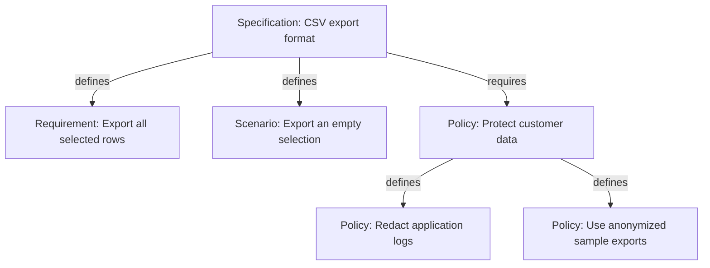
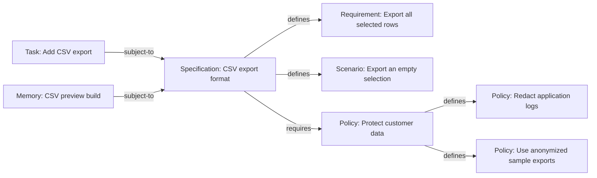
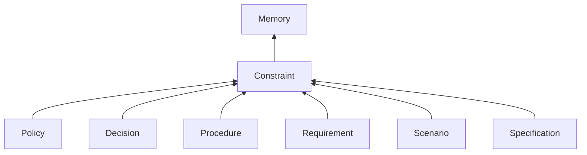
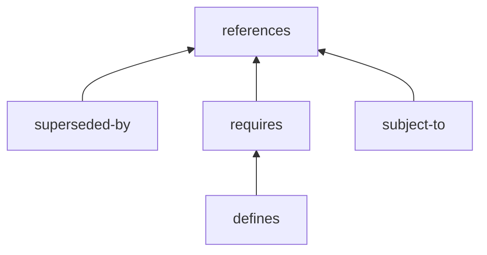

# [Memory] Memory Bead and Link Types

This proposal defines Memory Bead and Link Types and their common rules for ownership, dependencies, and applicability. It is a published design draft; the [publication scope](#publication-scope-and-deferred-specification-work) separates the selected model from deferred mechanics and implementation qualification. It builds on [Chris's Memory Beads proposal](https://github.com/gastownhall/beads/issues/5877).

Sections marked **informative**, including their subsections and examples, explain the design without adding requirements. The CLI sketch is also informative. All other contract text is **normative for this proposed design**. Normative status does not imply adoption or implementation; the publication-scope table identifies deferred work.

> **Validation status.** Historical JSON Schemas, `definitions.json`, and example fixtures retained alongside this draft describe the earlier catalog. Their passing checks do not validate this v0.2 catalog. Current implementation or qualification evidence must name the exact catalog revision and deliberately regenerated schemas and fixtures.

## Overview (informative)

### Memory Beads and References Links

A team rarely starts with a complete knowledge model. It starts with small things worth remembering: a file format, a decision made during implementation, or a rule someone should not have to rediscover. Those notes become more useful when they have stable identities and can be connected to the work they explain.

Consider a team adding CSV export. At first, “CSV files use UTF-8 encoding” is enough to save a future conversation. Later, a design note can cite that fact, an implementation Issue can refer to the design, and a Specification can collect the obligations the export must meet. The information can grow without turning every note into a formal requirement.

A Memory supplies a title and a Markdown body. The body can contain ordinary prose, examples, lists or links. The graph records explicit relationships around that prose; it does not turn the prose into an executable language. Issues and memories retain their different purposes while using the same identity, revision and graph model.

Memory Beads let agents record and recall knowledge in a graph that connects memories with Issues. The two general-purpose Types are [Memory Bead Type](#memory--bead-type) and [References Link Type](#references--link-type). A Memory Bead holds knowledge; a References Link connects it to useful context. The shared graph contract supplies identity, revision, and relationship rules, while the content can serve many purposes.

A Memory Bead's body holds arbitrary Markdown, and a References Link can have an optional Markdown body explaining the connection. Both also carry metadata for application-specific labels and structured data. The system preserves that content without interpreting arbitrary prose or metadata as executable rules.

### Revisions and replacement

Edit a Memory Bead when you are maintaining the same piece of knowledge. Its identity stays the same and it gains a new revision. Readers can distinguish the current content from earlier retained revisions.

Use a [Superseded By Link](#superseded-by--link-type) when a different Memory Bead takes its place. The Link points from the retiring Bead to its replacement. Each retiring Bead has at most one selected replacement, and replacement chains cannot form cycles. Retirement preserves the old Bead and its history; it does not delete it or automatically approve the replacement.

For example, a short deployment note might be replaced by a separately maintained deployment handbook. A Superseded By Link makes that change of identity explicit. Editing the original note would instead keep its identity.

Memory Beads, References Links, and Superseded By Links provide the general knowledge model. The Types below add a common system for expressing constraints and discovering governing rules.

### Shared constraint behavior

Agents also need to discover the rules governing their behavior and side effects. They should be able to find their obligations, understand what they must do or avoid, and follow the relationships between those obligations.

[Constraint](#constraint--bead-type) is the common Bead Type for obligations and restrictions. Policy Beads state governing rules. Decision Beads state choices that constrain later work. Procedure Beads describe how work is carried out, with the flow in the body. Requirement and Scenario Beads state required outcomes and conditions. Specification Beads describe intended results at any level of detail. These six Types refine the Constraint Bead Type and share its behavior. A plain Constraint Bead can hold a rule that needs no more specific Type; a plain Memory Bead can hold context and can itself be subject to constraints.

> **Custom Types (informative).** Creating and installing user-defined Bead or Link Types is not part of this proposal's initial Memory release surface. While that capability is unavailable, use the closest supported Bead or Link Type and put experimental labels or structured fields in metadata. Such conventions do not create new Type membership, validation, or executable behavior. Type refinement allows later Types to join the common model when custom Type support is introduced.

A Requires Link connects a Constraint Bead to another Constraint Bead necessary for meeting it. The Defines Link Type refines the Requires Link Type and adds the defining-parent relationship. A Policy Bead can define subpolicy Beads; a Requirement Bead can define subrequirement Beads. Each child has at most one defining parent and keeps its own identity and history. A query over the Requires Link family includes Defines Links without needing a special case.

A Subject To Link declares that a Constraint Bead applies to any source Bead, including an Issue Bead. Starting at those declarations and following Requires and Defines gives an agent a repeatable way to discover the rules it must follow.

Selecting governing roots, establishing their authority, and choosing an executable representation for applicability remain separate design work. Arbitrary prose and metadata do not become executable rules merely because they appear on a Constraint Bead.

## A worked example (informative)

### Start with useful context

A reference answers “what context is useful here?” The design notes for CSV export can point to the encoding note so that a reader can find the agreed format. They can also point to the implementation Issue, connecting an explanation to the work that will put it into practice.

The relationship deserves its own record. A title such as “Uses this text encoding” tells the next reader why the connection exists; a longer body can explain caveats. Two notes can refer to the same target for different reasons. A References Link preserves that authored explanation and direction instead of asking a search engine to infer the connection from similar words.

A plain References Link is unowned: adding or editing it revises the Link, not either endpoint. The source and target retain their identities and revisions.

### Keep edits distinct from replacement

Knowledge changes in two useful ways. We can correct or extend a note while keeping its identity: it is still the same note, with a new revision. Or we can write a separately maintained document that replaces it. These changes should remain distinguishable to someone following an older reference.

For the CSV example, a short encoding note might eventually give way to a fuller guide covering headings, spreadsheet behavior and examples. Superseded By records that replacement. Someone opening the old note can still read what it said and discover its successor. Existing references continue to identify the old note until their authors deliberately change them; replacement does not rewrite the rest of the graph.

The replacement Link points from the retiring Memory to its successor. It is owned by the retiring Memory, so adding or changing it revises that source. Its target is not revised. Each retiring Memory has at most one selected successor, and replacement chains cannot cycle.

### Define the obligations

Some notes describe useful context; others state obligations. A CSV export Specification might require every selected row to appear in the file and specify that an empty selection produces headings without data rows. A customer-data Policy might govern logs and sample exports across many features, including CSV export.

Keeping those documents distinct lets each evolve where it belongs. The export team maintains the Specification and its detailed behavior. The customer-data Policy can remain independently maintained and apply to other work too. Both are Constraints: knowledge stating obligations that a subject is expected to meet. Their more specific Types tell a reader whether they are looking at a Specification, Requirement, Scenario, Policy, Decision or Procedure.

The Specification has two kinds of connection. “Export all selected rows” and “Export an empty selection” are parts of its definition. The customer-data Policy is an additional obligation it requires, maintained as a separate document. Defines expresses the first relationship; Requires expresses the second.

That distinction matters when reading. Asking for the Specification's definition should show its defining Requirement and Scenario. Asking what it requires should also reach the independently maintained Policy and that Policy's defining obligations: redact application logs and use anonymized sample exports. Defines is a refinement of Requires, so the broader requirements question includes both kinds of connection.

A defining child belongs to at most one defining parent, and defining trees cannot cycle. Requires can connect independently maintained trees, including cycles that a traversal must recognize and stop following. In either case, each linked obligation is necessary for meeting its source. The graph does not establish that the listed children exhaust everything required by the parent's prose; an author must say that explicitly when it is intended.

Requires and Defines Links are owned by their source Constraint. Adding, changing or removing one revises the source while leaving the target unchanged. A defining child retains its own identity and can be required from another tree without acquiring a second defining parent.

The empty-selection Scenario states that no selected rows produces column headings and no data rows. The two subpolicies are ordinary Policy Beads, and they can define further policies. The graph supplies the relationships; the Markdown bodies supply the obligations and any claim that the listed children are a complete acceptance condition.

### Find the rules governing an Issue

The obligation graph still leaves one question unanswered: what work is governed by it? Subject To connects a subject to a Constraint. The CSV implementation Issue can be subject to the export Specification, and a Memory describing a preview build can be subject to that same Specification. The constraint vocabulary works uniformly for both kinds of Bead.

Starting from either subject, a reader can discover the declared Specification and then the obligations reached through Requires and Defines. This is useful when preparing a change, reviewing a build, or asking which rules apply before work begins. The paths explain how each obligation was reached.

Subject To declarations do not spread transitively through other Subject To declarations. If the Specification document is itself subject to a document-review Policy, that governs maintenance of the document. It does not automatically impose that review process on the implementation Issue. To govern the Issue, declare the appropriate relationship explicitly.

These records help people and agents find obligations. They do not execute policies, certify compliance or establish that a particular author had authority to bind a subject. Those questions need their own evidence and workflows.

Subject To is owned by its source subject. Editing the declaration revises that subject, not the governing Constraint. These relationships do not automatically alter Issue readiness, blocking or dispatch; those continue to follow the Issue workflow and Dependency-family rules.

## Memory and the CLI (informative)

The Type definitions below describe the data and relationship rules. The separate [Memory CLI proposal](https://github.com/gastownhall/beads/issues/7758) specifies the canonical `bd memory` command group, selection and output. Source publication is not an installed-command or release-readiness claim.

| Relationship | Read operations | Authoring operation |
| --- | --- | --- |
| References | `bd memory references`, `bd memory referenced-by` | `bd memory reference A B` |
| Replacement | `bd memory successor`, `bd memory supersedes` | `bd memory supersede OLD NEW` |
| Necessary dependencies | `bd memory requirements`, `bd memory required-by` | `bd memory requires A B` |
| Defining tree | `bd memory definition`, `bd memory defined-by` | `bd memory defines A B` |
| Applicable obligations | `bd memory constraints`, `bd memory subjects` | `bd memory subject-to A B` |

The positional authoring forms name source first and target second. Explicit endpoint options use `--from SOURCE --to TARGET`; for Superseded By, source is the retiring Memory and target its replacement. CLI reference conveniences resolve to full identities and revision tokens before a Link is stored. See the separate CLI contract and release runbook for the selected syntax and qualified build.

The initial discovery surface follows explicit Subject To declarations and their Requires-family dependencies. Direct subjects are reported separately. Generic Bead and Link operations remain the underlying authoring model. Existing `remember`, `recall`, `memories`, and `forget` retain their contracts; Type-specific CRUD shortcuts are separate future interface work.

## Constraint-system behavioral contract

Constraint is the common Bead Type for obligations and restrictions. Policy, Decision, Procedure, Requirement, Scenario, and Specification refine it. Future supported subtypes inherit these same rules through Type refinement, without requiring a closed list of names. Custom Type creation and installation are outside this proposal's initial release surface.

A **subject** is a Bead whose obligations are being considered. It can have any Bead Type, including Issue. Being subject to a Constraint does not make the subject a Constraint. “Any Bead” is an endpoint category without a Type restriction, not a new Type or a closed union; it does not add Link or opaque external-Resource endpoints.

| Type | Common behavioral contract |
| --- | --- |
| Constraint | States obligations, restrictions, and conditions in its body. |
| Subject To | Any Bead → Constraint. Declares applicable obligations without transitive Subject To inheritance. |
| Requires | Constraint → Constraint. Makes its target necessary for meeting its source; necessity composes transitively. |
| Defines | Refines Requires. Adds the defining-parent role, at most one defining parent per child, and an acyclic defining tree. |

Subject To is not transitive. If X is subject to A and A is subject to B, B applies to A; that path alone does not make B apply to X. A Policy requiring Specification documents to undergo review governs those documents, not every Issue or release governed by them.

Necessary obligations are discovered through Requires. If X is subject to A and A requires B, then B is an obligation for X. Follow the complete Requires family, including Defines and further dependencies, for compatible revisions and context. Preserve supporting paths and distinguish derived obligations from direct Subject To declarations. Traversal creates no inferred stored Links, terminates on repeated visits, and does not turn a dependency cycle into a defining tree.

Every Requires target, including each Defines child, is necessary for meeting its source Constraint. The source's own body still applies. The children are collectively sufficient only if that completeness is explicitly stated in the body. An empty child set does not waive the parent's obligations. A parent's conditions or exceptions do not silently remove its dependencies.

### Explicit declarations and implicit selection

An explicit Subject To Link includes its source under the target Constraint. The optional `applicability` property reserves an executable subject-selection predicate. Matching subjects would be included implicitly, without creating stored Links. Explicit declarations and matching predicates are independent inclusions; a non-match cancels neither an explicit declaration nor an obligation reached through Requires. Omitting the property selects no additional subjects.

The representation remains open: an inline predicate on a Constraint and a Link to a Policy supplying a selection rule are candidates for later experiments. Using a Policy to choose subjects is distinct from declaring that those subjects are governed by that Policy. No new applicability Link Type, executable Policy-body language, or authority rule is selected here.

Predicate matching needs a selected subject revision, an explicit context snapshot, and an authority/search scope. Its result must distinguish match, non-match, and unresolved information, retaining the rule and relevant facts and revisions. Missing or inaccessible information must not silently become a non-match. Concrete syntax, operators, inputs, bounds, and context selection remain open; arbitrary strings must not be advertised as executable predicates.

### Discovering governing rules

A generic view recognizes Constraint and its refining Types through Type refinement. Starting with a subject's explicit declarations, it follows the target Constraints' Requires families, including Defines, to find necessary obligations. It does not follow a reached Constraint's Subject To declarations as though they bound the original subject. A direct References Link supplies context without making its target a governing rule. Dependencies may cross defining trees without assigning another defining parent.

A future supported applicability mechanism may add predicate-selected starting relationships under the inclusion rules above. Until then, the view must state that it reports explicit declarations only. It must retain the subject, roots, relevant revisions, supporting paths and any traversal bounds rather than silently presenting an incomplete result as complete.

### Issue workflow boundaries

A Bead is eligible for dispatch only if its actual Type is Issue or refines Issue. Ordinary Issue readiness rules still apply. Memory or Constraint membership, a status label, and Subject To Links do not confer dispatch eligibility. Blocking semantics require a Link whose Type is Dependency or refines Dependency. Requires and Subject To do not become Issue Dependencies merely because they connect obligations. Issue closure is a workflow transition; it does not change the meaning of these Type definitions or dependency declarations.

### Type-constraint enforcement

An implementation claiming enforcement must validate affected Type constraints on create, update, and delete, including graph effects on surviving Beads and Links. This includes Defines' single-parent rule and the selected Defines and Superseded By acyclicity rules. Invalid resulting state must be rejected atomically at the shared contract's commit boundary; concurrent writes must not jointly evade an invariant. A merged graph must be validated before it is admitted as valid state. Batch validation follows the accepted shared transaction contract; this statement selects no storage or branch-merge mechanism. Read-time diagnostics alone do not constitute enforcement.

## Reading the definitions (informative)

Prose uses names such as Memory Bead and References Link to distinguish resources. Headings, Type tables, refinement declarations and property-origin columns use the shorter Type names. Code formatting identifies literal commands, property names and Type spellings.

**Refines** connects Types: every valid instance of the source Type must meet the target Type's structural and semantic promises. A refinement inherits properties and rules and may add restrictions. For example, Decision inherits `title`, `body` and `status` from Memory. The **Defined by** column identifies the Type introducing a property. Type-graph arrows point from a more specific Type to its parent. This relationship does not automatically rename stored identifiers, wire fields, or installed definitions.

An **owned Link** is part of its source Bead's versioned content. Adding, changing or deleting one creates a new source revision, without revising the target. Ownership is declared by the source Type for particular outgoing Link families. An unowned Link has its own identity and history; changing it revises neither endpoint. Ownership gives no permission to edit or delete a target Bead.

## Bead Types

The following definitions specify the Bead Types. Examples labelled informative illustrate their use and add no rules.

| Bead Type | Meaning |
| --- | --- |
| [Memory](#memory--bead-type) | A Memory Bead holds knowledge that should remain available for later use. All other Bead Types in this list refine Memory. |
| [Constraint](#constraint--bead-type) | A Constraint Bead states an obligation or restriction; its subtypes share applicability and dependency rules. |
| [Policy](#policy--bead-type) | A Policy Bead states a governing rule for a project or organization. |
| [Decision](#decision--bead-type) | A Decision Bead explains a choice and the reasons for making it. |
| [Procedure](#procedure--bead-type) | A Procedure Bead explains how to carry out a repeatable task. |
| [Requirement](#requirement--bead-type) | A Requirement Bead states an outcome or constraint that must be met. |
| [Scenario](#scenario--bead-type) | A Scenario Bead describes a concrete situation and the outcome expected in it. |
| [Specification](#specification--bead-type) | A Specification Bead describes an intended result and refines Constraint. |

### Memory — Bead Type

**Meaning and use.** A Memory Bead holds knowledge you want to use again. Use a plain Memory Bead for a general note, or choose one of the more specific Bead Types defined here. The title helps readers find the Bead, and the body holds the knowledge itself. Choosing a Type is an explicit authoring action; the content does not automatically change the Bead's Type. Constraint Beads can define other Constraint Beads. Plain Memory Beads supply context through References Links.

**Example (informative).** A Memory Bead might explain an unexpected behavior in the project's export tool.

**Refines.** None within this catalog. It is the common parent of the named Memory Types below.

**Properties.**

| Name | Type | Defined by | Use and meaning |
| --- | --- | --- | --- |
| `title` | Required nonblank text | Memory | Human-readable name for discovery and display. |
| `body` | Required Markdown text; may be empty | Memory | The Bead's primary content, preserved as authored. |
| `status` | Optional nonblank open string | Memory | Organization-defined lifecycle label (e.g., draft, approved). Organizations choose their own values; this property adds no built-in workflow or approval effect. |

**Owned outgoing Link Types.**

| Link Type family | Declared by | Effect |
| --- | --- | --- |
| `subject-to` | Memory | Owns applicability declarations; a Link change revises the source. |
| `superseded-by` | Memory | Revises the retiring source when its replacement Link changes. |

### Constraint — Bead Type

**Meaning and use.** A Constraint Bead states an obligation or restriction governing behavior, side effects, or outcomes. Use it directly for a general rule, or choose Policy, Decision, Procedure, Requirement, Scenario, or Specification when one expresses the rule more clearly. Additional supported subtypes inherit the common rules through Type refinement; experimental metadata labels do not create Type membership.

The body carries the constraint itself, including conditions, exceptions, and any explicit statement of what is sufficient to meet it. Every Requires target, including each Defines child, is necessary for meeting the source. The parent's own body still applies. Plain Memory Beads can supply context through References Links without becoming required Constraints. Optional `status` remains descriptive and adds no approval or workflow effect.

A Constraint can itself be subject to another Constraint. The optional `applicability` property reserves a future executable selection mechanism; its representation is not selected, and it does not filter explicit Subject To declarations.

**Example (informative).** A general Constraint Bead can state "No customer secrets may leave the approved environment". Put experimental context in metadata on a supported Type while custom Type authoring is unavailable; that metadata does not create a new Constraint subtype or an executable rule.

**Refines.** Memory.

**Properties.** Introduces optional applicability as a design extension whose concrete executable representation is deferred; it inherits Memory's title, body, and optional status.

| Name | Type | Defined by | Use and meaning |
| --- | --- | --- | --- |
| `title` | Required nonblank text | Memory | Human-readable name of the obligation or restriction. |
| `body` | Required Markdown text; may be empty | Memory | The constraint and its conditions, preserved as authored. An empty body does not waive the constraint. |
| `status` | Optional nonblank open string | Memory | Organization-defined label; no automatic approval, applicability, or workflow effect. |
| `applicability` | Optional executable subject-selection predicate; concrete representation deferred | Constraint | Matches add implicit Subject To applicability without filtering explicit declarations or inherited obligations. |

**Owned outgoing Link Types.**

| Link Type family | Declared by | Effect |
| --- | --- | --- |
| `requires` | Constraint | Owns the entire Requires family, including Defines; a Link change revises the source. |
| `subject-to` | Memory | Inherited ownership of applicability declarations. |
| `superseded-by` | Memory | Inherited ownership; revises this Bead when its replacement Link changes. |

### Policy — Bead Type

**Meaning and use.** A Policy Bead states a rule governing how a project or organization works, including constraints on an agent's behavior and side effects. Put the rule and its scope in the body so readers can tell when it applies. Explain its authority there, cite another Bead with a References Link, or identify the issuing person or governing source with `authority`. Defines Links can organize more specific Policy Beads beneath it.

**Example (informative).** A Policy Bead might require customer data to be removed from sample exports.

**Refines.** Constraint; transitively Memory.

**Properties.**

| Name | Type | Defined by | Use and meaning |
| --- | --- | --- | --- |
| `title` | Required nonblank text | Memory | Name of the rule. |
| `body` | Required Markdown text; may be empty | Memory | Rule, scope, rationale, and any source citation. |
| `status` | Optional nonblank open string | Memory | Organization-defined lifecycle label (e.g., draft, approved); no automatic workflow effect. |
| `applicability` | Optional executable subject-selection predicate; concrete representation deferred | Constraint | Matches add implicit Subject To applicability without filtering explicit declarations or inherited obligations. |
| `authority` | Optional URI or `{uri, revision}` Reference | Policy | Identifies the person, role, or governing source that issued the rule. |

The `authority` value identifies who or what issued the Policy Bead; it identifies the issuing authority without proving approval.

**Owned outgoing Link Types.**

| Link Type family | Declared by | Effect |
| --- | --- | --- |
| `requires` | Constraint | Inherited ownership of Requires and its specializations, including Defines. |
| `subject-to` | Memory | Inherited ownership of applicability declarations. |
| `superseded-by` | Memory | Inherited ownership; revises this Bead when its replacement Link changes. |

### Decision — Bead Type

**Meaning and use.** A Decision Bead explains a choice and why it was made. It constrains subsequent behavior and side effects that must follow that choice. The body can explain alternatives and consequences. Defines Links can identify finer-grained Decision Beads. If a later choice replaces this one, create a new Decision Bead and give the earlier Bead a Superseded By Link to its replacement. Editing the earlier Bead instead continues its identity.

**Example (informative).** A team might choose CSV for its first export format because its users already work in spreadsheets.

**Refines.** Constraint; transitively Memory.

**Properties.**

| Name | Type | Defined by | Use and meaning |
| --- | --- | --- | --- |
| `title` | Required nonblank text | Memory | The decision's subject or chosen direction. |
| `body` | Required Markdown text; may be empty | Memory | Choice, rationale, consequences, and any alternatives worth recording. |
| `status` | Optional nonblank open string | Memory | Organization-defined lifecycle label (e.g., draft, accepted); no automatic workflow effect. |
| `applicability` | Optional executable subject-selection predicate; concrete representation deferred | Constraint | Matches add implicit Subject To applicability without filtering explicit declarations or inherited obligations. |
| `authority` | Optional URI or `{uri, revision}` Reference; working shape | Decision | Identifies the person, team, or governing body that made the decision. |

**Owned outgoing Link Types.**

| Link Type family | Declared by | Effect |
| --- | --- | --- |
| `requires` | Constraint | Inherited ownership of Requires and its specializations, including Defines. |
| `subject-to` | Memory | Inherited ownership of applicability declarations. |
| `superseded-by` | Memory | Inherited ownership; revises this Bead when its replacement Link changes. |

### Procedure — Bead Type

**Meaning and use.** A Procedure Bead explains how to carry out a task that people or agents may need to repeat. Put the flow, steps, and relevant conditions in the body. Defines Links identify meaningful parts that can be followed and checked independently, such as named subprocedure or subpolicy Beads; the Links do not encode execution order.

**Example (informative).** A release checklist explains the steps to repeat for each release.

**Refines.** Constraint; transitively Memory.

**Properties.**

| Name | Type | Defined by | Use and meaning |
| --- | --- | --- | --- |
| `title` | Required nonblank text | Memory | Name of the method. |
| `body` | Required Markdown text; may be empty | Memory | The instructions and relevant conditions. |
| `status` | Optional nonblank open string | Memory | Organization-defined lifecycle. |
| `applicability` | Optional executable subject-selection predicate; concrete representation deferred | Constraint | Matches add implicit Subject To applicability without filtering explicit declarations or inherited obligations. |

**Owned outgoing Link Types.**

| Link Type family | Declared by | Effect |
| --- | --- | --- |
| `requires` | Constraint | Inherited ownership of Requires and its specializations, including Defines. |
| `subject-to` | Memory | Inherited ownership of applicability declarations. |
| `superseded-by` | Memory | Inherited ownership; revises this Bead when its replacement Link changes. |

### Requirement — Bead Type

**Meaning and use.** A Requirement Bead states something that must be true of the intended result. Another Constraint Bead, such as a Specification Bead or parent Requirement Bead, can define it. Use Defines Links to break it into subrequirement Beads; each child has at most one defining parent. Other Beads can require that same Requirement Bead or describe work that meets it without defining a duplicate.

**Example (informative).** 'An export must include every row selected by the user' describes an outcome that an implementation can be checked against.

**Refines.** Constraint; transitively Memory.

**Properties.**

| Name | Type | Defined by | Use and meaning |
| --- | --- | --- | --- |
| `title` | Required nonblank text | Memory | Short description of the demanded outcome or constraint. |
| `body` | Required Markdown text; may be empty | Memory | The full obligation and interpretation. |
| `status` | Optional nonblank open string | Memory | Organization-defined lifecycle. |
| `applicability` | Optional executable subject-selection predicate; concrete representation deferred | Constraint | Matches add implicit Subject To applicability without filtering explicit declarations or inherited obligations. |

**Owned outgoing Link Types.**

| Link Type family | Declared by | Effect |
| --- | --- | --- |
| `requires` | Constraint | Inherited ownership of Requires and its specializations, including Defines. |
| `subject-to` | Memory | Inherited ownership of applicability declarations. |
| `superseded-by` | Memory | Inherited ownership; revises this Bead when its replacement Link changes. |

### Scenario — Bead Type

**Meaning and use.** A Scenario Bead makes an expected outcome concrete by describing a situation. Another Constraint Bead, such as a Specification Bead, can define it through a Defines Link. Its body describes the situation and expected outcome. Requirement and Scenario Beads remain distinct so authors can write and find either form.

**Example (informative).** 'A user with no selected rows requests an export and receives an empty file with column headings' explains what should happen in that case.

**Refines.** Constraint; transitively Memory.

**Properties.**

| Name | Type | Defined by | Use and meaning |
| --- | --- | --- | --- |
| `title` | Required nonblank text | Memory | Short name of the case. |
| `body` | Required Markdown text; may be empty | Memory | Situation, actors, actions, and relevant outcomes. |
| `status` | Optional nonblank open string | Memory | Organization-defined lifecycle. |
| `applicability` | Optional executable subject-selection predicate; concrete representation deferred | Constraint | Matches add implicit Subject To applicability without filtering explicit declarations or inherited obligations. |

**Owned outgoing Link Types.**

| Link Type family | Declared by | Effect |
| --- | --- | --- |
| `requires` | Constraint | Inherited ownership of Requires and its specializations, including Defines. |
| `subject-to` | Memory | Inherited ownership of applicability declarations. |
| `superseded-by` | Memory | Inherited ownership; revises this Bead when its replacement Link changes. |

### Specification — Bead Type

**Meaning and use.** A Specification Bead describes what a result must do clearly enough for someone to check it. It may state high-level goals or turn another Specification Bead's goals into detailed Requirement and Scenario Beads, using Defines Links for the ones it introduces. Its optional status can distinguish draft from accepted without changing Type. A detailed Specification can require another Specification and define its own Requirement and Scenario Beads. An older Specification can select its replacement through a Superseded By Link.

**Example (informative).** A CSV export Specification can define the file format, escaping rules, and behavior for an empty selection.

**Refines.** Constraint; transitively Memory.

**Properties.**

| Name | Type | Defined by | Use and meaning |
| --- | --- | --- | --- |
| `title` | Required nonblank text | Memory | Name of the contract. |
| `body` | Required Markdown text; may be empty | Memory | Normative behavior or interface description. |
| `status` | Optional nonblank open string | Memory | Organization-defined lifecycle. |
| `applicability` | Optional executable subject-selection predicate; concrete representation deferred | Constraint | Matches add implicit Subject To applicability without filtering explicit declarations or inherited obligations. |
| `version` | Optional nonblank open string | Specification | Author-chosen version label; independent of Bead revisions and source/build identifiers. No automatic increment or ordering. |

**Owned outgoing Link Types.**

| Link Type family | Declared by | Effect |
| --- | --- | --- |
| `requires` | Constraint | Inherited ownership of Requires and its specializations, including Defines. |
| `subject-to` | Memory | Inherited ownership of applicability declarations. |
| `superseded-by` | Memory | Inherited ownership; revises this Bead when its replacement Link changes. |

## Link Types

These five Link Types describe context, replacement, necessary dependencies, defining structure, and applicability. Specialized Types refine `references` directly or transitively and inherit its optional `title`, `body`, and `status` properties.

| Link Type | Meaning |
| --- | --- |
| [`references`](#references--link-type) | Connects a Bead to useful context. |
| [`superseded-by`](#superseded-by--link-type) | Points from a retiring Memory to its replacement. |
| [`requires`](#requires--link-type) | Makes a target Constraint necessary for meeting its source Constraint. |
| [`defines`](#defines--link-type) | Adds defining-parent structure to Requires necessity. |
| [`subject-to`](#subject-to--link-type) | Declares that a target Constraint applies to its source Bead. |

### `references` — Link Type

**Meaning and use.** Use a References Link when one Bead provides useful context for another. The Link points from the Bead making the reference to the Bead being cited. It supplies context without declaring a necessary dependency, an applicable obligation, or a replacement.

A direct `references` Link is unowned: changing it does not revise either endpoint. The other Link Types below build on `references` to express a more specific relationship.

**Example (informative).** A Decision Bead about CSV export might reference a Policy Bead about customer data.

**Refines.** No named Link Type in this catalog. Every other Link Type in this catalog refines it directly or transitively.

**Link constraints.**

Allowed source → target Type pairs:

| Source Type | Target Type |
| --- | --- |
| Memory | Memory |
| Memory | Issue |
| Issue | Memory |
| Any Bead Type | Constraint or any subtype |

The last alternative admits a source of any Bead Type when the target is a Constraint Bead, so the applicability Links below remain valid References specializations. It does not open other target Types to arbitrary sources.

Other constraints:

| Kind | Rule |
| --- | --- |
| Scope | Endpoints are in one Scope under the current public proposal. |
| Pins | A direct `references` Link may use current or exact-revision target selection; an exact pin does not follow later revisions. A subtype may narrow this rule. |
| Direction and multiplicity | Direction is recorded. A reverse connection needs a separate Link. Direct `references` Links allow parallel Links and cycles, but refuse a self-Link by Bead identity. No participation minimum or ordered-pair uniqueness rule applies to direct `references`; subtypes may be stricter. |
| Status | Descriptive only; it does not activate, validate, hide, or invalidate the connection. |

**Properties.**

| Name | Type | Defined by | Use and meaning |
| --- | --- | --- | --- |
| `title` | Optional nonblank text | references | Short display label for the relationship; not its identity. |
| `body` | Optional nonblank Markdown text | references | Context for the connection; a direct `references` Link supplies context only. |
| `status` | Optional nonblank open string | references | Author-reported state of this Link; no automatic workflow effect. |

### `superseded-by` — Link Type

**Meaning and use.** Use a Superseded By Link to retire a Memory Bead in favor of a replacement with a different identity. The replacement may have any Memory Bead Type, including a different subtype from the retiring Bead.

An ordinary update creates a new revision of the same Bead. The latest revision becomes that Bead's current state, and earlier revisions remain in its history. A Superseded By Link expresses a different change: another Bead, with a different identity, takes over the old Bead's role. Use an update to maintain one Bead; use Superseded By to retire it in favor of another.

The Link points from the retiring Bead to its replacement. The retiring Bead owns the Link, so adding or changing the replacement creates a new revision of that Bead. Each Bead can point to at most one replacement. If that replacement is later retired too, following the Links leads along a chain to the current successor. Cycles are forbidden.

Retirement through this Link leaves the old Bead and its earlier revisions available. It does not delete the Bead, assign a status value, or approve the replacement. Both endpoints follow their Beads' current states rather than exact revisions.

**Example (informative).** A plain Memory note about an informal convention can point to a Policy Bead that makes the convention a governing rule.

**Refines.** `references`. It receives `title`, `body`, and `status` from `references`.

**Link constraints.**

Allowed source → target Type pairs:

| Source Type | Target Type |
| --- | --- |
| retiring Memory or any subtype | replacement Memory or any subtype |

Other constraints:

| Kind | Rule |
| --- | --- |
| Identity | Endpoints are distinct identities, both floating rather than pinned to exact revisions. |
| Direction | The source is the retiring Bead; the target is its replacement. |
| Ownership | Memory owns its outgoing `superseded-by` Link. Every Memory subtype inherits this rule. Adding, changing, or deleting the Link revises the source Bead; the Link change does not revise the replacement. |
| Successor count | Each Memory Bead has zero or one live outgoing `superseded-by` Link. A competing draft may exist without being selected as its replacement. |
| Acyclicity | Following `superseded-by` Links must never return to a previously visited Bead. |
| Effect | The Link does not approve the replacement, alter either Bead's status, delete the retiring Bead, or rewrite History. |

**Properties.**

| Name | Type | Defined by | Use and meaning |
| --- | --- | --- | --- |
| `title` | Optional nonblank text | references | Short display label for this retirement and replacement. |
| `body` | Optional nonblank Markdown text | references | Reason for retiring the source in favor of the target; the replacement Bead may explain the fuller rationale. |
| `status` | Optional nonblank open string | references | Organization-defined label; no automatic workflow effect. |

### `requires` — Link Type

**Meaning and use.** Use a Requires Link when one Constraint Bead can be met only by also meeting another. The source depends on the target. Any Constraint subtype can participate, including Requirement, Policy, Decision, Procedure, Scenario, and Specification. The target keeps its defining home; requiring it does not copy it or assign another defining parent.

Requires Links are interpreted transitively. If A requires B and B requires C, then A transitively requires C. Traversal includes every Link Type refining Requires, including Defines. Multiple necessary conditions do not become sufficient merely because all of them have been recorded or met; the source's own constraints still apply.

**Example (informative).** An export Specification defines a Requirement Bead for correct output. That Requirement requires a data-protection Policy defined elsewhere. A uniform Requires traversal starting at the Specification Bead finds both the Requirement Bead and the Policy Bead, with the dependency path as its explanation.

**Refines.** `references`. It inherits optional `title`, `body`, and `status`.

**Link constraints.**

| Source Type | Target Type |
| --- | --- |
| Constraint or any subtype | Constraint or any subtype |

| Rule | Meaning |
| --- | --- |
| Direction and necessity | The source requires the target. Every target is necessary for meeting the source; necessity composes transitively across the Requires family, including Defines. |
| Arity | Many outgoing and many incoming Links are allowed, with no participation minimum or additional maximum. |
| Defining home | Requires alone assigns no defining parent. Defines adds that role and its narrower structural restrictions. |
| Self Links | Provisionally forbidden by Bead identity, including different revision selectors, as inherited from References. Whether cross-revision dependency Links on the same identity should be permitted remains open. |
| Cycles | Allowed in the Requires family. Mutual necessity is meaningful, but a cycle does not make its obligations disappear. Traversal must terminate without treating repeated visits as progress. Defines still forbids cycles within its own family. |
| Parallel Links | Allowed. Independently authored Links, reasons, and revision selections keep their identities; repeated paths do not create additional obligations. |
| Ownership | Constraint owns outgoing Requires-family Links. Adding, changing, or deleting one revises the source Constraint; the Link change does not revise the target. |
| Scope and pins | Scope follows References. Detailed revision selection, edit, deletion, and transaction behavior remain open. |

**Properties.** No new properties are selected.

| Name | Type | Defined by | Use and meaning |
| --- | --- | --- | --- |
| `title` | Optional nonblank text | references | Optional label for the dependency. |
| `body` | Optional nonblank Markdown text | references | Explains why the target is necessary. |
| `status` | Optional nonblank open string | references | Descriptive label; it does not change whether the dependency is necessary. |

### `defines` — Link Type

**Meaning and use.** Use a Defines Link when a Constraint Bead defines another Constraint Bead as part of its content. It supplies the defining tree and inherits the necessity semantics of Requires Links. A parent may define many children, while each child has at most one defining parent. A standalone Bead can be the root of a tree. No separate Subpolicy or Subrequirement Type is needed: these are ordinary Policy or Requirement Beads with defining parents.

The source is the parent and the target is the child. The parent owns the Link, so adding, changing, or removing a defining relationship revises the parent. The child keeps its own Type, identity, properties, and history. Ownership of the Link does not transfer ownership of the child's identity or grant permission to edit or delete it. Deleting a parent does not by itself imply deletion of its children.

Another Constraint Bead can require the child without becoming a second defining parent. The Defines Link Type inherits source ownership from the Requires Link Type and adds the definitional role. It does not by itself approve a child or waive any obligation. The parent's own body constraints still apply, so the children are not collectively sufficient unless that completeness is explicitly stated. Plain Memory Beads can be linked through References Links for context.

**Example (informative).** The Policy Bead "Protect customer data" can define the subpolicies "Redact application logs" and "Use anonymized sample exports". The same structure lets an export Requirement define smaller Requirement Beads about preserving rows and column headings.

**Refines.** `requires`; transitively `references`. It inherits optional `title`, `body`, and `status`.

**Link constraints.**

| Source Type | Target Type |
| --- | --- |
| Constraint or any subtype | Constraint or any subtype |

| Kind | Rule |
| --- | --- |
| Defining parent | Each child Bead identity has zero or one live incoming `defines` Link, across all allowed parent Types. No defining parent is required for a root. The mechanics of moving a child to a different parent remain open. |
| Children | A parent may have any number of outgoing `defines` Links, subject to each child's single-parent rule. |
| Tree structure | Self-Links and directed cycles are forbidden by Bead identity. Following Defines from parent to child must never return to a previously visited Bead. |
| Ownership | Constraint owns outgoing Requires-family Links, including Defines; every Constraint subtype inherits this rule. A Link change revises its source parent, without revising the target child. The child retains independent identity and history. |
| Meaning | The Link supplies the defining tree. For a Constraint parent, defined Constraint children are necessary under the Requires rules above. It does not approve the child, waive its obligations, or imply cascading deletion. |
| Pin and edit mechanics | Exact revision selection, child edits, moves, and publication of a bundled child remain open. |

**Properties.** No new properties. The child's status and body belong to the child, not the Link. Writing children inline in a document is one way to display the tree; the Link does not require that layout.

| Name | Type | Defined by | Use and meaning |
| --- | --- | --- | --- |
| `title` | Optional nonblank text | references | A relationship-specific label if useful; separate from the child's title. |
| `body` | Optional nonblank Markdown text | references | Context about the defining relationship, if distinct from the child body. |
| `status` | Optional nonblank open string | references | State of the defining Link; not the child's status. |

### `subject-to` — Link Type

**Meaning and use.** Use a Subject To Link to declare that a Constraint applies to any source Bead, including an Issue. It identifies an obligation the source must meet. For example, an export release can be subject to a data-protection Policy.

Subject To and Requires answer different questions. Subject To names an applicable contract for a subject; Requires names another Constraint necessary for meeting a Constraint. Subject To is not transitive: if X is subject to A and A is subject to B, B applies to A, not automatically to X. Follow the target's Requires family, including Defines and further dependencies, to discover the necessary obligations for X. Preserve supporting paths and create no inferred stored Subject To Links. A declaration does not by itself prove its author's authority to bind the source.

**Example (informative).** An Issue for CSV export is subject to the format Specification, which requires a customer-data Policy. That Policy is therefore a necessary obligation for the Issue. A separate Subject To Link from the Specification to a document-review Policy governs the Specification, without imposing that review process on the Issue.

**Refines.** `references`. It inherits optional title, body, and status.

**Link constraints.**

| Source Type | Target Type |
| --- | --- |
| Any Bead Type | Constraint or any subtype |

| Rule | Meaning |
| --- | --- |
| Applicability | The target's constraints apply to the source. The Link records applicability. |
| Arity and parallel Links | Many-to-many; no participation minimum or additional maximum. Independent declarations may coexist. |
| Self Links and cycles | Inherit References' identity-self prohibition; no additional cycle prohibition. Circular declarations do not create transitive applicability. |
| Ownership | Every source Bead owns its outgoing Subject To-family Links under this contract. A Link change revises the source, without revising the target. |
| Composition | Subject To is not transitive. Discover the source's necessary obligations by following each applicable target's Requires family, including Defines. Retain supporting paths for compatible revisions and context, terminate on repeated visits, and create no inferred stored Links. |
| Scope and pins | Scope follows References. Exact revision selection, contextual applicability, authority, and lifecycle mechanics remain open. |

**Properties.** No new properties are selected. These fields do not substitute for unresolved structured applicability or authority rules.

| Name | Type | Defined by | Use and meaning |
| --- | --- | --- | --- |
| `title` | Optional nonblank text | references | Optional label for the applicability declaration. |
| `body` | Optional nonblank Markdown text | references | Explains why the Constraint applies and any relevant context. |
| `status` | Optional nonblank open string | references | Descriptive label; it does not activate or suspend the obligation. |

## Ownership by source Bead and Link Type

Ownership is declared for a Link Type family and includes refining Types. The target retains its independent identity and history; a Link change does not revise it.

| Source Bead Type | Outgoing Link family | Allowed target Type | Owner | Consequence |
| --- | --- | --- | --- | --- |
| Any Bead Type | direct `references` | As in References endpoint pairs | None | The Link has its own history; neither endpoint revises when it changes. |
| Constraint or any subtype | `requires`, including `defines` | Constraint or any subtype | Source Constraint | Its revision includes necessary dependencies; Defines also establishes the defining parent. |
| Any Bead Type | `subject-to` | Constraint or any subtype | Source Bead | Its revision includes declared applicable obligations. |
| Memory or any subtype | `superseded-by` | Memory or any subtype | Retiring source Bead | Its revision includes the selected replacement; the target is not revised. |

Defines permits at most one incoming Defines-family Link per child identity; other Requires dependencies may have many incoming Links. Memory declares outgoing Subject To ownership for its family. Other participating source Types, including Issue, must declare Subject To ownership directly or through a base when adopting this contract. Widening endpoint eligibility alone does not install ownership on an existing Type. Existing Issue→Issue Dependency ownership belongs to the separate Issue contract.

## Publication scope and deferred specification work

This proposal defines eight Bead Types: Memory, Constraint, Policy, Decision, Procedure, Requirement, Scenario, and Specification. It defines five Link Types: References, Superseded By, Requires, Defines, and Subject To. Their meanings, inherited properties, correlated endpoint pairs, ownership, necessity, tree limits, and multiplicity are specified above. No `kind` field is required.

Publication provides a design for review and implementation planning. It does not itself adopt a BDP profile, install Type identities, qualify a runtime, select a release cutline, or lift an integration hold. Each implementation must state its exact source revision and supported behavior.

| Deferred work | Baseline retained by this proposal |
| --- | --- |
| Pin and revision mechanics | Current and exact selection follow accepted shared contracts where defined. No new pin policy, automatic repinning, or complete revision-composition algorithm is selected. Requires' same-identity cross-revision prohibition remains provisional. |
| Executable applicability representation | Explicit declarations and implicit matches independently include subjects. A non-match cancels neither. Inline predicates and linked Policies remain candidates; concrete syntax, operators, inputs, bounds, authority, context and root selection remain open. The abstract property is reserved, not an installable executable schema. |
| Conditional dependencies and sufficient conditions | The body can state conditions, exceptions and a complete acceptance condition. A parent condition does not automatically remove its dependencies. No structured AND/OR/threshold representation is selected. |
| Shared write and lifecycle integration | Ownership, graph invariants and atomic enforcement are selected. Exact retype/edit/move/delete, recovery and transaction behavior must reconcile with shared contracts. Ownership alone selects no deletion cascade. |
| Detailed CLI contracts | Command selection, result framing and presentation belong to the separate CLI proposal. Type-specific CRUD shortcuts remain future interface work. |

Unavailable behavior must be reported truthfully. An implementation omission is not enforcement of the selected rule. Historical schemas, example corpora and passing checks validate only the exact sources they name; they do not validate this revised catalog unless deliberately regenerated and checked against it.
