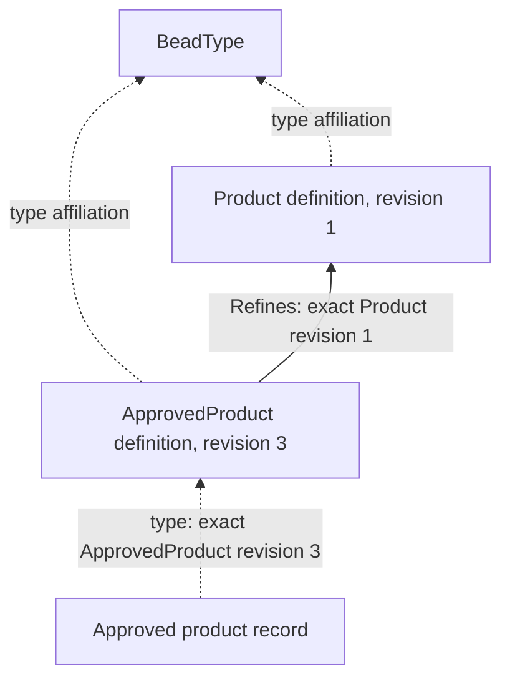
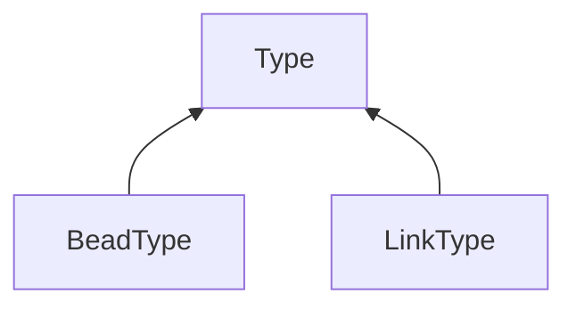

# BDP Type descriptors

This **Specification** is the working descriptor contract for the selected draft BDP Types design. It defines abstract descriptor fields, shapes, requiredness, defaults, local restrictions and concise field meanings. The [BDP Types profile](../../profiles/types/types.md) owns detailed composition, conformance, enforcement, constraint populations, lifecycle, revision and transaction rules. Both documents specify parts of the proposed design; neither adopts it into the released protocol.

Sections marked **informative**, including their examples, explain the design without
adding requirements. Other contract text specifies this proposed design; publication
does not establish implementation or released-profile adoption.

## Overview (informative)

### Definitions and instances

A Type definition is a Bead describing a contract that other Beads or Links can use.
Its properties contain a descriptor: the value schema, field meanings and applicable
relationship rules. An instance records its affiliation with one exact definition
revision. The definition Bead also has its own affiliation, which says what kind of
definition it is.

BeadType describes Bead-Type definitions, and LinkType describes Link-Type
definitions. Both refine the abstract common Type. A Link-Type definition is still
a Bead; the relationships created using it are Links. Keeping those two levels
separate makes the same graph tools useful for definitions and ordinary records.

### Refinement and revision

A Refines Link declares that the source definition meets an exact target definition's
structural and semantic promises. Refinement can add requirements and tighten
restrictions. It does not erase the requirements of the actual Type used by an
instance.

Definitions and declarations have their own revisions. A child's declaration names
an exact parent revision, so revising the parent does not silently change the child's
captured meaning; earlier child revisions likewise retain their own declarations.
The profile specifies the exact historical interpretation and transaction rules
behind this model.

### Availability for use

Storing a definition and registering it for use are separate actions. A repository
can hold Type definitions without supporting instances of those Types. The Types
profile distinguishes retained definitions, registration, write defaults and
retirement; a readable definition alone establishes none of those permissions.

## A worked example (informative)

### Describe a Product

Suppose Product describes Beads with a name and a nonnegative price. Its definition Bead is
an instance of BeadType, while a product record is an instance of an exact Product
definition. The common Type fields describe that property schema and its meanings.
The example uses names and revision labels for explanation, not production seed IDs.

### Add an approval requirement

ApprovedProduct adds an approval code while preserving Product's contract. Its
Refines declaration names Product at a particular revision. Product's schema must
permit the added field, and the child schema and semantic rules must still meet
the parent requirements. These are the profile's existing conformance rules.



The solid arrow is a Refines Link; dashed arrows illustrate distinguished `type`
fields, which are not extra incident Links. The product record must satisfy both
contracts, including the approval requirement. Matching the Product family does
not allow a writer to discard that requirement.

### Keep the recorded meaning

If Product later gains another revision, the declaration above still names revision
1. Revising ApprovedProduct's declaration changes its owned state under the shared
revision rules. Existing product records keep their exact affiliations until an
explicit valid update changes them. Exact definition reads follow retained records;
live adjacency is a different view.

The [intrinsic-1 publication](../../profiles/types/intrinsic-publication.md) assigns
shared exact definition/declaration values separately from these illustrative examples.
The descriptor schemas and retained schema closure in that publication have their own
versioned resource identities; publication does not prove installed provider support.

## Types and the CLI (informative)

The [canonical Types CLI companion](../../../docs/cli-design/types-cli.md) follows
this model through ordinary canonical operations and the agreed Type-inventory
command location. It records the remaining Type-command design gaps explicitly.
The [general CLI](../../../docs/cli-design/bdp-cli.md) owns shared syntax and protocol
lowering; this descriptor specification owns the meanings of the fields below.

## Specification

### Reading the definitions (informative)

Each entry gives the Type's meaning, an informative example, its direct conformance
and its properties. Applicable entries also give abstractness, owned outgoing Links,
allowed endpoint pairs and other constraints. The **Defined by** column identifies
where a field originates; inherited fields are repeated in the complete category
tables. Owned outgoing Link tables describe
state belonging to a definition Bead, separately from any ownership policy that
the definition imposes on its instances.

### What this package groups

The four definitions form the intrinsic seed proposed by BDP Types. Three are **Bead Types** whose instances are Type-definition Beads; **Refines** is a **Link Type** whose instances declare direct conformance between definition Beads. A definition Bead's own `type` affiliation is distinct from the Type it defines and from its outgoing Refines Links.



Solid arrows are direct Type conformance. Refines is not a child of Type in this graph: it is a Link Type **defined by a Bead affiliated with LinkType**. The candidate seed's own affiliations are:

| Definition Bead | Own Type affiliation | Direct conformance |
| --- | --- | --- |
| Type | BeadType | none |
| BeadType | BeadType | Type |
| LinkType | BeadType | Type |
| Refines | LinkType | none |

These affiliations and the bootstrap procedure are still candidate design. The common Type is abstract: authors cannot affiliate instances directly with its exact definition. BeadType and LinkType remain usable metatypes. Abstractness is not inherited automatically by refinements. The four intrinsic definitions would be supplied by an implementation and would not be changed through ordinary Scope writes. Detailed trusted-seed establishment, identity, revision, installation and upgrade rules belong to the Types profile; their implementation and qualification are separate gates.


### Shared descriptor shapes

These tables describe abstract values, not an executable Markdown-to-schema projection. Type IDs and references below follow the Types profile's candidate representation. No field here introduces a new endpoint pin-mode or selected-set graph language. The category entries below identify which fields use these shared shapes.

#### Type reference

A Type reference uses an absolute HTTP(S) Type identity URI string or an object containing exactly `uri` (that URI) and `revision` (nonempty text). In the descriptor selectors below, a URI-only entry selects an identity across revisions; it never means “look up latest.” An exact selector names that revision and applicable conformance to it. For instance affiliation input, the same selected carrier has a different context: an explicit URI resolves once through the Scope's registered exact default, while stored/output Types-profile affiliations are exact. Full matching, default resolution and accepted-definition admission belong to the Types profile. No relative or document-local binding is introduced as a stored Type identity.

#### Type selector

A Type selector is exactly one of these objects:

| Shape | Local restriction | Meaning |
| --- | --- | --- |
| `anyOf` | Nonempty array of distinct Type references; no other members. | Selects any listed Type family according to reference matching. |
| `any` | Literal `true`; no other members. | Matches every eligible Type; in a positive ownership selection, selects all eligible outgoing Link families. |

An `ownsOutgoing` value is an array of distinct Link-Type selectors; omission declares no additional ownership. `incoming` and `outgoing` values are arrays of participation constraints; omission declares no additional participation constraints. Empty arrays add no local declarations, like omission. Duplicate participation constraints remain permitted and impose the same bounds again; they do not weaken any bound. These local omissions do not remove inherited restrictions or ownership. Ownership selects a positive union of Link families independently of participation maxima; it does not invent a finite ownership maximum.

#### Participation constraint

| Name | Type | Required | Default or local restriction | Meaning |
| --- | --- | --- | --- | --- |
| `linkTypes` | Type selector | yes | Must select Link Types. | Incident Link population counted for this rule. |
| `min` | integer | no | Nonnegative; omitted means zero. | Minimum incident Link count. |
| `max` | integer | no | Nonnegative; omitted means unbounded. | Maximum incident Link count. |

At least one of `min` or `max` is present. No other members are permitted. When both are present, `min` must not exceed `max`. Detailed population counting, inheritance and intersection with other bounds belong to the Types profile.

#### Endpoint constraint and pair

An endpoint constraint is exactly one of the following shapes:

| Shape | Required fields and local restrictions | Meaning |
| --- | --- | --- |
| Typed Bead | `resourceKind: "bead"`; `scope` is `same`, `cross`, or `either`; `types` is a Type selector (`{"anyOf": [...]}` or `{"any": true}`). No other fields. | Restricts the endpoint's resource category, Scope relation and eligible Types. The `any` selector adds no Type restriction. |
| Resource | Only `resourceKind: "resource"`. | Admits the profile's opaque external-resource form; does not enable local Link endpoints. |

`same`, `cross` and `either` express the endpoint Scope relation to the storing Scope. Detailed Scope classification, exact registered Type-definition matching and external-resolution rules remain in the Types profile. A URL's shape alone never establishes Type membership.

An endpoint pair is an object containing exactly `source` and `target`, each an endpoint constraint. Both endpoints must satisfy the same pair alternative together; the two columns are not independent unions.

#### Link constraints

| Name | Type | Required | Default or local restriction | Meaning |
| --- | --- | --- | --- | --- |
| `typeConstraints` | array of endpoint pairs | yes | Nonempty; distinct alternatives. | Permits the union of correlated endpoint pairs. |
| `sourceMax` | integer | no | Nonnegative; omitted means no local maximum. | Maximum outgoing family Links per source identity. |
| `targetMax` | integer | no | Nonnegative; omitted means no local maximum. | Maximum incoming family Links per target identity. |
| `unique` | boolean | no | False or omission adds no local restriction. | True requires ordered endpoint-pair uniqueness in the constrained population. |
| `acyclic` | boolean | no | False or omission adds no local restriction. | True imposes the profile's directed acyclicity promise. |
| `allowSelf` | boolean | no | False prohibits equal source and target Resource identities, ignoring revision selectors. True or omission adds no local prohibition. | Independent self-link admission constraint; inherited false remains binding. |

No other members or Link minimum fields are permitted. The obsolete `pairUnique` spelling is also rejected here by the closed shape; the current field is `unique`. Maxima and graph constraints apply to the combined family, not separately to each endpoint-pair alternative. No local value disables inherited restrictions. `allowSelf: true` grants no permission to bypass `acyclic: true`, which also excludes identity self-loops, or an inherited prohibition. Detailed population, transaction and lifecycle enforcement belongs to the Types profile. `allowSelf: false` rejects A→A, A@1→A@2 and floating A→A@1. Without a separate acyclicity promise it does not prohibit A→B→A. Refines can permit T@2→T@1 while still rejecting exact-revision conformance cycles under its separate profile rules.

#### Property access

`propertyAccess` maps exact JSON Pointers relative to an instance's `properties` object to one of `writable`, `init-only`, or `service-managed`. Standard JSON Pointer escaping applies; malformed pointers and unknown modes refuse admission. Paths traverse object members. Arrays are governed as whole values initially; numeric object-member names are not automatically array indexes. No wildcard or per-array-element policy is introduced. Existing array insertion/append, replacement and removal operations are not prohibited by this designation boundary.

```json
{
  "propertyAccess": {
    "/referenceCode": "init-only",
    "/computedScore": "service-managed"
  }
}
```

Omission adds no local restriction. Where no applicable rule restricts access, the property is ordinarily writable, subject to schemas, authorization and other constraints. Inherited compatible restrictions combine: the tightest applicable rule wins. A local `writable` declaration cannot remove an inherited restriction. Conflicting caller-versus-service supplier requirements refuse admission rather than select a parent. Replacing an ancestor object must not bypass restrictions on its descendants; detailed composition and mutation enforcement belong to the Types profile.

An existing initialization-only value is preserved during retyping and must satisfy the destination contract; no conversion or replacement is inferred. If the value is absent, the caller may initialize it while adopting a Type that introduces that rule. Preserve it during departure from an applicable initialization-only contract; subsequent writes follow the destination contract. This is not an implicit lifetime restriction.

Caller-supplied service-managed values refuse, including equal copies of the current value. Replacement supplies the complete caller-writable property set; the service supplies service-managed values before full value validation. No computation or supplier language is introduced by these mode names.

#### Common local restrictions

The common descriptor is an open object for extensions, except reserved envelope or obsolete fields `id`, `revision`, `type`, `ownedLinks`, `conformsTo`, `refines`, `revisionProvenance`, `describes`, `source`, `target` and `pairUnique` are prohibited as descriptor properties. BeadType additionally prohibits `linkConstraints`; LinkType prohibits `incoming`, `outgoing` and `ownsOutgoing` and requires `linkConstraints`. Nested shared shapes are closed where specified above. Descriptive metadata and ordinary nonassertion annotations remain permitted. A definition requiring unsupported enforcement semantics refuses admission; an implementation must not silently ignore a required constraint. No general executable extension language is introduced.

`description` is text; an empty string is permitted and remains distinct from an absent property.

`version`, when present, is SemVer text including permitted prerelease/build labels, not an empty label or a Resource revision. Labels may repeat across revisions; no version label resolves an exact definition or infers conformance, compatibility or upgrade. `schemaResources` values retain standard schema ID, base and anchor semantics; closure retention, conflicting bindings and offline resolution require the profile's admission checks. The schema resource dialect is standard Draft 2020-12 throughout the retained closure. Implementations supply the standard Draft 2020-12 meta-schema resources; definition revisions need not embed copies. Application-schema dependencies and their resolution bindings remain retained immutably with the exact definition revision. A relative external reference requires an explicit applicable absolute schema `$id` base; neither the Type identity nor a download location supplies an implicit base. Internal fragment-only references may be used without a root `$id`. Unresolved required application references refuse admission. No network fetch or author-supplied executable validator is implied.


### Bead Types

These are addressable Type-definition Beads affiliated with BeadType in the proposed package. The table is a review index and a candidate `defines` projection from this Specification to those Beads; this file does not assign actual Bead IDs or assert stored Links. Their descriptor fields are specified here; detailed enforcement and candidate validation artifacts live in BDP.

| Bead Type | Meaning |
| --- | --- |
| [Type](#type--bead-type) | Common descriptor contract for Type-definition Beads. |
| [BeadType](#beadtype--bead-type) | Metatype for definitions whose instances are Beads. |
| [LinkType](#linktype--bead-type) | Metatype for definitions whose instances are Links. |

#### Type — Bead Type

**Meaning and use.** The common contract for a Bead that defines a Type. Its definition Bead's `properties` object is the descriptor; the common Resource envelope supplies identity, revision, affiliation, metadata, owned state and provenance. An instance's `type` field pins the exact definition revision under the proposed Types profile.

**Example (informative).** Both a Product definition and a relationship-Type definition use these common descriptor fields. Their different categories are expressed by their metatype affiliations, not by adding a second category property.

**Refines (direct conformance).** No parent Type in this package.

**Properties.** The [candidate common properties schema](../../profiles/types/type-definition.properties.schema.json) is a companion validation projection. The tables here own abstract field meanings; the profile owns detailed interpretation. Shape validation does not prove those semantics. The common authored fields are:

| Name | Type | Required | Defined by | Meaning |
| --- | --- | --- | --- | --- |
| `description` | text | no | Type | Explains the definition's meaning; the Bead ID remains its identity. |
| `propertiesSchema` | embedded Draft 2020-12 JSON Schema, object or boolean | yes | Type | Validates the `properties` of instances described by this definition; not a schema URL. |
| `schemaResources` | map from absolute fragment-free retrieval URI to embedded Draft 2020-12 schema | no | Type | Retains exact additional schema resources with the definition revision; omission supplies no additional resources. |
| `version` | SemVer text | no | Type | Informational author label; may repeat across definition revisions, not a Resource revision or conformance proof. |
| `abstract` | boolean | no | Type | Defaults to false. True forbids direct affiliation with this exact definition; concrete refinements remain permitted. |
| `propertyAccess` | map from property JSON Pointer to write mode | no | Type | Declares object-member write policy independently of the value schema; omission adds no local restriction. |

**Abstractness.** The intrinsic Type definition declares `abstract: true`. A definition that refines Type does not thereby become abstract; its own `abstract` field governs direct affiliation with it. This rule applies to creation and retyping, not just a particular command.

**Owned outgoing Links.** Type owns direct Refines declarations. BeadType and LinkType inherit this ownership for their **definition Beads**; a BeadType descriptor's separate `ownsOutgoing` field governs instances of the Type it defines.

| Link Type family | Declared by | Effect |
| --- | --- | --- |
| Refines | Type | Direct declarations belong to this definition Bead's revision-covered owned state. Changing one has the profile's atomic source-revision effects. |


#### BeadType — Bead Type

**Meaning and use.** Defines Types whose instances are Beads. It adds participation and ownership rules to the common Type contract. The Type category follows affiliation/conformance to BeadType, rather than a second writable `describes` field.

**Example (informative).** A Product definition can require a name and a nonnegative price on its instances. Its own affiliation is BeadType; an ordinary product Bead instead names the exact Product definition it uses.

**Refines (direct conformance).** Type.

**Properties.** The table includes the fields inherited from Type and the participation and ownership fields introduced by BeadType. The [candidate BeadType properties schema](../../profiles/types/bead-type-definition.properties.schema.json) composes the common Type schema with its category-specific fields; it is a companion validation projection, not an independent field authority:

| Name | Type | Required | Defined by | Meaning |
| --- | --- | --- | --- | --- |
| `description` | text | no | Type | Explains the definition's meaning; the Bead ID remains its identity. |
| `propertiesSchema` | embedded Draft 2020-12 JSON Schema, object or boolean | yes | Type | Validates the `properties` of instances described by this definition; not a schema URL. |
| `schemaResources` | map from absolute fragment-free retrieval URI to embedded Draft 2020-12 schema | no | Type | Retains exact additional schema resources with the definition revision; omission supplies no additional resources. |
| `version` | SemVer text | no | Type | Informational author label; may repeat across definition revisions, not a Resource revision or conformance proof. |
| `abstract` | boolean | no | Type | Defaults to false. True forbids direct affiliation with this exact definition; concrete refinements remain permitted. |
| `propertyAccess` | map from property JSON Pointer to write mode | no | Type | Declares object-member write policy independently of the value schema; omission adds no local restriction. |
| `incoming` | array of participation constraints | no | BeadType | Bounds incident incoming Link families. |
| `outgoing` | array of participation constraints | no | BeadType | Bounds incident outgoing Link families. |
| `ownsOutgoing` | array of Link-Type selectors | no | BeadType | Selects outgoing Link families owned by instances; separate from arity. |

This descriptor prohibits `linkConstraints` on a BeadType definition. Owned direct Refines Links are inherited from Type.

**Owned outgoing Links (inherited).**

| Link Type family | Declared by | Effect |
| --- | --- | --- |
| Refines | Type | Direct declarations belong to this definition Bead's revision-covered owned state. Changing one has the profile's atomic source-revision effects. |


#### LinkType — Bead Type

**Meaning and use.** Defines Types whose instances are Links. The definition itself remains a Bead. It adds endpoint eligibility and graph constraints to the common Type contract.

**Example (informative).** A Supplies definition can admit a Supplier source and a Product target. Supplies is defined by a Bead affiliated with LinkType; each actual supply relationship is a Link affiliated with Supplies.

**Refines (direct conformance).** Type. LinkType does not conform to BeadType; both are Bead Types with separate category-specific meanings.

**Properties.** The table includes the fields inherited from Type and the endpoint and graph constraints introduced by LinkType. The [candidate LinkType properties schema](../../profiles/types/link-type-definition.properties.schema.json) composes the common Type schema with its category-specific fields; it is a companion validation projection, not an independent field authority:

| Name | Type | Required | Defined by | Meaning |
| --- | --- | --- | --- | --- |
| `description` | text | no | Type | Explains the definition's meaning; the Bead ID remains its identity. |
| `propertiesSchema` | embedded Draft 2020-12 JSON Schema, object or boolean | yes | Type | Validates the `properties` of instances described by this definition; not a schema URL. |
| `schemaResources` | map from absolute fragment-free retrieval URI to embedded Draft 2020-12 schema | no | Type | Retains exact additional schema resources with the definition revision; omission supplies no additional resources. |
| `version` | SemVer text | no | Type | Informational author label; may repeat across definition revisions, not a Resource revision or conformance proof. |
| `abstract` | boolean | no | Type | Defaults to false. True forbids direct affiliation with this exact definition; concrete refinements remain permitted. |
| `propertyAccess` | map from property JSON Pointer to write mode | no | Type | Declares object-member write policy independently of the value schema; omission adds no local restriction. |
| `linkConstraints` | object | yes | LinkType | Correlated source/target Type-pair alternatives, with optional family-wide source/target maxima, ordered-pair uniqueness, directed acyclicity and self-link admission. |

This descriptor prohibits BeadType-only `incoming`, `outgoing` and `ownsOutgoing` fields here. Endpoint eligibility is a union of **pairs**: both endpoints must match one row together. BeadType and LinkType category membership must not be ambiguous. Owned direct Refines Links are inherited from Type.

**Owned outgoing Links (inherited).**

| Link Type family | Declared by | Effect |
| --- | --- | --- |
| Refines | Type | Direct declarations belong to this definition Bead's revision-covered owned state. Changing one has the profile's atomic source-revision effects. |


### Link Types

The Refines definition would be an addressable Type-definition Bead affiliated with LinkType. Its row projects the separate candidate `Specification → LinkType` `defines` arm; it is not a Link instance embedded in this document.

| Link Type | Meaning |
| --- | --- |
| [Refines](#refines--link-type) | Declares direct structural and semantic conformance to an exact Type definition. |

#### Refines — Link Type

**Meaning and use.** A directed declaration that every valid instance of the source Type meets the target Type's structural and semantic promises. Direct declarations compose transitively. The Link belongs to the source definition revision's owned state; its target is an exact pinned definition revision.

**Example (informative).** An ApprovedProduct definition declares conformance to Product at an exact revision. A later Product revision does not change the contract captured by that declaration.

**Refines (direct conformance).** No parent Link Type in this package. Specialized Refines Link Types may add only tighter promises.

**Allowed endpoint pairs.** These are correlated alternatives over endpoint Type membership, not named definition identities or independently interchangeable source and target lists. They do not themselves encode the profile’s kind-agreement or category-exclusivity checks:

| Source definition | Target definition |
| --- | --- |
| BeadType | BeadType |
| LinkType | LinkType |

**Properties.** The [companion Refines properties schema](../../profiles/types/refines.properties.schema.json) uses the selected name; the Refines properties contract is an open object with no required relationship-specific fields. A specialized Link may add descriptive evidence and restrictions expressed by the specified schema, graph and property-policy mechanisms, but cannot weaken the base promise. No general executable qualifier language is selected. Common Link envelope fields and revision provenance are not duplicated as authored properties.

**Other constraints.** Exact-revision conformance declarations form a directed acyclic graph. This is different from the generic `acyclic: true` rule over Bead identity: the source draft deliberately does not set that flag on Refines because it would also forbid a declaration from one revision of a Type to an earlier revision of the same Type identity. The draft imposes no arbitrary maximum. Across the entire Refines family, a source definition state may have at most one direct declaration to the same exact target definition revision. A plain declaration and a specialized declaration to that same exact target are duplicates and refuse atomically. Different exact revisions of the same target identity remain permitted, each imposing its requirements; diamond inheritance remains permitted. This intrinsic exact-target rule is not the generic identity-based `unique` flag. Kind agreement, exact target pinning, ownership and semantic compatibility need checks beyond the properties schema.

The endpoint-pair summary above is not a literal complete `linkConstraints` value: the Types profile and its reviewed definition artifact own the Refines bootstrap instance, including its Scope predicates and exact-revision graph checks. This descriptor edit does not select new Scope predicates, change the seed, or claim a complete installable projection.


## Publication scope and deferred specification work

<a id="package-boundary-and-open-work"></a>

| Area | Selected contract | Remaining work |
| --- | --- | --- |
| Descriptor fields | Common and category-specific field shapes and meanings in this specification. | Implementation and exact-source qualification. |
| Definition representation | Definitions are Beads; direct Refines declarations are owned Links. | Trusted bootstrap, production identities and upgrade publication. |
| Exact interpretation | The profile's retained-definition and recorded-owned-state rules apply. | Provider, authorization and operational-bound qualification. |
| Availability and lifecycle | Definition presence does not grant registration or instantiation. | Concrete lifecycle commands, permissions and retention operations. |
| Canonical Types CLI | Agreed Type-inventory command location; the companion is a design draft. | Complete Type-command signatures, results and faithful lowering. |


The [artifact index](../../profiles/types/README.md) points to the colocated profile,
four candidate property schemas and literal final-state graph. Stable production
identity, trusted bootstrap, publication authority, closure admission and mutation
enforcement belong to the Types profile. Definition presence does not register a
Type for instantiation. Complete exact-definition reads, operational admission
bounds and narrow retained-definition access follow Types §3.14; general application
History is not required by this descriptor.

This document is not an installable package or completed implementation. No
per-Link-Type endpoint pin-policy feature is selected or added. Owned-source pin
semantics and selected-set graph rules remain separate design work; the descriptor
does not settle them. Installation, import, retirement and upgrade operation syntax
and permissions remain separate lifecycle work. These tables authorize no new
lifecycle operations.


## Source and status

This v0.1 candidate deliberately relocates the working descriptor from its
[immutable memory-beads source](https://github.com/donnabox/memory-beads/blob/01beba80b07fbed0564cabba1827f69b17d84369/specs/type-packages/type-system/type-system.md)
into BDP. The [original placement Decision](https://github.com/donnabox/memory-beads/blob/cc32cba35758a8dbbd89d5cf953c7035203cd836/decisions/type-descriptor-profile-split.md)
remains historical context. Trish owns the descriptor/profile correspondence;
Janet's earlier format scope was returned on October20. The accepted format
rulings are incorporated in the Specification section above. [Source and status](../../profiles/types/README.md#source-and-status)
records the original bytes and digest; that origin digest does not identify this
amended file. JSON schemas are candidate validation projections, with semantic
admission checks beyond shape validation. Relocation preserves the original
source and supplies no runtime registration or released-profile adoption.

The descriptor tables are human review tables, not documents in the companion Markdown JSON Schema DSL. Their Type phrases and code spans do not claim executable translation.

## Depends on

| Title | Target | Status | Body |
| --- | --- | --- | --- |
| BDP Types profile | [BDP Types profile](../../profiles/types/types.md) | draft | Coordinated part of the working v0.1 design; no released-profile adoption. This authoring reference does not assert a stored dependency Link. |
